<div align="center">

# Exolune

**Real-scale planets. Seamless from orbit to the ground.**

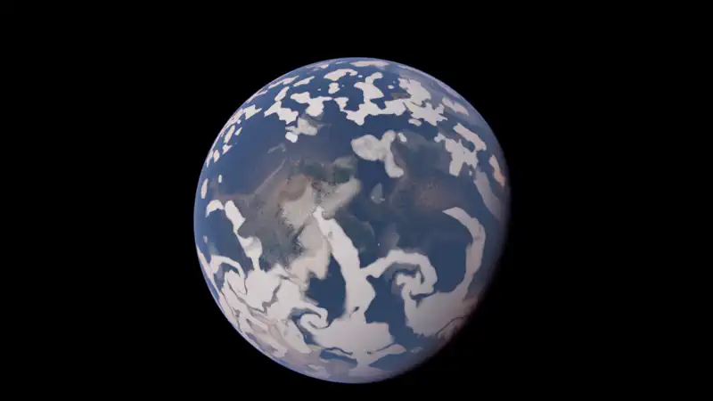

*One shot, no cut, no loading: from the whole globe down to a clearing in the forest.*

</div>

---

**Exolune is a space game in the making, built on its own planet engine, and its source is public.** The planets are not maps or skyboxes: each one is a whole world at real scale, 6,378 km in radius like the Earth, rendered every frame from the orbit down to the pebble at your feet.

**Seamless means no loading screen and no cut.** The terrain is recomputed on the GPU around the camera, so the same planet holds at every altitude. You can point the ship at any spot on the globe and land there: a canyon floor, a snow ridge, a beach at dusk.

**The ambition is a solar system to explore,** where every planet and every moon can be flown over, crossed and landed on. The world is already here. The game around it is what we are building now, and Exolune is looking for the people who want to build it.

## From orbit to the ground

<table>
<tr>
<td width="20%">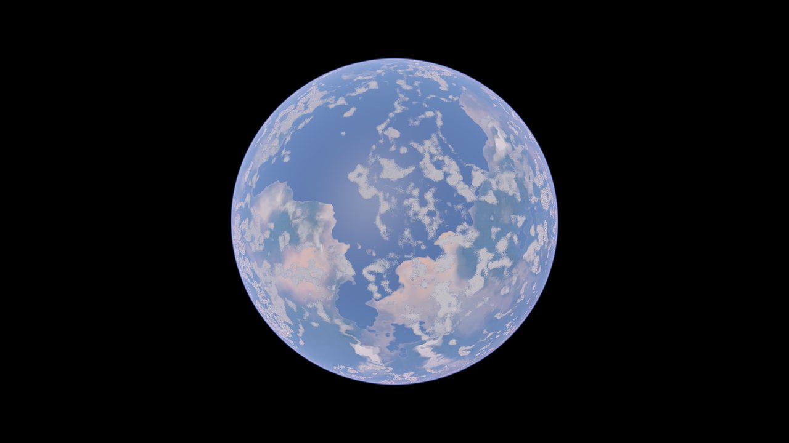</td>
<td width="20%">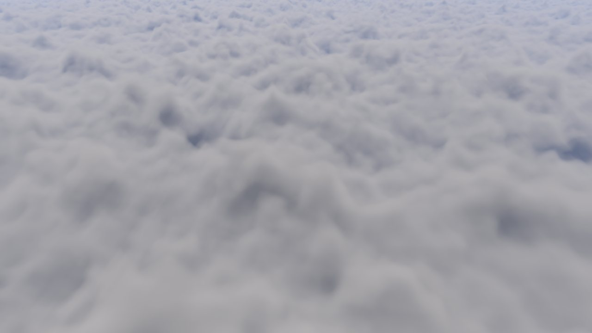</td>
<td width="20%">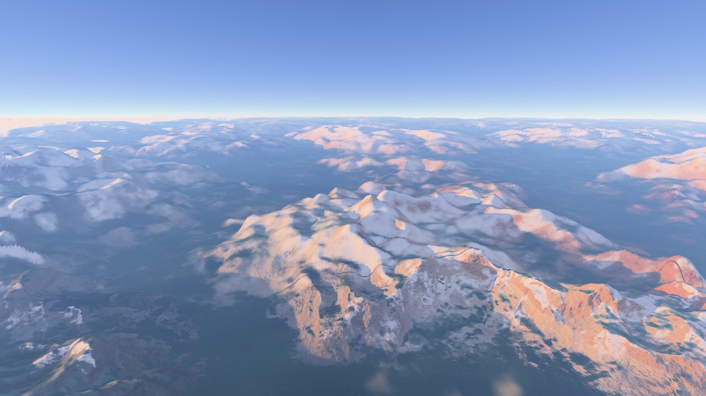</td>
<td width="20%">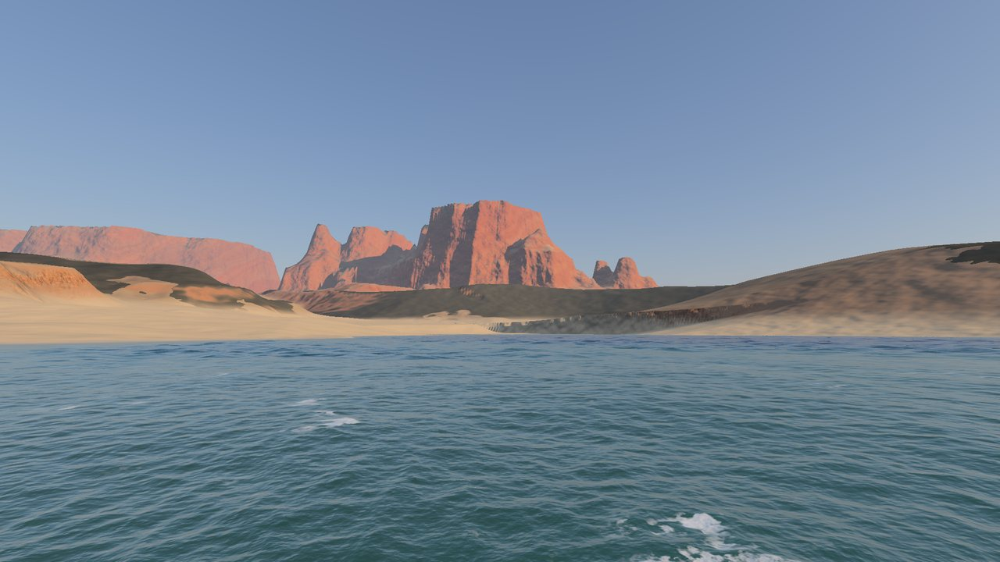</td>
<td width="20%">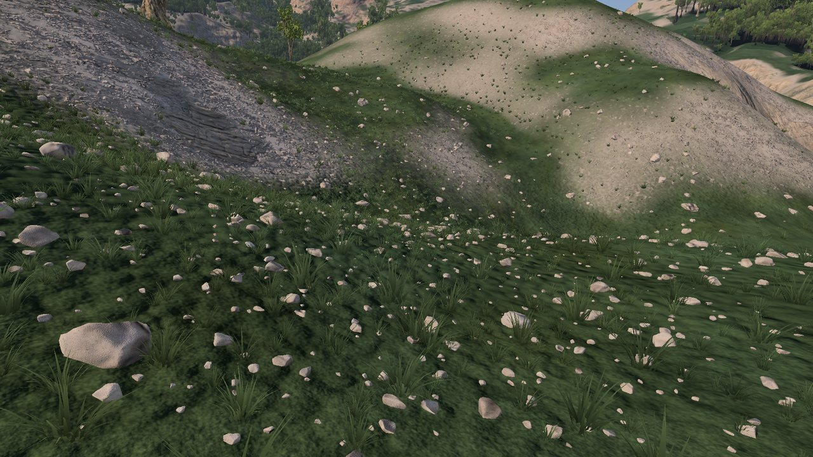</td>
</tr>
<tr align="center">
<td><sub>10,000 km</sub></td><td><sub>10 km</sub></td><td><sub>8 km</sub></td><td><sub>sea level</sub></td><td><sub>1 m</sub></td>
</tr>
</table>

The same planet at every scale: nothing is streamed, nothing is loaded, nothing is faked with a backdrop.

## Worlds to land on

<table>
<tr>
<td width="33%">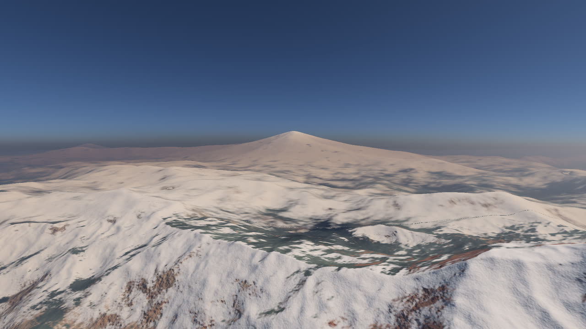</td>
<td width="33%">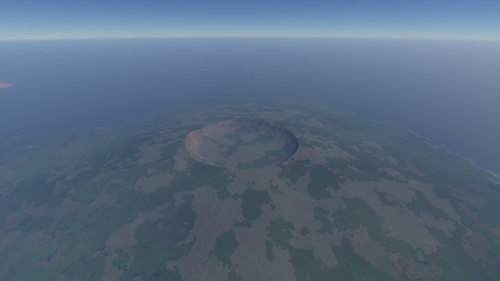</td>
<td width="33%">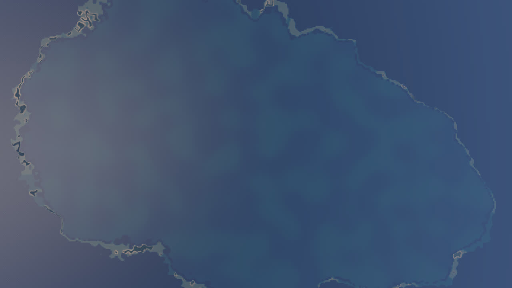</td>
</tr>
<tr align="center">
<td><sub>A volcanic cordillera above a subduction zone</sub></td><td><sub>An island volcano and its caldera</sub></td><td><sub>An atoll on a sinking hotspot chain</sub></td>
</tr>
<tr>
<td>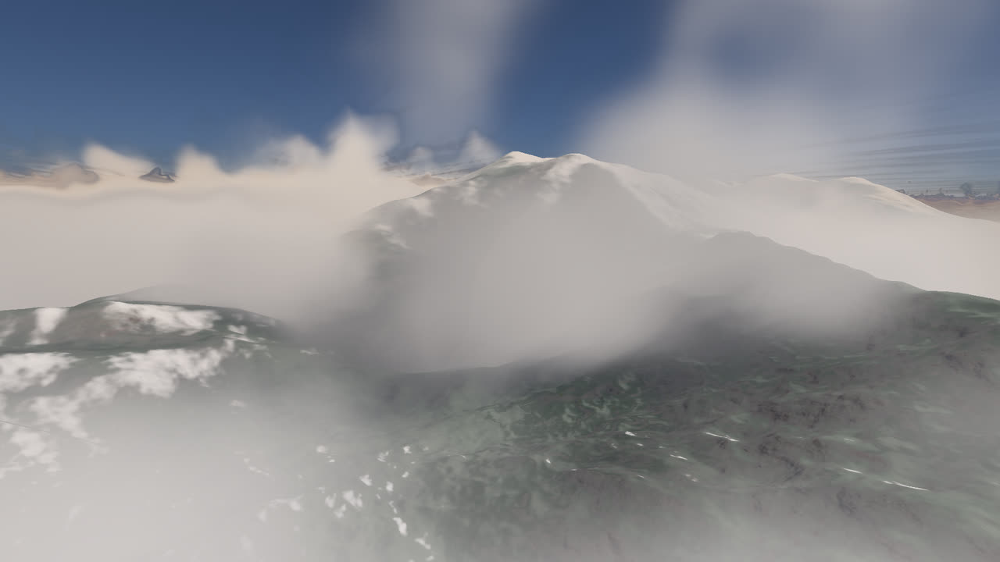</td>
<td>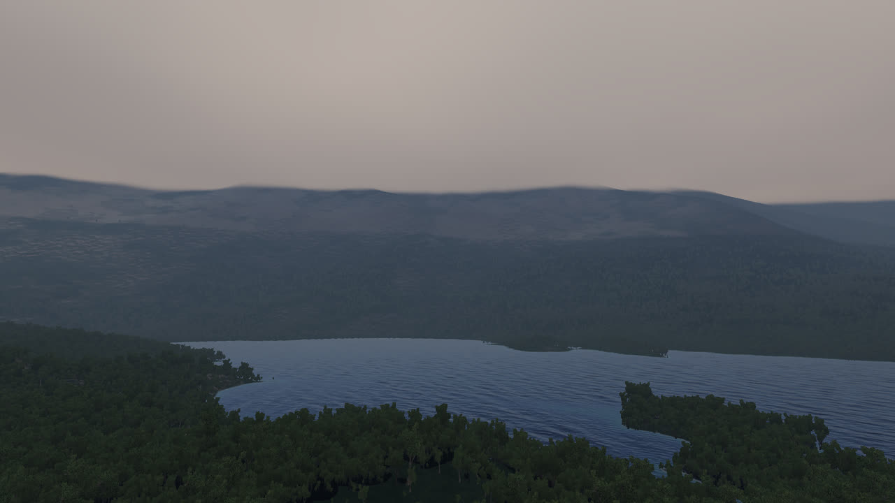</td>
<td>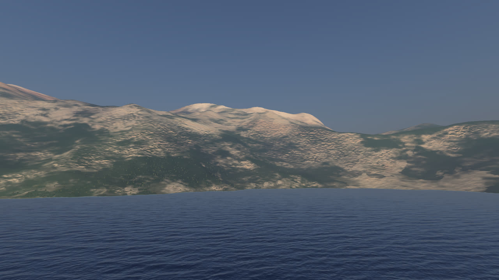</td>
</tr>
<tr align="center">
<td><sub>A range raised where two continents collide</sub></td><td><sub>An active coast, seen from the sea</sub></td><td><sub>A snowy massif plunging into the sea</sub></td>
</tr>
</table>

<table>
<tr>
<td width="50%">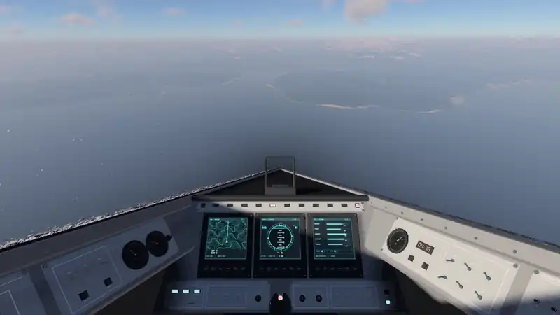</td>
<td width="50%">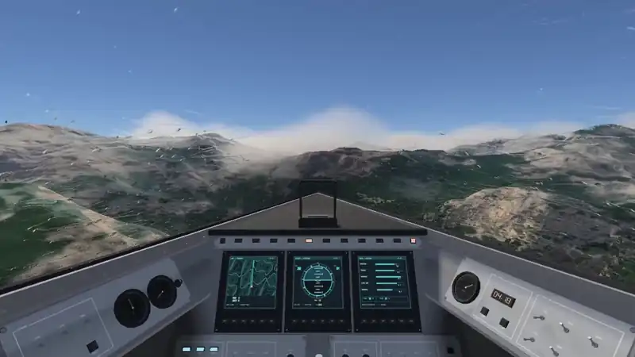</td>
</tr>
<tr align="center">
<td><sub>Low over the sea, up to the coast</sub></td><td><sub>From the cockpit, above the snow peaks</sub></td>
</tr>
</table>

## What is already there

- **The relief:** plate tectonics computed at startup: continents, mountain chains, trenches, rifts, active and passive coasts; then the climate from the winds and the relief, and the volcanoes, from island arcs to atolls. Noise details it, driven by the geology, evaluated in double precision near the ground. Rock strata, scree, sand, grass and snow follow the climate, photo scans take over up close, and ridges cast their shadows.
- **The air:** a physically based atmosphere, a haze that follows the valleys, sun shafts behind the peaks.
- **The sea:** FFT waves on four cascades, persistent foam, the sun's glint from orbit to the waterline.
- **The clouds:** volumetric, from a planet-wide weather map. Their shadows sweep the ground, and the wind carries them east.
- **The vegetation:** trees and shrubs placed by climate over the whole globe, meshes up close and impostors far away.
- **The ship:** a cockpit and a chase view, mouse and keyboard flight, rain, mist and frost on the canopy, a synthesized engine sound.

What is not there yet is the game around it: a solar system to cross, reasons to land, things to do on the ground. That is the part to build together.

## Play it

**You need** Windows 10 or 11, Visual Studio 2022 with "Desktop development with C++", a Windows SDK, and a DirectX 12 GPU with double-precision shaders. Development runs on an RTX 4070 Ti.

From the repository's root, in PowerShell:

```powershell
powershell -NoProfile -ExecutionPolicy Bypass -File tools\lance.ps1 -Build
```

That builds the game in Release, about 4 minutes the first time, then opens it full screen. The first launch also downloads the ground photo scans, 28 MB from Poly Haven, next to the repository.

**The plants** are built once from third-party models; without them the planet flies bare. It needs Python 3, and takes about 3 minutes and 750 MB:

```powershell
powershell -NoProfile -ExecutionPolicy Bypass -File tools\plantes.ps1
```

After that, `tools\lance.ps1` alone starts the game. `-Resolution fenetre` opens a window, and `-Parcours tools\tests\<file>.txt` puts a list of viewpoints on F1 to F12. Every option is in [`docs/lancement.md`](docs/lancement.md).

<details>
<summary><b>Controls</b></summary>

The game starts in the cockpit. Key positions are physical: on AZERTY, W A S D are Z Q S D.

| Ship | |
|---|---|
| Mouse | Pitch and yaw |
| Q / E | Roll |
| Mouse wheel | Throttle; it holds where you leave it |
| A / D | Slide left / right |
| W / S, Space / Ctrl | Slide up / down |
| Shift, X | Boost, brake |
| Right mouse button held | Free look |
| Tab | Cockpit, chase view, ship hidden |
| Backspace | Free camera, and back to the cockpit |
| Alt held | Releases the mouse, to reach the Tests palette |

| Free camera | |
|---|---|
| Right mouse button held | Look around |
| W A S D, arrows | Move |
| E / Q, Page Up / Page Down | Up / down |
| Mouse wheel | Speed, proportional to the height above the ground |

| Everywhere | |
|---|---|
| O / P, held | The sun turns: sunset, sunrise |
| N | Clouds on / off |
| C | Cloud quality: Eco or Reference |
| Space (free camera), V | Weather runs or pauses; weather speed x1 or x5 |
| T | Temporal anti-aliasing, off at startup |
| F1 to F12 | The viewpoints of the Tests palette |
| Alt+Enter | Full screen or window |
| Esc | Window, then quit |

The diagnostic keys are in [`docs/lancement.md`](docs/lancement.md) and [`docs/spec-vaisseau.md`](docs/spec-vaisseau.md).

</details>

## Join

Exolune needs people who want to turn a world into a game:

- **gameplay and game design:** what you do once you have landed;
- **graphics:** C++ and HLSL, DirectX 12;
- **3D art and sound:** ships, props, creatures, ambiences;
- **procedural generation:** erosion and rivers are in progress, other planets and moons are ahead.

Start with [`docs/README.md`](docs/README.md), the map of the documentation. It is written in French, one spec per system. Every experiment is kept in [`docs/log/`](docs/log), with a git tag to return to it. [`docs/principes.md`](docs/principes.md) holds the rules every change follows, and [`AGENTS.md`](AGENTS.md) the guidance for coding agents.

## Licence

Exolune is source available under the **PolyForm Shield License 1.0.0**; see [`LICENSE.md`](LICENSE.md). You may read, use, modify and redistribute it for any purpose other than a product or service that competes with Exolune. Contributions are welcome under a contributor licence agreement; see [`CONTRIBUTING.md`](CONTRIBUTING.md).

The relief, the noise, the climate and the volcanoes are original code. Exolune adapts code and data under MIT licences from Wicked Engine, web-ocean and TileableVolumeNoise; [`NOTICE`](NOTICE) lists every third-party part, its licence and its source.
