# Journal of the planet

History of field adjustments: what changed, why, what it cost or brought, and how to go back. The most recent entry is at the top.

**2026-11-09 · Merge current main into the celestial branch**

- **Snapshot:** `jalon/ciel-lunes-2026-11-09` preserves the reviewed branch at `f3867eb` before integration.
- **Upstream:** merge public `main` at `f3530b3`, including the final erosion optimizations and near cliff materials.
- **Resolution:** keep terrestrial contour classification and near/screen shader variants; airless surfaces keep their dry material channel and skip water classification.
- **Geometry:** no merge-specific field or topology change; retain the upstream erosion settings and all three lunar manifests.
- **Review:** `tools/tests/2026-11-09-integration-main.txt` covers moons, cloud transitions, terrestrial orbit, river contours, close rock and night.
- **Handoff:** Release relaunched at test 1 in a responding window with `-Camera libre`; only one engine is running.
- **Validation:** Release x64 and five CPU suites pass: airless terrain/contact, celestial photometry, flight attitude, walking and terrestrial flight contact. Eight native captures cover both surface profiles, clouds, river contours and near materials.
- **Startup:** the first post-build capture required about six minutes of initialization; subsequent launches completed normally.
- **Evidence:** `artifacts/integration-main-2026-11-09/`. No performance or quality benchmark requested or run for this integration.

**2026-11-09 · The cliff photo near the ground**
- **Report:** the 30 places against `main`, rock 12 m at place 4, gap p95 +17 % and repeat +27 %. Its worst crops lie on a cliff the erosion bared, under the face photo, whose straight joints repeat along their length (`diagnostic-orbite.md`).
- **Settings:** `FACE_WARP` (0.5 m, 0.04): the face photo read aside by about 2 cm, faded in between 6 and 3 cm a pixel; `FACE_BANDS`: shades of 25 and 50 cm, 4 % at one deviation each (`PlanetSettings.hlsli`, `Materials.hlsli`). Only under `NearDetailClearance`, 1,000 m above the ground (`D3DApp.h`).
- **Gain, 30 places against `main`:** rock 12 m gap +8 %, repeat −4 %; every p95 within 10 %. Over 24 views around place 4, gap p95 2.55 and repeat 0.193 against `main`'s 2.59 and 0.210. Frame time unchanged at the eight views: the far shaders are the same bytes as before.
- **Review:** `tools/tests/2026-11-09.txt`, the cliff at 5 and 2 m.
- **To go back:** `FACE_WARP.y` 0 and `FACE_BANDS.w` 0.
- **Milestone:** `jalon/2026-11-09-erosion-main`, the erosion merged into `main`.

**2026-11-09 · Faint river water dry; lakes read once**
- **Report:** in the final bench against `main`, the erosion's own cost (on minus off) over its 15 % share at 250 km (2.36 ms against 2.25) and 1,231 km (1.86 against 1.81); 2,200 m at the limit.
- **Setting:** `INLAND_MIN_COVERAGE` 1/64 (`PlanetSettings.hlsli`, `PixelShader.hlsl`): inland water covering less of the pixel is dry. Rivers filtered at wide footprints spread their wetness thin over whole valleys, and every pixel shaded the water for it.
- **Gain:** 0.15 ms at 250 km and 1,231 km; at most 6/255 along the valleys' floors there, within 2/255 at 97 km and 2,200 m.
- **Quality, 30 places against `main`:** every p95 as before the setting (`qualite-final`); all within 10 % but rock 12 m, below.
- **Exact, no setting:** the pixels read the terminal lake's level once (`PixelShader.hlsl`), 0.1 ms at 97 km and 2,200 m (`spec-eaux-interieures.md`).
- **Rock 12 m, place 4:** measured over 24 views around the place, the build equals `main` (gap p95 2.59 both, repeat 0.220 against 0.210); the bench's one view ranges from 1.5 to 4.2 dB of gap by heading alone (`principes.md`). No setting changed.
- **To go back:** `INLAND_MIN_COVERAGE` 0.
- **Milestone:** no commit, tag or push requested.

**2026-11-09 · Ravines by slope; the contour's channel band at altitude**
- **Report:** the quality bench against `main`, 13 places: grass 200 m gap +19 %, snow 50 m gap +15 %, soil 50 m gap +35 %, rock 12 m repeat +13 %.
- **Settings:** `RAVINE_OCTAVES` back to 11 (4.9 m); `RAVINE_SLOPE` (0.05, 0.3): no ravine on the flat; `RAVINE_CLIFF` (15 m, 0.5, 0.8): the finer ones fade on the cliffs (`PlanetSettings.hlsli`, `Relief.hlsli`, `tools/hydro/cp.py`). `CONTOUR_CHANNEL_BAND.z` from 0.2 to 0.15.
- **Gain, 30 places against `main`:** grass, snow and soil within 10 % at every height (soil 50 m +7 %, snow 200 m +9 %); places 26, 28 and 29 give exactly `main`'s soil. Left: rock 12 m, place 4 alone, gap +17 % and repeat +27 %. 97 km 0.2 ms faster with the band.
- **To go back:** `RAVINE_OCTAVES` 9 without `RAVINE_SLOPE` and `RAVINE_CLIFF`; `CONTOUR_CHANNEL_BAND.z` 0.2.
- **Milestone:** no commit, tag or push requested.

**2026-11-08 · Ravines down to 19.5 m**
- **Report:** place 4 of the quality bench, at 12 m: a gully's walls striped by the ravines' cascade, parallel grooves of 5 and 10 m.
- **Setting:** `RAVINE_OCTAVES` from 11 to 9, the finest period 19.5 m instead of 4.9 m (`PlanetSettings.hlsli`, `tools/hydro/cp.py`). The rock's photos carry the detail below.
- **Gain, place 4's rock:** at 12 m, the gap's p95 from 2.81 to 2.18 (`main` 2.07) and the repetition's from 0.22 to 0.205 (`main` 0.18); at 50 m, the repetition's from 0.184 to 0.140 (`main` 0.16). Frame time unchanged at 97 km, 2,200 m, 250 km and 1,231 km.
- **To go back:** `RAVINE_OCTAVES` 11.
- **Milestone:** no commit, tag or push requested.

**2026-11-08 · Cloud continuity through the distant-surface transition**

- **Report:** clouds disappear during approach and return closer to Exolune.
- **Cause:** the proxy's 8,192 m coverage envelope entered scene depth; colour blending also interpolated signed ocean distances and could place an occluder in front of the cloud layer.
- **Change:** blend RGB only, replace HDR alpha with filtered physical surface depth, and preserve detailed depth during the transition draw.
- **Scope:** no cloud-density, weather, lighting, exposure or temporal-sampling change; the existing map sample also supplies height.
- **Validation:** Release x64 passes. Five background views at 20,000, 10,000, 7,000, 4,000 and 2,000 km retain the same cloud formations across the transition; continuous flight remains for user review.
- **Review:** `tools/tests/2026-11-08-transition-nuages.txt`; evidence in `artifacts/trois-lunes-2026-11-08/nuages/`. No performance benchmark requested or run.
- **Handoff:** waited for the erosion branch's benchmark to finish, then relaunched Release at test 1 of `tools/tests/2026-11-08-lunes-et-nuages.txt` with `-Camera libre`. The window responds and only one engine is running. F1–F6 cover the moons; F7–F12 cover the cloud transition.
- **Base:** `piste/base-profondeur-nuages-2026-11-08` identifies the base commit only; implementation remains uncommitted.

**2026-11-08 · Three seeded landable moons**

- **Request:** apply the same surface stack to the other moons with different seeds.
- **Manifests:** moon 1 keeps 1,800 km / 9173 / 1.62 m/s²; moon 2 uses 700 km / 28411 / 0.63 m/s²; moon 3 uses 260 km / 60149 / 0.234 m/s².
- **Geometry:** cap the largest impact band at the smaller of 1,000 km and 60% of radius; the first moon is unchanged.
- **Sharing:** one set of sliding planes, rings, fine grids, screen reconstruction and object buffers; switching bodies clears reused histories.
- **Distant surface:** three generated atlases replace the procedural/reference pair; one additional 11,184,812-byte payload, no new detailed planet engine. Headers check radius, seed and field version.
- **Contact:** broad-phase candidate checks share a 192-height-sample sweep budget; walking and illumination use the selected manifest.
- **Checks:** Release x64, 96 contact sequences, celestial photometry, terrestrial sweep checks and walking at all three gravities pass.
- **Native review:** eight final stills cover both new moons in orbit, their distant maps, ground/contact, walking and the unchanged first moon. The walking sites contain 1,114 and 388 seated stones, with Exolune visible from both.
- **Flight review:** continuous movement and inter-body switching remain for the user; the combined twelve-view route is `tools/tests/2026-11-08-lunes-et-nuages.txt`.
- **Review:** `tools/tests/2026-11-08-trois-lunes.txt`; evidence in `artifacts/trois-lunes-2026-11-08/`.
- **Base:** `piste/base-trois-lunes-2026-11-08` identifies the base commit only; implementation remains uncommitted.

**2026-11-08 · Contact permits retreat and sliding**

- **Report:** free camera becomes unusable on touching a body.
- **Reproduction:** the production airless sweep stopped an outward request from a previously accepted contact; the new regression test fails before the fix.
- **Response:** reject only inward motion, recover shallow overlap and sweep the remaining slide; placement and movement share the existing 2.5-radius hull support.
- **Bounds:** retain the 2 cm contact skin; recovery targets 4 cm clearance. Up to five responses share 192 height samples, including contact normals.
- **Look:** terrestrial free-camera recovery and invalid-query rollback change position without restoring stale attitude.
- **Validation:** Release x64 and the shared relief tests pass, including 48 contact sequences at three radii/seeds, two hull sizes and polar sites. Terrestrial swept-contact, attitude and walking suites also pass.
- **Native review:** four background stills cover near-contact, a crater slope, initial overlap recovery and a polar site; the recovered eye is above the terrain. Evidence is in `artifacts/contact-libre-2026-11-08/`.
- **Flight review:** `tools/tests/2026-11-08-contact-libre.txt` also includes two terrestrial approaches, walking and orbit. Continuous user-controlled movement remains for flight review; automated stills do not initialize the terrestrial GPU contact solver.
- **Handoff:** Release relaunched through the dated route at test 1 with `-Camera libre`; the native window responds and only one engine is running.
- **Scope:** no rendered geometry, field, material or lighting changes; no performance benchmark requested or run.
- **Base:** `piste/base-contact-libre-2026-11-08` marks the base commit only; changes remain uncommitted.

**2026-11-08 · Independent flight attitude**

- **Report:** the camera felt bound to an orbit instead of moving freely.
- **Cause:** position changes rotated the camera and ship around the body's vertical; free look also clamped pitch and rebuilt its up axis from the planet.
- **Change:** camera and ship keep their own orthonormal frame; translation and nearby-body selection do not steer them or rotate velocity.
- **Placement:** explicit heading supplies a stable up axis at nadir, zenith and geographic poles; free-camera/ship transitions preserve roll.
- **Controls:** free camera retains right-drag look and translation; Shift + left/right arrow adds roll. `tools/lance.ps1 -Camera libre` starts directly in that mode.
- **Scope:** walking vertical, terrain collision and near-Moon orbital translation remain; no terrain, shader or lighting settings change.
- **Checks:** Release x64, attitude, flight-contact and walking checks pass; background review route `tools/tests/2026-11-08-vol-libre.txt`.
- **Native review:** seven background stills cover both bodies, exact nadir/zenith, inverted pitch, a geographic pole, approach and walking; user-controlled movement remains for flight review.
- **Handoff:** Release relaunched through the dated route at test 1 with `-Camera libre`; the native window responds and only this engine is running.
- **Evidence:** `artifacts/vol-libre-2026-11-08/`; no performance benchmark requested or run.
- **Base:** `piste/base-vol-libre-2026-11-08` marks the base commit only; changes remain uncommitted.

**2026-11-08 · Airless references across distance**

- **Request:** iterate against orbital and ground photographs; retain the shared renderer and globally bounded detail.
- **References:** Galileo full disc, LRO Taurus-Littrow and Tycho, Apollo 17 ground panorama; links and colour limits are in `spec-lune-terrain.md`.
- **Field:** nine scales from 1,000 km, divided by five, with radii from 0.07 to 0.45 of each scale; footprint support starts at half a sampling footprint and is full at two.
- **Morphology:** deepen simple impact bowls, retain age-dependent wear, and use fractured, pointed central uplifts in complex craters; the shared envelope remains ±16 km.
- **Materials:** impact ejecta and old basin floors supply reflectance; reduce and break up the overly circular dark floors exposed by the first iteration.
- **Distance:** carry the impact reflectance through the mesh, fine grid and screen reconstruction in the existing buffer layout.
- **Dust:** common filtered bands cover unresolved wavelengths up to 8 km, with a continuous cutoff below the current geometry sampling; retain real-scale grain and rock scans nearby.
- **Projection:** sample material coordinates on the reconstructed surface, as Exolune does.
- **Photometry:** 35% diffuse and 65% single-scattering approximation, shared by ground, objects and distant disc; unresolved flux integrates the same law.
- **Proxy:** 2,048 × 1,024 RGBA8 with twelve linear mip levels, 11,184,812 bytes, regenerated from the filtered physical field.
- **Orbital bridge:** two filtered atlas reads add only the slopes missing below the detailed grid's footprint; the common map slot is reused and the bridge fades out below a texel's width.
- **Objects:** retain a background impact-debris share on airless regolith instead of applying the terrestrial stoniness cutoff.
- **Validation:** Release x64 and CPU relief/contact/reflectance checks pass; 14 poses were inspected across three visual iterations, with seven final recaptures covering the orbital bridge, walking, a basin and polar terrain.
- **Ground:** the two walking sites contain 436 and 77 stones; Exolune is visible from the young crater site. Native stills retain contact and hard terrain shadows.
- **Cost:** existing mesh, fine-grid, screen and object budgets are unchanged; no performance benchmark was requested or run.
- **Evidence:** baseline and iterations remain under `artifacts/lune-references-2026-11-08/`; flight route `tools/tests/2026-11-08-lune-references.txt`.
- **Review:** begin at the full disc, test 3; F1–F10 cover lunar distances and ground sites, F11–F12 are terrestrial controls. Interactive flight remains for the user.
- **Handoff:** Release relaunched at test 3 in windowed mode; the native window responds and only this engine process is running.
- **Base:** `piste/base-erosion-lune-2026-11-08`; these changes remain uncommitted for review.

**2026-11-08 · Fundamental body-manifest architecture**

- **Decision:** every celestial body, including Exolune, the Sun and gas giants, has a descriptive manifest and uses the common rendering framework.
- **Solid terrain:** retain the existing sliding planes, rings and per-frame continuous refinement; change the physical stack, not the rendering technology.
- **Quality:** simpler airless physics retains realistic surface materials, regolith, rocks, pebbles, contact and shadows.
- **Cost:** inactive descriptions remain compact; distant work is minimal, and nearby detail shares bounded engine budgets.
- **Correction:** the separate lunar quadtree is rejected; its settings and preliminary checks are archived in `log/spec-lune-terrain-historique.md`.
- **Status:** contract recorded in `principes.md` and `spec-manifestes-corps.md`; common-renderer integration remains in progress.
- **Integration:** the impact stack reuses the terrain, fine-grid, screen, object-placement and shadow paths with their shared buffers; negative basin elevations remain valid throughout.
- **Lighting:** nearby surfaces, distant bodies and exposure now share the phase law for reflected planet light.
- **Review lighting:** the lunar route uses solar latitude/longitude -25/55 degrees, about 30 degrees above the first site's horizon; the polar view keeps its separate lighting.
- **Impact profile:** shared floors, age-dependent rim wear, irregular outlines and large-crater floors replace the overly regular bowls seen in the first common-renderer captures. Fractured-highland amplitude is 0.012 times each band scale; radius and seed are unchanged.
- **Checks:** Release x64 build, shared-field, contact and walking checks pass. Orbit, descent and an Exolune view from 25 m were captured with the common renderer before this profile revision. The revised surface opened in walking mode at 1.7 m with Exolune visible; full flight review remains pending.
- **Review workflow:** the user requested background captures instead of computer-use control; further agent visual checks follow that preference.
- **Handoff:** Release relaunched on the lunar walking view after the erosion capture process ended; one engine running and its native window responding. Flight review and the zero placed-rock count at this site remain open checks.
- **Base:** retain `piste/base-erosion-lune-2026-11-08`; no commit or push requested.

**2026-11-08 · Erosion base and first airless terrain**

- **Base:** rebased `codex/vegetation-biomes` from `e524e4c` onto `claude/erosion-sur-main` at `9780367`, adding 17 committed upstream changes.
- **Recovery:** the original working tree is retained in stash `f9124cc` and `artifacts/rebase-erosion-2026-11-08/working-state.zip` with a hash manifest.
- **Integration:** kept the erosion resource layout, fixed 5 cm near plane and contact changes together with the celestial buffers, infinite reversed Z, direct exposure and Navigator work.
- **Rebase verification:** Release x64 build passed; both reported orbital overexposure views were captured successfully with readable daylight and bounded solar glare.
- **Moon:** radius 1,800 km, seed 9173, nine compact impact bands, shared mesh/contact field and a 512 × 256 filtered far proxy.
- **Architecture:** the initial separate lunar mesher is superseded by the shared-renderer decision above; discarded settings are archived.
- **Movement:** nearby body frame, swept spherical flight contact, 0.5 m walking samples and 1.62 m/s² lunar gravity.
- **Lighting:** lunar horizon and planet shine enter the direct exposure meter; no temporal exposure filter.
- **Review:** `tools/tests/2026-11-08-lune.txt`; final validation must cover the common renderer, surface objects and landing.
- **Performance:** no performance or quality benchmark was run; the implementation bounds work explicitly.
- **History:** the base milestone is `piste/base-erosion-lune-2026-11-08`; lunar work remains uncommitted for user review.

**2026-11-07 · Temporal exposure reverted after flight review**

- **Decision:** the user preferred the previous direct response and requested removal of the temporal smoothing.
- **Change:** removed the 0.35/2.5 s global filter, GPU state, bindings and CINE exposure trace; restored direct scene and cockpit metering.
- **Preserved:** observer-altitude sunlight and finite solar-disc integration, previous orbital overexposure corrections, celestial rendering and all unrelated work. No geometry change.
- **Verification:** all eight modified engine/project files match the saved pre-filter versions; Release x64 rebuild passes.
- **Review:** `tools/tests/2026-11-07-exposition-sans-lissage.txt`, twelve sunrise, orbital, atmospheric and lunar controls.
- **Flight:** restored app relaunched at the saved player location with the review route; native window responding.
- **History:** rejected settings and measurements moved to `log/recherche-tons-exposition-historique.md`; no commit or tag was created.

**2026-11-07 · Orbital terminator exposure correction**

- **Report:** a saturated planetary day side and an entirely white frame at 13,545 and 19,811 km altitude.
- **Cause:** the initial celestial meter retained the sea-level solar beam; ground night drove exposure upward while the observer remained in sunlight.
- **Rule:** the direct beam transitions to the observer altitude with the existing air fraction `1 - exp(-h / 8 km)`.
- **Geometry:** use the apparent planetary horizon; outside the atmosphere, intersect its outer sphere before sampling the transmittance table. Average eight strips over the visible solar disc with analytic coverage, preserving light when its centre is occulted. No terrain geometry change.
- **Settings:** unchanged +1/0 EV compensation, tone curve and optical straylight 0.3; no screenshot-specific exposure cap.
- **Review:** `tools/tests/2026-11-07-exposition-orbite.txt`, fourteen locations and conditions; functional stills only, no benchmark requested.
- **Checks:** Release x64 and shader compilation pass. Fourteen native stills verify the two reported views, neighbouring phases, full planetary shadow, low orbit, atmospheric nights, lunar approach, Sun and partial solar eclipse. The day side retains detail; the reported white frame and both solar-crescent controls retain a dark space background.
- **Flight:** corrected Release launched from the workspace root in windowed mode at the first reported position; F1/F2 reproduce the two reports, with fourteen review views.
- **Status:** uncommitted. Planned tag `piste/exposition-orbite-2026-11-07` belongs to a future requested commit.
- **Current rules:** `recherche-tons-exposition.md`; superseded behaviour in `log/recherche-tons-exposition-historique.md`.

**2026-11-07 · Celestial sky and finite lunar system**

- **System:** three moons, radii 1,800 / 700 / 260 km at 280,000 / 110,000 / 42,000 km; circular Kepler motion on the shared world clock.
- **Planets:** orbital radii 0.68 / 1.65 / 4.7 AU, physical radii 6,100 / 4,200 / 63,000 km; the finite Sun is at 1 AU with radius 695,700 km.
- **Photometry:** scene solar irradiance pi, solar V magnitude -26.74; Lambert phase, inverse-square irradiance and finite solar penumbra cast by Exolune.
- **Geometry:** analytic spheres, real depth and camera-relative positions; infinite reversed depth and a near plane bounded by the nearest body; no Exolune terrain change or lunar landing geometry.
- **Surfaces:** normalized LROC albedo and LOLA normal slopes; 2048 × 1024, twelve mip levels, 11,184,812-byte resident packet; source hashes and credit in `assets/celestial/manifest.json`.
- **Reflectance:** moon RGB values `(0.16, 0.15, 0.135)`, `(0.24, 0.255, 0.27)` and `(0.15, 0.115, 0.085)`; different texture rotations.
- **Points:** 42,000 stars, magnitudes -1.46 to 8, normalized Moffat profile with scale 1.35 pixels and exponent 3, four integration samples; warm/cool colours and a denser galactic population.
- **Galaxy:** observer at 8.2 kpc in a spiral stellar disk; forty depth intervals, emitting populations and chromatic dust absorption; two inclined remote galactic volumes.
- **Transport:** final air/cloud transmission exported by both cloud paths; body depth clips air and clouds; visible surfaces block stellar points.
- **Night light:** ambient irradiance 2e-8, airglow over 86--98 km with zenith radiance 3.8e-9; lunar sky light, atmospheric scattering and sea glints.
- **Tables:** square-root solar coordinate concentrates samples at twilight; sky irradiance uses 32-bit floats, at unchanged dimensions.
- **Display:** night key approaches 0.03/0.69, stellar response bounded to 650,000--2,000,000, resolved bright-disc exposure capped at 8; fixed half-code-value dither.
- **Optics:** existing linear glare enabled by default at unchanged straylight 0.3; diagnostic views bypass it; `MYPLANETENGINE_GLARE=0` disables inspection runs.
- **Cockpit:** dimmable emitters scale by at most `2 / Exposure()` at night, blending over solar cosine -0.02 to 0.03; exterior beacons keep their flux.
- **History:** stellar points stay outside temporal history; resolved bodies use their finite distance for reprojection.
- **Review:** `tools/tests/2026-11-07-ciel.txt`; native functional stills in `artifacts/ciel-2026-11-07`; no performance or quality benchmark requested or run.
- **Flight:** fourteen-view route launched from the workspace root in windowed mode, starting at the moonlit-night view; user review remains open.
- **Checks:** Release x64 builds; phase, penumbra, orbital radius, inverse-square flux, parallax and finite-value assertions pass; shipped texture size and hash pass. Native stills verify atmospheric visibility, both cloud paths, finite body depth, solar glare and night instrument readability.
- **Scope:** visual system prototype; moon light has no terrain/cloud-cast shadows or solar-eclipse lighting on Exolune; distant reflection fallback omits stars and galaxies.
- **Status:** uncommitted; planned tag `piste/ciel-celeste-2026-11-07` belongs to a future requested commit, not to the unrelated current HEAD.
- **Current spec:** `spec-ciel-celeste.md`; superseded branch plan and visual iterations in `docs/log/`.

**2026-11-03 · Connected Navigator cabin and quiet levitation resonance**

- **Geometry:** six connected closed cabin solids; continuous wall, coved floor, rooted station and sensor; 139 wall panels, formed pressure wells and a 1.56 m octagonal rear fitting.
- **Assembly:** console and seat frame landings follow the chassis; the cushion underside follows the evaluated bucket shell. Contact checks cover 1,876 points; eight instrument sightlines are clear from the pilot eye.
- **Exterior:** smooth v2 ×4, nose −Y, 196,608 triangles; chrome metallic 1, roughness 0.075, linear base colour `(0.84, 0.87, 0.91)`.
- **Packet:** 459,757 vertices, 723,264 triangles, 12 material ranges, no texture images.
- **Instruments:** each console has three circular controls/readouts, a formed palm well, an engraved legend strip and four captive seats. Blue heading and amber propulsion use actual flight state; the other controls remain static.
- **Live faces:** material role 12, generated centres/radii, derivative-filtered strokes; emission gain 0.32 with blue `(0.18, 0.40, 1.0)` and amber `(1.0, 0.32, 0.045)`. Fixed raised needles become flat optical surfaces.
- **Materials:** polished edges, satin tactile surfaces, dark optical faces and charcoal seating; current linear palette and emission in `spec-navigateur-cockpit-son.md`.
- **Shading:** flat deck normals, 45-degree sharp transitions and a more detailed sensor casing around an amber lens.
- **Studio review:** white key 850, blue strip 400, warm return 220, forward card 350 and reading light 65 Blender watts; world strength .25, exposure -.5, close-up f/11. These settings affect offline review only.
- **Camera:** Navigator eye `(0, -0.65, 0.70)` m; starts in cockpit view, with cockpit/chase/bare cycling.
- **View:** clear forward field in the cabin; opaque reflective hull in exterior views; no canopy water simulation.
- **Lighting:** three blue fixtures with analytic illumination in the same normalized solar units as the world.
- **Sound:** quiet nearly stationary noise-excited resonances at 164.9/437.7/1031.3 Hz; faint 38.17/53.83 Hz sub layer and damped delays. Power changes level and brightness, without an RPM sweep or exhaust voice.
- **Mix:** existing master/ship gains; internal vibration retained, exterior sound follows air density.
- **Reflection:** current-scene HDR/depth trace, physical sky/planet fallback and ship reprojection; omit hidden cabin geometry from exterior reflection input.
- **Review:** Release x64 and current geometry checks pass. Native sea, forest, orbit, night and exterior stills verify the integration; paired instrument views show heading 000/090 degrees and propulsion 000/060 percent. Standalone audio checks remain valid for the unchanged synth.
- **Flight:** `tools/tests/2026-11-03-navigateur-cockpit.txt` launched from the workspace root in windowed mode for user review, after advance notice; six locations via F1–F6.
- **Scope:** optional Navigator profile; fighter remains the default and planet generation settings are unchanged.
- **Status:** uncommitted; no tag or publication requested. Details: `spec-navigateur-cockpit-son.md`.
- **History:** superseded construction and sound settings in `log/recherche-vaisseau-navigateur-historique.md`.

**2026-11-07 · Erosion against main's frame rate**
- **Goal set by the user:** the erosion costs `main` at most 15 % of its frame rate.
- **Settings:** `ScreenReliefHigh` from 400 to 200 km; the contour's river band from 2–3 samples to 0.6–0.9, no grid water past it outside lakes; partly wet samples for lake shores only; the inland reflection's sky in 3 steps instead of 6.
- **Banks, after the Isere's photographs:** `RIVER_WIDTH_NOISE.x` from 3,000 to 1,500 m; `RIVER_BANK_EDGE` from (12 m, 0.16) to (25 m, 0.25); gentle reaches keep 60 % of their bank displacement instead of 30 % (`Erosion.hlsli`, `tools/hydro/cp.py`). To go back: those values.
- **Evaluation:** courses built at startup (14 MB), shared node listings, direct screen relief, mesh rivers from the map at mid orbit.
- **Exact:** screen rivers per texel, each texel's finish in their kernel; fine grid and mesh by tiles; the contour lists wet nodes; the fine grid's culling margin at 6 fine cells; the plants' missing exact grounds in their own pass, within 1/255.
- **Result, corrected on 2026-11-08:** against `main` measured in the same window, 97 km and 2,200 m lose 21 %, 250 km and 1,231 km 11 to 13 %. The "14 % at worst" compared with a `main` measured in a busier window. `diagnostic-orbite.md`.
- **Review:** pending, `tools/tests/2026-11-07.txt`; the crossfade, the bands and the banks change images slightly.
- **Milestone:** no commit, tag or push requested.

**2026-11-06 · Water contour rungs**
- **Report:** rivers and erosion are convincing, but the frame rate collapses below 400 km. The pixel water contour cost 21.6 ms at 250 km and 11.1 ms at 97 km.
- **Change:** a channel's contour no longer evaluates the whole terrain and every valley at the pixel. Away from a shore's level, the grid's ground and the channels alone (`gErosionWater`); near the sea's or a lake's level, the whole relief as before. One rung per GPU wave.
- **Settings:** none changed; no geometry, width, filter, resolution or storage.
- **Gain:** 250 km 17.8 to 20.5 FPS, 97 km 37.1 to 49.6, 2,200 m 34.6 to 39.4; moving camera, `diagnostic-orbite.md`.
- **Evidence:** `verifie_contours.py`, `water_rung`: the full query's water on the CPU port. Images within 7/255 of the whole relief in four views.
- **Review:** `tools/tests/2026-11-06-contour.txt`, pending.
- **Return:** run every candidate through the whole relief, `wholeRelief` in `PixelShader.hlsl`.
- **Milestone:** no commit, tag or push requested.

**2026-11-05 evening · Remaining river evaluation cost**
- **Report:** full erosion remains much slower than the same executable with rendered erosion disabled.
- **Change:** conservative spherical-cap clipping of candidate rectangles; direct merge of the unchanged physical section boundaries; four-lane screen reduction.
- **Settings:** no geometry, discharge, width, filter, resolution or distance cutoff changed. No additional GPU storage.
- **Diagnostics:** per-frame mesh, horizon, fine-grid and fine-normal times supplement the six screen phases.
- **Evidence:** candidate-cap and section-partition proofs, native field/image comparisons and the requested moving-camera/material benchmarks; current results in `diagnostic-orbite.md`.
- **Return:** `x64/erosion-reprise/source-before-cap-window/` and `diagnostic-orbit-before-cap-window/` retain the preceding sources/runtime. Rejected schedules stay in `log/spec-erosion-historique.md`.
- **Milestone:** no commit, tag or push requested; tagging remains deferred.

**2026-11-05 · Orbit river evaluation and missing-stencil fallback**
- **Change:** index exact conditioned-node eligibility and projected support; skip zero contributions; schedule bounded GPU node work with complete overflow fallback.
- **Timeout:** a missing screen stencil at the limb keeps the existing filtered mesh/fine water instead of restarting per-fragment river evaluation.
- **Settings:** no terrain, width, discharge, filter or sampling-resolution change. Sparse scheduling thresholds affect execution only; both parallax queries remain.
- **Memory:** 24 MiB of GPU index/bounds; at most 256 MiB of task/results scratch plus 12 bytes per screen texel. Physical disk cache unchanged.
- **Evidence:** requested moving-camera benchmarks, native index/bounds checks, odd-size and forced-overflow captures, and a paired 30-site material survey. Exact results and limitations: `diagnostic-orbite.md`.
- **Review:** `tools/tests/2026-11-05-orbite-correction.txt`. Prior experiments and measurements moved to `log/spec-erosion-historique.md`.
- **Milestone:** no commit, tag or push is authorized. Tagging remains deferred to a requested reviewable commit.

**2026-11-04 · Confluence banks follow the receiving section**
- **Report:** satellite references show pointed land tongues and asymmetric confluence banks; the engine's symmetric widening leaves rounded bulbs.
- **Change:** replace the unconditional 1.15 receiving-half-width addition. `RIVER_CONFLUENCE` becomes (0.5, 9): match the receiving physical width, then allocate half the positive width deficit to a one-sided downstream opening. Width and centre shift share it, preserving the opposite bank.
- **Direction:** use receiving flow including its meander slope. A signed smoothstep over turning sine 0–sin(12 degrees) removes the opening continuously at parallel alignment. Three of 584 sampled joins needed the opposite side from the coarse heading; twenty-four have a partial angular opening.
- **Extent:** nine combined nominal half-widths, bounded by the connector's own length. A short connector cannot change its upstream join. The shifted endpoint fits inside the receiving width, with the existing bounded bank octaves added separately.
- **Preserved:** drainage controls, stages, flow, first-water contacts and fan controls. Bed, bank geometry, water support, floor clearance and conservative search share the physical section. No location-dependent conditions.
- **Scope:** geometry calibration, not sediment transport. Bars, scour and seasonal exposed sediment remain open. Primary confluence references and verification are in `spec-erosion.md`.
- **Checks:** final Release build, 240 section tests, 584 connector orientations, regional continuity and retained geometry/water suites pass. Seven native views inspected; the compared round protrusions are removed. Native cache payload remains bit-identical. Logs `x64/erosion-confluence-flow-banks-*`; no benchmark.
- **Review:** `tools/tests/2026-11-04-confluents.txt`; four confluence poses plus eight retained receiving-water/mountain/approach witnesses.
- **Return:** ignored `source-before-confluence-banks/` and `erosion-before-confluence-banks.bin` in `x64/erosion-reprise/`.
- **Tag:** `piste/confluents-berges-2026-11-04` deferred to the next requested commit. No benchmark, commit, tag or push.

**2026-11-04 · Progressive valley heads and estuary scale references**
- **Report:** heads taper nearby but retain blunt silhouettes from orbit; mouth openings lack a credible physical scale.
- **Change:** `RIVER_Q.x` 200 to 100 m³/s. Use `smoothstep(100, 300, Q)` in discharge, replacing the former log-discharge smoothstep over 200–300. Depth and width share this onset at all viewing distances. Dry branches taper in width and depth; the share is exactly one above 300 m³/s. Water thresholds remain 300–450 m³/s.
- **Reason:** the old narrow activation range compressed the growth into a short part of the coarse course. A point must grow through the physical drainage hierarchy, not through an orbital mask. The polynomial is an engine calibration, not an empirical erosion law.
- **References:** Google Earth inspection of Gironde and Somme; approximate 5.2 km ruler across Somme's entrance. Primary sources give Gironde over 75 km long and up to 12 km wide. These envelopes include bays, sediment banks and tidal flats. Sources and limits are in `spec-erosion.md`; mouth coefficients are unchanged pending a model of upstream receiving-water influence.
- **Checks:** Release x64 succeeds (`x64/erosion-head-growth-build.log`). Final native/cache verification is recorded in `spec-erosion.md`.
- **Review:** `tools/tests/2026-11-04-tetes-estuaires.txt`, two reported distances, closer head views, two other massifs and retained river/mouth/lake witnesses.
- **Return:** ignored `x64/erosion-reprise/source-before-head-scale/` and `erosion-before-head-scale.bin`.
- **Tag:** `piste/tetes-vallees-echelles-2026-11-04` deferred to the next requested commit. No benchmark, commit, tag or push.

**2026-11-04 · Surviving inflow, mouth approach and wet banks**
- **Report:** a river vanishes before reaching coastal water, returns as an isolated strip, and has no mouth flare; river and sea edges remain visually flat.
- **Flow:** decode the existing interrupted-edge bit. Both sides of a surviving midpoint retain the source discharge; the receiver's remaining local runoff is a separate catchment.
- **Mouth:** retain `RIVER_MOUTH` (2, 8, 600), with eight nominal half-widths of longitudinal approach to the cached contact. The original low-bank fallback remains. Lower stage and bank height continuously to receiving water.
- **Wet bank:** reuse `RIVER_BANK_SHOULDER` (2 m, 4 times depth) for the submerged shoulder. Replace the broad quartic shelf with a flat core and cubic shoulders; width and maximum depth stay fixed. Velocity uses area `depth * (2 halfWidth - shoulder)`.
- **Native review correction:** the first candidate exposed coastal erosion being reapplied to a river floor, manufacturing a marine pool. Coastal and river envelopes now meet on their common substrate; contacts read the actual coast without the probing river.
- **Fan coverage:** replace centre-ordered interval accumulation with exact inclusion/exclusion. A narrow side branch contained by the trunk no longer turns part of the main water bed into dry coverage.
- **Coastal foam:** use existing FFT height means and the spare fourth moment for incident height energy. Breaking crest threshold is 0.39 water depth; maximum coverage 0.75; energy activation over 0.02–0.08 m RMS. These are a calibrated local foam approximation, not resolved wave transformation.
- **Checks:** Release x64 succeeds; shared midpoint invariants, physical section quadrature, receiving-level translation, retained morphology and continuity pass. Twelve native views and a sampled 224-frame descent confirm the reported pool/stripe correction. Remaining delta/lake defects and the pre-existing inactive talus fixture are recorded in `spec-erosion.md`.
- **Review:** `tools/tests/2026-11-04-embouchures.txt`; twelve locations/distances. Previous evidence is in the erosion log. No benchmark requested.
- **Return:** ignored `x64/erosion-reprise/source-before-mouth-banks/` and `erosion-before-mouth-banks.bin`.
- **Tag:** `piste/embouchures-berges-2026-11-04` deferred to the next requested commit. No commit, tag or push.

**2026-11-04 · Open junctions and terrain-defined river ends**
- **Report:** sharp confluence corners, pale closing sills, straight fine banks, blunt valley heads and rivers continuing across standing water.
- **Junctions:** `RIVER_JUNCTION` (30, 75) to (12, 55) degrees; `RIVER_CONFLUENCE` (0.7, 6) to (1.15, 9).
- **Fine banks:** `RIVER_BANK_EDGE` (12 m, 0.16 nominal half-width), bounded additionally by one quarter of local width. Existing bank octaves move the actual shoreline; gentle grades retain 30% of their displacement.
- **Bank shoulder:** `RIVER_BANK_SHOULDER` (2 m minimum, four times bank height), bounded by channel half-width. The physical rise occupies this shoulder, followed by the existing terrace and outer slope; the clipped profile remains integrated analytically.
- **Mouths:** `RIVER_MOUTH` (2 half-widths, 8 channel depths, 600 m maximum); mouth width and fan spread share one aperture budget. Fill fades over 0–50 m above standing water and is zero below it.
- **Fans:** eligible sea-bound courses open towards their first cached shoreline, including contacts before the coarse sea node. The low-gradient and low-wall eligibility gates remain; short runs fade over four to twelve channel half-widths.
- **Heads:** dry extensions multiply both corridor width and incision by `smoothstep(0, 1, t)`.
- **Contacts:** `RIVER_CONTACT` (256 m probe spacing, 25 m terrain cell, 80 m submerged fade); seven bisection steps refine a detected crossing. Cached limits retain the original meander trace.
- **Flow:** retain original local runoff; stop accumulation at a detected water contact. Independent sources remain active. The original level-0 words remain unchanged.
- **Wet support:** remove the longitudinal stage/current handoff at confluences. Actual wet-section weights retain the tributary until overlap; the independent continuity test exposed a 1.207 m jump with the former handoff after discharge changed.
- **Cache:** `EXOEROS6`, 24 RG32 slices, 48 MiB at 512 cells per face. The additional 24 MiB stores four contact limits, effective discharge and local runoff. Three startup shader binaries enter the key.
- **Validation:** Release x64, CPU correctness suites, twelve native poses and a 224-frame descent. The reported coastal continuations and confluence fragments are removed. Distributary contacts, basin-stage boundaries and bank finish remain open; details in `spec-erosion.md`. Review route: `tools/tests/2026-11-04-approche-berges.txt`.
- **Tag:** `piste/rivieres-jonctions-contacts-2026-11-04` reserved for the next requested commit; no commit or tag created.

**2026-11-03 · Approach continuity, confluences and banks**
- **Request:** remove crawling and mutation between orbit and ground; open tributary junctions and deltas; give banks real relief and grounded detail.
- **Filtering:** integrate the composed corridor; reconstruct water and premultiplied flow with the terrain's positive B-spline; blend water moments across resolution changes.
- **Settings:** `RIVER_CONFLUENCE` (0.7, 6), extra receiving half-width and transition in combined half-widths; water handoff inside half the receiving half-width.
- **Banks:** `RIVER_BANK_DETAIL` (180 m, 0.7), octave weights (0.55, 0.30, 0.15) at (180, 45, 11.25) m. Existing bank height remains the unresolved mean.
- **Fans:** `RIVER_DELTA` (800, 2500, 14, 1800), discharge onset/full, offset in nominal half-widths, maximum offset in metres. Eligibility fades over grade 0.002–0.01 and terminal wall scale 600–1600 m. A 2.4 km field varies side shares by ±60% and offset factors within 0.7–1.
- **Objects:** 40 m bank band; gravel share at least 0.6 of loose ground there, stoniness driver up to 2.5; bare-bank tuft coefficient approaches the existing grass coefficient outside canopy. Existing candidate bounds, wet rejection and burial remain in use.
- **Memory:** fine samples 32 to 48 bytes; screen samples 48 to 64 bytes for premultiplied flow. Screen storage at its 4K maximum is about 127 MiB.
- **Checks and review:** `spec-erosion.md`; route `tools/tests/2026-11-03-approche-berges.txt`. No performance or quality benchmark requested or run.
- **Return:** ignored baseline source copies in `x64/erosion-reprise/source-before-refinements/`; previous upstream correction retained.
- **Tag:** `piste/rivieres-approche-berges-2026-11-03` reserved for the next requested commit; no commit or tag created.

**2026-11-03 · Horizontal room for upstream spurs**
- **Report:** the previous morphology is better, but small upstream channels acquire very long, deep slot canyons; broad gorges returning to ordinary beds remain acceptable.
- **Cause:** recovered terrain height used only a width-based transition. At the reported course, it restores several hundred metres close to a channel only a few tens of metres wide.
- **Change:** bound only the recovered spur height by a smooth envelope from the physical dry bank; preserve small lifts with ample room and the base valley profile.
- **Settings:** `RIVER_SPURS` (0.6, 60 m, 0.6), adding a retained-height envelope of 0.6 m per metre, rounded over 100 m. Discharge, water widths and stage conditioning are unchanged.
- **Checks and review:** `spec-erosion.md`, `verifie_amont.py`, `tools/tests/2026-11-03-amont.txt`; Release, four correctness suites and thirteen native views checked. User flight review of this correction remains pending.
- **Return:** ignored source snapshots in `x64/erosion-reprise/source-before-amont/`.
- **Tag:** `piste/amont-eperons-2026-11-03` deferred to the next requested commit; no commit or tag is created here.

**2026-11-03 · Valley spurs and river-width variation**
- **Report:** valleys and water repeat as uniform brush strokes, with parallel mountain flanks and systematic coastal cuts.
- **Cause:** the corridor's symmetric ramp suppresses intermediate terrain everywhere inside its floor.
- **Change:** retain the positive two-dimensional terrain residual, bounded by the original terrain, outside the wet bank; contract each flank around its mountain masses; add larger valley bends and couple multiscale water widths to valley openings.
- **Settings:** `RIVER_SPURS` (0.6, 60 m); `RIVER_CONFINEMENT` (0.25, 3), minimum local width factor and terrain sensitivity; `RIVER_MEANDER.x` 10 to 40 km; `RIVER_CHANNEL_WAVE` 10 km; `RIVER_WIDTH_NOISE.y` 0.3 to 0.9, with weights (0.5, 0.3, 0.2) at (12 km, 3 km, 750 m).
- **Map:** the graph and cache format stay unchanged; changed meanders invalidate the conditioned-stage cache through its compiled shader key.
- **Scope:** this preserves asymmetric relief; it does not generate a connected hierarchy of new side valleys or reduce the graph's density.
- **Bank correction:** the minimum floor contains the displaced channel and its banks in the valley metric; spur recovery keeps the uncontracted floor scale. A width about the axis alone could exclude the displaced banks. Narrow exposed strips in the native confluence view remain under review.
- **Checks and review:** the user reports a substantial improvement; upstream slots and water-width behaviour still need work. Current follow-up: `spec-erosion.md`, `tools/tests/2026-11-03-amont.txt`.
- **Return:** local source snapshots in ignored `x64/erosion-reprise/source-before-morphology/`; distance-filter corrections precede this experiment.
- **Tag:** `piste/vallees-eperons-2026-11-03` deferred to the next requested commit; no commit or tag is created here.

**2026-11-03 · River distance filtering: physical incision and wet area**
- **Reports:** wide water disappears and returns thin between the 250 km and 173 km views; repeated brush-like cuts on the coast at 863 km.
- **Cause:** channel banks moved outward with sampling radius; every positive filtered depth became full water coverage; the whole footprint could be lowered to a subpixel river's stage.
- **Change:** integrate the positive physical bank incision after clipping it against the supporting ground; carry wet fraction and mean depth independently through all terrain samples.
- **Settings:** no change to discharge thresholds, physical width/depth laws, valley sizing or cache version.
- **Checks:** independent quadrature and area conservation on 103 sections pass; full CPU and native review status is in `spec-erosion.md`.
- **Review:** `tools/tests/2026-11-03-eau-distance.txt`. The user's separate objection to systematic valleys and parallel flanks remains in scope.
- **Tag:** `piste/rivieres-filtre-2026-11-03` deferred to the next requested commit; no commit or tag is created during this continuation.

**2026-11-03 · Erosion handoff: bound water after combining channel beds**
- **Failure:** `verifie_couloirs.py` found a 0.660 m water-depth jump beside a confluence on the wet plateau.
- **Cause:** a neighbouring channel's dry bank lowered the composed bed below the entering wet channel's stage.
- **Change:** cap the final river surface at the composed bed plus the existing blended compact cut, in `Relief.hlsli` and the CPU mirror.
- **Scope:** no terrain-bed or settings change; lakes retain their existing stage. The rule applies to every river overlap.
- **Verification:** the complete default CPU check passes, including 22 corridor edges, 22 joins and four confluence lines; native review status is in `spec-erosion.md`. Saved sheet comparisons now require explicit paths because they do not test current code.
- **Documentation:** reconcile the interrupted sizing draft with `RIVER_Q` (200, 300, 450), `RIVER_REACH` 8500 m and cache `EXOEROS5`; distinguish calibrated density from observed outlet spacing.
- **Tag:** deferred to the next requested commit, together with `piste/couloirs-tailles`; this continuation does not create a commit or tag.

**2026-11-03 · Erosion step B: valleys sized by their river**
- **Symptom:** from 465 km over the wet plateau, a valley of one width and depth on nearly every 20 km link; without erosion, smooth.
- **Cause, measured:** every link from 10 m³/s drawn, 48 % of land links, 14 km apart on the plateau; floors set by the meander belt alone, ±4 % at a given discharge; walls at their 6 km bound across the plateau; stages lowered on 71 % of river cells, p95 568 m, small courses' caps included.
- **Change:** courses from 200 m³/s, dry notches faded in up to 300; water and full corridors from 300; floors 230 Q^0.4 m by rock and relief (Brocard and van der Beek 2006, Clubb et al. 2022), 2^±1 along the course; the valley follows channel bends that exceed its floor; walls steeper in resistant rock, 2^±0.5 along the course, a straight ramp for small rivers to broad footslopes for large ones; stages capped only where water runs (`spec-erosion.md`, step B).
- **Settings:** `RIVER_Q` (200, 300, 450) m³/s, was (10, 15); `RIVER_FLOOR` (230 m, 0.4, 4000 m, 0.35), `RIVER_FLOOR_ROCK` 0.5, `RIVER_FLOOR_LOG2` (−3, 1), `RIVER_VALLEY_NOISE` (12000 m, 1, 0.5), `RIVER_REACH` 8500 m, `RIVER_WALL` (0.15, 0.5, 3000 m³/s); in `Erosion.cpp`, `kWallRock` −0.25. Mirrored in `tools/hydro/cp.py`.
- **Map:** the sinuosity and the floor's factor share the course byte, 4 bits each; cache `EXOEROS5`.
- **Results:** inverse drainage density 232 km over all land; floors spread within each discharge band; stages lowered on 58 % of river cells, p95 265 m. This density metric does not measure outlet spacing. Current checks and review status are in `spec-erosion.md`, step B. No performance or quality benchmark.
- **Cost:** rivers below 300 m³/s carry no water; the five harness sites keep only their sea and lakes. A tag `piste/couloirs-tailles` to set with the commit.
- **To return:** `EROSION_RIVERS = false` restores step A. The first corridors were not committed; changing thresholds alone does not restore that implementation.

**2026-11-03 · Erosion step B: river corridors from level 0**
- **Why:** step A has no rivers; on the CPU, the `couloirs` prototype draws the level 0's rivers as corridors with continuous water (`tools/hydro/couloirs.py`).
- **Change:** per point, `ErosionRivers` draws each course, its meandered channel, floodplain, walls and water, on step A's relief; at startup, when the cache is stale, two GPU passes measure the courses where they are drawn and `Erosion::Condition` conditions their stages (`spec-erosion.md`, step B). Terminal lakes from their existing stage slices.
- **Beyond the prototype:** a course's stage continues past its ends along its slope; a wet channel is cut into the composed ground, its stage never above it. Both remove water steps the checks found at joins and perched water at edges.
- **Settings:** `EROSION_RIVERS = true`; `RIVER_Q` (10, 15) m³/s, `RIVER_MEANDER` (10000 m, 12, 0.1, 0.05), `RIVER_SPLIT` 6, `RIVER_OFFSET_MAX` 2500 m, `RIVER_SINUOUS` (0.02, 0.15, 0.3), `RIVER_WIDTH_NOISE` (3000 m, 0.3), `RIVER_BANK` 0.5, `RIVER_STEEP_BANK` 3, `RIVER_EXTEND` (15000 m, 12000 m, 0.15), `RIVER_JUNCTION` (30, 75)°, `RIVER_FLOODPLAIN` (0.2, 200 m), `RIVER_CAP_CELL` 500 m, `RIVER_CAP_SAMPLES` 33; in `Erosion.cpp`, fill 15 m, drops 3 %, walls 0.2 to 0.5 and 300 m to 6 km: the prototype's. Mirrored in `tools/hydro/cp.py`.
- **Map:** the course words in the terminal-lake slice's free high halves; cache `EXOEROS4`, its key with both passes' code. The level 0's own words unchanged.
- **Checks, review, cost:** first-corridor measurements are archived in `log/spec-erosion-historique.md`; route `tools/tests/2026-11-03-rivieres.txt`. The user reviewed this version in flight before sizing, according to the handoff. No performance or quality benchmark.
- **Tag:** none yet, to set with the commit.
- **To return:** `EROSION_RIVERS = false`, step A.

**2026-11-02 · Erosion step A: ravines on the pre-erosion form**
- **Why:** the network's valleys drew a geometry worse than none; on the CPU, the `ravines` prototype adds erosion-like gullies down to metres (`tools/hydro/etude_relief.py`).
- **Change:** 11 ravine octaves inside `ReliefDetail`, steered per point by the true slope of everything coarser; the network's valleys, gullies, channels, lakes, deltas and fans off; wave-cut cliffs kept; level 0 and its cache unchanged (`spec-erosion.md`, step A).
- **Settings:** `EROSION_RAVINES = true`; `RAVINE_TOP` 5000 m, `RAVINE_OCTAVES` 11, `RAVINE_SHAPE` (0.15, 0.8, 0.8, 0.2), `RAVINE_STEER` (0.5, 1), `RAVINE_ROUNDING` (2, 0.1), `RAVINE_LAND` (0, 50) m, `RAVINE_ROCK` (0.5, 2), `RAVINE_WET` (0.6, 1), `RAVINE_PLAINS` 0.6: the prototype's. Mirrored in `tools/hydro/cp.py`.
- **Checks:** `verifie_ravines.py` passes; the pre-erosion form identical, CPU to the byte, `ErosionForm`'s DXIL the same computation; steering 3 to 14° median from the prototype's.
- **Cost:** per visible ravine octave, 2 lattice cells and 3 derivative noises plus 8 phasor corners; per point, the detail warp's Jacobian, 3 cells and 9 derivative noises. The network's valleys are no longer evaluated.
- **Review:** `tools/tests/2026-11-02-ravines.txt`; geometry accepted in flight according to the 2026-11-03 handoff. No performance or quality benchmark.
- **Tag:** none yet, to set with the commit.
- **To return:** `EROSION_RAVINES = false`.

**2026-11-02 · Valleys kept from orbit: clip, then average**
- **Symptom:** from orbit, valleys absent at 2,400 km, then appearing between 2,000 and 1,400 km.
- **Cause:** each valley section was averaged over the sample before the ground clipped it; once the sample outgrew the valley, its averaged floor stood above the ground and the valley vanished.
- **Change:** the box mean of each section clipped by the point's own ground, in closed form (`ErosionClippedSection`); the two lowest links, combined by their plain minimum (`spec-erosion.md`).
- **Settings:** none; radius and walls unchanged. Mirrored in `tools/hydro/cp.py`.
- **Checks:** `verifie_vallees_lointaines.py`: 3.2e-7 m against quadrature, area kept to 4e-9, close range unchanged to 1e-13 m, terrain windows to 0.17 mm at 1 m; the existing checks pass, the composition bound moved to the clipped mean.
- **Captures:** two ranges from 2,400 to 900 km; valleys present at 2,400 km as broad soft bands, sharpening continuously, identical by 900 km.
- **Seen in passing:** a snowy range's snow still appears with descent, now between 1,600 and 1,200 km; separate defect.
- **Review:** `tools/tests/2026-11-02-vallees-orbite.txt`; validated in flight by the user, cliff contact F11-F12 included. No performance or quality benchmark.
- **Tag:** `piste/vallees-orbite-2026-11-02`.
- **To return:** `ErosionCarve` back to `v.surface + lift`.

**2026-11-02 · Screen relief from orbit**
- **Symptom:** from orbit, mountains blurred into squares, crawled when the camera moved, then sharpened suddenly near 1,400 km.
- **Cause:** from orbit the fine grid's cells span several pixels; it and the mesh's triangles slide with the view, and every field interpolated on them moved.
- **Change:** `ScreenRelief.hlsl` recomputes the true relief under each 2 × 2-pixel texel at every frame; the pixel reads it in a 4 × 4 B-spline for light, materials, coasts and water (`spec-rendu-lointain.md`).
- **Settings:** `ScreenReliefScale` = 2 pixels; `SCREEN_BAND_LIMIT` = 4 texels; weight from `ScreenReliefLow` = 150 km to `ScreenReliefHigh` = 400 km (`D3DApp.h`, `ScreenRelief.hlsl`).
- **Same family:** roughness and fresh volcanic ground read in the texel, geology at the pixel; the grid's reconstruction gap widens height limits; exposure widened by the height spread (factor 5); volcanic cones keep their area, edge ≥ 2 cells; `CLOUD_BAND_LIMIT` = 4 pixels per noise texel.
- **Storage:** one 48-byte texel buffer, sized for 4K, about 95 MiB; one root SRV, `t52`.
- **Review:** `tools/tests/2026-11-02-montagnes-exposition.txt`; validated in flight by the user. No performance or quality benchmark.
- **Tag:** `piste/relief-ecran-2026-11-02`.
- **Rejected:** the footprint mean of `min(ground, profile)` for valleys, and a statistical lake coverage (`log/spec-rendu-lointain-historique.md`).
- **Open:** valleys still appear suddenly between 1,400 and 1,800 km; cost near 300 km.
- **To return:** raise `ScreenReliefLow` and `ScreenReliefHigh` above any camera altitude; `CLOUD_BAND_LIMIT` = 1.

**2026-11-02 · Erosion review checkpoint**
- **Branch:** `codex/erosion-eaux-contours-2026-11-02`; tag `piste/erosion-eaux-contours-2026-11-02`.
- **Saved state:** inland rivers and lakes, bounded valley composition, coastal filtering, water contour refinement and coherent mountain shading.
- **Integrated dependencies:** coordinate HUD, swept flight contacts, walking and contextual audio with credited recordings.
- **Accepted:** reported side trenches, coastal contours and river contours; earlier river visibility is sufficient for this stage.
- **Open:** mountain flight acceptance, repeated incisions, channel shape, detailed outlet connectivity, volcanic integration and orbital GPU cost.
- **Validation:** Release x64 passes; previous targeted checks and native flight reproductions are recorded below. No new performance/quality benchmark.
- **History:** checkpoint based on public ancestry; preserve the separately advanced remote erosion documentation branch.
- **Stop:** work ends at this checkpoint; it does not mark the remaining erosion revision complete.

**2026-11-01 · Coherent mountain height and slope reconstruction**
- **Review:** the user accepts coastal contours and river contours; earlier river visibility is sufficient for this stage. Mountain transitions remain reported from orbit.
- **Cause addressed:** bilinear fine-grid heights have slope jumps at cell borders; independently interpolated normals describe another reconstruction.
- **Change:** one positive cubic B-spline height surface and its analytic normal on the spherical chart; retain the existing fade and invalid-sample fallback.
- **Cost:** additional height reads and arithmetic; no extra terrain evaluation, pass, buffer or generation setting. The previous pixel contour-query cost remains open.
- **Terrain and water:** mesh geometry and drainage are unchanged; existing water reconstruction and physical contour queries are retained.
- **Checks:** Release x64, paired native 120-frame motion reproductions and four additional mountain/water captures; transitions soften and broad forms remain. No performance/quality benchmark.
- **Review route:** `tools/tests/2026-11-01-montagnes-distance.txt`, F1-F6 for mountain approach; F7-F12 preserve water witnesses.
- **Limits:** global temporal stability, silhouettes, repeated incisions, channel shape and outlet connectivity remain open.
- **Status:** uncommitted correction awaiting flight review; no tag or publication.

**2026-11-01 · Resolve water contours and preserve coastal sections**
- **Cause:** dry grid samples could miss a narrow river; interpolated wetness exposed the sliding grid. Coastal filtering also widened the physical cliff landward.
- **Water:** retain contour candidates in dry samples; evaluate the shared terrain near unresolved boundaries at half the pixel footprint, with the existing 2 m floor.
- **Classification:** derivative lanes evaluate together; zero-depth floodplains remain dry. Refined water supplies stage, depth and flow without changing land-material bandwidth or mesh geometry.
- **Coast:** compose the fixed physical cliff and connected talus before averaging their incision over a symmetric footprint.
- **Settings:** no new terrain parameter, map or simulation; the physical coastal face remains `0.1 Hc`.
- **Storage:** +4 bytes per mesh vertex and fine sample relative to the preceding water reconstruction; fine samples now use 32 bytes. The immutable shared gradient table adds 4 KiB to frame constants.
- **Shaders:** terrain VS and PS use matching DXC compilation; noise gradients retain their values and no wave-operation support is required.
- **Cost:** extra terrain evaluations near contours noticeably increase orbital GPU rendering time; optimization remains open. Live title observations are not controlled benchmarks.
- **Checks:** Release x64, contour algebra, independent coastal quadrature, talus sections and shader-interface validation pass.
- **Review:** two native 120-frame approach sequences reduce the broad bank steps and orbital fringe; interactive F7/F8 retain no side trenches. The lake and mountain witnesses remain visible.
- **Limits:** a real river gap, regular paths, subpixel coverage, upstream valley filtering and silhouette stability remain unresolved; broader flight acceptance is pending.
- **Route:** `tools/tests/2026-11-01-eau-orbite.txt`, clouds hidden; observations and rejected prototypes are in `log/spec-erosion-historique.md`.
- **Status:** uncommitted work; no tag, publication or performance/quality benchmark.

**2026-11-01 · Swept flight contact**
- **Cause:** the previous frame's nadir height could let the camera or ship enter a steep wall, then lift it radially onto the plateau.
- **Change:** GPU triangle sweeps of each proposed displacement; first contact, tangent sliding and separate recovery after placement.
- **Envelopes:** camera radius 0.25 m; fixed hull sphere about 8.851 m, covering every attitude; cockpit eye stays attached when translation stops.
- **Long paths:** intersect the whole chord with the terrain envelope, keep its near-side contact interval, and retain an analytic sea stop with globally remapped fractions.
- **Settings:** contact sampling 0.5 m for the camera, about 0.59 m for the hull; up to 33 by 8,193 vertices; 2 mm contact separation and 1 m tangent retention.
- **Cost:** GPU sampling and reduction, at most 8,224 readback bytes for two bodies; existing frame fence, one-frame translation latency, no additional wait.
- **Idle:** a validated stationary sphere needs no new probe; chase still tests a moving eye around a stopped hull.
- **Checks:** shared production algebra passes CPU fixtures, including 52 oblique shell cases and inward/outward/tangent overlap rules; packed-model maximum radius 5.710 m about its declared centre, inside `Ship::Radius = 6.7 m`.
- **Review:** `tools/tests/2026-11-01-contacts-vol.txt`; Release x64 and interactive startup pass. Placement recovery, free-camera switch and orbital view exercised; continuous approach/retreat remains open. Six contact buttons are also in the water/orbit review route.
- **Limits:** sampled contact geometry, conservative hull, coarser exceptional long paths; automated captures do not exercise this solver; crest shimmer remains unisolated.
- **Terrain:** no geometry or generation setting changes; no commit, tag, publication or performance/quality benchmark.

**2026-11-01 · Water reconstruction and orbital coast classification**
- **Cause:** positive interpolated dry-land heights selected the inland-water shader over whole coastal mesh triangles; coarse dry vertices also suppressed fine water.
- **Change:** separate ocean/inland coverages; premultiply wet stage and depth by presence; carry the same quantities through the existing fine grid.
- **Settings and geometry:** unchanged; no additional terrain evaluation or resource binding.
- **Storage:** fine samples grow from 16 to 28 bytes in the two buffers, +13.54 MiB at the existing resolution.
- **Review:** `tools/tests/2026-11-01-eau-orbite.txt`; same-pose native capture removes the reported orbital diamonds. River water is present at both reported 18 km and 14 km views; serrated banks and interrupted reaches remain. Continuous flight, path shape, width law and sub-footprint wet-area conservation remain open.
- **Status:** uncommitted work; no tag, publication or performance/quality benchmark.

**2026-11-01 · Clear-sky erosion review**
- **Request:** hide clouds while inspecting erosion and rivers, including at high altitude.
- **Review:** eighteen flight views; six new views target three rivers at 4,678–4,915 m, with overview and close approach pairs.
- **Launch:** `tools/lance.ps1 -SansNuages`; N restores cloud visibility during flight. The ordinary game default remains unchanged.
- **Terrain:** no generation, geometry or climate setting changes; no milestone tag or publication.

**2026-11-01 · Valley and channel composition**
- **Change:** stop negative residual detail from excavating below a valley; bound the later water cut by its compact depth.
- **Coupling:** the fluvial floor includes the channel width and keeps its mask at terminal nodes; the shoulder join vanishes on the floor so shallow cuts reach their stage.
- **Settings:** unchanged; the C1 positive-part rounding reuses `EROSION_SMOOTH = 60 m`.
- **Data and runtime:** no new map, simulation or terrain query; pre-erosion terrain and drainage inputs retain their definitions.
- **Rejected prototype:** an absolute coarse-incision cap exposed mismatched support heights and erased river witnesses; it is not integrated.
- **Review:** `tools/tests/2026-11-01-composition.txt`; routing, volcanic integration, width regularity and distant visibility remain open.
- **Status:** uncommitted work, no milestone tag or publication; no performance/quality benchmark run.

**2026-11-01 · Match foot contacts to exposed ground**
- **Report:** weak footstep quality and contacts that did not match the visible material.
- **Change:** six real banks for soil, grass, loose gravel, hard rock, sand and snow; six takes per bank, no immediate repeat.
- **Selection:** textured material heights at 0.12 m; shared coating order, normalized base shares and at most two contact voices.
- **Settings:** second material threshold 15%; equal-power layer gains; pitch ±1.5%; rain dampens the same material.
- **Preparation:** 55 Hz high-pass, 16 kHz low-pass; bank RMS targets soil 0.09, grass 0.055, gravel/rock 0.10, sand 0.065, snow 0.095; peak ceiling 0.72.
- **Scheduling:** probe each walking frame; flight retains the 10 Hz limit; no new GPU wait.
- **Assets:** 42 PCM16 files, 2,283,646 bytes; CC0 and CC BY 3.0 credits in `assets/audio/README.md`; birds unchanged.
- **Review:** dominant-material label and `tools/tests/2026-11-01-pas.txt`; isolated auditions under `x64/WalkingChecks`.
- **Checks:** Release x64 and targeted controller, coating, wet/dry and mixed-contact PCM checks pass; listening remains with the user.
- **Terrain:** no geometry or generation setting change; 0.12 m is only the acoustic sampling footprint.
- **Status:** uncommitted correction, no milestone tag or publication; no performance/quality benchmark run.

**2026-11-01 · Rivers and terminal lakes**
- **Change:** visible water shares the erosion network; terminal lake stages propagate through their catchments.
- **Settings:** `EROSION_WATER = 1`; `EROSION_RIVER_SHAPE = (2.4, 0.35, 0.3, 20)` for half-width and depth versus discharge.
- **Section:** compact quartic, local box mean at the existing 2 m minimum; discharge fades from 0.05 to 0.5 m³/s.
- **Lake reconstruction:** `EROSION_LAKE_TRANSITION = 2000 m` half-width; constant interiors, continuous transitions between coarse basin stages.
- **Rendering:** two 64-second ripple phases; 1–4 m wavelengths, slope scale 0.11; wet threshold 2 cm, minimum shore transition 5 cm.
- **Optics:** shared water attenuation with type 0.85; reflection variance `(0.002, 0.003)` plus `0.0005 × speed`, speed capped at 4 m/s.
- **Storage:** `EXOEROS3`; 12 to 24 MiB for erosion, no extra runtime simulation.
- **Return:** `EROSION_WATER = 0`; the pre-erosion form and original drainage solve remain unchanged.
- **Checks:** Release x64, profile quadrature, network invariants, tributary overlap and terrain approach checks.
- **Review:** `tools/tests/2026-11-01-rivieres-lacs.txt`; limitations in `spec-eaux-interieures.md`.
- **Status:** uncommitted work, no milestone tag or publication; no performance/quality benchmark run.

**2026-11-01 · Walking and contextual sound**
- **Change:** instant ground placement and saved-ship return; direct FPS look, walk, run, crouch, jump and terrain contact.
- **Settings:** eye 1.68/1.05 m; pace 1.5/3.6/0.75 m/s; gravity 9.81 m/s²; 45-degree ascent limit; 0.5 m contact grid.
- **Sound:** world-driven wind, leaves, rain, surf and fauna; grounded-distance foot contacts; independent category gains.
- **Assets:** 1.24 MB of redistributed CC0 recordings, loaded once; remaining continuous layers synthesized.
- **Terrain:** unchanged; no new map or relief setting.
- **Checks:** Release x64 and focused controller/PCM regressions pass; forest, desert, snow, coastal plain, ship return, mute and submerged-placement refusal visually checked.
- **Input:** F10 remains a route key; Windows menu activation no longer captures it or suspends the game loop.
- **Review:** `tools/tests/2026-11-01-marche.txt`; full listening and movement review remain with the user.
- **Limits:** height-field footprint, no object collisions or swimming; sand and snow use filtered gravel.
- **Status:** uncommitted work, no milestone tag or publication; no performance/quality benchmark run.

## 2026-11-01 · Keep nearby cliffs inside the camera projection

- **Change:** use the existing cockpit near plane, 5 cm, in every view; retain reversed Z and the 1e9 m far plane.
- **Cause:** deriving the free-camera near plane from nadir clearance removed nearby walls when the ground below was distant.
- **Terrain:** unchanged; no material, erosion or smoothing adjustment.
- **Checks:** Release x64 builds; numerical depth checks and paired native close-wall captures pass.
- **Flight:** F12 in `tools/tests/2026-11-01-metrique-cotiere.txt`; F5 retains the user's separate collision report.
- **Open:** previous-nadir radial clamping is not swept wall collision; distant crest shimmer remains unisolated.
- **Status:** uncommitted correction; no tag or publication.

## 2026-11-01 · Measure coastal erosion at its physical scale

- **Report:** pose `254.1 34.983719 88.511430 43.46 -106.41`, seed 0; straight cliff wall with thin needles.
- **Cause:** metre-wide cusps in the coastal noise derivative moved the entire cliff-height contour; one 10 m crossing changed Hc from 56.89 to 258.82 m.
- **Rule:** filter both coastal octaves and their crease derivatives at the wave-erosion scale, not only at the rendering mesh scale.
- **Scope:** shared `ReliefCoastGradient` and its CPU counterpart; uncut source terrain and maps remain unchanged.
- **Settings:** no numerical change; reuse the existing `EROSION_CLIFF_SLOPE_KM = 9`; no new query or noise octave.
- **Checks:** 576 finite-difference derivatives over three seeds; six fixed terrain windows; resolved mesh invariance, bounded cuts and unchanged flat coast.
- **Evidence:** the reported cusp's maximum 1 m step changes from 172.67 to 0.176 m; its 1-to-4 m mesh difference is below 0.187 m.
- **Other coasts:** three witness windows still contain cuts over 10 m; the earlier cold talus location was also an invalid cut and now remains original ground.
- **Build:** Release x64 passes; valley-filter and talus-profile checks pass.
- **Flight:** `tools/tests/2026-11-01-metrique-cotiere.txt`; the second reported camera is lifted above the restored terrain.
- **Native review:** the reported wall and needles disappear; the southern witness loses its visible inland pits; a wider view still shows an overly straight incision and a serrated bank.
- **Status:** uncommitted correction awaiting flight review; no tag, push or performance/quality benchmark.
- **Separate investigation:** a rendering/collision agent found an altitude-dependent near plane and confirmed that the current radial height clamp is not swept wall collision; see `spec-vaisseau.md`.

## 2026-11-01 · Connect coastal talus to the cliff face

- **Report:** pose `28.7 -47.008952 -32.993928 62.67 -50.35`, seed 0; false groove beneath a coastal cliff.
- **Cause:** a symmetric talus mound fell again towards the wall; snow exposed its two artificial ridges.
- **Rule:** solve the talus contact on the cliff face, then extend its apron seaward; a supported section must not reverse slope towards its wall.
- **Scope:** the shared coastal profile in HLSL and the CPU port; coordinates occur only in regression cases and the flight route.
- **Settings:** unchanged; no new terrain query, map, noise octave or material adjustment.
- **Checks:** 384 sections, independent contact oracle, four coastal windows; no reverse slope, no uplift above source terrain, flat coast unchanged.
- **Evidence:** the reported section's 7.39 m back slope is removed; matching native captures show the false groove and snow ribbons disappear.
- **Build:** Release x64 passes; previous blade and valley-filter regressions pass.
- **Flight:** `tools/tests/2026-11-01-pieds-falaises.txt`, close and wider views, other coasts, mountain and blade witnesses.
- **Status:** uncommitted correction awaiting flight review; no tag, publication or performance/quality benchmark.
- **Still open:** coastal sensitivity to filtered input heights, the earlier unlocated green scar, useful gully strength and distant repetition.

## 2026-11-01 · Coordinates inside review screenshots

- **Request:** recover an exact camera pose from an ordinary screenshot; the window title was truncated.
- **Change:** a two-line overlay in the final image gives latitude, longitude, sea-level altitude, pitch, heading and seed.
- **Controls:** visible by default in interactive flight; I toggles it; automated renders omit it unless `MYPLANETENGINE_COORDINATES=1`.
- **Rendering:** after tone mapping, outside temporal history; text wraps at small resolutions and remains visible in full screen.
- **Terrain:** unchanged by this display feature; no new asset, font dependency or simulation.
- **Checks:** Release x64 builds; native captures at 1280x720 and 320x180 contain readable coordinates; an automated capture without the override omits them.
- **Status:** uncommitted review aid on the erosion branch; no publication or milestone tag.

## 2026-11-01 · Stabilize valley profiles during approach

- **Cause:** profile dilation divided by a near-zero coarse reference depth, moving entire valley banks as mesh spacing changed.
- **Change:** local analytic mean of the fixed fluvial/glacial section; physical floor masks remain fixed.
- **Settings:** unchanged; the minimum radius reuses `CREASE_MIN_CELL = 2 m`.
- **Evidence:** fixed snowy 4 km window, maximum 1-to-4 m mesh change 220.85 to 1.06 m; 1-to-16 m change 417.73 to 9.55 m.
- **Checks:** 240 independent profile-integral samples, three terrain windows, previous profile/curve checks and four blade regressions pass; Release x64 builds.
- **Flight:** `tools/tests/2026-11-01-mutations.txt`; the two native snowy captures retain their main cliff shape.
- **Open:** exact green-scar position missing; a separate coastal remap amplifies input-height filtering, unchanged here. Distant repetition and useful gully amplitude remain open.
- **Status:** uncommitted working correction; no milestone tag, publication or performance/quality benchmark.
- **History:** previous closure checks and the rejected area-preserving dilation are in `log/spec-erosion-historique.md`.

## 2026-11-01 · Resume erosion in Exolune: rock-gully blades

- **Working branch:** the existing `claude/erosion-globale-b42982`, copied from its public-history replay at `7187c1b` into the Exolune clone.
- **Cause:** rock gullies used a nominal wave slope while ignoring rapid changes of direction and forks.
- **Change:** one conservative envelope for soil and rock; their admissible slopes remain different.
- **Settings:** unchanged; the terrain before erosion and the valley profiles are unchanged.
- **Build:** Release x64 through `tools/lance.ps1 -Build -NoLaunch`, exit 0; existing warnings in unrelated shader modules.
- **Checks:** four close CPU regression windows; one-metre steps below 1.64 m, previously up to 514.73 m; resolved mesh independence and unchanged parent terrain.
- **Tradeoff:** the conservative envelope nearly removes rock-gully replacement in these windows; useful amplitude needs a coherent direction field at the octave's scale.
- **Flight:** `tools/tests/2026-11-01-lames.txt`, four close regressions and eight wider witnesses.
- **Visual checks:** four native color captures and one relief diagnostic; nearby slopes are continuous, distant serrations and regular drainage remain. Windows activation failed; the engine capture path was used.
- **Status:** uncommitted working correction; no milestone tag or publication; global geometry, useful gully strength and distant repetition remain under review.

## 2026-11-01 · Curved troughs and a network without folding in checks

- **The experiment:** existing `piste/erosion-globale`, resumed from `14c99ec`; stage frozen and local commit requested for migration to `C:\Users\etien\Documents\repos\Exolune`, without push or integration.
- **The U:** coefficient 0.3 defines curvature above the drained floor; overdeepening followed by flattening at water level is removed.
- **The joins:** quadratic position and height; discharge and ice shared at midpoints; distance to the actual curve in the tangent plane.
- **The sources:** direct solution for spans with repeated control points; quadratic flux interpolation and regular slope limit, without the width jumps found in renders.
- **The cut:** the envelope cuts the full terrain; detail suppression raises no hollows, so it no longer creates a rim.
- **Detail suppressed once:** the preliminary mesa mask is removed; 3 908 points outside incisions retain bit-identical detail.
- **The filter:** exact cross-section width; reciprocal horizontal expansion and vertical contraction, area preserved and profile carried by two grid cells.
- **The warp:** amplitude from 7 to 2 km, same wavelengths; around 13 % folding before, none in 100 000 probes per seed after correction.
- **The support:** its two coarse octaves remain intact before deciding incision; reinforcement at 0.35 of depth applies only to subsequent octaves.
- **The folds:** `EROSION_FOLD_DEPTH` and its preliminary attenuation removed; bit-identical support with and without erosion on 4 010 points, two seeds.
- **The soils:** gullies active only under a profile that actually incises; maxima in the four windows below the 51.34° threshold.
- **The floors:** flat areas from 31.60 / 33.53 % to 0.47 / 0.96 % in the two 4 km windows; six traces of 11 to 23 km follow their profile, without residual detail.
- **Verification:** `tools/hydro/verifie_auges.py`, two seeds, 200 joins and 840 boundaries; successful build and twelve flight views rendered without a window.
- **Measured cost:** over three 1080p flights, terrain computation +0.08 to +0.27 ms; total GPU +4.2 to +8.5 %, averages of 120 frames per view.
- **Initial benchmark:** 3 254 crops; `14c99ec` already exceeds the threshold on 22 p95 measurements against the preserved 2026-10-24 baseline.
- **Final benchmark:** 2 535 crops; 19 historical exceedances and thirteen regressed p95 values out of 47 comparable to the current control. No control family disappears; scree at 50 m is new and not comparable.
- **Mutation:** p95 falls at all five heights, notably 0.205 → 0.146 at 50 m and 0.216 → 0.168 at 200 m.
- **Main discrepancy:** bare soil at 50 m, gap from 2.20 → 5.73 dB; the dominant site is outside incision on 1 681 probes, ground bit-identical with or without erosion. Its material rendering remains insufficient on the restored support.
- **Status:** CPU checks pass on their samples, quality not accepted; user flight feedback still shows major geometry defects.
- **Flight feedback:** five captures preserved in `docs/images/erosion-2026-11-01`; blades, spikes and jagged joins between 40 and 79 m height, overly regular patterns at 417.5 km. The cause of the breaks remains to isolate; first priority in the new clone.
- **Flight:** `tools/tests/2026-11-01-auges.txt`, with `tools/lance.ps1`; unincised shapes may lose E's artificial bands.
- **Rollback:** profiles and settings in `14c99ec`; old details and measurements archived in `log/spec-erosion-historique.md`.
- **Continuation:** this worktree becomes a local archive after its commit; continue only in the public Exolune clone, on the branch replayed by the coordinating session.
- **Closing build:** `tools/lance.ps1 -Build -NoLaunch`, Release x64, successful without errors; warnings in unchanged shaders, local log `x64/erosion-2026-11-01/build-cloture.log`.

## 2026-10-31 · Cliffs: only the main terrain evaluation

- **The experiment:** existing `piste/erosion-globale`; simplification of E requested by the user, no commit or new tag.
- **Removed:** the second off-sphere valley query and three octaves recalculated to freeze Hc; `cliffSlope` comes from the sole main call. Parameters `sphere` and `project` removed.
- **Measurements:** Hc changes little at the median and p90; third-window maximum 255.085 → 343.741 m. The three sections retain their walls, angles and platforms; land in front 0 m, landlocked share of the three windows 0 % before and after.
- **Targets:** no cliff target fails; port, before/after comparison and full cliff check report `ok`. Release x64 without errors or new warnings in modified files.
- **Cost:** one fewer valley call and three fewer octaves at coastal points; no engine or benchmark run, GPU gain unmeasured.
- **Awaiting in-flight review:** `tools/tests/2026-10-31-cotes-sans-recalcul.txt`; full record in `spec-erosion.md`.

## 2026-10-31 · Broad rock gullies, troughs open on the sphere

- **The experiment:** existing `piste/erosion-globale`, after D committed by the user as `1ca9743`; no new commit or tag.
- **Flight feedback:** forest, trench, canyon, lakes and flat forest clean; mountain ranges softened at a distance, glacial ovals still closed.
- **Gullies:** soil at Sc = 1.25 below 300 m and outside mountains; transition to rock up to 1 km, according to mountain share, amplitude from 600 to 1 400 m and equilibrium-line reinforcement. Rock budget at octave scale, Sc = tan(70°), zero mean and finite rounding preserved.
- **Ranges at 25 m:** above 35 / 45 / 60°, integration 56.867 / 40.472 / 7.039 %, D 45.595 / 26.715 / 0.196 %, E 51.432 / 44.746 / 6.307 %; arêtes, integration 26.390 / 9.784 / 1.017 %, D 5.745 / 0.183 / 0 %, E 27.645 / 11.599 / 2.193 %.
- **Cause of the ovals:** the warped point had left the sphere; its radial offset counted as distance to the river. Double-precision projection before the query: coarse-cut closure depths of 72.964 and 441.570 m reduced to zero; full floors open too. The floor no longer calms ground the valley does not incise.
- **Downstream:** thalwegs traced over more than 5 km; ground and coarse cut at water level with 5 and 200 m grid spacing. Sixteen lake outlets retain their level.
- **Controls:** four C windows still zero above 45°; `valleys=false` and flat coast bit-identical. Hc identical at the same points on the six coasts, its estimator separated from the new geometry; extra valley query and three octaves in this band alone.
- **Checks:** `cp.py`, cliffs and E checks report `ok`; Release x64 without errors or new warnings in modified files. No engine or benchmark run; current GPU cost unmeasured.
- **Awaiting in-flight review:** `tools/tests/2026-10-31-ravines-roche-auges.txt`; measurements, command and limitations in `spec-erosion.md`.

## 2026-10-31 · Floors at water level; separate rock bound

- **The experiment:** existing `piste/erosion-globale`; no commit or new tag.
- **Feedback:** keep C's soils; arêtes have lost their walls. Two glacial ovals contain depressions caused by fine detail on the floor.
- **The join:** `ErosionCarve` removes both signs of the residual on the plateau bounded by water; the calm middle `floorShare` alone did not cover this plateau. Continuous transition to walls and at the start of incision, without changing profiles or ground outside incision; line-by-line port.
- **Rock:** threshold from 1.25 toward tan(70°), according to `gullies.glacial` alone; strong-rock choice within Selby 1980's framework, not a universal slope.
- **Measurements:** full floors at their level, versus residuals of −67 to +191 m and −155 to +164 m. Maximum closure depths of the two squares: 77.010 → 72.964 m and 734.793 → 681.453 m; coarse incision alone already encloses 72.964 m and 441.570 m.
- **Unresolved limitations:** new baseline differs from the 84 m integration depression; cause of coarse closures remains to investigate. The rock bound alone does not restore walls: arêtes still 0 % above 60°, maximum 47.432°.
- **Controls:** forest, slope and canyon windows preserved within 0.001°; Hc identical on the six coasts; `valleys=false`, flat coast and unincised ground bit-identical.
- **Checks:** detailed measurements and commands in `spec-erosion.md`; Release x64 successful without new warnings in modified files, through `tools/lance.ps1 -Build -NoLaunch`. No engine or benchmark run.
- **Awaiting in-flight review:** `tools/tests/2026-10-31-fonds-vallees.txt`.

## 2026-10-31 · Gullies respect the soil's critical slope

- **The experiment:** existing `piste/erosion-globale`; no commit or new tag.
- **Flight feedback:** A and B kept; forest cutoff removed, lakes and unglaciated forest clean, climate then erosion without errors. Remaining trenches and palisades came from gullies, without valley or deposit.
- **The rule:** `EROSION_GULLY_CRITICAL = 1.25`, Roering et al. 1999; no glacial exemption for mobile soil, noise of rocky crests remains intact.
- **The calculation:** reserve for larger octaves and ordinary noise; continuous gain for replacement alone; band period, weights, bifurcations and rotation included; zero mean preserved and no current grid spacing in the budget.
- **Caution:** conservative bounds; gullies canceled in the reported forest and canyon, millimeter-scale on the slope; rocky crests in the arête window remain at 47.432°.
- **The four windows:** shares above 45° reduced from 10.460 / 5.784 / 74.640 / 0 % to 0 %; details and controls in `spec-erosion.md`.
- **Northward transects:** forest 40.624° → 17.267°, slope 34.412° → 13.486°; maximum variation over 0.5 m, 0.424922 → 0.155406 m and 0.341587 → 0.119753 m.
- **Coasts:** Hc preserved at the same points in the six windows; `valleys=false`, noise without gullies and flat coast bit-identical.
- **Awaiting in-flight review:** `tools/tests/2026-10-31-pentes-ravines.txt`; no engine or benchmark run during C.
- **Checks:** Release x64 successful without new warnings in modified files; port, critical slope, cliffs and crests report `ok`.

## 2026-10-31 · Rounded glacial crests, erosion on computed climate

- **The experiment:** existing `piste/erosion-globale`, without commit or new tag.
- **Where:** only the equilibrium-line band activates arêtes; trough ice no longer sharpens them.
- **How:** power 0.7 removed; monotone quadratic profile, `EROSION_GLACIAL_SHARPEN = 0.2`, slope amplified by at most 15.1 %, original rounding and mean preserved; zero stops sharpening.
- **Climate:** annual precipitation and temperature from the map, kept on CPU before level 0; equilibrium-line formula unchanged.
- **Waves:** east/north wind from cube 1, strength from 1 to 1.6 between 5 and 8 m/s, continuous calms; same reference frame as climate.
- **Resources:** t20 bound with s4 in terrain and placement passes; t23 preserved.
- **Cache:** CPU climate map added to the key, explicit invalidation on every change.
- **Forest:** maximum northward slope 82.110° → 40.624°, rise over 0.5 m 2.888525 → 0.424922 m; remaining steep slopes in the three windows quantified in the spec.
- **Measurements and limitations:** `spec-erosion.md`, reproducible CPU check `tools/hydro/verifie_cretes_climat.py`; existing level 0 preserved, no engine or benchmark run.
- **Awaiting user flight review:** `tools/tests/2026-10-31-cretes-climat.txt`.
- **Verification:** Release x64 successful without warnings in modified files; all three CPU checks report `ok`; no engine or benchmark run, erosion cache and glaciated share of the new level 0 to renew at next startup.

## 2026-10-31 · Erosion joined to climate and volcanism

- **The connection:** existing experiment `piste/erosion-globale` joins `integration`, without new settings or tag.
- **Resources:** tectonics and views at t18–t19, climate at t20, volcanoes and index at t21–t22, erosion at t23.
- **Terrain:** volcanic edifices before detail; valleys, deposits and cliffs before smoothed coastal barriers; reef finishing last. The sea-probe read preserves the main point's volcanic material.
- **Preserved fixes:** double-precision distances and phases, quintic uplift, no transform offset, `ReliefSeaProfile`, decision and shore normals, shared catalog.
- **The port:** same composition; volcanic and hydrological profiles distinguished in Python. `cp.py` reports `ok` with build caches; before erosion, zero difference from HEAD on 70 points and three grid spacings.
- **The build:** Release x64 isolated in `x64/Verif`, zero errors; no change to `x64/Release`. Provisional erosion climate functions remain to connect to computed climate (`spec-erosion.md`).
- **Awaiting in-flight review:** `tools/tests/2026-10-31-integration-erosion.txt`; check renders in `x64/Verif/rendus`.
- **Renders:** ten 960 × 540 captures inspected, including two `relief` diagnostics to read the valley and volcano under the weather; reef, barriers, cliffs and forest visible. No title reports missing vegetation.
- **The merge remains uncommitted;** the sandbox prevents writing its Git index outside the worktree.

## 2026-10-31 · Coastal cliffs from a full-ground contour

**Abrasion joins erosion after valleys and deposits, before coastal barriers.** Experiment `piste/erosion-globale`, no new tag.
- **The contour:** `Hc = clamp(1000 W G, 8, 400)` m; G comes from large shapes and detail above 9 km, with coastal slope as a floor.
- **The shape:** wall on the full-ground contour; platform at −1 m, nominal 2 % slope, at most 4 m height difference; scree at 35° and rare remnants of the original ground.
- **The bound:** maximum lowering Hc + 1 m; no ground raised; face transition widened over two grid cells.
- **Rock:** erodibility converted per texel before B-spline; no new GPU channel.
- **Waves:** one zonal wind, `ErosionWaveWind`, to replace with climate; flat coasts and sheltered bays excluded.
- **Reach:** open seaward within the 8 km proxy; inland, `min(W + 1 + relief / coastSlope, 8)` km, fading over 500 m; contour and 9 km filter preserved.
- **Sea access:** pre-erosion ground probe at `RETREAT.z = 3 km` offshore; below −50 m, presence blended over 250 m of coastal distance; read only for a potential cut, without a second valley search.
- **Settings `EROSION_CLIFF_*`:** `RETREAT = (1, 1.2, 3, 0.45)`, `NOISE = 2.4`, `BAY = (-12, -6)`, `REACH = (1, 0.5, 8)`, `SEA = (50, 0.25)`, `HEIGHT = (8, 400)`, `SLOPE_KM = 9`, `FACE = 0.1`, `SCREE = (0.7002, 0.22)`, `PLATFORM = (-1, 0.02, 4)`, `STACK = (0.065, 0.8, 1.4)`, `WAVES = (0.28, 1.6)`; units in the spec.
- **The three fixed sections:** walls 252.295 / 42.020 / 121.945 m; angles 80.95 / 67.38 / 83.76°; platforms −1.157 / −1.242 / −1.939 m; land in front of the foot 0 m.
- **The six windows:** seed 0, sea p99 604 / 400 / 550 m, landlocked 0 %; seed 1, glacial plain entirely unchanged, then coasts at 1 388 / 559 m and 0.113 / 0 % landlocked; maximum distances from 502 to 1 656 m on the five active coasts.
- **Verified cause on the plain:** the symmetric band already cut 15.720 % of the surface by more than 10 m; seaward opening alone 16.121 %, inland extension alone 16.198 %, together 16.200 %; no level 0 link incised these points.
- **The two additional shores:** cold coast, 86.900 m wall at 75.62°; active coast, no face, proxy at 11.407 km beyond the 8 km cap.
- **Checks:** both CPU scripts report `ok`; pre-erosion form identical for both seeds and flat coast unchanged; measured lowering at most Hc + 0.998 m; Release x64 build successful, no warnings in modified files. Renders from the sea on seeds 0 and 1: walls and platforms on steep coasts, glacial plain and flat coast intact; no benchmark.
- **Details and distributions:** `spec-erosion.md`, “Coastal cliffs”; old models, symmetric band and fifth pass without a probe in the [history](log/spec-erosion-historique.md).
- **Rollback:** `EROSION_CLIFF_RETREAT.x = 0` removes abrasion alone; `valleys = false` preserves the pre-erosion form.

## 2026-10-31 · Global erosion

- **What changes:** at startup, after the tectonic map, erosion level 0: drainage to the sea, lakes by water balance, discharge, stream-power water level from uplift and erodibility, finite knickpoint retreat, ice from the last glacial maximum, fans and deltas (`Erosion.cpp`). Each link carves its valley by lowering the coarse ground, U-shaped under ice (`Erosion.hlsli`); detail octaves from 11 km to 100 m become gullies along the slope, with blade crests under ice. `spec-erosion.md`; new rules in `principes.md`.
- **New settings:** `EROSION_JITTER` 0.3, `EROSION_REACH` 0.6, `EROSION_FLOOR`, `EROSION_WALLS` 0.25 to 0.65, `EROSION_GLACIER`, `EROSION_GLACIER_WALLS` 0.85, `EROSION_SMOOTH` 60 m, `EROSION_COARSE` 20 km, `EROSION_GULLY_FIRST` 2, `EROSION_GULLY_SHARE` 0.85, `EROSION_GULLY`, `EROSION_GULLY_PERIODS` 2, `EROSION_GULLY_FORK` 0.3, `EROSION_GLACIAL_POWER` 0.7, `EROSION_GLACIAL_BAND` 600 m, `EROSION_FOLD_DEPTH` 0.8 to 2 km, `EROSION_WARP` 7 km, `EROSION_WALL_RELIEF` 0.35, `EROSION_DELTA`, `EROSION_FAN`. In `Erosion.cpp`: steepness, knickpoint reach, ice, fans.
- **The network,** seeds 0, 1 and 2: all land reaches the sea or a terminal lake, 13.6 to 18.8 % toward lakes; lakes 0.8 to 1.9 % of land; largest basins 4.6 to 7.7 Mkm².
- **Cost:** level 0, 0.54 s cold, 0.03 s from cache `erosion-<graine>.bin`; 12 MB on the GPU. Terrain computation in motion 0.67 to 1.46 ms versus 0.28 to 0.95 ms, shared GPU.
- **The port:** against the planet map, median difference 0.6 cm, p99 0.22 m; on ground under the camera, at most 0.5 m over 7 sites.
- **Known defects:** overly regular slopes, small deltas and one false delta, gullies barely visible at a distance; `spec-erosion.md`.
- **Awaiting in-flight review:** `tools/tests/2026-10-31-erosion.txt`.
- **Rollback:** commit `fd92705`; `valleys = false` in `TerrainAt` renders the pre-erosion form.
**2026-11-03 · Close trunks, filtered silhouettes and forest skylight**

- **Report:** planar tropical crown, faceted close trunks, soft bark maps, noisy cutout outlines and almost black forest ground.
- **Geometry:** adaptive PN curvature at L0; original vertices and root support heights fixed; source wood retained at L1–L4.
- **Bound:** 20,000 added triangles at most, 100,000 total cap, displacement at most 12% of an edge and 0.5% of source height.
- **Witnesses:** oak L0 counts 53,423 / 53,277 / 53,319; six following levels and impostors retained; root curvature has a tighter 0.1% horizontal bound.
- **Bark:** shared gradient noise in rest-pose metric bands at 18/64/200 cycles per metre, heights 8/1.2/0.2 mm, footprint filtering and bounded surface-gradient slopes.
- **Maps:** full woody normal strength, leaf strength 0.55, bark roughness at least 0.78.
- **Filtering:** temporal smoothing enabled by default; explicit TAA=0 now disables it rather than enabling by variable presence.
- **Coverage:** filtered proxy alpha and derivative-based mesh alpha; independent digitally shifted Sobol dimensions for both relays and alpha; freeze phase when smoothing is disabled.
- **Depth:** fractional-alpha proxy depth bounds remain conservative down to 1/1024 coverage.
- **Canopy:** diffuse leaf scatter 0.28, return factor 0.5; closed-crown sky transport about 0.46 instead of 0.21.
- **Materials:** separate forest litter from the orbital canopy palette; ordinary ground objects retain unshadowed reflectance with canopy cover packed independently.
- **Observer:** preserve open/orbital exposure; world-derived canopy adaptation is limited to two stops, fades above crowns, is neutral at night and converges in 0.35 s.
- **Attribution:** radiance retains separate sky and solar transport through cloud shadows; camera response is applied after linear history.
- **Diagnostics:** forestlight separates cover/cavity/sky transport; groundalbedo isolates material colour; effective AA is captured in a sidecar.
- **Generation:** inspect references before 3D with references-only; pinned reference bundles permit a geometry-backend comparison without regenerating the art. Rejected pipes, fragments and branch loops remain outside the review bank.
- **Tropical replacement:** retain a neural lower trunk, reconstruct five primary and ten secondary radial boughs, then reuse the common leaf/LOD/impostor chain. One 61,355-triangle master becomes 76,425 / 52,555 / 45,515 / 37,595 / 32,315 / 6,800 / 2,960 native triangles.
- **Volume:** upper-wood span ratio 1.016, surface-spread ratio 1.088 and zero persistent coarse handles; one new hybrid candidate serves five role aliases.
- **Checks:** 64 hidden native views, seven forced levels on oak and radial kapok, stationary feet under wind, zero queue overflow, matching F4/F5 observer cover, neutral sea/orbit/above-crown controls, fixed disabled-coverage frames and CPU curvature/root/material checks.
- **Review:** tools/tests/2026-11-03-vegetation-refinement.txt; art and moving-camera review remain open, no performance benchmark.
- **Milestone:** `jalon/2026-11-03-vegetation-production`.

**2026-11-02 · Reject planar woody sources**

- **Report:** the tropical tree's branches resemble a two-dimensional fan despite broad roots and added foliage.
- **Rule:** audit upper wood independently, above 35% of woody height; clip crossing triangles exactly and use area-weighted horizontal PCA.
- **Limit:** maximum oriented-span and surface-spread ratio 3:1; yaw, uniform scale and triangulation do not change the decision.
- **Placement:** before leaf assembly, again on exported masters and before structural variants; no runtime terrain or rendering change.
- **Generation:** references now request radial front/back boughs and an oblique view with clear foreshortening.
- **Inventory:** four new tree masters and zero shrubs; beech/kapok have native cooks but need new volumetric sources; Scots pine also fails; spruce has a separate LOD-cook failure.
- **Counts:** the initial oak adds one older master and three native derivatives; beech/kapok add six offline derivatives; derivatives and LODs are not new botanical models.
- **Review:** retain the current in-flight bank as a diagnostic witness; failed masters and their derivatives are not production-approved.
- **Checks:** Release x64; rotated fan rejection, radial crown acceptance, root exclusion, scale/translation and subdivision invariance; original oak variants retain fixed roots and their triangle counts.
- **Included in:** `jalon/2026-11-03-vegetation-production`.

## 2026-11-02 · Distant rendering on main, without the erosion

- **Why:** the user prefers the geometry without the erosion, whose method is in question; the distant-rendering corrections validated in flight on `claude/erosion-montagnes` come to `main` alone. The erosion branch keeps its own work.
- **Screen relief:** `ScreenRelief.hlsl` recomputes the true relief under each 2 × 2-pixel texel at every frame; the pixel reads it in a 4 × 4 B-spline for light, materials and the coast (`spec-rendu-lointain.md`). From tag `piste/relief-ecran-2026-11-02`, without the inland water fields.
- **Settings:** `ScreenReliefScale` = 2 pixels; `SCREEN_BAND_LIMIT` = 4 texels; weight from `ScreenReliefLow` = 150 km to `ScreenReliefHigh` = 400 km (`D3DApp.h`, `ScreenRelief.hlsl`).
- **Same family:** roughness and fresh volcanic ground read in the texel, geology at the pixel; the grid's reconstruction gap widens height limits; exposure widened by the height spread (factor 5); volcanic cones keep their area, edge ≥ 2 cells; `CLOUD_BAND_LIMIT` = 4 pixels per noise texel.
- **Fine grid:** one cubic B-spline height surface and its analytic normal (`spec-normales-spline.md`, 2026-11-01).
- **Coast:** below the screen relief, the coast's contour at the pixel, from the shared terrain, ocean only (`spec-rendu-lointain.md`, 2026-11-01). The noise's gradient table moves to `ReliefGradients.inl` and the frame constants; the terrain VS and PS compile with DXC, SM 6.0.
- **Left out:** erosion, rivers, lakes, inland water fields and their per-pixel contours.
- **Storage:** one 24-byte texel buffer, sized for 4K, about 47 MiB; one root SRV, `t52`; 4 KiB more frame constants.
- **Review:** `tools/tests/2026-11-02-rendu-lointain.txt`; Release x64 builds. No performance or quality benchmark.
- **Tag:** `piste/rendu-lointain-2026-11-02`, branch `claude/rendu-lointain`.
- **Open:** cost near 300 km, where the screen relief fades in and the coast query runs; `CLOUD_BAND_LIMIT` with `main`'s per-point cloud light, to check in flight.
- **To return:** raise `ScreenReliefLow` and `ScreenReliefHigh` above any camera altitude; `CLOUD_BAND_LIMIT` = 1.

**2026-11-02 · Walking, controls and environmental audio**

- **Integration:** walking and audio isolated on current public `main`; vegetation authoring continues on `codex/vegetation-biomes`.
- **Controls:** J disembarks and returns; WASD/ZQSD or arrows move; Shift runs, Ctrl crouches, Space jumps, H toggles bob, Y mutes and I toggles coordinates.
- **Contact:** a 9 by 9 relief query at 0.5 m spacing; eye heights 1.68/1.05 m; walking/running/crouching 1.5/3.6/0.75 m/s; slope limit 45 degrees.
- **Audio:** six recorded contact materials with six takes each, six bird calls and contextual procedural ambience; four independent gains default to 1.
- **Scope:** existing ship selection, cloud rendering, terrain and vegetation retained; no performance or quality benchmark.
- **Review:** `tools/tests/2026-11-02-marche-main.txt`; functional controller and PCM checks in `tools/tests/check_walking.ps1`.
- **Milestone:** `jalon/2026-11-02-marche-ambiances`; specification and limitations in `spec-marche-ambiances.md`.

## 2026-11-02 · Clouds: contrast and shiny contours

- **The defect:** since the whitening, flat clouds and bright outlines on their lobes, like specular highlights.
- **The cause:** the multiple scattering's build-up F was a pixel's quantity, taken at its seen point; it drew rims and dark channels where that point jumped between lobes. Under it, the source was nearly uniform: fitted on slabs, it lost nothing through a finite cloud's sides.
- **The change:** F per point, on the cloud's chord along the sun, three samples away from it (`CLOUD_BACK_SAMPLES`); the side leak `CLOUD_MULTI_LEAK` = 0,20, on each sample's own covered part. The seen point, its column and the mean μ are removed.
- **Then, the planes seen in flight:** grey horizontal bands at fixed heights, still while the clouds drifted. The chord's long intervals read the profile at their middle and the density in the cloud up to its 1e-4 floor of cover. Each light interval now reads its profile's mean over its height span (slices of the profile volume, computed at loading); the chord counts an interval whole from 2 % covered (`CLOUD_CHORD_COVER`).
- **The result:** relief at low sun, p10 / p90 of opaque clouds 0,74 → 0,51 at 3 km; no rim, vein, channel or plane; orbit white kept, 196 against 199 in sRGB; near cumulus greyer under a high sun, 157 against 190.
- **The cost, 1920 × 1080:** +5 to +15 % on clouds and air, +0,1 ms from orbit, +1,2 ms at 8 km still and +3,6 ms in fast flight; no optimization removed. A proved skip of the three samples was slower, two samples saved nothing measurable.
- **Reference:** `tools/calage_orbite.py relief`, λ = 0,20 refitted with F per point; sphere 1,9 to 8,5 against 2,5 to 9,7.
- **Then, in a fast flight, a line at the horizon behind the clouds:** the temporal pass tested its history on the surface the ray ends on; toward the horizon the sea's distance changes by 4 % a row, and neighbours above and below were refused. It now tests the clouds' end, 0 like the sky beyond the low layer's bottom (`CloudTemporalCloudEnd`). Row step at the horizon against the single pass 0,54 → 0,08; still images identical to the level; in a fast flight, 1920 × 1080, +1 to +2 ms at 2 to 8 km, more pixels traced again rather than filled; still, within the noise.
- **Judged in flight and accepted** by the user, its cost logged to be resumed in an optimization phase (`spec-nuages.md`, the cost).
- **To judge in flight:** `tools/tests/2026-11-02-nuages-contraste.txt`. Tag at commit: `piste/nuages-contraste`.
- **To go back:** `Clouds.hlsli`, `CloudsTemporal.hlsli` and `D3DApp.cpp` of `bfa6113`.
- **Detail:** `spec-rendu-orbite.md`, contrast and shiny contours.

**2026-11-01 · Approved fighter becomes the default**

- Milestone: `jalon/2026-11-01-chasseur-par-defaut`.
- Approved finish source: `b43d8ee`, from `codex/vaisseau-finitions`.
- Default model: `chasseur`; original triangular model: `classique`.
- The fighter lives in `assets/vaisseau/chasseur/`; original source files and binaries remain in `assets/vaisseau/`.
- `-ModeleVaisseau classique` restores the previous model at launch, with its original eye, folded canopy, water map and jets.
- The executable alone selects the fighter; no environment variable is required.
- Fighter eye: 1.03 m; classic eye: 1.07 m; shared forward offset: 0.9192 m.
- Fighter shadow centre: (0, −0.25, 0.55) m; classic: (0, −2.15, 0.05) m; radius: 6.7 m.
- Water maps: fighter 1684 × 2450, classic 1584 × 3660, both at 1.2 mm per texel.
- Main engines: four on the fighter, three on the classic; ten attitude jets on each.
- Pivots: six on the fighter, two on the classic; unused matrices are identity.
- VSX2 remains readable; original screen indices convert to explicit roles at load time, without rewriting the package.
- Accepted finish: seven fitted panels, curved console returns, recessed equipment, curved coaming and thin glazing retainer.
- Nose shoulders lower smoothly by up to 220 mm; the forward centreline lowers by up to 18 mm; the glazing contact stays fixed.
- Instrument faces: 1.5 mm recessed; display rims: 1 mm proud; pocket depths: 10/28/12 mm.
- Dashboard centre: 0.845 m; shoulders: 35 mm lower along the panel; console returns: 65 mm lateral width.
- Retainer: 34 × 12 mm, 2 mm chamfers, separate 4 mm seal; glass tessellation: 64 × 52.
- Finish maps: 4096px panel atlas and two 1024px linear micro-surface maps.
- Fighter asset: 61,698 triangles, 34 materials, 48 draw ranges and 12 images.
- Terrain, flight controls and planet settings are unchanged.
- Validation: Release x64 builds successfully; both VSX formats, screen roles and pivot counts pass the packet checks.
- All 32 original source, texture and model files are unchanged; only their README gains the selection instructions.
- Four direct engine captures verify cockpit and chase views for both models; the default captures set no model override.
- Review route: `tools/tests/2026-11-01-modeles-vaisseau.txt`, shared by both models.
- Construction and inspection details: [ship spec](spec-vaisseau.md); earlier measurements: [history](log/spec-vaisseau-historique.md).

## 2026-10-31 · Off-real-time cinematic path

- **The `MYPLANETENGINE_CINE` mode:** independent poses of the ship and the camera, cockpit of the game, not fixed, without audio or controls; the history survives the movement, except the change of view.
- **Security:** reading GPU of the current relief under the two poses; each clamp leaves its index in `cine.log`.
- **The weather from the glass follows the ship,** with constants separate from the outside camera; temperature and rainfall no longer depend on its distance.
- **Generator:** Exolune `tools/cine/parcours.py`, NumPy and CPU relief; C2 quintic splines, field band and guard checked after smoothing.
- **Rendering:** `tools/cine/rendre.ps1`, ranges of 600 images, heating of 120; H.264 CRF 14, deletion of BMP after verification, retrieval by fingerprint.
- **The test:** `tools/cine/essai.json`, seed 0, 10 s, descent from 2 000 km to −7,37 / 116,88, razor to 150 m, cockpit then free camera; final exit `x64/cine/essai-640-livre/film.mp4`.
- **Verified:** VS compilation 2022 Release x64 without error; 9 targeted CPU controls; 600 images at 60 Hz, H.264 `yuv420p`, 640×360; 12 images inspected, ship and cabin present, only cut-offs to 360 and 480 images; no clamp.
- **The connections:** rotation of the external camera limited to 1,67° between two images on this test; minimum guard of 152 m on the strip in razor; rendering in two ranges of 300 tried, then final version with the range of 600; resuming and deleting the BMP verified.
- **To be judged in flight:** `tools/tests/2026-10-31-cine.txt`; landing, sea, rain and frost remain to be visually controlled in the future course of 90 s.
- **Status:** work uncommitted, no tag; no benchmark launched; user in-flight judgment still needed.

## 2026-10-31 · Filter the emerged part of cords

- **The rule:** a profile that crosses the sea emerges on two grid cells at least, or remains drowned; its total width is not enough.
- **The filter:** `ReliefSeaProfile` redistributes the vertex in a flattened core and lowers its amplitude; the profile area remains constant, including overflows.
- **The perimeter:** the cordons, their spikes and their overflows; no distinct profile of arrow, plateau or volcanic motu on this branch.
- **Resolved shapes remain identical;** no tectonic distances in double precision are converted floating.
- **Targeted verification, without benchmark of `tools/`:** 200 000 profiles meet emerging width or submersion; on 40 numerical integrations, relative area error at most 3,5 × 10⁻¹²; at grid cell zero, exact identity of the port.
- **The port against the GPU map:** 600 points, median 6,48 cm, p99 2,17 m, maximum 13,39 m; same measurement before and after.
- **Renderings:** seed 0, three ribs at 20, 8 and 3 km, plus 60 m; reference `−27,18082 / −152,21264`, other cords found by `cp.py` at `26,5 / 104,5` and `18,5 / −5,5`.
- **Observed result:** no dotted on the nine altitude views after filtering; at 3 km, maximum deviation of 1/255 per channel; at 60 m, same boundary except a pixel of foliage on the east coast, no visible change of silhouette.
- **Control files:** `x64/Codex/rendus/avant/`, `apres/`, `comparaisons/` and `differences.txt`; Release x64 build isolated in `x64/Codex/`.
- **To be judged in flight:** `tools/tests/2026-10-31-cordons-emergence.txt`; uncommitted changes, no new tag.

## How to use it

- **Before any correction, read `principes.md`:** we correct rules, not cases. This file refers.
- **All settings are in `MyPlanetEngine/PlanetSettings.hlsli`.** Changing a value and recompiling, 2 seconds, is enough to find a log configuration.
- **For a complete return**, each entry gives its commit or tag.
- **Measurements:** calculation time GPU of the field, above 15° S, 50° E. The worst case is the worst of the ten reference views described in `log/spec-champ-de-vision.md`.
- **Visual shift:** Pixel-by-pixel comparison of before and after captures, on six views: two over the continent of departure, one orbit view, another continent and two coastal views. The journal images show in order: before, after, difference amplified 8 times.

## milestones and experiments

**Every step committed and every experiment tried has a git tag.** `git checkout <tag>` gets the exact state.

| Tag | Contents |
|---|---|
|  `piste/orbite-rendu`  | The planet orbit view facing Apollo 17: multiple scattering of aerosols by similarity, cloud light set on Monte-Carlo, water independent of cover, pixel statistic instead of distant quadrature, orbit exposure (`spec-rendu-orbite.md`). |

|  `piste/meteo-epaisseur`  | The thickness of the masses structured for the cloud water of the rendering: thin sheets in cells, thick heads and fronts, frayed edges; the table R rescaled (`spec-nuages.md`). |
|  `piste/meteo-bimodale`  | Clear skies: the clear sky by default, the speckling of small clouds in four regimes, the blanket worn by the masses, set on the photo of Apollo 17 (`spec-nuages.md`). |
|  `piste/meteo-orbite`  | The weather map viewed from orbit: depressions in comma, cold fronts, ZCIT in clusters, sheets, opaque masses; small clouds with shader grain; the cover of the Earth by latitude (`spec-nuages.md`). |
|  `piste/nuages-climat`  | The weather map of clouds calculated at startup on the climate and relief: ZCIT, anticyclones, cold coastal sheets, depressions in comma, cloud banks windward (`spec-nuages.md`). |
|  `piste/climat`  | The climate calculated at startup on the tectonic form: winds, water vapor carried from the seas, rain windward of the reliefs, continentality, cold currents; the map read by materials, plants, sea and ship (`spec-climat.md`). |
|  `piste/volcanisme`  | The volcanoes deduced from the tectonic map: arcs, hot spots and their chains, atolls and guyots, rifts, calderas, flows, cones, traps; basalts and ashes; branch `claude/volcanisme-7c3aea`, part of `bruit-propre`, to be judged in flight (`spec-volcanisme.md`). |
|  `jalon/29-avant-ouverture`  |  `main` just before storing for opening, commit `48f2e42` : cloud, vegetation and ground testing still in code, launcher `tools/nuages-planete.ps1`. |
|  `jalon/28-vaisseau-habitacle`  | The ship, its flight and its cabin: view without ship and free camera, gas wheel, head following acceleration; plume of nozzles, shadows of the relief on the ship and the ship on the ground, canopy glass drying, animated screens, mobile controls; sound synthesized on XAudio2. |
|  `piste/vegetation-relais-fondu`  | Relay impostor-mesh Models `game` : raster fade, animated at each frame, between 0,8 and 1,25 times the threshold of each plant, key H to cut it; impostors illuminated on the dispersion of their leaves and annealed linearly; validated in flight. |
|  `jalon/27-vaisseau`  | The ship in the game: cooked package, cockpit and chase views, keyboard-mouse piloting, clean shadows; canopy glass with simulated frost and water; weather read in planetary clouds (`spec-vaisseau.md`). |
|  `piste/optimisation-r8-sol-vol-rapide`  | Round 8 of optimization: sky holes in the sheets filled by history, terrain grid in pairs of floats in flight; in fast flight, forest of 49 to 60 fps, edge of 43 to 55, mountain of 48 to 54; identical still image, validated in flight. |
|  `piste/optimisation-r7-nuages-rapides`  | Round 7 of optimization: under 14 km, clouds whose history has slipped are plotted one pixel per square 2×2, the others interpolated; cumulus in fast flight from 36 to 90 fps, diving near the ground from 34 to 52; identical still image, validated in flight. |
|  `piste/optimisation-r6-nuages-mouvement`  | Round 6 of optimization: each fresh cloud trail checks history; drags, noise and ghosting corrected at benchmark, 4 to 6 ms more in slow flight at altitude and near cumulus; set aside, branch `optimisation` stay on the fast version. |
|  `jalon/optimisation-r1-r5`  | Optimization phase, rounds 1 to 5, on the branch `optimisation` : the fast version, with its edge effects of moving clouds. |
|  `piste/optimisation-r5-mesure`  | Round 5 of optimization, stopped at measure: the GPU waits the CPU only 0,6 to 1,2 ms per frame; real cadence at benchmark; full screen launcher 1920x1080. |
|  `piste/optimisation-r4-terrain`  | Round 4 of optimization: calculation of the ground kept as long as its inputs are those of the previous image; on the ground, 73 to 77 fps immobile, nothing in flight; identical image, validated in flight. |
|  `piste/optimisation-r3-vegetation`  | Round 3 of optimization: exact soil of plants kept from one frame to another, impostors in conservative depth, meshes close in depth first; forest of 30 to 17 ms, identical frame, validated in flight. |
|  `piste/optimisation-r1-nuages-mouvement`  | Round 1, continuation: temporal passage of clouds just in motion; traced doubtful history, air of the composition continuous in the distance of the cloud; plates and second skin disappeared in flight. |
|  `piste/optimisation-r2-terrain`  | Round 2 of optimization: depth field first, color on the only visible surface; calculations skipped where they are proven without effect; validated in flight. |
|  `piste/optimisation-r1-nuages`  | Round 1 of optimization: clouds traced one pixel on 16 per frame and reprojected in the world; identical still frame, judgment in flight to be made. |
|  `jalon/26-nuages-main`  | Planetary clouds, weather and cast shadows integrated into main with FFT sea and vegetation; previous lighting retained. |
|  `piste/nuages-main-integration`  |  `main` to commit `f66ead9` merged into the clouds, previous lighting retained; base of the milestone 26. |
|  `piste/nuages-planete-spike`  | Shadows of clouds on land and sea, weather on the whole sphere; the clouds of the game (`spec-nuages.md`). |
|  `jalon/25-vegetation-performance-main`  | Optimization of angular bases, conservative HiZ and material depth of meshes; populations and range preserved. |
|  `jalon/24-vegetation-detaillee-main`  | Version accepted as is: game models, meshes near, impostors far and twelve climatic bushes; deviations of benchmark recorded. |
|  `piste/vegetation-optimisation-base`  | Start the delayed phase of optimization GPU and memory, rendering, population and scope retained. |
|  `piste/vegetation-hiz-base`  | Base of current depth pyramid and conservative mask; performance work not committed. |
|  `piste/arbustes-climatiques-base`  | Catalog base of six families and twelve forms, retained instances and shared GPU sub-range; work integrated into milestone 24. |
|  `piste/vegetation-bouquets-lumiere-base`  | Base of foliar bouquets, local normals and pre-calculated visibilities; tag on the initial commit, work integrated in the milestone 24. |
|  `piste/vegetation-silhouettes-arbustes-base`  | Base of the relay without traming, mipmaps and bush replacement; same instances and scope, work integrated in the milestone 24. |
|  `piste/vegetation-modeles-jeu-base`  | Based on replacing full bouquets with artist models with cut foliage and detailed materials; same instances and scope, work integrated into milestone 24. |
|  `piste/vegetation-stylisee-base`  | Base of the replacement of photo trees by stylized semi-realistic original models; same instances and scope, work integrated in the milestone 24. |
|  `piste/vegetation-imposteurs-filtrage-base`  | Base of rectangle optimization and hardware filtering of impostors; density and range retained, work integrated in milestone 24. |
|  `piste/vegetation-compaction-stable-base`  | Base of the correction of saturated GPU selections; deterministic compaction of tiles and plants, work integrated in the milestone 24. |
|  `piste/vegetation-imposteurs-hybrides-base`  | Base of the variant mesh near and impostors far; same forests and same thresholds as the volume hybrid, work integrated in the milestone 24. |
|  `piste/vegetation-planetaire-base`  | Base of the test of replacement of planetary shafts by detailed models and volumes; first judgment directly in flight, work integrated in the milestone 24. |
|  `piste/vegetation-foliage-base`  | Base of the detailed vegetation prototype; work integrated into the milestone 24. |
|  `piste/nuages-orbite-spike`  | voxel and Frostbite tests preserved, three local families, regional distribution and first orbital quadrature; cirrus more rare. |
|  `jalon/01-jet1`  | One side of the cube facing the camera, complexplanet worn in HLSL. |
|  `jalon/02-anneaux`  | Field of view covered by rings, filtering octaves by vertex. |
|  `jalon/03-performance`  | Worst case calculation of 15,1 to 1,6 ms. |
|  `piste/aimantation-crans`  | Abandoned: mesh magnetized by notches, levels of detail in steps. |
|  `jalon/04-normales-voisins`  | Normal on neighboring vertices, fine grain per pixel, benchmark from jitter. |
|  `jalon/05-atmosphere`  | High dynamics, atmosphere, sky and sun. |
|  `jalon/06-materiaux`  | Materials per pixel, simple climate. |
|  `piste/relief-par-pixel`  | Abandoned: true relief of the mountains per pixel. |
|  `jalon/07-lissage-192`  | Temporal smoothing, 192 grid cells per side. |
|  `jalon/08-aretes-arrondies`  | Rounded edges to scale the grid cell. |
|  `piste/sommets-fixes-etape1`  | Summits fixed on the planet, step 1: cube and tiles, without fade. |
|  `piste/sommets-fixes-etape3`  | Close: fixed tops with nested fade and edge rows, without split or seam, but jagged in flight. |
|  `jalon/09-normales-spline`  | Normals per pixel in smoothing B-spline, adjustable relief cut. |
|  `jalon/10-herbe`  | Textures close up, frame and grass. |
|  `jalon/11-sable-roche`  | Path B: materials generated at start, sand wrinkles to pixel phase exact, rock and scree, thin shadows, benchmark visual. |
|  `jalon/12-roche-relief-lointain`  | Real relief of materials in the mesh, detail fine to the millimeter, rock colors by region, rock in beds, diaclases and cornices on 64 m, realism measure; from afar, rock and snow in fractions of the grid cell. |
|  `jalon/13-coherence-distance`  | The planet keeps the same appearance of the orbit on the ground: fine grid of the real relief under the grid cell, relief that keeps its average height, universal rule of the boundaries between materials, benchmark of descent and diagnostic views. |
|  `piste/couleurs-manuelles`  | The floor colors chosen at the main, before the Blue Marble palette; with the principles and correction of the strata felt. |
|  `piste/essai-hybride-scans`  | Photo scans test for sand and layered rock, measured against the procedural; taken for sand by photo (`log/spec-hybride-scans.md`). |
|  `piste/palette-blue-marble`  | The soil colors taken from the real Earth: the biome palette measured on Blue Marble. |
|  `piste/parois-gradins`  | Step walls: hard beds cliffs, replats at the angle of scree, ravines and granite in the mesh. Very close; from 100 m to 1 km, still straight, “fabric”. |
|  `piste/bandes-cassees`  | strata broken by faults, tinted by groups of formations. |
|  `piste/bandes-immobiles`  | Immobile bands on approach, granite without grillage, faults cut, doc rowed. |
|  `piste/sol-nu`  | The bare floor, a forgotten material, takes its texture; the benchmarks measure it. |
|  `jalon/14-banc-qualite`  | The quality benchmark: places drawn by material, blur, scale holes, repetition, straight bands, mutation; cipher reference. |
|  `jalon/15-roche-photo`  | A single rock, its photo; strata in color, disturbed, of variable thickness; wallpaper partly set. |
|  `jalon/16-une-roche`  | The code of a single rock: families, tiles drawn, faults, column steps and parallax removed. |
|  `piste/roche-regionale`  | Set aside, before "one rock": the regional rock per pixel according to the province, a wet rock crust, the forest on the slopes (`log/roche-regionale.md`). |
|  `jalon/17-brume`  | The fog of the limit layer: visibility of 40 km, colored aerosols, not from the radius to the average of the air. |
|  `piste/integration`  | A palette of tests for each function; its mergers are in `main`. |
|  `jalon/18-lumiere`  | Light: halo of the objective, exposure and tone curve, cast shadows of the relief, sun rays in the fog; parts of stable materials at approach. |
|  `jalon/19-detail-sol`  | The detail of the ground near the camera: pebbles, tufts of grass and rocks according to the ground, fixed place on the planet, without pop or floating. |
|  `jalon/20-ombre-carte`  | A single shadow of the relief, for the soil and sun rays; pebbles v5, present by zones; the fog follows the regional soil of the map of the planet, hydrological map calculated at startup. |
|  `jalon/21-vegetation`  | Vegetation v3: trees and shrubs according to the climate, regions without trees, clearings, bare ridges; trees whole or absent, the distant canopy at their height. |
|  `piste/mutation-approche`  | Fix: the green spot keeps its shape at the approach; fine grid up to 160 m of the ground, snow without the slope of textures, benchmark of descent of the parts seen. With the cleaning "one rock". |
|  `piste/bandes-declarees`  | The strip stack declared by material and its measured validator. |
|  `piste/bandes-detail`  | Detail strips: snow, sand, grass, scree. |
|  `piste/photo-falaise`  | Geometry at complexplanet, proximity geometry disabled, wall photo `marble_cliff_04` on the layered rock. |
|  `piste/erosion-filtre`  | Set aside: erosion filter in relief, a replacement overlay from complexplanet (`geometrie.md`). |
|  `piste/papier-peint`  | Rock-photo test v12; two photos of the marble according to the orientation, bands of the rock at the slope of its photo, spreading measured at benchmark. |
|  `piste/cercles-orbite`  | Fix: no more circles on oceans seen from far away; distance passed to atmosphere in floating 32 bits. |
|  `piste/patchs-pixels`  | A gradient noise for all fields: no more mosaic from far; geography is removed. |
|  `piste/halo-optique`  | The halo of the lens around the sun, in 1/θ², which conserves energy, before the tone curve. |
|  `piste/tons-exposition`  | Exposure set to daylight under the camera, exposure meter turned to the sun; the tone curve of the photoreceptors on the strongest channel. |
|  `piste/ombres-relief`  | The shadows cast from the relief: horizon towards the sun at each vertex, interpolated as an angle, part of the sun to the pixel. |
|  `piste/rayons-soleil`  | Sun rays: the air in the shadow of the relief, by the height of shadow read at each step of the ray of view. |
|  `piste/etoiles`  | The night sky: stars and planets in point images, threshold of the Schaefer eye, Milky Way, atmospheric glow, night with the exposure meter and eye key, sticks. Historical branch `etoiles`, unavailable in this checkout; superseded by `spec-ciel-celeste.md` (`log/recherche-ciel-nocturne.md`). |
|  `piste/plages`  | Beaches: the beach of 0 to 2,5 m, the clean waterline, the wet sand and its brilliance, the sea leash, the rock belts. Branch `plages`, made on the old sea, to wear on the sea FFT (`recherche-cotes.md`). |
|  `piste/objets-proximite`  | Proximity objects, step 3: the detail of the ground, pebbles and tufts grass, debris only in the stony regions, fixed on the grid of the planet, without pop. |
|  `piste/ombre-unique`  | A single shadow of the relief: the walk of the horizon of each vertex also gives the shadow height of the air; the polar grid and its two passes removed. |
|  `piste/carte-planete`  | The map of the planet: complexplanet on a fixed cube, calculated and drained at startup; fog follows the regional soil; lakes and network measured. |
|  `piste/vegetation`  | Vegetation, step 1: trees and shrubs according to the climate, three species generated at startup, nearby objects and canopy in the soil matter beyond, connected in Boolean layer. |
|  `piste/vegetation-v2`  | Vegetation v2: treeless areas and clearings by two fields of noise, shrubs by spots and borders, bare ridges, eight variants, output at 14 pixels with a rough shape. |
|  `piste/vegetation-v3`  | The vegetation v3: the trees whole or absent, never growing; the distant canopy at the height of its trees; a fifth of shrubs less; no forest under 1 000 mm. |
|  `piste/rivieres-lits`  | Setting aside: lakes at the level of the water balance, rivers wide of their flow, hollow beds. Rated very bad: lakes on 35 % of land, flat water, dry trenches. To be taken as a rapid prototype, two. |
|  `piste/dendry-maquette`  | The Dendry model: the relief of the river tree on an area of 150 km, read by the engine; contained in the branch `erosion-niveaux`. |
|  `jalon/avant-spikes-rivieres`  | The Dendry model before the river spikes of 26 October, commit `b0252c9` ; and `jalon/` laid on a stage of experiment. |
|  `piste/rivieres-spikes`  | Aside: the river spikes of 26 and 27 October, basins built with their rivers, global network on complexplanet, bounded profiles, meanders and variable widths; taken up by `erosion-niveaux` (`log/recherche-rivieres-historique.md`). |
|  `jalon/rivieres-cp-resultat-prometteur`  | The commit of `piste/rivieres-spikes`, `31a1271` : the result considered promising the 27 October; a `jalon/` laid on a stage of experiment. |
|  `piste/mer-animee`  | The sea: wind on the climate, reflection of the sun and sky by Cox-Munk, animated waves in constant variance pixels, whitecaps by Monahan that arise and fade, water color and background seen. Branch `mer-animee`. |
|  `piste/essai-fusion-mer-plages`  | Fusion test of `piste/plages` in the lively sea: a single reflection of the water; set aside with the old sea. |
|  `piste/mer-fft-spike`  | Base of the independent prototype FFT, before the work validated to the following milestone. |
|  `jalon/22-mer-fft`  | Ocean FFT in four cascades, common geometry and normals, persistent foam; aspect validated in flight. |
|  `jalon/23-mer-fft-main`  | Sea FFT rebased and integrated into main, with its vegetation, map and unique shadow. |
|  `piste/nuages`  | Clouds in volume, from orbit to ground: the weather map on the climate, a volume launched to the quarter of pixels, volute 3D, cumulonimbus, shadows and fog. |

## Current settings

| Adjustment | Value | Effect |
|---|---|---|
| Relief (`Relief.hlsli`) | tectonic relief, `PLANET_SEED` 0 | The large shapes of the tectonic map, left of 30 km; the ridges of 60 to 3 km, moved from 12 km on the steep ridges, 8 on the plateaus, cordons and lagoons; the detail in 12 octaves of 50 km to 13,5 m, lacunarity 2,11, the widest of the chains in folds at 36 km, the three widest stretched along them; the adjustments `RELIEF_*` of `PlanetSettings.hlsli` (`spec-relief-tectonique.md`). |
| Tectonic map | 6 × 512², three slices RGBA16F, a fourth to quarter for views, on startup | Continents by location, 40 to 44 % of crust; 12 to 20 plates; borders, profile families, ages, sutures; open rifts in narrow seas; elevation and erosion for level 0; 0,85 s and 38 MB; written next to the executable for the port CPU, five slices (`Tectonics.cpp`). |
| Volcanoes (`Volcanoes.hlsli`) | 1 113 volcanoes, 15 hot spots, seed 0, on startup | Arcs at 140 to 230 km of pit, hot spot chains, rifts; concave or shield profiles, lobed contours of 20 %, craters, calderas, flows of 40 and 15 m, cones all 2,5 km, guyots and atolls; swell of plumes, traps and oceanic plateaus in the map; adjustments `VOLCANO_*` (`spec-volcanisme.md`). |
|  `EXACT_LATTICE_MAX_CELL`  | 4 m | Double precision only for grid cells less than 4 m. |
|  `CREASE_ROUNDING`  | 2 | Billow and RidgedMulti edges rounded on about two grid cells. The rounding loses its average excess: the relief keeps its average height at any distance. |
|  `CREASE_MIN_CELL`  | 2 m | Peaks no longer refine under grid cells of 2 m, as close as the camera. |
| Projection of textures | triplanar, `max(|n| − 0,45, 0)²`  | One, two or three planes according to the normal, continuous everywhere; replaces the biplanar at the power 8. |
|  `MESH_BAND_LIMIT`  | 2 | Shortest wavelength of the relief, in grid cells. 3 or 4 sparkle less, but the shape mutes more as it approaches. |
|  `DETAIL_SLOPE`  | 0,08 | Fine grain of the lighting drawn in pixels: slope added per octave. 0 disables it. |
|  `TEXTURE_DETAIL`  | 1 | Materials close-up textures: grass and rock calculated by pixel, sand generated at startup. 0 disables them. |
|  `STRATA_FORMATION_CONTRAST`  | 0,3 | Tinted by groups of formations, sandstone palette at three quarters. Color only. |
|  `STRATA_SLOPE`  | 0,4 | Perturbation of strata from 8 km to 4 m, slope decreasing by 15 % per octave; layer thickness varies along walls. |
|  `SNOW_BANDS`, `SAND_BANDS`, `GRASS_BANDS`, `SCREE_BANDS`  | see `PlanetSettings.hlsli`  | Detail strips of each material, `DetailBands` : wavelengths, pitch and color per octave. |
|  `SOIL_BANDS`  | 50 cm to 64 m; 0,05; 0,05 | Bare ground: photo of sandy gravel and detail strips. |
|  `ROCK_TILE`  | 64/5 m | Tile of the rock: wall photo `marble_cliff_04`, 12,7 m, on slopes of more than 45°. |
|  `ROCK_TOP_TILE`  | 64/3 m | The same marble taken from above, `marble_cliff_05`, 20 m, on softer rock; slice `MATERIAL_ROCK_TOP`. |
|  `ROCK_BANDS`  | 8 to 64 m; 0,24; 0,06 | Bands of the rock, above his photos: the slope per octave of his photo, `STONE_SLOPE_SIGMA`. |
|  `BLEND_RISE`  | 0,3 m | Texture height that moves a border between materials by an entire weight; blending by height fades for pixels from 25 cm to 2 m. |
| Fine grid | 4 × the face, from grid cells to 20 m | Normals and altitude of the real relief under the grid cell, recalculated at each frame (`FineSubdivision`, `FineMinCell`). |
|  `OCTAVE_SLOPE`  | 0,16 | Slope carried by every octave hidden mountains. roughness of the relief: young chains 1, mesas and badlands 0,6, old chains 0,5, hills 0,35, plains 0,1. |
|  `TEXTURE_FINE`  | 1 | Fine tile of 1 m per material, 1 mm by texel, laid on the coarse as long as one pixel covers less than 1 to 2 cm. 0 removes it. |
|  `SPLINE_NORMALS`  | 1 | Normal per pixel, B-spline on the 4 × 4 neighboring vertices. 0 returns to the normal summits. |
|  `SPLINE_SURFACE`  | 1 | Materials and fine grain taken on the spline surface, meeting the radius of view. |
|  `DETAIL_MIN_WAVELENGTH`  | 13,5 m | No grain finer than the finest octave of the relief. |
|  `DETAIL_MAX_WAVELENGTH`  | 6 km | No grain wider than the fine octaves of the relief. |
| Materials | the climate map, `GroundMaterials` in `Materials.hlsli`  | Temperature: that of the map at sea level, −5 °C/km, noise of the snow line of 2 km at most, ±0,6 °C. Snow at −2 °C. Rock beyond a slope of 0,65 to 1,0, scree from 0,43 to 0,75. Humidity: the precipitation log of the map, from 100 to 3 000 mm, more `CLIMATE_LOCAL`, 0,08, from 100 to 6 km. Each limit shows its average on the pixel (`SpreadStep`, `SlopeShares`) ; hidden slopes count 4 °C per unit of slope. |
| Climate map | 6 × 256², two cubes RGBA16F, 9 mips, at startup, after the tectonic map (`Climate.hlsli`) | Precipitation, temperature at sea level, half-amplitude of seasons, share of rainfall in summer; wind, continentality, cold currents. water vapor transport to equilibrium on 200 then 100 km; 0,23 s and 8 MB; written next to the executable for the port (`Climate.cpp`, `spec-climat.md`). |
|  `LEDGE_SCREE`, `LEDGE_SOIL`  | 0,72 to 0,82; 0,84 to 0,92 | Flatness of textured rock beyond which scree then soil cover the replats. |
|  `STONE_SLOPE_SIGMA`  | 0,6 | Deviation of the slope of the rock texture, which the mips lose from far: the part of the replats takes this into account. |
|  `EXPOSURE_COMPENSATION`  | 1 | The exposure follows the daylight under the camera, an incident exposure meter turned towards the sun: a gray card facing the sun shows its reflectance, plus this compensation. After bedtime, bedtime light. |
|  `FILM_CONTRAST`  | 1,5 | tone curve x^a / (x^a + k^a) on the strongest channel, by the gray card: slope 1,5 in the shadows, 1,23 to gray, shoulder to white. |
|  `HORIZON_STEP`  | 0,02 | Cast shadows and rays: no walking to the sun, part of the distance traveled, never under the grid cell. 0,05 gives the same shadows on the ground, but the rays shake more. |
| Atmosphere | Earth, according to Hillaire 2020 | Rayleigh, ozone, 100 km thick; boundary layer aerosols, visibility of 40 km at sea level, up to 2 km above regional ground; ground albedo 0,3, sun of illuminance π. |
|  `HAZE_GROUND_SCALE_KM`  | 10 km | The layer of mist settles on the ground of the planet map, smoothed on this standard deviation: it follows the plateaus, levelling on the ridges and valleys. |
| Map of the planet | 6 × 1 024², at startup, after the tectonic map (`PlanetMap.hlsli`) | The relief on a cube fixed on the planet: the soil, the water of the filled bowls, the drained area. From the data, no summit moves. |
|  `GLARE_STRAYLIGHT`  | 0,3 deg²/sr | Halo of the lens: a source of illuminance E veils the image at θ degrees from it of 0,3 E / θ². A recent goal. 0 removes it. Enabled by default; `MYPLANETENGINE_GLARE=0` disables it. |
|  `OBJECT_STONY`  | 0,27 to 0,42; 0,22 | Nearby objects: where there is debris, a field of 0,5 to 32 km raised by the scree, dry bare ground and slope. No debris on 74 % of grasslands, 70 % of sands and bare soils, 11 % of scree. |
|  `PEBBLES`, `GRASS_ROCKS`, `TUFT_COVER`  | 2 % to 3 cm, erased beyond 8 cm; 0,03; 20 % and 1 % per octave | The recipe by soil: pebbles of sand and bare soil; rocks of grass, law of Golombek and Rapp; tufts in grass, dry on sand and bare soil. |
|  `DEBRIS_ABUNDANCE`  | 0,05 ; 0,25 | Stones of the scree; landslides at the foot of the real walls. A law of Golombek and Rapp each. |
|  `OBJECT_OCTAVES`, `TUFT_OCTAVES`  | 3 cm to 2 m; 12 to 50 cm | The octaves of sizes of pebbles and tufts; the finer gravel is the texture of the soil. |
|  `OBJECT_LANDFORM`, `OBJECT_CREST`, `OBJECT_GATHER`, `OBJECT_PATCHES`, `OBJECT_CLUMPS`  | 16 m; 0,004 to 0,02 /m, 10 %; 10 to 20°; zero on 58 % of soil; 0,4 to 1,6 times | The shape of the soil read on 16 m; the ridges; the foot of the walls; the spots of the rocks; the clusters of pebbles and tufts. |
|  `OBJECT_REPOSE`, `OBJECT_BURIAL`  | 38°, −1° per octave, 3°; 8 to 40 %, 3 at least mm | Angle of rest by size; burial of rock in loose soil. |
|  `OBJECT_PIXELS`, `OBJECT_CELLS`  | 6 to 9 px; 1 to 1,5 times width | An object rises from the ground from 6 to 9 pixels wide, and only where the grid cells make less than 1,5 times its width. |
|  `TREE_SEASON_START`, `TREE_LINE`  | 0,9 °C; 5,7 to 7,1 °C | Vegetation: seasons of the climate map, on land 3,5 + 18 sin² of latitude to average continentality, adjusted on TerraClimate; tree line by growing season, Körner and Paulsen. |
|  `TREE_CEILING`, `TREELESS_RAIN`, `FOREST_RAIN`, `TREE_COVER_MODES`, `STAND_COVER`  | 1,98 × aridity − 0,142; 820 ± 190 mm, floor 2 %; 2 100 ± 380 mm, nothing below 1 000 mm; 20 and 80 %; 90 % | Water: ceiling of Sankaran; the three states of Hirota, without trees, savannah, forest; settlements. |
|  `PRESENCE_SCALES`  | 32 km and 1 km, up to 8 m | Where are the woods: the field of the regions, then that of the spots, the clearings. |
|  `EXPOSURE_RELIEF`, `EXPOSED_SEASON`, `EXPOSED_DRIVE`  | 300 m; 0,5 °C; 2 deviations | Ridges and lows: the height on the regional soil, the season and the fields of the woods. |
|  `SHRUB_LAND`, `SHRUB_COVER`, `SHRUB_ARIDITY`, `SHRUB_HEIGHT`  | 50 % of land; 20, 60, 35 and 25 %; 0,03 to 0,12, 0,3 to 1; 1,5 m | Shrubs by spots: desert, dry lands, wet clearings, undergrowth. |
|  `FOREST_EDGE`, `SHRUB_LINE_OFFSET`  | 32 m, 2 deviations; 1,5 °C | The bush coat of the edges; the krummholz above the tree line. |
|  `CANOPY_HEIGHT`, `PLANT_HEIGHT_SPREAD`  | 40 m; 0,6 octave | The height of the canopy by season and water; the spread of heights. |
|  `CANOPY_ALBEDO`, `PLANT_TINT`, `SHRUB_ALBEDO`, `CANOPY_RELIEF`  | Amazon; 0,7; olive grey; 0,6 and 0,2, trees alone | Color of the canopy, conifers, shrubs; relief of crowns on the ground. |
|  `PLANT_OCTAVES`, `PLANT_LOD_PIXELS`  | 0,5 to 64 m; 64 to 48 px | Plants on the grid, one octave of heights per level; each whole as soon as it is drawn, from 8 to 5 pixels high (`PlantPixelRange`, `Vegetation.hlsli`) ; under 48 pixels, the foot on the ground of the mesh, from 48 to 64 to the exact ground. |
| Planetary vegetation | output 5 to 8 px; 512 tiles; relay impostor-mesh from 96 to 128 px according to seed, fade from 0,8 to 1,25 times this threshold; auto-shading 0,65 | The only foliage, active by default, its hard settings (`PlanetFoliage.cpp`, `PlanetFoliageLod.hlsli`) : meshes close, impostors distant, fourteen models; canopy and placement share the threshold. |
|  `CANOPY_SIDE_LIGHT`  | 0,2 ; 3 | The light of the canopy seen at elevation e, 1 − 0,2 (1 − sin e)³, measured on the drawn plants. |
| Shadow of relief in the air | shadow height per vertex (`Shadows.hlsli`) | Given by the walk of the horizon of each vertex, read between the vertices; the sunlight diffused once is cut under it. |
| The sea | Four FFT 256²; persistent foam in two cards 512²; `FOAM_ALBEDO` 0,22 in the distance | Common displacement and normals; water color by climate map temperature; uniform wind per view, climate map bears wind, connection to make; time to 1/60 s per frame in capture. |
| Nuages |  `Clouds.hlsli`, `CloudsTemporal.hlsli`, `assets/clouds`, `Climate::Weather`  | Game clouds, activated by default (`spec-nuages.md`) : low layer from 2 to 8 km, cirrus from 9 to 13 km; planetary weather map 1 024 × 512, calculated at start on climate, form on 32 km, erosion on 4 km; extinction 80 /km, four steps to the sun, double Henyey-Greenstein; wind from 12 m/s to the east; time pass, one trace per tile 4 × 4. The air of their composition keeps rays and regional mist. Views `clouds`, `weather`, `cloudshadow`. |

Out of this file: `PLANT_CROWN` in `Objects.hlsli`, 0,3, 0,45 and 1,1, the crowns of Tallo; `PlanetPlantWindow`, 512 tiles of 4 × 4 cells. mesh of 192 × 192 + growth rings 1 + 2/192, regulated by the single `FaceCells`, k = 2, radius of 6 378 km, in `D3DApp.h` and `D3DApp.cpp`. The mesh slides continuously with the camera. The lighting uses the normal calculated on neighboring vertices, in the vertex shader, plus the fine grain in pixels; the R key returns to the faceted lighting. The sun and the sky illuminate the field through the atmosphere, in linear light, in a high dynamic image, in floating 32 bits: its alpha carries the distance from the field to the atmosphere.

---

## 2026-10-31 · Low orbit: textured clouds, organized cumulus clouds

- **The defect:** at 750 km, uniform white sheets with clear edges; a regular seeding of small cumulus between them.
- **The causes, by elimination:** water from a frontal heart in all the sheets, τ ≈ 60, saturated reflectance; an octave missing between 10 and 150 km, the erosion of 4 km placing only the cumulus. Neither the card with the mip 0 nor the fine variance.
- **Correction:** water in the cloud follows the thickness of the map, `0,25 + 0,75 e`, e = (R − 0,28) / 0,62, convention shared with the climate; the form reread to 128 km, axes permuted, added to the threshold (`spec-nuages.md`).
- **The result:** textured sheets with frayed edges, cumulus in clusters and alleys; orbit held, thick cloud 0,674; close up, more translucent and softer.
- **Cost:** +0,3 to +1,7 ms, the most ground under convection.
- **For the climate:** the covered part of the partial R moves a little with the octave; its table is to be rescaled.

## 2026-10-31 · Clouds seen close up, without reflection on their contours

- **The defect:** in flight, close up, clouds of shiny plastic, a dark circle on the contours and folds, a backlit border, a flat interior.
- **Causes, by elimination:** the thickness factor F of the multiple scattering measured along the view, thin on a smooth edge; opaque edges in 12 m on a smooth noise under 125 m. Neither the phase nor the card to the mip 0.
- **The correction:** F on the cloud column where it exists, smoothed to the scale of diffusion, about 1 km, and at least the thickness crossed; the variance of scales thinner than the texels of the noise functions, 0,0124 and 0,033, at any distance. Spaced: F along the sun, normal, middle column (`spec-rendu-orbite.md`).
- **The result:** no more circle, fold or plastic; orbit unchanged, thick cloud 0,685. The relief of the cumulus nearby remains softer than before the experiment.
- **The cost:** +0,1 to +0,5 ms.

## 2026-10-31 · The planet seen from orbit facing Apollo 17

- **The defect:** at 10 000 km, translucent pink gray clouds, a sandy grain on the distant clouds, a lavender veil on the whole planet. Measured against Blue Marble: ocean at 102, 129, 177 in sRGB against 45, 67, 100; thick clouds at 189, 186, 195 against 220 to 233.
- **The causes, established by elimination and against Monte-Carlo** (`tools/calage_orbite.py`): the multiple scattering of aerosols, isotropic take, three to five times too strong towards the orbit, and a gray ground of 0,3 under the air; clouds ceilinged towards 0,25 of reflectance, a phase returning ten times too much single light backwards, a water proportional to the cover; steps of six optical thicknesses and 4 to 8 point rays per pixel of 10 km; a landscape exposure.
- **Corrections:** the van de Hulst similarity for aerosols, `AIR_GROUND_ALBEDO` 0,12; a droplet phase, g = 0,85, a multiple scattering calibrated on Monte Carlo, sun and sky together, six samples towards the sun, water independent of cover; the attached statistic of shape and erosion at pixel, in columns of maximum overlap per footprint, instead of the distant quadrature; the weather map in B-spline; 0 exposure EV in orbit, +1 on the ground, the share of air under the camera between the two. The detail: `spec-rendu-orbite.md`.
- **Orbit result:** ocean at 55, 75, 111, clouds at 208, 202, 203, more grain. In equivalent reflectance, before the curve: thick cloud 0,645 against 0,237, ocean 0,061 against 0,090, contrast 10,5 at zenith and 6,6 at oblique sun, against 2,6 and 1,8; CERES: 0,5 to 0,8, 0,08 to 0,1. Above a layer at noon, white tops uncut with internal shadows more marked than before; at low sun, softer. Below, lighter bases, a little cream at noon.
- **On the same day, the card reads at the mip 0** and the multiple source decreases to `1 / (1 + b τs)`, the diffuse transmission of a layer: W 3,40, b 0,040, k 0,061.
- **Cost:** orbit +0,5 ms; at 10 km +1,7 to +2,8 ms, the image below the 60 images per second above the cumulus; on the ground 0,2 to 1 ms less.
- **Rest:** an octave is missing between 32 and 160 km, partial fields are blurred in spots; cost at 10 km.
- **To be judged in flight:** `tools/tests/2026-10-31-orbite-rendu.txt`.
- **To return:** the commit before the `piste/orbite-rendu` tag.

## 2026-10-31 · The thickness of the masses, for textured layers

- **What changes:** the map bears above R = 0,28 a structured e thickness, which the rendering reads for cloud water, `0,25 + 0,75 e` (same day log, low orbit). Thin sheets and strata, from 0 to 0,25, in cells of 120 km; medium shields and arms; heads, front axis and thick convective hearts, up to 1; variations of 80 and 250 km; and tapered to 0 on the 40 to 80 km of the edges. `spec-nuages.md`, the weather map.
- **The table R → is covered,** resized on the law of rendering with its octave of 128 km: softer, full at 0,92 for R = 0,28.
- **Coverage does not move,** near 0,02: 0,35 and 0,34 on seeds 0 and 1, clear sky on 52 and 53 % of area.
- **Verified** at 10 000, 750 and 10 km, on the merged rendering branch (`238439c`): the layers have a texture and frayed edges seen from 750 km.
- **Written by Codex,** reread; the table measured and placed at the main.
- **To return:** the tag `piste/meteo-bimodale`; the experiment has the tag `piste/meteo-epaisseur`.

## 2026-10-31 · Clear skies: bimodal coverage

- **The defect, judged in flight:** "clouds almost everywhere". Partial fields of 0,35 to 0,7 covered almost the whole sphere, and the law of rendering made it a speckled cumulus everywhere, without a clear sky.
- **What changes:** The sky is clear by default. Spotting exists only in four regimes, extinguished at 0 on their edges: open cells behind the fronts, edges of the sheets, trade winds downstream of the sheets, wet and warm lands. The organized masses carry the cover. Anticyclones, ridges, hot areas and deserts are emerging without floor.
- **The targets:** those of the Apollo photo 17, 37 % of white, bimodal, and no longer the 0,66 of MODIS, which count fine cirrus and fragmented clouds.
- **The numbers,** seeds 0 and 1: opaque fraction 0,37 and 0,35, against 0,63; clear sky on 52 % of the area, against 0; cloudy on 31 %.
- **Verified** at 10 000, 750 and 10 km, before and after, on the `integration` branch and its rendering law.
- **Written by Codex,** reread and measured; `spec-nuages.md`, the weather map.
- **To be judged in flight:** `tools/tests/2026-10-31-meteo-orbite.txt`.
- **To return:** the tag `piste/meteo-orbite`; the experiment has the tag `piste/meteo-bimodale`.

## 2026-10-31 · The weather view from orbit

- **What changes:** the weather map draws itself, in the way of Apollo's Earth 17, opaque organized masses: the commas of the depressions, 8 to 10 in a ring in the south and 6 to 8 in the north, their cold fronts of 2 500 to 5 000 km, their shields, the clusters of the ZCIT, the torn sheets of the cold coasts. Fields of small clouds are left to the shader's grain; deserts, dry slits and fronts' alleys are cleared out. `spec-nuages.md`, weather map.
- **What R means:** the part of the sky covered, by a table measured under the law of the session of the rendering, where the density no longer depends on R; the thickness above 0,28. The ceiling of 0,6 disappears.
- **The cover,** seeds 0 and 1: 0,625 and 0,619, against 0,110 before, for 0,66 on Earth; each band of latitude in ±0,08 of Earth averages, except 20-30° S of seed 1, more desertic, to 0,40.
- **What does not change:** the format, its mips, the interface, the list of depressions; the shader. Under the current law, partial fields remain a translucent veil until the rendering branch is merged.
- **Startup:** 140 to 220 ms to title, loaded machine; to bit near one calculation to another.
- **Written by Codex** on three briefs, reread, calibrated and orbit checked on two seeds.
- **To be judged in flight:** `tools/tests/2026-10-31-meteo-orbite.txt`.
- **To return:** the tag `piste/nuages-climat`; the experiment has the tag `piste/meteo-orbite`.

## 2026-10-31 · Beaches, distance from the water

- **The defect:** the range was a band of altitude, from 5 to 25 m. On the flat coasts and around the cordons, kilometers of sand inside the land; on the steep coasts, a strip of sand painted at the level of the water; the motus of the atolls, at 3 m, all in sand, without plants.
- **The tape:** the step 1 of `piste/plages`, commit `c87dcd9`, carried on the sea FFT (`recherche-cotes.md`). A water height, from 0 to the berm of 2,5 m, softened by ±1 m, multiplied by wave exposure; a share of pixel land, `ShoreBelow`; under the slopes of 0,12 to 0,22; above 0 °C. Without the wet sand or the sea leash of the 2 stage.
- **The width capped at 120 m times exposure:** the top of the band is worth `min(2,5 m, 120 m × pente)`. A strip of 2,5 m on a slope of 0,002 made 1,25 km.
- **The slope, at the scale of the beach:** taken on 60 m on both sides, `SHORE_BASELINE`, on the surface of the mesh. Taken on the normal of materials, at 1 m, it followed the bumps and the ceiling did not bite: at port, 73 % of the lands of a coastal plain remained in beach, 3 % with the slope taken on 20 m. A new rule of `principes.md`.
- **In the distance, the fine grid carries this slope** as soon as its grid cells covers 60 m. Views of 20 km, the grid cells of the face make 417 m: they no longer resolve the sides of a cord, and the normal of the vertices, vertical on its crest, erased its range of 5 to 20 km. Thinner, the grid would bring back the bumps.
- **Offshore exposure:** open water at 3, 10 and 30 km down the slope, read on the planet map; a sheltered coast keeps 40 % of its exposure.
- **Settings:** `BEACH` 2,5 m, 1 m, 120 m and 0,4; `BEACH_SLOPE` 0,12 and 0,22; `BEACH_FETCH` 3, 10 and 30 km; `SHORE_BASELINE` 60 m.
- **Verified by rendering:**
  - the motus of an atoll, green and sand-frayed;
  - a cord of 20 km to 150 m, its range of 50 to 90 m on the sea side, narrower on the lagoon side;
  - a flat coast, the plain rendered to the colors of the climate;
  - a steep coast, without beach.
- **Limitations:**
  - pools of a few hundred meters behind a cordon keep a ring of sand: the map of the planet, read at 3 km, does not see them sheltered;
  - beyond the face of the mesh, without fine grid, a narrow cord loses its range.
- **Cost:** 16 more vertex readings per vertex under 60 m of grid cell; three planet map readings per pixel near the sea. Not measured.
- **To be judged in flight:** `tools/tests/2026-10-31-plages.txt`.
- **To return:** the commit `5fc1d47`.

## 2026-10-31 · The faults of the rifts and the cords of the flat ridges

- **Fault 1, the fault of the emerging rift:** close-up view, a straight trench in V, parallel cornices along its walls, rows of white teeth.
  - **The cause:** the shift of the detail along the transformants, 8 km on an area of 0,3 km on both sides. The noise was sheared there 13 times: stretched along the fault, its slopes multiplied. It also applied to oblique rifts, whose shear share exceeds 1 m.
  - **The proof:** in the engine, seen `sun` faceted, the striped strip disappears by cutting this only shift, at two places of the border; the hollow of the transformer, the graben and the folds are not for nothing. At port, six faults on the seeds 0 to 2: the same band everywhere. Enlarging the area is not enough: at 4 km the trench remains, at 8 km the shift is no longer visible.
  - **The correction:** the offset removed, `RELIEF_TRANSFORM` reduced to the hollow. A new rule of `principes.md`.
- **Defect 2, the flat rib cord:** a constant width ribbon, in segments and sharp angles, glued to the ground by a rectangular block.
  - **The cause:** it followed the contour of the noisy shore. The fine octaves and rias of the noise of the ribs make the angles there; in a ria narrower than it, its two sides joined in a flat block at 3 m. Its crest, always 3 m, and its width, always 0,6 km, made the pipe.
  - **The proof:** in the engine in the same place, without the wrinkles the block disappears, the ribbon remains sinuous; without the noise of the ribs, the cord becomes a smooth arc. At the port, the detail dominates the shore of the flattest coasts: a cordon on the only large forms fell to land on 50 to 90 % of its length.
  - **The correction:** the cord follows the smooth shore, the large forms, the three widest octaves of the noise of the ribs and the detail. Islands in arcs between passes, curved towards them; dunes, width and ridge variable; cones of overflow side lagoon; raised from the relief below it, its entire ridge; never on the land emerging. `spec-relief-tectonique.md`, the ribs.
- **The dotted white line on the sea:** a narrow cord seen from afar, sampled by the mesh. Its profile is two grid cells wide, but only its summit emerges, a third of its width on a sea of 10 m: the summits of the mesh fall in turn on and next to it. Established in the engine at the same cord: in dashes at 20 km, continuous at 8 and 3 km; the port, at 20 m, draws it continuous. Raising it from the relief below it keeps its entire crest, 3,2 % of its points at water level instead of 8,3, but does not remove the dash. Remains to be done: a ridge emerged of at least two grid cells, a flatter profile at the top for example.
- **Settings:** `RELIEF_TRANSFORM` in float2; `RELIEF_BARRIER_FORM` new, 0,6, 0,15, 4 km, 3 octaves.
- **The orders of magnitude,** port, seeds 0 and 2: unchanged, lands 32,9 and 30,5 %, vertices, pits, share above 3 km; 9 to 12 % of points move, near the transformants, from 11 to 14 m in median.
- **The port:** against the map of the planet, median deviation 6,5 cm, p99 2,2 m.
- **Cost of the ground:** one more noise on the cords; no shift near the transformers.
- **To be judged in flight:** `tools/tests/2026-10-31-relief-tectonique.txt`, the fault at 40 m and the cords at 1,5 km and 60 m.
- **To return:** the commit `ba3372e`.

## 2026-10-31 · Atolls, on the shape of their volcano

- **The defect, seen in flight:** atolls in rings too circular, a reef "band". The contour of the reef was a separate noise circle, its plateau at +0,5 m of constant width: the swell discovered it, a continuous beach.
- **The ruler:** a shape placed on another follows the contour (`principes.md`). The reef is read on the contour of the building, at the level of the old shore; a barrier reef, an atoll, a guyot have the shape of their volcano.
- **The contour of buildings,** for all: elongated in a drawn direction, up to 10 % of the radius of a stratovolcano, 35 % of a shield; lobed and angular, two octaves, 12 % to one standard deviation; 30 % at most. The scope of the index is changed to 1,7 radius.
- **The reef:** a plateau at −1,5 m, underwater, eroded, from 0,25 to 0,8 km, wider windward, east of the trade winds; motus separated at +3 m, from 150 to 500 m wide, numerous windward, rare leeward; passes especially leeward; the bottom of the lagoon by spots.
- **The reference frame of each straightened volcano:** its "east" was the west.
- **Settings:** `VOLCANO_REEF` 4,5 m, −12 m, 1,5 km; `VOLCANO_LOBES` 0,12, 0,1 and 0,35.
- **Verified:** three atolls and one barrier reef of the seed 0, three atolls and one barrier reef of the seed 1, from 25 km to 300 m, windward and leeward; the port to 7,6 cm on the ground, 0,3 cm on the planet map.
- **The limit:** the motus remain in bare sand near the water, the beach being a band of altitude from 5 to 25 m (`Materials.hlsli`); a few palm trees only.
- **To return:** the commit `5a546e6`.

## 2026-10-31 · The snow that sparkles on the edge of the rock

- **The fault:** at 1 m from the ground, in the transition between snow and rock or orange ground, the snow sparkled in elongated spots in the slope and moved with the camera.
- **Cause:** the normal of the decisions was that of the summits, taken on two grid cells, 4 cm to 1 m of the ground. It followed the millimeters of the mesh, 1 to 3° which change with each slip; the snow depends on it by the slope that chases it and by the exposure to the pole, 8 °C per unit of inclination, on a transition of 2 °C. Established by elimination in the same place, at the grid cell changed alone (k 2,0 against 2,4): cut the slope and the exposure cancels it, nothing else. Already there before the tectonic pile, twice less strong.
- **The correction:** the materials are decided on a normal taken at `DECISION_BASELINE`, 1 m on both sides, read on the surface of the mesh (`VertexShader.hlsl`), where the grid cells are finer; the octave of 13,5 m there keeps 96 % of its slope. On three locations, the snow that changes with the grid cell goes from 4,1 % of pixels to 0,2 %, in flight between two poses of 2 cm from 4,7 % to 0,8 %.
- **Rest:** at the stop, the mesh switches back from pairs to exact calculation, and some snow lines switch once, 1,9 % of pixels against 6,3 %.
- **Cost:** 16 vertex readings per vertex under 1 m of grid cell; terrain drawing takes 0,05 to 0,14 ms more to measure.
- **To return:** the commit `5a7b586`.

## 2026-10-31 · Clouds derived from climate

- **What changes:** The cloud weather map is no longer a frozen noise texture, `weather-planet1024`, without any geographical connection. It is calculated at startup on the climate map and the large forms (`Climate::Weather`): the convection of the ZCIT in clusters, the clear sky under anticyclones and on deserts, the layers of stratocumulus off the coasts with cold current, 18 depressions in comma on the rails towards 50° with their fronts, their shields and their cirrus, the cells behind the fronts, the cloud banks windward reliefs and the clear sky leeward. `spec-nuages.md`, weather map.
- **What does not change:** the format, RGBA8 in 1 024 × 512, and its mips, the maximum of R and B from the mip 2; the rendering, the wind to the east and the clock; the canopy glass reads the same map.
- **Removed:** `assets/clouds/weather-planet1024.rgba8mips` and `tools/gen_cloud_weather.py` (`log/spec-nuages-historique.md`); the manifest now describes only the three volumes.
- **The budget,** seed 0: average coverage 0,110, against 0,094; above 0,2 on 16,8 % of the sphere, against 15,5; cirrus above 0,03 on 3,3 %, against 1,6. The cost of clouds in flight is not measured: no benchmark requested.
- **Startup:** 235 to 296 ms more to title, loaded machine; to bit close from one calculation to another. The engine writes `meteo-<graine>.bin` and the list of its depressions, `meteo-<graine>.txt`.
- **To be judged in flight:** `tools/tests/2026-10-31-nuages-climat.txt`.
- **To return:** the commit `07c8e0d`, before the experiment; the experiment has the tag `piste/nuages-climat`.

## 2026-10-31 · The shared plant catalog, the naked planet without it

- **The flaw:** a worktree without plant catalog, generated files that git does not track, showed a striated wall at a fixed distance from the camera, wherever the forest grows. Reported in flight on the integration branch.
- **The cause:** without catalog, the canopy on the ground was drawn everywhere; seen from under its tops, at man's height, it makes a curtain at the edge of the range of plants. Established by adding the catalogue to the same worktree: the forest returns, the curtain disappears. The bare ground below the reach, tried first, blackened the ground, shaded by trees absent: abandoned.
- **The correction:** without catalog, no vegetation, neither drawn nor in canopy (`VegetationAbsent`, `TreesHere`, `ShrubsHere`). The catalog is published next to the repositories by `tools\plantes.ps1`, `plantes/climate_shrubs_v2`, and all worktrees find it by going back from their exe, like the scans: a single catalog of 743 MB for all.
- **To return:** the commit `d304da0`.

## 2026-10-31 · The climate calculated at startup

- **What changes:** Humidity is no longer a regional noise and a dry band at 24°, nor the temperature a noise of ±3,6 °C. A climate map is calculated at startup on the large forms of the tectonic map: the winds of the three cells, the thermal equator that follows the summer, the thermal depressions of the lands; the water vapor carried from the seas, the rain by the ascension and windward of the reliefs, the rain shadow; the continentality; the cold currents. `spec-climat.md`, detail.
- **What reads it:** the materials and plants, temperature, humidity and half-amplitude of the seasons; the color of the sea; the canopy glass of the ship, from which the cube of noise cooked at startup, `ShipClimate.hlsl`, is removed. The clouds do not read it.
- **Settings:** the laws at the head of `Climate.cpp`; `CLIMATE_LOCAL` 0,08, the variation of rainfall under the map, from 100 to 6 km (`Materials.hlsli`); `SEASON_AMPLITUDE` leaves `PlanetSettings.hlsli`, the map gives it.
- **The orders of magnitude,** port, seed 0: 879 mm on the lands; 2 167 mm from 0 to 10°, 596 from 20 to 30°; deserts under 250 mm on 28,5 % of the lands, 33 % of the band from 20 to 30°; seeds 1 and 2, 45 and 46 % of this band.
- **Startup:** 0,22 to 0,24 s at title, loaded machine; 8,0 MB on the GPU; at bit near one calculation to another. The file `climat-<graine>.bin`, 12,6 MB, for the port and erosion.
- **Cost of land:** one map read and four octaves of noise more per pixel of materials; not measured.
- **Places change climate:** the tropical flat coast of the control views is a coast leeward, 250 mm; the mesas, a monsoon savannah; an equatorial plain that was a desert is a forest.
- **To be judged in flight:** `tools/tests/2026-10-31-climat.txt`.
- **To return:** the commit `fd92705`, before the experiment; the experiment has the tag `piste/climat`.

## 2026-10-31 · Volcanism

- **What changes:** the planet has its volcanoes, listed at startup at the end of `Tectonics::Build` and evaluated point by point by `Volcanoes.hlsli`, on the form before erosion. `spec-volcanisme.md`.
- **The places:** the arcs on the overlapping plate, at 140 to 230 km of the pit, a volcano all the 35 to 80 km; the continental rifts; 8 to 16 hot spots, each a chain along the movement of its plate, up to the head of its plume, traps or ocean shelf. Each volcano brought back by the lefting of the map reading: a new rule of `principes.md`.
- **The buildings:** concave stratovolcanoes, almost straight shields, lobed outlines; craters and calderas; zero-average flows, in tongues stretched along the slope; fields of slag cones; flattened islands, guyots, barrier reefs and atolls in the tropics. Any profile on two grid cells at least, its volume kept.
- **In the map:** the plume swell, 0,6 to 1,3 km; the traps in marches; the oceanic plateaus; the volcanic rock around the volcanoes.
- **The materials:** `gVolcanic`, in the old field `relief` of `FaceVertex`: basalt for the rock, ashes and dark slags for the soil, black beaches.
- **Settings:** `VOLCANO_FLOWS` 1,5 km, 0,25 radius, 40 and 15 m; `VOLCANO_CONES` 2,5 km; `VOLCANO_REEF` 0,5 km, 3 m, −12 m, 3 km; `VOLCANO_LOBES` 0,2; `VOLCANIC_ASH` 0,07, `VOLCANIC_COVER` 0,85.
- **Orders of magnitude,** port, grid cells from 2 km: land 32,8, 34,3 and 30,7 %, seed 0 to 2, against 32,6, 34,0 and 30,5 %; median land 388 m against 380; modes +375 and −4 525 m; above 3 km 2,03 % against 1,99. Seed 0: 697 stratovolcanoes, 352 shields, 163 calderas, 26 atolls, 113 guyots.
- **Startup:** 60 to 77 ms of volcanism on 1,0 to 1,3 s of card, the machine loaded by other sessions; memory GPU +0,18 MB.
- **Cost of the land,** in motion, against the same version the buildings cut: +0,02 to +0,12 ms to volcanic places, 0,20 to 0,65 ms in all; GPU shared.
- **The port:** `cp.py` reads `volcans-<graine>.bin`; against the map of the planet, 0,4 cm in median on volcanoes; on the ground, 7,9 cm in median after the fusion of `d304da0` and the cones placed in double precision, the slope of the sides and the decimeter of the title.
- **To be judged in flight:** `tools/tests/2026-10-31-volcanisme.txt`, seventeen views.
- **To return:** the commit `d304da0` of `bruit-propre`.

## 2026-10-31 · The walls of the chains at close sight

- **The defect:** seen at 1 m, the floor of the chains formed rails, walls of 8 to 17 cm all the 0,5 m, checkered in places, and a tingling in flight, the mesh sliding on these steps. Signaled in flight on an orange slope and a gray hill.
- **The cause:** the distance smoothed at the border, hundreds of km floating, advanced by steps of a few cm; the lifting of the chains and the phase of the folds, which make it to the relief at about 1 m by m, made it steps. Established by cutting the two: the walls disappear. Neither the rock scan, nor the specular, nor the reading position in the map: `precise` on it changed anything.
- **The correction:** this distance read in double precision (`TectonicSample.along`), the lift in double precision, the phase of double folds reduced to one turn. Verified on five locations, chain slope, top view, snowy dome, hill, t43: no more walls.
- **Setting:** the rise follows a quintic instead of a tanh, same slope at the border and same height, reached at 844 km; the relief of the chains moves a little. The port follows.
- **Cost:** a sum of B-spline in double precision per side read; the field time did not move to the measurement, 0,2 to 0,3 ms.
- **To return:** the commit `fd92705`.

## 2026-10-31 · The folds of chains, less regular

- **What changes:** seen from 300 km, the folds of the chains formed parallel bands of constant spacing, a fingerprint. Now two sets, of 26 and 52 km, take turns according to a noise of 120 km: the spacing varies from single to double, and the peaks of one set take the relay of the other in scale. Their amplitude varies by segments of 50 km, from almost nothing to double, on the weight of the octave; a common shift, never steeper than the distance, curves them without loop; the sharp chevrons near the triple junctions are erased. `spec-relief-tectonique.md`, detail.
- **Settings:** `RELIEF_FOLD` 26 km, offset 0,35, 150 km; `RELIEF_FOLD_SETS` new, 2 and 120 km; `RELIEF_FOLD_SADDLES` 0,8 and 50 km; `RELIEF_FOLD_REACH` gains the threshold of the chevrons, 0,5 to 0,7 of the slope of the distance.
- **The orders of magnitude,** port, seed 0: lands 32,9 %; summits of the 12 higher chains 6,9 to 7,6 km, against 6,3 to 7,3; the rest unchanged. The tectonic map has not moved: boot and memory identical.
- **Cost of land:** two more noise functions per vertex on chains, four in total for folds.
- **The port:** against the map of the planet, median deviation 6 cm, p99 1,9 m.
- **To be judged in flight:** `tools/tests/2026-10-31-relief-tectonique.txt`, the chain at 300 km and the cordillera.
- **To return:** the commit `f4bf87d`, tag `piste/relief-tectonique`.

## 2026-10-31 · The tectonic relief, second pass

- **What changes:** the known defects of the first version fixed; `spec-relief-tectonique.md`, its ribs sections, 0 level and measurements.
- **The coasts:** near the shore, a noise of 60 to 3 km moves the coast of 12 km to a standard deviation on a steep coast, 8 on a flat; its amplitude is the slope of the large shapes once this displacement, a new rule of `principes.md`. Capes, bays, islands and rias; on half of the flat coasts, cordons to 2,5 km off, lagoons and arrow; the flat coastal plains calmer, their badlands too. `RELIEF_COAST`, `_COAST_SLOPE`, `_COAST_NOISE`, `_RIAS`, `_BARRIER`, `_BARRIER_GAPS`, `_COAST_QUIET`.
- **The rifts:** each opens from 1 to 3 Ma; beyond 50 km, a narrow sea, young crust of 2 to 3 km of depth, middle ridge, young margins and their shoulders. The others keep an emerged bottom: a dome of 1,2 km, shoulders of 1,1 km, a graben of 0,5 to 0,8 km. Rifts: 2,5, 8,6 and 2,5 % of borders, seeds 0 to 2, against 15,7, 17,6 and 10,9 %.
- **The chains:** the widest octave of the chains in folds, continuous ridges along the level lines of the distance to the border, at 36 km, left-handed, passes; the valleys between the chains; the next two octaves reduced by half below, more spots. Up to 800 km from the border, except halfway between two. `RELIEF_FOLD`, `_FOLD_SADDLES`, `_FOLD_REACH` settings.
- **Starting:** 0,81 to 0,86 s in title, against 2,53 s; 0,88 to 0,90 s out of engine. Propagations on buckets, independent parallel calculations, which exceeds 300 km on a half-resolution cube. Memory GPU 37,9 MB, against 49,5: the quarter view segment. Always bit close from one calculation to another.
- **The level 0:** the elevation and erodibility in the map, read by `cp.uplift` and `cp.erodibility`; the file `EXOTECT2`, five slices, 65 MB. The connection is described in the spec, to be done on `erosion-niveaux`.
- **The locations:** the start of the game over a continent, −12°, 116,875°, the chain on the horizon; the globe of the launcher on the large continent; `tools/tests/vues.txt` and its shadows on a land, hills under scattered cumulus; eight control views, `rend_tecto.ps1`, reference `base_tecto`.
- **Orders of magnitude,** port, seed 0: lands 32,9 %; modes +125 m and −4 525 m; summits of the 12 higher chains 6,3 to 7,3 km; pits −9,1 to −10,1 km; above 3 km, 2,0 %.
- **Land cost:** still image, 0,1 to 0,4 ms of calculation before and after; moving, not measured: some noise functions closer to the coasts and on the chains.
- **The port:** against the map of the planet, median deviation 6 cm, p99 1,8 m.
- **To be judged in flight:** `tools/tests/2026-10-31-relief-tectonique.txt`, updated.
- **To return:** the entry `relief tectonique v1, avant vol` of `git stash list`.

## 2026-10-31 · The tectonic relief

- **What changes:** `Relief.hlsli` is rewritten on the tectonic map; it keeps nothing of the composition inherited from complexplanet, no graph, no settings, no names. The first section of `PlanetSettings.hlsli` becomes `RELIEF_*` settings; `CUR_SEED` becomes `PLANET_SEED`. `spec-relief-tectonique.md`.
- **The corrected tectonic map:** the continental crust by location, plus by plate; passive and active margins; profile families by sign of movement; four slices per face, with a border, read in B-spline and mixed near the edges. A view `relief` more.
- **The great forms:** oceans by age, pits and bumps, mountain ranges and arcs, collision chains and plateaus, forelands, rifts, transformants, old chains, cratons; laws of Stein and Stein, Turcotte and Schubert, Stern.
- **Detail:** chains in 1 − |n|, oriented along borders; erosion by slope on a noise with derivatives (`RlGradientNoiseD`); mesas and badlands. No valley is dug.
- **The port CPU:** `tools/hydro/cp.py` reads the engine map, `x64/Release/tectonique-<graine>.bin`; 8 cm of difference at most against the planet map.
- **The orders of magnitude,** port, seed 0: lands 33,0 %; modes +125 m and −4 625 m; summits of the 12 higher chains 6,8 to 7,9 km; pits −9,4 to −10,5 km. Seeds 1 and 2: land 33,8 and 30,4 %.
- **Cost:** tectonic map 2,5 s and 50 MB at startup, versus 1 s and 32 MB; moving terrain calculation 0,3 to 0,7 ms at reference views, versus 0,5 to 1,3 ms, and 0,7 to 2,5 ms at ground level, versus 3,9.
- **The places fall elsewhere:** the reference views are at sea, except the orbit and `macro`; the reference of the quality benchmark is no longer valid.
- **To be judged in flight:** `tools/tests/2026-10-31-relief-tectonique.txt`, ten views; the map, `tools/tests/2026-10-31-tectonique.txt`.
- **To go back:** the previous commit, `f00004d`; the experiment will take the `piste/relief-tectonique` tag at its first commit.

## 2026-10-31 · The relief in original code

- **What changes:** the relief is rewritten in clean room, from a functional specification, without seeing the port of complexplanet or libnoise. `ComplexPlanet.hlsli` and `LibNoise.hlsli` are deleted; `Relief.hlsli` and `Noise.hlsli` replace them. `ComplexPlanetElevation` becomes `ReliefElevation`, with the `valleys` overload of `erosion-niveaux`.
- **The noise:** Perlin gradient over the entire network, xxHash32 hash nested axis by axis, 256 unit gradients on a Fibonacci spiral. Standard deviation 0,40 in both grades. Each octave shifted by a fraction of grid cell (`principes.md`). Seeds: 64 per module, without covering.
- **Keeped:** the graph and its values, the three sections of the network, the filtering of octaves, the rounding of peaks, the roughness. Rescaled averages: billow −0,350 and −0,345, ridged 0,510 and 0,505, Voronoi −0,055.
- **Removed:** `VECTOR_TURBULENCE`, the non-vector path of turbulence no longer exists.
- **The port CPU:** `tools/hydro/cp.py` rewritten, same hash; `tools/cotes/cp.py` relies on it.
- **The character,** port CPU, seed 0, grid cells of 55 km, 2 km and 50 m:
  - land 59,8 / 60,1 / 60,3 %, against 58,6 / 58,1 / 57,2 %;
  - median land 945 / 889 / 880 m, against 736 / 691 / 686 m;
  - mountains 8,6 / 8,9 / 8,6 % of land, compared to 6,6 / 6,7 / 6,8 %; hills 17,7 / 17,8 / 17,3 %, compared to 12,5 to 13,2 %;
  - highest point 5,1 / 5,5 / 6,1 km, against 5,0 / 6,0 / 5,7 km;
  - on eight seeds, the land ranges from 37 to 60 %; the median and the proportion of mountains remain above the old relief.
- **The places fall elsewhere:** start, benchmarks and flight tests are to be reviewed. The quality benchmark reference is no longer valid.
- **To be judged in flight:** `tools/tests/2026-10-31-relief.txt`, from orbit to ground.
- **License:** `NOTICE` no longer cites complexplanet or libnoise; `LICENSES/LGPL-2.1-or-later.txt` removed; `LICENSE` unchanged.
- **Cost:** not measured.
- **To go back:** the previous commit, `f00004d`.

## 2026-10-30 · Storage for opening

- **What changes:** the repository placed for publication under GPL-2.0-or-later. The variable-free executable is the game; a single launcher, `tools/lance.ps1`.
- **Commits:**
  - `d4f00c9`, documentation: specs closed to log, index by theme, license and `NOTICE` third parties;
  - `3a4508a`, vegetation and terrain: volume prototype, vegetation v3, relief of materials, walls in steps and spline prefilter removed (next entry);
  - `df5c2b3`, the docs and vegetation tools updated, launchers and benchmarks of the removed modes removed;
  - `3663177`, clouds and atmosphere: only one path, the game path, active by default. The old volume, POC, voxel, Wicked V1 to V5, Shapes, Currents and Frostbite variants are removed with their launchers, generators and assets. The shaders of the game are compiled by the project under neutral names; its four textures, frozen in `assets/clouds` with their provenance. TAA and halo decoupled from clouds: the TAA cut off at startup, the T key restores it; the halo cut off, `MYPLANETENGINE_GLARE` activates it.
- **The air light rendered to the game,** in place, to be judged in flight (`tools/tests/2026-10-30-lumiere.txt`): sun rays, fog on the regional ground along the view, solar disk behind the clouds. The composition of the clouds omitted them; it takes the air of the atmosphere pass before (`spec-nuages.md`, the air around the clouds).
- **Documentation:** `spike-nuages-planete.md` becomes `spec-nuages.md`, the cloud reference of the game; its story sections go into `log/spec-nuages-historique.md`. Live docs no longer quote the removed code. The `README.md` root, in English, is the public gateway.
- **Visual difference:** Rendering the game bit-to-bit identical on six views, with and without variables, based on commit messages. The light rendered changes the air; not measured.
- **Cost:** not resized.
- **To return:** `jalon/29-avant-ouverture`, the state of `main` before; the data string of clouds, `jalon/26-nuages-main`.

## 2026-10-30 · Opening: Out of play code removed, vegetation and terrain

- **Settings removed,** with the code they commanded, commit `3a4508a`:
  - `MATERIAL_RELIEF`, `_BAND`, `_MAX_CELL`, 0; 8 grid cells; 8 m, and `RELIEF_NORMAL_CELLS`, 32: the relief of materials in the mesh, disabled since the 2026-10-23. Tag `piste/parois-gradins`, where it is active.
  - `WALL_RELIEF`, `_MAX_CELL`, `_SLOPE`, `_CLIFF`, `_REPOSE`, 0; 16 m; 0,55 to 1; 0,35; 0,67: the step walls, disabled since 2026-10-23. Tag `piste/parois-gradins`.
  - `SPLINE_SHARPENING`, 0, and the cardinal spline prefilter: the smoothing B-spline reads the vertices themselves. Tag `jalon/09-normales-spline`.
  - `LEAF_ALBEDO`, 2,6, 1,7 and 1,8, and `PLANT_PIXELS`, 14 to 21 px: the plants generated v1 to v3, which did not draw anything in the game. Tag `piste/vegetation-v3`.
- **The game foliage, alone and default:** meshes near, impostors far, fourteen models, HiZ and material depth. Its variables are removed, its settings hard; its catalog is alone, and without it no plant. The volume prototype, other modes and the `photo` and `stylized` models remain in the `piste/vegetation-relais-fondu` tag.
- **Why:** the engine release; without variable, the executable shows the game.
- **Cost:** the copy passes of the relief and the prefilter do not rotate anymore; they took 0,07 to 0,19 and 0,02 to 0,13 ms at the profile of the round 4. Not resized.
- **Visual difference:** Rendering the game bit-to-bit identical on six views, based on the commit message.
- **To return:** the tags above; the state just before is the commit `d4f00c9`.

## 2026-10-29 · The relay impostor-mesh: melted and lighting

- **Setting, the fade:** for models `game` and shrubs, a relay fade, between 0,8 and 1,25 times the threshold of each plant. The traming changes with each frame: without temporal antialiasing, cut by the launcher of flight, the eye the bottom. The H key cuts it, to compare.
- **Why:** Without fading from the 2026-10-27, each tree tipped at once, and the light gap made it a clear jump.
- **In flight, the fade:** validated.

- **Setting:** the impostor lights up on the dispersion of its leaves. The length of its average normal gives the consistency; the direct, the backlight and the term sol/ciel take the hope, instead of the renormalized normal that illuminated it as a card face to the eye. Its cooked colors are averaged in linear, and no longer in sRGB; the fourteen impostors are annealed.
- **Why:** In flight, a dark tree would light up by becoming mesh. Prior to optimization: `242d0f7` gives the same image.
- **Measurement, luminance mesh / impostor of the same plants, 4 places and 5 suns:** at the ground, from 0,82–1,30 to 0,87–1,15, mean deviation of 13 to 7 %; at the relay, at 25 m from the ground, from 0,86–2,05 to 0,86–1,74, mean deviation of 21 to 13 %. The rest, mesh lighter under a high front or rasing sun, is not explained.
- **Cost:** few operations per pixel of impostor, not measured at benchmark.
- **Visual difference:** the meshes are identical to the bit close; all the impostors change, lighter in backlight and under a high sun, darker sun in the back.
- **In flight, the lighting alone:** no visible effect on the jump; kept with the fade. `tools/tests/2026-10-29-imposteurs-eclairage.txt`.
- **Detail:** `vegetation-planetaire.md`, the lighting of the impostors.

## 2026-10-29 · Optimization, round 8: ground in fast flight

- **Setting:** under 14 km, a sky hole in the leaves that neither the history nor the fresh tiles see takes the texel closest to the history that sees the sky, instead of being plotted by resolution; failing, clear for an image. In flight, grid cells of less than 4 m, the grid of the terrain is cut into pairs of floats instead of doubles, in a separate shader; the vertex under the camera remains accurate, and all the mesh at a standstill.
- **Measurement, `tools/banc_perf.py`, fast flight at 5 % of height per frame, against the front binary in the same session:** forest from 49 to 60 actual fps, edge from 43 to 55, mountain from 48 to 54; terrain calculation from 4,6 to 3,0 ms in forest, cloud resolution from 3,6 to 0,9 ms in edge. Above ground, unchanged.
- **Visual deviation:** still image identical to bit close; in motion, 0,05 to 0,09 medium level on the ground against the front binary, at the edges of the leaves; against the full pass, the same deviation at 0,1 close level. `banc_qualite.py` without p95 changed.
- **In flight:** validated, `tools/tests/2026-10-29-optimisation-sol-vol-rapide.txt`. The shafts that light up when moving from impostor to mesh come from before the optimization: the lighting of the impostor, treated separately.
- **Detail:** `optimisation.md`.

## 2026-10-29 · Optimization, round 7: clouds in fast flight

- **Setting:** under 14 km, the gate of the distant quadrature, the pixels whose cloud history has slipped or turned are no longer all traced: one pixel per square 2×2 is traced, in turn, the other three are interpolated. Above, nothing changes. The 6 round, set aside, remains on the `piste/optimisation-r6-nuages-mouvement` tag.
- **Measurement, `tools/banc_perf.py`, fast flight at 5 % of height per frame:** cumulus at 10 km, goes from 24,2 to 8,1 ms, from 36 to 90 fps real; 150 m under cumulus, from 59 to 70 fps, and in dive from 34 to 52. At 160 km, 440 km and in orbit, unchanged: 57, 53 and 22 fps.
- **Visual deviation:** still image identical to the bit close; in motion, against the full pass, equal deviation on eleven views, except the cumulus in fast flight, 0,06 → 0,13 average level by deviation of one level, less pixels beyond 8. `banc_qualite.py` without p95 changed.
- **In flight:** validated, `tools/tests/2026-10-28-optimisation-nuages-rapides.txt`.
- **Detail:** `optimisation.md`.

## 2026-10-28 · Optimization, round 5: flying images

- **Setting:** none. Measured and stopped: the GPU waits for the CPU only 0,6 to 1,2 ms per frame, below the threshold of 1 ms at the ground. The benchmark now measures the image of the CPU, the actual cadence and idle of the GPU.
- **Measurement, `tools/banc_perf.py`, 1080p:** recording and submission 0,6 to 0,9 ms, preparation 0,01 ms; on the ground, actual cadence of 64 to 71 fps still, 44 to 50 in flight, against 68 to 75 and 45 to 52 at GPU time. Two in-flight images would make these 4 to 6 % on the ground.
- **Visual deviation:** none, ten identical views to the bit.
- **Detail:** `optimisation.md`.

## 2026-10-28 · Optimization, round 4: terrain calculation

- **Setting:** the calculation of the terrain is not restarted when the constants that read its passes are, to the bit close, those of the previous image; the mesh only equal, the camera turning in place, only the vertices entered in the view are calculated.
- **Measurement, `tools/banc_perf.py`, 1080p:** stationary, terrain calculation from 3,3 to 4,2 ms to 0 on the ground, 73 to 76 fps; turning on the spot, from 4,3 to 1,7 ms in forest, 52 to 59 fps on the ground. In flight, nothing changes: 41 to 52 fps on the ground.
- **Visual deviation:** none, still as moving, against the whole calculation at each frame; `banc_qualite.py` without p95 changed.
- **In flight:** validated, `tools/tests/2026-10-28-optimisation-terrain.txt`.
- **Detail:** `optimisation.md`.

## 2026-10-28 · Optimization, round 3: vegetation

- **Setting:** exact floor of the tiles of plants kept from one frame to another, erased at each jump of the camera; impostors in conservative depth, at the end of their HiZ test; meshes close in depth first, color in equal depth; sorting of the tiles without its sixteen plans when the end proves it.
- **Measurement, `tools/banc_perf.py`, 1080p:** placement and foliage of 18-20 ms to 6 ms in forest; 54 to 59 fps at ground, 83 in fly-over, 115 at sea.
- **Visual deviation:** at most 1 level on 3 to 11 pixels, on sixteen views; `banc_qualite.py` without p95 changed. When moving, the table keeps roundings from a previous camera: 0,006 % of pixels at most.
- **In flight:** validated, `tools/tests/2026-10-28-optimisation-vegetation.txt`.
- **Detail:** `optimisation.md`.

## 2026-10-28 · Optimization, round 1, continue: clouds in motion

- **Setting:** the history of clouds that drifted, or whose direction of view rotates by more than 1° per frame, is traced instead of filled; drift measured on the distance spread of the light; far average capped at two moving rays. The air of the composition is cut only at the step where the cloud is.
- **Measure, `tools/banc_perf.py`, fast flight at 5 % of height per frame:** plates at 160 km from 18 % to 3 % of frame against single pass; beyond x5 in orbit, pass costs single pass, 10 to 38 ms.
- **Visual deviation:** still image less than 0,3 level; `banc_qualite.py`, same sites as the round 2, all p95 identical.
- **In flight:** plates and second skin disappeared; remains a noise of high-speed clouds, set aside, like the trails of diving from orbit.
- **Detail:** `optimisation.md`.

## 2026-10-28 · Optimization, round 2: plot drawing

- **Setting:** pre-pass of depth of the field, then its color in equal depth, after objects and foliage; strata, presence of woods and vegetation fades calculated only where they can change the pixel.
- **Measurement, `tools/banc_perf.py`, 1080p:** terrain drawing from 11-17 ms to 3-7 ms near the ground; from 27-28 to 33-37 fps at ground, 64 in fly-over.
- **Visual deviation:** at most 1 level on a few pixels; `banc_qualite.py` without p95 gradient, compared to `main` on the same sites.
- **In flight:** validated with single pass clouds (`nuages-planete.ps1 -PassePleine`, new option). The plates seen in flight come from the temporal passage of clouds, in correction.
- **Detail:** `optimisation.md`.

## 2026-10-28 · Optimization, round 1: clouds and atmosphere

- **Setting:** clouds time pass, one track per tile 4×4 and per frame, reprojected in the weather reference frame; distant quadrature spread over up to eight visits. `MYPLANETENGINE_CLOUD_FULL=1` makes the pass unique from front.
- **Measure, `tools/banc_perf.py`, 1080p:** moves clouds from 10 to 51 ms to 1,2 to 4,8 ms; from 17 to 34 fps to 27 to 195 fps depending on view.
- **Visual deviation:** still image of 0 to 0,65 level; 0,8 % of pixels beyond 8 levels to the globe, in the grain of the edge.
- **Remains to be judged in flight:** areas discovered and shadow on the ground late at most 16 images; `tools/tests/2026-10-28-optimisation-nuages.txt`.
- **Detail:** `optimisation.md`.

## 2026-10-28 · Profile Release and Full Screen

- **Request:** Full-screen optimized executable, with better resource utilization and rendering preservation.
- **Display:** Monitor resolution at startup, window without border, Alt+Enter and Esc; free display with DXGI capability verified. Captures and benchmarks remain invisible.
- **Compilation:** options Release x64 `/O2`, inline functions, speed, global optimization and LTCG explicit; GPU high performance selection already present, controlled and GPU name displayed.
- **Profile:** `tools/lance_optimise.ps1` prepares `x64/Optimise/MyPlanetEngine.exe` and its INI file; clouds, detailed vegetation and sea preserved. The profile is also reloaded by double-click; the variables of benchmark take precedence.
- **Limits:** one GPU image in flight, constants and CPU readings still shared; fullscreen1080p requires2,25 times the pixels of 720p. No change in range, density or quality to produce apparent gain.
- **Verification:** three 720p views compared to previous runtime, one pixel different in total; two 1080p views off-screen, forest and sea, profile loaded and no vegetation overflow. Full screen1920×1080 and return to window observed; mouse capture cancelled on switching to avoid parasitic rotation.
- **State:** runtime prepared and restarted; no global FPS gain measured, no commit or push requested. Guide: `execution-optimisee.md`.

## 2026-10-27 · Composition of cloud shadows on vegetation

- **Cause:** detailed trees and shrubs wrote their color but not their solar part; the composition replayed that of the hidden terrain. The HiZ path also connected only to the HDR target after the occlusion calculation.
- **Effect:** black silhouettes or vegetation seemingly transparent in front of the ground, mostly light; the contours followed the vegetation formations drawn on the ground, not the horizon.
- **Fix:** two consistent outputs on all opaque surfaces, including material depth and impostors; direct sun separated without changing the total lighting of models. Meeting of the two targets after HiZ; solar retreat bounded and strictly neutral at transmission1.
- **Replayed regression:** in forced transmission at 1, the old rendering changed154921,433185,37695 and115553 pixels more than 1/255 on four views; clouds completely disabled returned the same images with/without shadows.
- **Check after correction:** compilation native Release x64 and 72 shaders, then shader Planet DXC; transmission forced at 1: four images strictly identical with/without solar composition, zero pixel different. No models, no geometry, no population changed.
- **Conservation:** solar composition disabled, four images avant/après strictly identical; lighting models preserved. Two captures with real shadows inspected on the ground and at 35 m in boreal forest: opaque silhouettes found; flight resumed at 35 m from main.
- **Tool:** `tools/banc_composition_surfaces.py`, four off-screen views; captures and reports in `x64/SurfaceComposition/`. No commit or push required; in-motion verification entrusted to the user.

## 2026-10-27 · Activation of vegetation in the cloud launcher

- **Cause:** Detailed models were in main, but the cloud launcher cleared vegetation variables without selecting their mode; historical rendering remained active.
- **Fix:** `tools/nuages-planete.ps1` selects `hybrid-impostor`, `game` models, `climate_shrubs_v2` catalog, volume0,65, HiZ and hardware depth by default.
- **Control:** caches of the two trees and twelve bushes present; application re-launched near the ground, title confirming the game patterns and the meshes of trees and bushes active, without overrunning. Visual verification in flight entrusted to the user.
- **Comparison:** `-AncienneVegetation` returns to the previous mode; `-Parcours` allows you to choose the vegetable palette without changing the default cloud palette. No shader or model modified.
- **Status:** local fix on main, no commit or push requested.

## 2026-10-27 · Return of the previous lighting and merger of main

- **User decision:** "It was better before." Fuzzy compensation removed; lighting from `5b53b81` commit retained. Testing and measurements moved to `log/spike-nuages-lumiere.md`.
- **Integration:** Merge of `main` to commit `f66ead9` in `codex/nuages-voxel-poc`, without rewriting its published history; experiment `piste/nuages-main-integration`.
- **Contracts:** Vegetation and pixel angle remain in `taa.zw`, sea in `waveAxisX/Y`, weather in `cloudMotion.xy`; global map in `t29`, out of cloud resources. Clouds32 diagnosis, main field and climate diagnosis preserved.
- **Surfaces:** sea FFT with signed depth retained for smoothing, absolute distance for cloud rays. The second target receives the exact direct solar light from the ground, water and foam; the reflection of the sky remains separate.
- **Build:** Planet launcher rebuild the native Release x64 and its shaders in an isolated folder; Direct3D links and Windows subsystem configured also in Release. Frozen witnesses unchanged.
- **Verification:** C++ and 72 shaders of the project compiled, then variant Planet DXC; captures off-screen in orbit and at 60 m above sea level FFT. Point clouds+air27,65 and17,75 ms; no prolonged benchmark or validation in motion.
- **Detailed vegetation:** start with local assets of main,13610 impostors, zero overflow or floating; GPU total37,97 ms, of which14,44 ms clouds+air, on a single capture.
- **Reference:** `docs/spike-nuages-planete.md`, `tools/nuages-planete.ps1`, captures in `x64/MainCloudPreview/`.

## 2026-10-27 · Integration of plant performance · `jalon/25-vegetation-performance-main`

**Decision:** request to commit, push, rebase and merge into `main`.

**Content:** Shared angular bases, HiZ of current image, conservative mask and material depth variant of near meshes. Models, sources, density and scope preserved.

**Verification:** compilation and benchmarks already completed before comparative flight; results and limits in `vegetation-hiz.md` and `../tools/foliage/results/2026-10-27/hiz.json`.

**Next:** reduce the cost of placement and field calculations; the drawing gain is not yet sufficient to guarantee a large overall margin in flight.

## 2026-10-27 · HiZ vegetation · base `piste/vegetation-hiz-base`

**Request:** hierarchical culling by depth, with rendering, density and range preserved; clear a margin above the reported 30 FPS.

**Rule:** current image depth after field and meshes close, pyramid by minimum in reversed Z, visibility mask GPU. Sources and order of drawing preserved; uncertain cases visible. The hidden impostors produce a degenerate quad before the expensive work.

**Near depth:** Hardware variant of the mesh shader, same colors and alpha cutouts, no recalculated depth or forced earlydepthstencil. The witness remains accessible.

**Measurements:** four states interspersed in a single process, six views, 64 cycles per view. Indoor temperate vegetative rendering of 10,30 to 4,64 ms, tropical of 8,21 to 3,46 ms; the total GPU time is also limited by terrain and placement. See `vegetation-hiz.md`.

**Verification:** HiZ only strictly identical on fourteen views in both depth modes; final variant with 25 pixels of difference in total. Populations and resources unchanged, zero overfishing. benchmark general: ten pixels changed on 745 crops, no new regression of more than 10 % on 59 p95 against the current control; previous canonical deviations retained. Summary: `../tools/foliage/results/2026-10-27/hiz.json`.

**Status:** integrated into milestone 25; compilation and benchmarks off-screen completed. Version re-launched in flight by `tools/lance_vegetation_hiz.ps1`, zero overrun at the starting view; witness accessible by `-Reference`.

## 2026-10-27 · Optimisation of vegetation · base `piste/vegetation-optimisation-base`

**Request:** reduce cost by maintaining rendering, density and reach, then re-launch in flight; audit existing culling.

**Change retained:** the angular bases of the four views of impostors, already calculated at the vertex, are reused at the pixel. The placement, representations, thresholds and models remain the same.

**Measurement:** Placement time stamp separate from classification, same instrumentation in control and candidate. Scanning tests do not give stable gain and are rejected; `log/optimisation-vegetation-historique.md`.

**Culling:** rejection of out-of-field vertices before the relief noise, filtering of octaves, selection of tiles then plants, indirect controls and depth. No depth pyramid to eliminate masked plants; `optimisation-vegetation.md`.

**State:** work not committed on its branch, integrated since the `jalon/25-vegetation-performance-main`, tagged base; compilation and off-screen comparisons, then palette flight `2026-10-27-vegetation-performance.txt`.

**Verification:** Fourteen identical BMP, same accounts per model, zero overrun. benchmark general on six locations and five heights: 744 PNG identical on 745, one pixel deviation from 1/255, no new p95 gradient of more than 10 %. Dense forest drawing reduced from about 0,3 to 0,55 ms in multiple views; total time variable. Summary: `../tools/foliage/results/2026-10-27/optimisation.json`.

## 2026-10-27 · Integration validated · `jalon/24-vegetation-detaillee-main`

**Decision:** the user validates the vegetation in the state and requests its rebase then its fusion on `main`.

**Perimeter:** game models, near mesh and distant impostors, bouquets and lighting, twelve climatic shrubs. Density and range of the validated flight retained. The Dendry mock-up of the starting branch remains out of this integration; the `main` sea is retained.

**Acceptance:** user visual judgment, with the five known p95 deviations from paired comparisons. The automatic threshold remains unmet; no metric or baseline changes. The ratios and their limits remain recorded in both vegetation specs.

**Integration:** Complete compilation Debug x64 successful after rebase, sea and vegetation together. Separate descriptor ranges; time stamps sea 6–7 and vegetation 8–11. No benchmark rendering restarted for this merge.

**Delayed continuation:** GPU performance and memory optimization, described in `optimisation-vegetation.md`, base `piste/vegetation-optimisation-base`. No new rendering settings for this phase.

## 2026-10-27 · Climatic shrubs · base `piste/arbustes-climatiques-base`

**Application:** to diversify shrubs and give them a port and foliage consistent with the cold, aridity and mountain, like trees.

**Adjustments:**
- Six families, two architectures each; 2 492 to 4 272 triangles per model.
- Altitudes: boreal 0,65, desert 0,85, steppe 0,60, mountain 0,30, temperate 1, tropical 1,15; maximum reference crown 1,1.
- Continuous partitioning of existing climate fields, without flooring forcing a family out of its climate.
- Seeds, positions, source sizes, presence and range preserved; same files of both trees.
- Six GPU regions shared from 192 MiB; counting, prefixes and scatter, then drawings grouped by representation and empty commands ignored on GPU.

**Verification:** isolated compilation successful; identical identities and positions on fourteen views, same totals, zero overrun; four additional neighboring locations. The BMP avant/après call rearrangements are identical. The representations add about 445 MiB of data, excluding queues.

**Quality:** all twenty-four sites finish without loss GPU, but two p95 regress by more than 10 % compared to the previous candidate. The three previous failures remain inherited. This is a experiment judgment, without validation of the project criterion; `arbustes-climatiques.md` and its log give the measurements.

**Return:** `-Assets assets/foliage/volume_look_normals` finds the previous single bush on the same executable. The tag is on the initial commit; changes are not committed.

## 2026-10-27 · Bouquets and light · base `piste/vegetation-bouquets-lumiere-base`

**Request:** continue rendering of deciduous trees and shrubs by iterations compared to forest references; more foliar density and volume, same population and range.

**Adjustments:**
- Original leaves spread around the twigs; deciduous 7 010 triangles, shrub 13 406, pine unchanged.
- Foliar normals mixed at 55 % to a local radial field, high bias 0,15.
- Sky: sixteen pre-calculated rays; sun: six local directions; rendering force 0,65.
- Luminous cover of the ground and objects composed by transmission: the addition trees + shrubs sometimes exceeded 1.
- Relay 96–128 pixels, window 512 and output 5–8 pixels unchanged.
- The first tests compare the geometry, then the forces 0 / 0,65 / 1 and the normals with equal geometry; the intermediate measurements remain in the log.

**Verification:** Hidden captures on eight views, two suns and four biomes; even six instance counts, no overruns in these views. An out-of-allocation reading of the missing visibility buffer was identified in the compiled shader, corrected by a full neutral buffer, and then checked on the view that blocked the GPU. Detailed reports are under `x64/ForetVolumeComparaisons/`; `vegetation-planetaire.md` describes the protocol.

**Return:** `-Assets assets/foliage -Volume 0` finds the models and their lighting source; the corrected soil cover composition remains active. The tag denotes the starting commit; changes and generated data are not in a commit.

**Status of the benchmark:** the two series of 24 sites end without loss GPU. The candidate does not pass three p95 on 59; there remains a experiment of judgment, without correction accepted. Measurements, their samples and mask limits are recorded in `vegetation-planetaire.md` and its log.

## 2026-10-27 · Silhouettes and shrubs · base `piste/vegetation-silhouettes-arbustes-base`

**Request:** correct the grain and blur at man's height, then replace the full bushes while remaining efficient; same density and same range, without tests before the flight.

**Change:**
- Models `game`: only one representation per plant, stable threshold of 96 to 128 pixels depending on seed and projected size hauteur/largeur.
- End of dot fading for these models; near trunks opaque. A jump in form is still possible at the relay.
- Alpha-test fixed 0,5 for their impostors; mipmaps approximately retaining cover and silhouette support between the four views.
- meshes textures filtered by hardware, ×8, mipmaps anisotropy weighted by alpha and colors expanded at the edges.
- Searsia Lucida f CC0 shrub from Poly Haven, 7 232 triangles, branches and cut leaves; same pipeline as trees.
- Six rows GPU and fifteen SRV; old plant drawing calls are skipped in planetary mode.
- Presence, seeds, allometry, window 512 tiles and withdrawal at 5–8 pixels retained.
- F12 resumes the ground view indicated; `-Sun` allows to resume also its lighting.

**Preparation:** asset construction, cross-static review and compilation only; no test, benchmark or control capture before flight.
- Initialization and memory increase; queue buffer reserves 192 MiB. No gain of FPS announced without measure.
- Tree models are kept to judge first their representation; the quality of the library remains to be pursued.
- Uncommitted work; the tag keeps the base, not local changes.

**Detail:** `vegetation-planetaire.md`; previously reported in `log/vegetation-planetaire-historique.md`.

## 2026-10-27 · Tree models for the game · base `piste/vegetation-modeles-jeu-base`

**Request:** realistic trees of quality game AAA, leaves and branches credible; density and distance retained, test directly in flight.

**Change:**
- Pin from evolveduk under CC BY 4.0, 5 627 triangles; leafy Rakshi Games Tree10_1 under CC BY 3.0, 3 308 triangles.
- Artist models, mesh branches and cut foliage cards; opaque bouquets were rejected.
- Atlas color, normals, roughness and transmission; packaged Unity normals converted for hardwood.
- Hardwood uses a constant roughness; pine source maps are retained.
- Normal mapping close, ambient occlusion, moderate solar reflection and limited foliar transmission; common atmospheric light.
- impostors 12 × 5 in 128² and volume 64³ rebuilt from the same meshes; hardware filtering and rectangles preserved.
- Even population, height, crown width, retraction 5–8 pixels and relay maillage/proxy 384–512 pixels.
- Launcher chooses `-Models game` and `-Mode hybrid-impostor` by default; credits and sources in `../assets/foliage/game_origins.md`.

**Preparation:** sources retrieved, conversion, representation construction and compilation only; no test, benchmark or verification capture before flight.
- Visual quality and performance remain to be judged; triangle budgets do not prove a AAA level.
- Uncommitted work; the tag keeps the base, not local changes.

**Detail:** `vegetation-planetaire.md`.

## 2026-10-27 · Stylized semi-realistic trees · base `piste/vegetation-stylisee-base`

**Request:** replace the too photorealistic models by natural forms with foliage in masses; same density and same range, judgment directly in flight.

**Change:**
- Two original models built off-line: branched hardwood, 9 720 triangles; tiered conifer, 8 174 triangles.
- Opaque lobed bouquets, pierced in the crown, tapered branches and simplified color textures.
- Same mesh source for the impostors 12 × 5 in 128² and volume 64³.
- `-Models stylized` becomes the launcher's default; `-Models photo` keeps the previous shafts for comparison.
- Same population, seeds, climate, allometry, distances and relays at 384–512 pixels.
- Material filtering and projected rectangles preserved; bushes keep their current geometry.

**Preparation:** asset generation, static review and compilation; no test, benchmark or verification capture before flight.
- The triangle budgets describe the new meshes; they do not measure a gain of FPS.
- Uncommitted work; the tag keeps the base, not local changes.

**Detail:** `vegetation-planetaire.md` and `../assets/foliage/README.md`.

## 2026-10-27 · Rectangles and hardware filtering of impostors · base `piste/vegetation-imposteurs-filtrage-base`

**Request:** optimize the impostors without changing the density or distance; relaunch for comparison in flight, without prior tests.

**Change:**
- Perspective rectangle calculated on the four view planes, limited to the old square; margin of one pixel and conservative fold to the near plane.
- Two texture tables RGBA16F per species; linear color, normals and depth pre-multiplied by cover.
- Bilinear and between mipmaps filtering by hardware; same mix of four views.
- Population, patterns, placement, relay at 384–512 pixels and withdrawal at 5–8 pixels retained.
- The following models will have to follow the stylized semi-realistic direction chosen by the user: natural forms and foliage in masses.

**Verification:** static review and compilation only; no benchmark, capture or test before user flight.
- No gains announced before comparison.
- Uncommitted work; the tag keeps the base of the experiment, not the state of local changes.

**Detail:** `vegetation-planetaire.md`.

## 2026-10-27 · Stable tree selection · base `piste/vegetation-compaction-stable-base`

**Issue:** Distant trees flash in still camera during user's flight.

**Cause identified:**
- The title announces 87 395 distant plants for a list of 65 536, and another overrun in the renderer.
- The saturated atomic append keep different subsets according to the order of the waves GPU.

**The corrected rule:**
- Fixed tile index, then sums prefixes and compaction in deterministic order.
- Same method for close and distant individuals; large octaves are prioritized.
- Source lists of 262 144 plants; render queues of 524 288, sufficient for their union.
- Upstream limits remain explicit; they no longer choose trees according to the order of arrival.
- The models, climate, seeds, terrain and distance thresholds remain the same.

**Verification:** Reading existing counters, cross-static review and compilation; no benchmark or pre-capture, as per user request.
- Temporary memory increases; the previously truncated population may also require more drawing.
- The stability and cost of this version remains to be judged in flight.

**Detail:** `vegetation-planetaire.md`; tests replaced in `log/vegetation-planetaire-historique.md`. Uncommitted work.

## 2026-10-27 · mesh near and impostors far · base `piste/vegetation-imposteurs-hybrides-base`

**Request:** judge the approach with the impostors on the same forests, without prior testing.

**Change:**
- New `hybrid-impostor` mode: detailed models replace the impostors on approach.
- Same complementary relay between 384 and 512 pixels as the volume hybrid.
- Same population, placement, size, climate, light and palette F1 to F12.
- The `impostor` mode remains available for the impostors alone, even at close range.
- Compilation then interactive launch; no benchmark or validation capture.
- The performance and rendering of this variant remains to be judged in flight.

**Lancer:** `tools/lance_planet_foliage.ps1 -Mode hybrid-impostor`. Uncommitted work; detail in `vegetation-planetaire.md`.

## 2026-10-27 · Planetary test of detailed vegetation · base `piste/vegetation-planetaire-base`

**Request:** Replace current shafts to judge flight performance and approach; no prior test requested by the user.

**Change:**
- population instances feed directly into GPU queues of coniferous and hardwood trees.
- mesh detailed close up, volume 64³ in the distance; complementary fade between 384 and 512 pixels.
- Exit between 5 and 8 pixels and window of 512 tiles; same rule for removing plants from the canopy.
- The soil, climate, seeds and heights remain common to the current placement.
- The shrubs remain on their previous rendering.
- The palette of twelve views covers four locations; direct launch in temperate forest by `tools/lance_planet_foliage.ps1`.

**Verification:** compilation only; no benchmark or capture before user judgment.
- The measurements of the isolated plot below do not validate this connection.
- Cover conservation, proxy bases and the cost of dense forests remain to be observed.
- The title indicates the accounts and overruns of the render queues.

**Detail:** `vegetation-planetaire.md`. Without `MYPLANETENGINE_PLANET_FOLIAGE`, return to the usual vegetation. Uncommitted work.

## 2026-10-27 · Prototype of detailed vegetation · base `piste/vegetation-foliage-base`

**Purpose:** compare detailed models, impostors multiviews and hierarchical volumes before connecting to the vegetation of the planet.

**The experiment:**
- Uncommitted work on its branch, integrated since the `jalon/24-vegetation-detaillee-main`; the tag keeps its base.
- Jacaranda and Poly Haven Spruce CC0; 3 863 832 and 157 402 triangles imported.
- Same shaft standardized to 12 m, same anchor, same camera, same light in all three modes.
- Volumes from 32³ to 128³; 64³ by default; transmission filtered to maintain coverage.
- Foot on the true triangle drawn, by radial intersection in double precision precision; the terrain does not change.
- Activation by `MYPLANETENGINE_FOLIAGE`; absent, the usual rendering remains unchanged.

**What we remember:**
- The 64³ volume enhances the mask on all six final views; it costs more than the impostor.
- For 1 024 requested instances, the jacaranda drawing costs 0,980 ms of median in volume 64³, against 0,373 ms in impostor, on RTX 4070 Ti.
- The 128³ brings the cover closer to the reference, with eight times more memory and a moderate form gain.
- At close sight, only the detailed model retains individual leaves; the source fir can also be less expensive than its proxies.
- The averaged normals and visibility remain insufficient for light; shadows and wind are absent.
- The comparison plot does not yet replace the planetary population or its distance relay.

**Verification:**
- C++ and HLSL compilation; windowless captures, modes measured successively.
- Final comparison of six views at two resolutions, plus load tests.
- Twelve cases of placement on two locations; residue in the lower plane to 0,032 mm for feet found; a case close to 1 024 requests finds only 971.
- Exploration on two locations and multiple lights; invalid attempts are recorded in the log.
- The usual rendering keeps its measurements on 24 places and its 2 990 extracts identical pixel by pixel.
- The historical reference exceedances exist already before this work; no additional p95 is degraded.
- The pallets of `tools/tests/2026-10-26-vegetation-prototype*.txt` allow judgment in flight, via `tools/lance_foliage.ps1`.

**Detail and measurements:** `log/prototype-vegetation-volumique.md`; `tools/foliage/results/2026-10-26/`.

## 2026-10-27 · River spikes, set aside · tag `piste/rivieres-spikes`

**Out of `main`:** the old branch `codex/rivieres-spikes`, part of the Dendry model, tag `jalon/avant-spikes-rivieres`. Complete documentation, final status, replaced tests and spike log: `log/recherche-rivieres-historique.md`.

- **Tested the 26 and 27 October:** the model Dendry in continuous sections, spread out in flight; a relief built with its rivers, in a visualizer; the Phasor of Grenier et al. on a basin; a noise basin with downstream courses by construction, rendered in the engine; three coastal basins; a global network in cells on complexplanet, then in the engine.
- **The result,** tag `jalon/rivieres-cp-resultat-prometteur`: the incision never raises complexplanet; the profiles descend, bounded by the terrain; meanders and variable widths up to the mouth. Promising, on one seed.
- **Remained:** an organization of branches still geometric, no delta, stability in motion, other seeds, cost.
- **The following:** the branch `erosion-niveaux`.

## 2026-10-26 · Sea FFT in main · jalon/23-mer-fft-main

- **Request:** rebase, merge and launch from main.
- **Base:** main 083bfb1; vegetation v3, proximity objects, planetary map and single shadow retained.
- **Connection GPU:** map in t10, sea in t11 to t16; sea timestamps 6 and 7, separate from objects.
- **Diagnostics:** identifiers 1 to 26 from main retained; the five sea views added from 27 to 31.
- **Atmosphere:** water light call on the zero regional ground mist slice; single shadow of main retained.
- **Quality:** six paired locations, one per material, five heights; 753 crops strictly identical to the main control, no new p95 degraded. Reference unchanged; its pre-existing overruns are recorded in the log.
- **Storm:** simulation 0,13 ms GPU; rendering 1,22 ms, minimum 1,20 ms; object placement 0,23 ms, no objects on water; 1280 × 720, after 600 images.
- **In flight:** tools/tests/2026-10-26-mer-main.txt, sea, two forests, orbit and poles; tools/lance.ps1.

## 2026-10-26 · Ocean FFT validated · jalon/22-mer-fft

**State:** aspect validated in flight by the user. Base 47c404b on piste/mer-fft-spike.

- **Application:** New visual core after the removal of foam nets and translucent strips.
- **Settings:** four FFT 256², sizes 1 103 / 113,1 / 11,57 / 1,183 m; choppiness 1,25 amortized under 40 cm; fetch 90 km, JONSWAP 3,3; explicit swell.
- **Foam:** two 512² cards of 128 / 1 024 m; Jacobian threshold 0,68, gain 2; dissipation 0,22/s, cooling 1,6/s; multiscale pores.
- **Coordinates:** transported plan, modulo origins in double precision precision, whole map indices.
- **Camera:** deformed surface and guard of 75 cm; old ground in cache and reading GPU of the old position invalidated at change of place.
- **Cost:** simulation and foam 0,13 ms GPU; rendering 1,12–1,27 ms in open sea, minimum 3,35 ms on reported coast; 1280 × 720, Debug x64, optimized shaders.
- **Quality:** 30 places matched, 3 891 crops, three pixels changed by one level; no new p95 gradient. Six exceedances of the baseline already existed, unchanged.
- **Verifications:** cool sea, storm, coastline reported, waterline and two poles; stable terrain, variation of frozen sea still present.
- **Reflection:** average Cox-Munk deviation of 2,8 % to 12 m/s and 6,2 % to 24 m/s; target 5 % missed in strong wind. Measurements in log/spec-mer-fft-spike-historique.md.
- **Limits:** Wind controlled, coast and planetary coupling simplified; spec-mer-fft-spike.md.
- **Comparison:** old rendering kept in mer-animee; this milestone carries the validated FFT kernel.
- **Source:** Noniv/web-ocean, MIT; license retained in third_party/web-ocean.

## 2026-10-25 · Vegetation v3: trees don't grow anymore · tag `piste/vegetation-v3`

**New settings:** `CANOPY_SIDE_LIGHT`; `FOREST_RAIN.z`, 1 000 mm; `SHRUB_LAND` 50 %, `SHRUB_COVER` 35 and 25 %; `SHRUB_ALBEDO` gray-green. Detail and measurements: `recherche-vegetation.md`, section "v3".

- **Request:** In views like F3, trees seem to grow as the camera moves forward; a little less shrubs.
- **Cause:** a tree grew with its fade, from 14 to 21 pixels; beyond, the canopy was flat, a tree height under the crowns.
- **Fact:**
  - **a whole or absent tree,** at its own threshold of the fade; the coarse form covers the screen as the fine;
  - **the canopy at the height of its trees:** the ray of view crosses the crowns of the plants not drawn before the ground; the edges stand up, the tops have their parallax, the aerial perspective their distance; their light seen from bias, measured on the drawn plants;
  - **the shrubs,** a fifth less; the bushes of the desert, low dome gray-green;
  - **no forest state under 1 000 mm** (Staver): no more dark spots on deserts seen from orbit.
- **Tried, not kept:** the crowns of each tree thrown into the pixel, 10 ms more at F3.
- **Measures:**
  - **the flight,** benchmark `mouvement`: the height seen of the forest beyond the trees drawn, 26 to 37 m up to 3 km, against 0 to 4 m in v2 beyond 2 km; by ground strip, 1,92 m from one image to the next against 2,58 to 150 m;
  - **the light relay** at F3, from 1 to 3 km: the trees drawn 5 to 12 % darker than the canopy, against 13 to 20 %;
  - **no pop downhill,** no plants float, the jitter unchanged;
  - **the cost:** the rendering of the floor 1 ms more, the placement unchanged.
- **Pending questions, asked to the user:** warm the climate of the middle latitudes; remove the forest part of the biomes palette.
- **frames:** `journal/2026-10-25-vegetation-v3-avant-apres-1.jpg` and `-2.jpg`, v2 left, v3 right; `-v3-vol-150m.jpg`, 1 km of flight frame by frame; `-v3-tests.jpg`.
- **To return:** the tag `piste/vegetation-v2`.
- **Verdict, the 2026-10-25:** validated, merged into `jalon/21-vegetation`. To resume later: the appearance of the trees remains too brutal.

## 2026-10-25 · Vegetation v2: where there are no trees · tag `piste/vegetation-v2`

**New settings:** `PRESENCE_SCALES`, `SHRUB_LAND`, `FOREST_EDGE`, `SHRUB_LINE_OFFSET`, `EXPOSURE_RELIEF`, `EXPOSED_SEASON`, `EXPOSED_DRIVE`, `TREELESS_RAIN`, `FOREST_RAIN`, `PLANT_LOD_PIXELS`; `PLANT_PIXELS` from 24 to 14 pixels. Detail and measurements: `recherche-vegetation.md`, section “v2”.

- **Request:** distribution rules with noise, as for the pebbles, places without trees regardless of the soil; more shrubs, by spots; no trees on the ridges; trees a little more complex, which come out earlier.
- **Fact:**
  - **where are the woods:** two fields of noise, one rule; regions, 32 km to 8 m, leave entire lands without trees; spots, 1 km to 8 m, open clearings of 30 m to 1 km in any forest;
  - **the shrubs:** a field of spots of their own, on 60 % of the land; 40 % of the soil in wet clearings, 30 % in undergrowth; a coat on the edges; the krummholz above the tree line;
  - **the ridges:** the height of the ground on the regional ground of the planet map, at 16 km; the ridges lose their trees, the hollows keep them;
  - **forms:** eight variants per species, staggered verticles, deciduous on several trunks, inclined crowns;
  - **emerge earlier:** at 14 pixels instead of 24, a rough form of 156 vertices under 48 pixels, without frame; in the distance, the foot on the ground drawn.
- **Measures:**
  - **ridges,** above 300 m on regional soil: 0 to 2 % of soil under trees, compared to 11 to 83 % in v1; hollows, 14 to 80 %;
  - **tree cover:** 7 to 9 points less in forest biomes, 43 to 50 %; more shrubs;
  - **no pop:** the proportion of forest per pixel at ±1 point from 2 km to 200 m, ±1,5 in savannah;
  - **no plant floating** by half a pixel on the sixteen test views;
  - **jitter,** without smoothing, rises from 0,01 to 0,03 up to 0,05 to 0,10, the bare ground level from front; with, 0,02 at most;
  - **the cost of plants:** 0,6 to 1,6 ms at rest, against 0,4 to 1,2, for three times more surface; the first iteration cost 2,5 to 4 ms;
  - **the light connection:** 0,98 to 1,14, except the boreal forest of bias, 0,48: its cones hide the snow of the clearings.
- **Pending questions, asked to the user:** warm the climate of the middle latitudes; remove the forest part of the biomes palette.
- **Images:** `journal/2026-10-25-vegetation-v2-avant-apres-1.jpg` and `-2.jpg`, v1 left, v2 right; `-v2-tests.jpg`, the views of `tools/tests/2026-10-25-vegetation-v2.txt`.
- **To return:** the tag `piste/vegetation` finds the v1.

## 2026-10-25 · Vegetation, step 1

**New settings:** the “Vegetation” block of `PlanetSettings.hlsli`, table above. Tag `piste/vegetation`. Search, detail and measurements: `recherche-vegetation.md`.

- **Request:** trees of several types according to altitude and terrain, shrubs, forests; the state of the art first.
- **The architecture:** a single population, `Vegetation.hlsli`, two representations.
  - **Near:** one more class of objects on the planet grid; three species generated at start, conifer, deciduous, shrub, four variants each; they rise from the ground from 24 to 36 pixels high.
  - **Far away:** the canopy in the soil material, its drawn part removed in Boolean layer; its color, that of the Amazon, darker for conifers; the relief of its crowns; its shadow on the ground, to the pebbles and to the tufts.
- **Where grows what:** the growing season for cold, Körner; the aridity of Holdridge, the ceiling of Sankaran, the modes of Hirota, the bistability of Staver for water; the settlements by a field of noise; the heights by season and water; Tallo for crowns.
- **Measures:**
  - **no pop:** the proportion of forest per pixel, from 20 km to 50 m, at ±Z1,5 point close on three places; before the Boolean connection, it lost 8 points where trees are born;
  - **biome coverage:** trees 52 to 58 % in forest biomes, 15 % in savannah and drylands, 3 % in desert, as published modes;
  - **the tree line:** trees fall half for a season of 5,3 to 6,3 °C, Körner gives 6,4 ± 0,7; 4 320 m at the equator, the Earth 3 100 to 3 900; at medium latitudes, 1,5 to 2,5 km below that of the Earth: the planet's climate is colder there;
  - **the light connection** between plants and canopy: 0,99 to 1,07 for hardwoods, savannah and scrub; 0,70 to 0,89 for boreal forest on snow;
  - **no plant floating** by half a pixel on the fourteen test views;
  - **the jitter** does not rise anywhere;
  - **the cost:** under the load of other instances, the placement goes from 0 to 9 % of the calculation of the terrain to 24 to 47 % in forests, 0,1 to 2 ms at rest; the drawing, 0,1 to 0,2 ms at rest.
  - **the quality benchmark,** 12 locations: grass gains +4 to +10 dB of fine detail from 50 m to 3 km; at 12 m, straight trunks, the repetition of the four variants and smooth masses of shrubs degrade segments, repetition, hole and fine detail beyond the 10 %; the mutation p95, +16 to +45 % from 200 m to 3 km. To treat before any fusion: the forms.
- **Fix on the way:** `objects` diagnostic view was drawing objects in `sun` view; `ObjectsView` from 12 to 13.
- **Images:** `journal/2026-10-25-vegetation.jpg`, the views of `tools/tests/2026-10-25-vegetation.txt`; `-descente.jpg`; `-raccord.jpg`.
- **To return:** `MYPLANETENGINE_NO_PLANTS` removes the objects, the canopy on the ground everywhere; the tag `jalon/19-detail-sol` returns to the previous state.

## 2026-10-25 · Nearby objects: where there are pebbles, and which · tag `piste/objets-proximite`

**Settings:** `OBJECT_STONY` new; `OBJECT_OCTAVES` from 3 cm; `PEBBLES` 2 %, erased beyond 8 cm; `GRASS_ROCKS` 0,03. Spec: `spec-objets-proximite.md`, step 3.

- **The opinion in flight:** too many pebbles everywhere, a little too big; gravel commonly, the bigger less; large meadows and large sands without anything.
- **Before,** the presence came only from parts of the soils and spots of 8 to 64 m: all sand carried pebbles.
- **Changes:**
  - a field of debris-specific stonyness, from 0,5 to 32 km, surveyed by the scree, dry bare ground and slope, threshold by the limit rule;
  - the gravel below 3 cm left to the texture of the soil; the pebbles five times less numerous at every octave above 3 cm;
  - grass rocks at the bottom of the measured sites.
- **Measures:**
  - free of debris: 74 % of grasslands, 70 % of sands and bare soils, 11 % of scree, 68 % of all soil, on 67 randomly selected sites;
  - gravelly sand, per m² from 3 to 50 cm: 5,2, 1,0, 0,14, 0,008, bottom of photo, 16, 6, 0,5;
  - all the floor from 0 to 10°: 2,2 objects per m² instead of 71;
  - no floating objects; arrivals at 0,06 px at most; jitter never more than without objects;
  - placement 6 to 19 % of the calculation of the ground under load, against 14 to 28 %.
- **Flight tests, replaced:** rocky sand, sand without debris near the coast, grass and rocks, dry grassland without debris, bare rocky ground, slope of scree.
- Image: `journal/2026-10-25-objets-pierrosite.jpg`, photos on the left.

## 2026-10-25 · A single shadow of the relief · tag `piste/ombre-unique`

**Settings:** `HORIZON_STEP` 0,05 → 0,02; the shadow height of the air comes from the walk of the horizon, the polar grid of 512 × 512 and its passes `SunShadowTerrain.hlsl`, `SunShadow.hlsl` are removed.

- **Why:** Two sources for one shadow. The cast shadows walked towards the sun at each vertex, on the heights of the image; the rays recalculated the relief on their grid and walked again.
- **Changes** (`recherche-rayons.md`, part 4):
  - the march of the horizon also keeps, from each point marked, its height above the ray of the sun drawn from the top; the greater gives the shadow height of the column, `FaceVertex.shadow`;
  - it stops when nothing can go beyond the horizon, nor pass above the ray drawn from the shadow height: a summit in the sun runs as before;
  - the atmosphere reads the shadow height between the four vertices around the point, `MeshCell`, the same search as the height of the mesh; `ShadowRay` loses its field `grid`;
  - the cover holds: the mesh keeps any visible column of the sea at 10 km, and any relief whose shadow can reach it (`ShadowSweep`).
- **Measurements,** against `jalon/18-lumiere`, `images/ombre-unique-avant-apres.jpg`: before, after, difference amplified 8 times.
  - Rays, eleven views: average deviation from 0,00 to 0,88 level on 255, 99,9e percentile 19 at most, except "peak, side sun", 45. The air is a little darker at the ridges: a grid of 1 024 × 1 024 departs half as far from the new shadow as from the old, 0,33 against 0,64 on six views. The grid of 512 lowered the ridges.
  - Cast shadows, eight views: average deviation from 0,03 to 0,74; some shadow edges gain one to three pixels, which the walk at 5 % was missing; 99,9e percentile 67 at most, "successive shots".
  - jitter with / without smoothing, `banc_tremblement.py`: peak at 14°, 0,10 / 0,66 → 0,10 / 0,66; valleys at 9°, 0,07 / 0,43 → 0,06 / 0,40; needle at 11°, 0,07 / 0,45 → 0,06 / 0,45; mass at 8 km, 0,18 / 1,14 → 0,18 / 1,12; pyramid, 0,14 / 0,71 → 0,13 / 0,71.
  - Cost, pairs of successive captures on the shared GPU: calculation −0,7 to −1,3 ms on the four ray views measured at calm, rendered unchanged at 0,1 ms near; at the step of 5 %, −0,7 to −1,0 ms on the nineteen views. Sun in the back, the worst case of walking, measured only with four other instances on the GPU: −0,4 to −1,2 ms in median, to be confirmed.
  - Code: 248 lines removed, 110 added, in HLSL and C++; three files less.
- **Tried, not kept:** 5 % step. Ground shadows unchanged, 1 ms less, but air was shaking more at peak at 14°, 0,12 / 0,69. The shadow height counts a missed height between two whole steps, the horizon only on its distance. 3 % : 0,10 / 0,67.
- **For clouds, tag `piste/nuages`:** `IntegrateScattering` and `ShadowRay` keep their shape; `ShadowRay` loses only `grid`, and `ShadowGridScale` disappears: `AtmospherePass.hlsl` no longer fills this field. The `t9` register of the atmosphere bears the mesh, `StructuredBuffer<FaceVertex>`; `Clouds.hlsli` declares `cloudWeatherZ`, a conflict already present since `jalon/18-lumiere`.
- **Rest:** the penumbra of the sun in the air; tighter steps near the camera on the rays of the sky.
- **Return back:** the tag `jalon/18-lumiere`.

## 2026-10-25 · The map of the planet: the fog follows the ground · tag `piste/carte-planete`

**Settings:** `HAZE_GROUND_SCALE_KM` = 10, new. The map of the planet, new (`PlanetMap.hlsli`, `PlanetMap.hlsl`, `PlanetMap.cpp`). Tables of the atmosphere to 25 floor slices. Views `ground`, `haze`, `lakes`, `rivers`; benchmark `tools/banc_carte.py`.

- **Why a card:** Two needs, one source.
  - The fog followed the sea level: a high plateau remained in the clean air (the fog of the boundary layer, lower).
  - No point calculation finds the level of a lake or the path to the sea (`recherche-rivieres.md`).
- **The map:**
  - complexplanet as such, the function of the mesh, at the center of each texel of a cube fixed on the planet; octaves filtered to two texels, like the mesh to two grid cells;
  - 1 024² per face, the grid cell of the river plan: 9,8 km at the center of a face, 4,6 km at the corners;
  - of the data, not of the geometry: no vertices move (`geometrie.md`);
  - by texel: soil, max(e, 0); water from filled bowls; drained area; of mips by averages 2 × 2.
- **Start-up cost, measured as:**
  - calculation on GPU, including reading, 14 to 125 ms depending on the load of GPU; drainage on CPU, 0,6 to 0,8 s; mips and semi-floating, 0,15 s; sending, 0,03 to 0,1 s. Less than a second in all;
  - 64 MB on the GPU, RGBA in semi-floating with mips; at startup, 0,3 GB of RAM and 0,1 GB on the GPU, rendered immediately;
  - drainage is compiled optimized even in Debug. With the stack and verified access of the STL, it took 2,4 s.
- **Verified** (`tools/banc_carte.py`):
  - altitude against complexplanet numpy port, 600 grid cells: median deviation 7 cm, 9,5 m at most;
  - identical filled surface, grid cell for grid cell, to a single Priority-Flood written separately;
  - each grid cell flows to a neighbour without rising, until the sea, which receives 100 % of the land.

**The fog follows the regional soil:**
- **The physical rule:** the boundary layer follows the large-scale relief and levelles above the narrow reliefs. A plateau much wider than the layer is thick makes its own layer; a ridge or valley of several times that thickness, no (De Wekker and Kossmann 2015).
- **The choice:** the floor of the map smoothed on 10 km of standard deviation, the mip of 20 km read linearly, at the same scale on the whole cube.
  - A plateau of 100 km keeps 82 % of its height; spaced ridges of 20 km, less than 1 %.
  - The fog thins on the summits and fills the valleys.
- **Along the Ray of View:** Each step reads the regional ground at both ends and in the middle. The exact average of the mist on the step follows its height above this ground.
- **The tables of the start-up, just the simplest solution:** a third dimension, the ground of the mist.
  - 25 ranges from 0 to 6 km; the highest regional ground is 5,2 km. Each slice is the air of a uniform floor.
  - The pixel and each step read them to the regional ground of their point; the rest of the air keeps the altitude above the sea.
  - Interpolation between slices: 0,06 % of transmission at zenith sun, 0,5 % at sun at 6°, worst, at top of layer.
  - The exhibition keeps its gray card at sea level, in the fog of the sea: unchanged.
- **Measurements,** before → after:
  - the distant ground on the horizon sky, at 5 km altitude: 2,47 → 1,62 and 4,17 → 2,00; in plain, 1,00 before and after. The horizon sky of the southern plateau clears up: 0,18 → 0,31;
  - descent above the plateau, from 1 500 km to 30 m: against the old fog, at most 0,05 EV from one height to the next. Seen from above, −0,07 EV: fog covers the snow;
  - jitter with/without smoothing: southern plateau 0,14 / 0,71 → 0,11 / 0,57; northern plateau 0,04 / 0,22 → 0,02 / 0,14; mountains 0,19 / 1,37 → 0,17 / 1,25;
  - cost of rendering unchanged to noise near, the GPU shared: minimum on 8 captures, 4,47 → 4,30 ms at the floor of the plateau, 2,20 → 2,31 ms in plane. Two readings of the map by step of the radius, tables in three dimensions; +3,5 MB of tables;
  - plains, sea, coast and orbit unchanged, mean deviation from 0,5 to 3 / 255; mountains, 8 to 15 / 255; plateaus, 15 to 18 / 255. quality benchmark, 12 places, against the front: mutation p95 downward, 0,140 → 0,108 to 200 m, 0,085 → 0,060 to 800 m; a single p95 beyond 10 %, the hole of the snow at 200 m, 1,0 → 1,2 dB, the fog now covering the snow of altitude; the photos have 3,5.
- **To be judged in flight:** `tools/tests/2026-10-25-carte.txt`, plateaus and mountains; `tools/tests/2026-10-24-profondeur.txt`, plains, coast and orbit, unchanged. Before and after, `journal/2026-10-25-carte.jpg`.

**Hydrology, stage 1 of the river plan:**
- **A Priority-Flood from the sea** (Barnes 2014): the level of each basin, the flow direction, the drained area. On CPU: simpler, and quite fast.
- **Lakes, each filled basin:** 43 % of land, 231 m of median depth; the benchmark 0 found 41 % at 55 km. 20 359 lakes.
  - Three basin of 58, 28 and 10 million km²: the interiors of continents, lower than their edges.
  - 95 % of the land flows into a basin; on Earth, no-exit pools make 20 % (Wang 2018).
  - Sizes: N(>A) ∝ A^−0,99 above 1 000 km²; HydroLAKES, A^−1,14 (Cael and Seekell 2016).
- **The network:**
  - drainage density beyond 1 000 km² drained: 0,056 km/km²; on Earth, approximately 0,037, HydroRIVERS extended by the terrestrial exponent;
  - P(A > a) ∝ a^−0,63, against a^−0,43 on Earth; Hack's law, exposing 0,36, against 0,5 to 0,6;
  - too little branched: it crosses the large bowls in straight lines, from the threshold upstream. A river in a lake is not one: the view `rivers` masks them.
- **What makes it stand out:** inland seas. Without water balance, 43 % of land would be under water. The water balance comes before any drawn lake.

**Rest, to draw lakes and rivers:**
- the water balance, Fill-Spill-Merge, of runoff in our climate: the real share of lakes, and the choice for inland seas;
- an identifier and a level per lake in the map; flat water at lake level, with the seawater model of the branch `mer-animee`; coast generalized by `SpreadStep`;
- rivers: the network out of lakes, smooth and meandering, width 7,2 Q^0,5, a ribbon in part of the pixel; then the thin tiles near the camera.

**To return:** `RegionalGround` which makes 0 brings the fog back to sea level, including tables; the map remains, unused.
**New settings:** the “Vegetation” block of `PlanetSettings.hlsli`, table above. Tag `piste/vegetation`. Search, detail and measurements: `recherche-vegetation.md`.
## 2026-10-25 · The animated sea: reflection of the sun and sky, whitecaps, waves · tag `piste/mer-animee`

**Settings:** `WAVE_LONGEST` = 512 m, `SLOPE_OCTAVES` = 16, `FOAM_ALBEDO` = 0,22, new; 14 octaves of 12 waves (`Planet.hlsli`, `D3DApp.h`). New file `Sea.hlsli`; views `foam` and `glint`; `MYPLANETENGINE_TIME`. Details: `recherche-mer.md`, section 8.

- **Request:** “Sea: reflection of the sun and the sky, whitecaps. But lively, not static.”
- **Before:** a flat and diffuse sea, blue according to the depth on 3 000 m; no reflection, no foam, no movement.
- **Changes:**
  - **wind,** a climate map: circulation by latitude, time from 3 000 to 300 km, gusts from 100 to 5 km;
  - **the slope of the sea has the variance of Cox and Munk at any distance:** 168 waves drawn in the pixel, each its average on it; the rest expands the reflection;
  - **a single reflection of the water, `ReflectOnWater`:** the sun by Cox-Munk and masking Smith, the sky walked from the water, the Fresnel medium of Bruneton;
  - **waves move:** deep water dispersion, leeward of the pixel; their plane is carried by the camera, their phases held in double precision precision on the CPU;
  - **the whitecaps:** the part of Monahan from far; from close, born on the crests of the groups of waves, they follow them and fade away, at the same average;
  - **water:** a type by latitude and plateau, the bottom seen in shallow water; no more gradient on 3 000 m;
  - **temporal smoothing** skips sea pixels showing waves: it spreads their movement, 30 % of contrast lost at 20 m;
  - **the title bar** also gives the fastest image: the GPU is shared, the other programs lengthen the average.
- **Measures:**
  - **the orbit reflection against Cox-Munk,** pixel by pixel: at 1 % near the center of 2,6 to 14,6 m/s, 2 % to 20 m/s; average deviation 1,1 to 3,6 % (`images/mer-reflet-cox-munk.png`);
  - **downhill,** from 1 500 km to 10 m, three sites from 6,7 to 26,6 m/s: the average reflection at 2 % of Cox-Munk up to 200 m, −Z8 to +11 % lower where the view sees only a group of waves; the whitecaps to 1 % of Monahan up to 3 km, ±8 % close up, 20 % below at 6,7 m/s;
  - **flicker,** mesh that slides: out of the sea, unchanged when it moves, 0,02 / 0,08 at the coast; the sea, 0,05 frozen; its movement keeps all its contrast, against 70 % with the smoothing of before;
  - **cost,** fastest image: +0,4 ms orbit, +1,5 to 2 ms near water in full screen, 1280 × 720, RTX 4070 Ti;
  - **the earth is unchanged,** pixel by pixel.
- **Choice:** a sum of waves per pixel rather than a FFT. Neither resource nor new pass, an exact filtering by wave, the local wind on each amplitude. 6 waves per octave drew a lattice; fade on one octave only, too.
- **Merge with `plages`:** test done and compiled, tag `piste/essai-fusion-mer-plages`; `WaterSheen` replaced by `ReflectOnWater` (`recherche-mer.md`, section 8).
- **Flight views:** `tools/tests/2026-10-25-mer.txt`; board `images/mer-tests.jpg`.
- **Rest:** the waves in geometry near the camera, the surge at the coast, a FFT for the cost of close, the swell, the fetch, the lakes.
- **To return:** the commit `044bcf2`.
## 2026-10-27 · Cloud shadows and first weather on the whole sphere

- **User feedback:** rendered considered quite good; add shadows on land and sea, then try a planetary distribution from references.
- **Witness:** Orbit accepted frozen in `x64/NuageFrostbiteOrbitTemoin/`,44 verified files, including copied sources; Git base `6cd34e7`, tag `piste/nuages-orbite-spike`.
- **Shadows:** path of the two shells from the surface to the sun; same density and time; extinction80/km; not minimum250 m and maximum256 intervals per segment. Only the direct solar `t17` is attenuated before the air.
- **Distribution:** Global map1024×512, Perlin3D fields on the sphere, irregular fronts, blankets and convective regions; smooth latitude trends. R>0,03 on55,93% of the area of the map; B>0,03 on1,59%, without equivalence with the rendered coverage.
- **Retention:** three 3D textures copied exactly from Orbit; inherited pas and view filtering. The regional variant and the shadowless option allow separate comparisons.
- **Short checks:** rendering of two hemispheres, dense region at 800 km, shadows on land and sea, with/without comparisons and transmittance diagnostics. The terrestrial comparison changes32,1% of pixels more than 2/255; the maritime effect at 80 km remains discrete. No validation in motion or extended benchmark.
- **Point cost:** clouds + air19,46 and18,76 ms on both globes;28,09 ms on the dense region at 800 km;10,36 against8,98 ms on the terrestrial point at 30 km with/without shadows. GPU shared; these captures do not validate a budget.
- **Limits:** Artistic weather without geography, mip1 map close to78 km to the equator, cirrus fibers in the fixed reference frame of the initial site; cost and shadow filtering still approximate.
- **Test:** `tools/nuages-planete.ps1`, palette `tools/tests/2026-10-27-nuages-planete.txt`; detail and references in `spike-nuages-planete.md`.
- **Publish on demand:** `piste/nuages-planete-spike` tag; sources, assets and tools included, `x64/` outputs local and ignored. PR in draft against `main`;12 conflicts reported by the merge simulation with `f66ead9`.

## 2026-10-27 · Rare Cirrus and first orbital quadrature

- **User feedback:** low regional clouds are correct; too many cirrus regularly aligned. Passage requested at very high altitude and orbit.
- **Witness:** Regional version frozen in `x64/NuageFrostbiteRegionalTemoin/`, forty files and sources with footprints.
- **Cirrus:** weatherB clustered à24/42/70 km, average26,8% of Regional; new field of rare filaments,7,42% of mip0 above 0,05. FormeR/B/A and météoR/G/A unchanged to all mips.
- **Filtering:** average light premultiplied and transmittance of four or nine distant rays, with continuous mixing to the inherited ray; footprint0,25–0,8 km and safety ramps out of the couches/rayons rasant.
- **Near:** Low-density recipe unchanged; close control view identical pixel-by-pixel with and without filtering. Atmospheric composition once after the quadrature.
- **Cost:** at 800 km on a pair of captures with identical data, clouds+air2,88 ms without filter and11,37 ms with four rays; first compromise to judge, without global budget validated.
- **Control:** four compiled variants, four views and two hidden comparisons inspected; copies, mips and control verified.
- **Delivery:** `tools/nuages-orbite.ps1`, twelve views; `-Temoin` for Regional and `-SansFiltrage` to compare the filter with the same new cirrus.
- **Limits:** quadrature finished, increased cost and residual periodicity; user in-flight validation, no time history.
- **Publish on demand:** `piste/nuages-orbite-spike` tag; sources, assets and licenses included, `x64/` outputs local and ignored.

## 2026-10-27 · Regional formations on an extended weather map

- **Decision:** first extend the distribution, then judge the same field at several distances; top view map before rendering in main of the volume.
- **Witness:** local scene of the three families frozen in `x64/NuageFrostbiteFamiliesTemoin/`, forty files with fingerprints; sources and previous data preserved.
- **Weather:** map1024×512 on1200×800 km, origin0,5°/161,775°; nappes/fronts fragmented, two regions of cumulus clusters, associated cirrus and large clearings.
- **Settings:** mask variations à15/60/160 km; R low coverage, G type, B cirrus; source and parameters in `tools/gen_frostbite_regional_weather.py` and regional manifest.
- **Conservation:** the three3D textures, profiles, light and integration steps remain those of the local scene; only weather, extent and vacuum acceleration change.
- **Trail:** sphere650 km around fixed origin; proof of vacuum at mips7–3, jumps limited to50 km; mipsR/B of conservative presence.
- **Limit:** regional artistic map; repetition of noise functions and distant transparency still to be judged, without new temporal reconstruction or new LOD statistic.
- **Control:** three variants compiled; legended map and four captures on two distances and two locations inspected; copies3D, low density, presence mips and witness verified.
- **Constat:** visible regional distribution; distant repetitive grain and striations of cirrus still present. Clouds+air point2,93–9,24 ms; costly field calculation on two nearby locations, without overall performance verdict.
- **Delivery:** `tools/nuages-region.ps1`, Rendu/Meteo/Opacite views, twelve positions; in-flight validation to the user.
- **Git:** no commit, tag or push requested.

## 2026-10-27 · Three families together and correction of the cirrus mask

- **User feedback:** the waves of cirrus are quite good, but their common contours seem cut by a mask; fibers too wide compared to their length.
- **Scene:** cumulus, nappe and cirrus together; data and density recipe of the two validated families kept exactly.
- **Channels:** t24R remains Frostbite form, t24G carries fibers; t27R/G remains low weather, t27B carries cirrus; mips low unchanged.
- **Outlines:** removal of the coverage threshold0,03 for only cirrus; Gaussian and exponential tails connected over4 km, halo weak, melted at the ends.
- **Fibres:** domain64×16×8 km, correlations Est8/6 km and North0,28/0,14 km; slight global shear, maximum density0,018.
- **Trail:** up to four shell segments2–8 and9–13 km, sorted along the radius; no vacuum tracking between layers.
- **Control:** three compiled variants and four hidden captures inspected; data, low recipe, presence mips and control verified. Validation in flight to the user.
- **Delivery:** `tools/nuages-familles.ps1`, twelve views; B opacity, C quality, Space pause, V weather×1/×5.
- **Git:** no commit, tag or push requested.

## 2026-10-27 · Local cirrus and witness conservation

- **User feedback:** Excellent rendering and stability at cumulus and cloud cover approach; local validation acquired.
- **Priority:** to complete local forms with cirrus before extending the distribution.
- **Witness:** Frozen copy of binary, shaders, four assets and palette in `x64/NuageFrostbiteReferenceTemoin/`, with verified footprints.
- **Cirrus:** pre-calculated anisotropic fibrous 3D field128³, fixed domain Est64/Nord32/vertical8 km; three local coverage bands.
- **Density:** fibers shaped before the mips; compact profile centered at 11 km, center variable of±0,35 km and thickness0,7–1,2 km in a shell9–13 km; maximum0,022 with extinction80/km inherited.
- **Limit:** Local art trial, not a planetary weather or a full new Frostbite reproduction; in-flight checks to user.
- **Memory:** Cumulonimbus retained for the following, after the current local families.
- **Git:** no commit, tag or push requested.

## 2026-10-27 · Local reference guided by Frostbite

- **Decision:** stop global variations without visual reference; isolate two families and their diagnoses.
- **noise functions:** original C++ generator sebh/TileableVolumeNoise, revision1f879a26b89aaa4b5a7f112f14ec149d08057661; no parameters or formulas changed.
- **Entries:** explicit densité/érosion profiles, local map256×128 km and two drawn zones; artistic choices from the test, not original Frostbite engine data.
- **Rendering:** shape32 km, detail4 km, extinction80/km neutral, albedo1, four solar intervals; analytical integration and reference frames doubles preserved.
- **Diagnostics:** Fixed density cut, 3D opacity and illuminated rendering separate; exposure neutralized in data views only.
- **Control:** three compilations and five captures in two locations; mips and data verified. No benchmark complete or validation in motion.
- **Delivery:** `tools/nuages-frostbite-reference.ps1`, pallet of October 27; Currents C frozen as a witness.
- **Limit:** profiles still to be judged; planetary passage and reconstruction to be processed after local validation.
- **Git:** no commit, tag or push requested.

## 2026-10-27 · Currents C: returning the disturbance to the macro scale

- **User feedback:** B distorts clouds into filaments; the request was for large sets and currents.
- **Retirement:** shader B resumed with warp24 vers3 only; B and its real weather B frozen as witness.
- **Macro:** joint transport RGBA from weather A, field tangent2/4 on the sphere, median displacement182 km and maximum573 km.
- **Proof of presence:** R modified, mips conservators reconstructed; three identical 3D textures.
- **Comparison:** C with A/C cards, same local shader; `-MeteoA` isolates transport and `-Temoin` finds B.
- **Control:** compilation and two hidden pairs à180/1 600 km, two hemispheres; no fold measured on the card grid.
- **Limit:** Reference static transport; repeats, ceilings and near cost are not resolved by this test.
- **Delivery:** `tools/nuages-courants-c.ps1 -Static`, twelve views in the palette.
- **Git:** no commit, tag or push requested.

## 2026-10-27 · Forms B: a review of silhouettes and regimes

- **User feedback:** Forms A remains repetitive, flat at the top and bottom; large contours too geometric.
- **Density:** potential3D minus square height, then positive square part; removal of the two plateau ramps.
- **Variation:** global mix of bandes8/29,3 km, deformation128 km of amplitude±12 km, local variable half-heights.
- **Macro:** GBA disturbed together on the sphere; R and the three3D textures preserved. Option `-MeteoA` to isolate this modification.
- **Witness:** Forms A and its assets frozen; native code and marcher unchanged.
- **Control:** compilation, data audit and targeted hidden captures; increased near initial cost, no overall or movement verdict.
- **Delivery:** `tools/nuages-formes-b.ps1 -Static`, `-Temoin` for Forms A; details and limits in spike manual.
- **Git:** no commit, tag or push requested.

## 2026-10-27 · Forms A: cumulus, sheets and vertical extinction

- **Request:** two separate families, bases and tops less clamped; quick release for flight judgment.
- **Witness:** weather A and V4 rendering frozen, four textures packed with footprints; no changes to its session.
- **Density:** wide field of 32 km for clouds, primary field 3D of 8 km for cumulus; G interpolates families.
- **Profile:** Variable local support read to fixed mip 3 fixed, then fades after coverage threshold and erosion; no profile displacement depending on camera.
- **bounds:** support between 1,45 and 8,47 km, strictly in the shell 1–9 km.
- **Cloth contrast:** `smoothstep(0,55, 0,85, sheetMacro)`; support standardized by `smoothstep(0,50, 0,90, sheetMacro)`.
- **Preservation:** weather map, four textures, executable, light, extinction and walk identical; only the density shader changes.
- **Cost:** even maximum of five readings per occupied density, weather map included; no new volume or history. No statistical performance measures.
- **Control:** DXC successful; three pairs of initial captures, then two targeted pairs after correcting a too uniform layer. Two places and two families; flight to the user.
- **Delivery:** `tools/nuages-formes-a.ps1 -Static`; `-Temoin` for weather A to the same twelve views. Isolated sources and outputs.
- **Limits:** appearance and disappearance of the clamp effect to be judged; no new LOD, cirrus, radial band correction or planetary validation.
- **Git:** no commit, tag or push requested.

## 2026-10-27 · Weather A: distribution test only on V4

- **Request:** isolate the distribution before resuming the forms and the LOD; quick release for flight checks.
- **Rule:** compare at identical time, rendering and positions; only R of the map changes.
- **Conversion:** `R = 0,75 × smoothstep(0,08, 0,68, L)` replaces the low luminance boost NASA.
- **Limit:** regional contrast assumption; this coefficient is not a physical cloud fraction or a new weather simulation.
- **Preservation:** executable, shaders, three 3D V4 and GBA textures of all mips identical; witness without writing.
- **Map Measurement:** Area-weighted R mean from 0,403798 to 0,215494; no equivalence with rendered coverage.
- **Control:** three pairs of hidden captures, orbit, patterns at 271 km and near layer; footprints and sidecars in `x64/WickedWeatherACompare/`.
- **Constat:** Weak areas less covered; repetitions still visible in dense benchmarks. No verdict of movement or performance.
- **Delivery:** `tools/nuages-meteo-a.ps1 -Static`, `-Temoin` for V4; twelve common views in the palette of the 27 October.
- **Git:** no commit, tag or push requested.

## 2026-10-27 · Return in flight: V5 not retained

- **Appearance:** LOD deemed less good; persistent repetitions, sharper contours and unconvincing reduction of noise.
- **Close regression:** coverage increases and blanket fill also change the fine field; J does not remove these changes.
- **Confirmed limits:** distribution without convincing weather organization, vertical profiles too visible, absence of distinct cirrus.
- **Decision:** V4 retained as control; no new settings or binary in this diagnostic.
- **Follow-up:** separate distribution, morphology and LOD tests; details of V5 moved to spike log.
- **Git:** no commit, tag or push requested.

## 2026-10-27 · Wicked V5: training and optical coverage

- **Request:** Varie horizontal organizations and filter distant contours, with quick delivery to the user.
- **Forms:** benchmarks regional at 192 km, envelope at 32 km and microvolume at 8 km; continuous modulation of convective sheets and clusters.
- **Filtering:** transmittance average on 512 columns × 48 not in a 32³ table; no new threshold on a noise already averaged.
- **LOD:** mix lumière/transmittance between 0,12 and 0,65 km footprint; J mode to compare to the same fine formation.
- **Tongue:** segment middle for radii without proxy crossing, continuous height cap; approximation to be checked.
- **Native:** a texture t28, b1 retained, flag `MYPLANETENGINE_CLOUD_WICKED_OPTICAL_LOD`, J and `-FineOnly`; separate V5 outputs.
- **Controls:** targeted compilation and hidden captures, multiple locations; no full benchmark or motion validation.
- **Limits:** lighting approximate average and local statistics; thin radial bands unresolved.
- **Delivery:** `tools/nuages-wicked-v5.ps1`, V4 test at the same positions and palette of 27 October; no commit/tag/push requested.

## 2026-10-27 · Wicked V4: targeted grid correction

- **User Perimeter:** keep current rendering; correct radii and straight distribution.
- **noise:** periodic Perlin octave at one cell replaced by a 3 base; frequencies 3–48 and sum of weights retained.
- **mips:** periodic binomial filter of the shape, without changing its mip0; filters of the second reading shape and deformation adapted to their frequencies.
- **Data:** `assets/wicked-clouds-v4/` separated; detail, deformation, weather and V2 profiles preserved.
- **Radius:** positive, signed and quadratic interpolation tests, then constant albedo, excluded for remaining bands and cost. Periodic deformation HLSL also dismissed; see spike log.
- **Decision:** V2 step retained; V4 delivers only grid correction. The shelves remain open.
- **Control:** four short captures with frozen weather, no full benchmark or movement validation. Laying and costs in `x64/WickedV4DeliveryPreview/startup.json`.
- **Delivery:** `tools/nuages-wicked-v4.ps1`, F1 close, F7 to 454 km, F8 to 2 601 km; `-Temoin` opens the V2 with the same palette and positions.
- **Notice:** `log/spike-nuages-reference.md`; in-flight checks to user. No commit, tag or push requested.

## 2026-10-27 · Wicked V3 Diagnostic: Radial Bands

- **User feedback:** moving rings at 2 601 km and near clouds; repetitive patterns at 454 km.
- **Isolated cause:** bands present in opacity alone, without atmosphere and with a constant macro shape; volume subsampling by steps of 48–240 m.
- **Tests:** not uniform of 12 m too expensive; refinement by optical variation insufficient near clouds; archives under `x64/RadialDiagnostic/` and `x64/Recovery/WickedV3AdaptiveFirst/`.
- **V3:** subdivision of cloud-containing intervals at 12 m Eco / 6 m Reference; empty run and conservative weather jump maintained; transmission stop at 0,003.
- **Short control:** four hidden captures, three locations and multiple distances; large bands attenuated, remaining repeats.
- **Clouds + air cost:** 31,67 / 26,26 / 38,55 / 45,88 ms; regression, diagnostic version not validated as final solution.
- **Delivery:** `tools/nuages-wicked-v3.ps1`, palette of October 27, `-Temoin` for V2; V2 binaries unchanged.
- **Notice:** `log/spike-nuages-reference.md`; flight checks entrusted to the user, no complete benchmark or commit/tag/push required.

## 2026-10-27 · Wicked V2: Local Envelopes and Reference Coverage

- **User feedback:** stability progress near clouds; high and low limits too flat, uniform distribution and repetitive patterns especially towards 160 km.
- **Envelopes:** 1–9 km course shell; local base and summit profiles, macro variations and soft ramps. The family profile no longer crosses before the final ramp.
- **Forms:** two fixed reference frames of noise world; a single remap of the combined Perlin-Worley, fractional macro levels and sunlight independent of the LOD view.
- **Test rejected:** purely synthetic weather map; too large solid plates and grainy rendering. Preserved under `x64/WickedV2Preview/` and `x64/Recovery/WickedV2Start/`.
- **Reference:** historical composite NASA Blue Marble Clouds as cover proxy; types, bases and thicknesses remain synthetic. Credits and original image in `third_party/NASA/`.
- **Empty:** Real mip1 unchanged; R of mips2+ to the maximum to prove the empty. Jumps bounded by the spherical sector and the bilinear margin, never by sigma alone.
- **Delivery:** `x64/NuageWickedV2/MyPlanetEngineWickedV2.exe`, launcher `tools/nuages-wicked-v2.ps1`, V1 test by `-Temoin`. The user session in V1 is not interrupted.
- **Final checks:** three target captures, near, 160 km and orbit; native compilation and DXC successful. GPU clouds+air 13,12 / 3,22 / 8,57 ms in 720p frozen on GPU shared; cost and mean distance remain imperfect.
- **Status:** flight test expected, no global validation. Notice `log/spike-nuages-reference.md`, artefacts `x64/WickedV2FinalPreview/`. No commit, tag or push requested.

## 2026-10-27 · Premier spike Wicked Engine · tag `piste/nuages-orbite-spike`

- **Request:** start from a published database, keep the old witness and let the user quickly judge on the fly.
- **Model:** HLSL adaptation from Wicked Engine, `5433f0a6cb0ed9ddfd41b7742978d038eaff70de` revision, MIT license retained in `third_party/WickedEngine/`.
- **Field:** a shell of 3 to 6,5 km; continuous weather cover and type in 3D, Perlin-Worley shape and erosion, without instantiating the volume of the POC.
- **Textures:** 128³, 32³ and 64³ RGBA8 with mips, 10 935 148 bytes; loaded once and animated by coordinates.
- **First captures:** the initial shape period of 1,67 km repeated its silhouettes; adjustment replaced by 8 km, detail 1 km and continuous deformation ±1,5 km at the scale of 37 km.
- **Precision:** Input references and phases in double precision precision, roots refined by Newton and whole floor, then float offsets in loops.
- **Quality:** C compares 48–240 m/one solar sample and 24–160 m/two samples; no time history in this first throw.
- **Controls:** Compilation successful; four initial hidden views and two after adjustment. Last checks in 720p frozen: profile 9,91 ms/frame of which 8,76 ms clouds+air; above 7,51 of which 6,10 ms. GPU shared, spot measurements.
- **Delivery:** launcher `tools/nuages-wicked.ps1`, palette of the 27 October; `-Temoin` opens the old V2, whose binaries are unchanged. First session `MyPlanetEngineWicked.exe` kept open; `MyPlanetEngineWickedV1.exe` fixes counter and accents on next launch, with the same shader.
- **Limits:** light, aerial perspective, filtering after threshold and orbital rendering remain approximations to be judged. User-managed flight tests; no commit, tag or push requested.
- **Notice:** `log/spike-nuages-reference.md`; final captures `x64/WickedPreview/`.

## 2026-10-27 · V3 voxel shutdown and return to published references

- **User feedback:** strips and flicker seen from the side; repetitive distribution, insufficient performance and voxel benefit not demonstrated.
- **Decision:** Stop agents before build V3; keep V2 as a witness.
- **Restored status:** native sources and launcher V2; three-family shader V3 has not been implemented. Save native preparations in `x64/Recovery/V3Interrupted-20261027/`.
- **Search:** Nubis Evolved, Nubis³, Unreal documentation and HLSL shaders from Wicked Engine. Framing in `log/spike-nuages-reference.md`; no new binary delivered.
- **Proposal:** Adapt a published core of weather, shape, erosion and lighting; start with a convincing layer and ground, profile, interior, top and orbit views.
- **Scope:** no GPU or end to end campaigns launched; in-flight checks entrusted to the user. No commit, tag or push requested.

## 2026-10-26 · Spike voxel planetary · tag `piste/nuages-orbite-spike`

**Request:** after a local POC functioning, quickly try the planetary scale in the same conditions; the user performs the checks in flight.

- **Return V1:** about 10 FPS in voxel and procedural; blocks too repetitive to judge the distant. Old distribution and measures in `log/spike-nuages-voxel-planete-historique.md`.
- **V2:** double input calculations, then loops in float local coordinates; continuous regional coverage, 1 023 cells per axis and smaller and varied formations.
- **Diagnosis V2:** N actually cuts clouds; time GPU clouds+air and frame visible. Separate output `x64/NuageVoxelPlaneteV2/`. Two final captures with frozen weather: 13,66 ms/frame approaching, 26,97 ms from orbit. Report `x64/VoxelPlanetV2Placement/startup.json`; no verdict in flight.
- **V2 location:** widely offset centers, nine candidate cells and sum of overlaps; broken rows, small formations still visible as points from orbit. First optimization faster but still aligned kept in history.

- **Choice V1:** Repeat the shared volume on six faces of 127 × 127 fixed cells; no density texture per formation.
- **Test purpose:** coverage, downhill continuity and visible fluidity; repeated shapes and simplified far walking.
- **Isolation V1:** output `x64/NuageVoxelPlanete/MyPlanetEngineVoxelPlanete.exe`, POC local retained.
- **State V1:** Debug x64 compilation successful; two hidden captures, planet at 8 000 km and approach, produced without error. Regular distribution visible from orbit; no flight verdict or complete benchmark. Control `x64/VoxelPlanetStartup/startup.json`. No commit, tag or push requested.
- **Archived notice:** `log/spike-nuages-voxel-planete.md`, V2 test launcher `tools/nuage-voxel-planete.ps1`.

## 2026-10-26 · POC voxel isolated · tag `piste/nuages-orbite-spike`

**Request:** Quick test in a separate worktree; user takes the main as soon as a version is showable. The main conversation continues its planetary solution.

- **Base:** `7298330`, POC animated near validation.
- **Volume:** final density R32_FLOAT, fixed local cube of 4,8 km, grid 128³ or 256³, without mipmap.
- **Time:** same weather; volume rebuilt when phase changes, reused during break.
- **Comparison:** C swings voxel/procédural at identical exposure and time; F1–F8 palette retained.
- **Scope:** a dense local cloud; no conclusions on planetary memory or performance.
- **Verification:** Compilation and light boot only, as requested; visual verdict entrusted to the user.
- **State:** x64 Debug compilation successful; a hidden capture 128³ in 1 280 × 720 produced without error. Cloud visible, body of procedural function unchanged. `x64/VoxelStartup/startup.json` control; no benchmark complete, no verdict in flight. No commit, tag or push requested.
- **Note:** `log/poc-nuage-voxel.md`, launcher `tools/nuage-voxel-poc.ps1`.

## 2026-10-26 · A shared weather, lighter fringes · branch `codex/nuage-poc`

**User feedback:** The previous POC remains stable at approach and its appearance is validated. Next request: movement and deformation with time, thought as a common weather; made a little less solid.

- **Common field:** wind by rotation around the axis of the planet, 12 m/s at the equator; reverse of the same movement to read density. Three waves in the world, periods 120/150/200 s, amplitudes 80/40/60 m. Detail driven up at 1,71 m/s. No movement parameters specific to the identity of a cloud.
- **Clock:** Shared real time, independent of camera inputs and frame count; continuous phase looped at 2 400 s. The benchmarks freezes time, with snapshots per task. Space pause/reprise, V ×1/×5; F1–F8 follow the wind without resetting time.
- **Appearance:** extinction 24 → 16 /km, fringes 0,18 → 0,26 with square profile, more progressive base; diffuse 0,18 → 0,22. Same budget of walk and light, always two detailed readings per density; three analytical waves in addition.
- **Versions:** new binary `x64/NuagePoc/MyPlanetEngineAnime.exe`; frozen validation version retained in `x64/NuagePocReference/`. History: `log/poc-nuage-stable-historique.md`. No merge, no commit or push requested.
- **Validation:** Complete compilation successful; all five checks of `tools/banc_nuage_poc.py` pass. Return to the same time and the same view: opacity difference exactly zero. Mean change at 1/60 s: 0,0000211; wind-tracking deformation at 30 s: 0,0214; 2 399,99 → 2 400 s: 0,00000911. Linear opacity values averaged on the image. The interactive flight remains at the user's discretion.
- **Fringe measured, close-up view:** 36 739 pixels of partial opacity versus 24 907 in reference; average image opacity 0,1234 versus 0,1374. The two complete versions are compared, including initial deformation.
- **Cost measured at this station, same view and sun, time 0:** median rendering 1,93 → 2,75 ms (new version: 2,59–3,12 ms on four readings). Comparison of the full versions, with the new fringes, not an isolated measurement of the three waves. Results: `x64/NuagePocAnimationCheck/verification.json`, `animation.png`, `cout/mesures.json`.
- **Scope:** common law of motion is exercised on the formation of POC; integration of planetary cover outside the perimeter of this iteration.

## 2026-10-26 · A fixed cumulus, approach reference · branch `codex/nuage-poc`

**Goal:** Quickly validate the position, shape and contour in approach, before optimizing. Explicit mode `MYPLANETENGINE_CLOUD_POC`, without modification of normal rendering. The user supports the end to end verdict.

- **Mock-up settings:** center at 4 000 m, 0,5 N, 161,5 E; four lobes, tile 3D fixed at 4,096 and 1,024 km, extinction at most 24 /km; full resolution, no more than 12 m, no more than 384 step and six points to the sun.
- **Rule:** Density depends on the position in the cloud, never the mesh sliding, anchor or camera footprint. Relative position calculated in double precision precision before shading. Without cascade, checkerboard, jitter, wind, temporal smoothing or halo.
- **Run and iterate:** `tools/nuage-poc.ps1`, `-Build` after modification. Build `x64/NuagePoc`. Palette F1–F8: away, approach, edge, entry, inside, back, top, bottom.
- **Scope:** a single local volume, lighting simplified and no shadow on the ground. The quality planetary benchmark is out of the scope of this reference. No merge, commit or tag before request and validation.
- **Validation:** Complete compilation successful; five windowless captures at 1 280 × 720 (far, approach, edge, inside, opacity). On eight fixed camera opacity images with the mesh of the moving field: average difference of 0,0000355 on 255, maximum of 1 on 255. This controls the independence of the mesh, not the actual flight. Local results: `x64/NuagePocCheck/verification.json`, `apercu.png`. Approach and crossing in flight to be validated by the user.
- **Iterations:** Full-screen passages are all compiled by DXC to keep a compatible string; incremental rebuild controlled. Errors from a windowless benchmark are written to `<jobs>.error.txt` instead of waiting for an invisible dialog.
- **Detail:** `log/poc-nuage-stable.md`, `MyPlanetEngine/CloudPoc.hlsli`, `tools/tests/2026-10-26-nuage-poc.txt`.

## 2026-10-25 · Cloud stability · branch `muse-nuages-stabilite`

**Symptom, in flight on the volume below:** tingling and flickering, square glitches and turned at 54 and 135 km, a dark disk seen from the ground, mutations on approach; and an animation that seemed to live in small within the cloud. The field is frozen, without wind: all this movement was sample noise.

**The causes, and what rules them** (detail and rules: `log/recherche-nuages-historique.md`, “The stability”; `principes.md`):
- **The sewing of the cascades:** their range was read in standard max, a square, and each refocus took east-north axes that turned the grid and recut each column. Range in distance, broadened fade, refocus by texels wholes of the own plane, transported axes, fractional fine level in descent, maximum smoothed between level constraints.
- **The checkerboard:** half of the texels kept the march of the previous image, and the history remixed it as fresh, in a camera that moved. Trust is governed by the reprojection shift in texels; the distance of the clouds accumulates like their light; the past is clipped at the moments of neighborhood.
- **The close detail disc:** its fade was linear in distance, and the same volute opened the door and lifted the top, inflating the average thickness of one side of the fade. Blend by octaves of footprint, lognormal summit of average the column, correlation offset gate.
- **The cut-off on the field** was made by quarters of whole pixels: the distance is read filtered as light.

**jitter at rest** (benchmark `stabilite`, new: fixed camera, mesh in flight; average difference between successive images, with smoothing):

| View reported | Before | After |
|---|---|---|
| Ground, 764 m, upwards | 0,23 | 0,09 |
| 54 km | 0,22 | 0,23 |
| 135 km | 0,29 | 0,28 |

- **Without smoothing:** 3,48 → 2,66 on the floor; 2,87 → 3,11 and 3,76 → 3,99 in height: the rough walk varies a little more, the detail fade covers more octaves.
- **Rendered downward mutation,** 200 → 25 km per step, paired centers: 0,0347 → 0,0344 of luminance linear average. The captures of the benchmark are converged view by view: the gain of continuous flight refocus is judged in flight, not at the benchmark.
- **Excluded by measurement:** the fixed pixel-by-pixel walk offset (rest at 0,01-0,07, but a regular dotted bias of quadrature on converged images) and its common golden progression (1,05 and 1,38). The shift renewed by frame is kept; the governed history absorbs it.
- **Unchanged:** fraction per band and descent of benchmark (43,6 → 43,0 %, variance 0,5 point). Whole disc: contrast 2,5 → 2,7, dark pixel ratio 12,9 → 11,0; the milky planet remains, below.
- **benchmark quality,** 12 sites, `--before` the base of the branch: 23 tiles on 26 to ±0,0. Three p95 holes move from +0,4 to +0,8 dB (snow at 12 and 800 m, grass at 800 m), where the cloud shadow changes place with the cascades; the p95 in the photos is at 3,4 dB. Right segments and mutation of the mesh unchanged.

**Rest:** a fine arc at the passage of range of the cascades (the ceiling and the sigma of a coarse texel are not the average of the ends: cascades by descending average to do); the wind and the wide movement of the formations, following work; the cost under the cirrus and the milky planet, unchanged.

- Image: `journal/2026-10-25-nuages-stabilite.jpg`. Flight tests: `tools/tests/2026-10-25-nuages-stabilite.txt`. benchmarks : `tools/banc_nuages.py --parts stabilite`, `tools/banc_tremblement.py`.

## 2026-10-25 · Clouds in volume, from orbit to ground · tag `piste/nuages`

**Settings:** new `Clouds.cpp`, `Clouds.h`, `GpuHelpers.h` files and `CloudBake.hlsl`, `CloudDetail.hlsl`, `CloudCascades.hlsl`, `CloudVolume.hlsl`, `CloudResolve.hlsl` passes. The 2D layer is removed. cascades of 1 024² texels, half widths 32 × 4^k km; volutes tile of 128³ texels; 80 not at most, half of pixels per frame in checkerboard, three points to the sun. Diagnostic view `clouds`: 14. Cloud records: t10 to t22. Plan and deviations: `recherche-nuages.md`, section "Fact: the volume".

**Why a redesign:** in flight, the user saw flat clouds, broken below and inside; orbit, grids of points and a milky planet; at 855 km, bridges cut at the ribs; at 2,5 km, a full bridge, without transparency.

**The causes, and what regulates them:**
- **The grids of points:** the octaves of the noise canceled together at the nodes of their nested grids. Each octave is offset (`CloudFbm`). Rule added to `principes.md`.
- **Coastlines:** the map does not know the land; the layer 2D erased the clouds of an entire region. The volume replaces it.
- **The solid and gray deck:** the multiple scattering reversed its two faces, R at the base and 1 − R at the top. Returned to place, and taken along the ray of the sun.
- **Needles and cliffs:** a field 2D set up in height. Its octaves of 1 km and less pass into 3D, volutes of the same standard deviation. Rule added to `principes.md`.
- **Pyramids in the distance:** the foot of a step was worth all its length, and blurred the towers. It is worth the pixel footprint plus a quarter of the pitch.

**Reference pictures,** memory, none being uploaded, against the flight tests:
- **from the ISS, 400 km:** cumulus of trade winds in popcorn, each with its shadow on the dark ocean; stratocumulus bridges in cells; anvils in disks. Outfit: popcorn and shadows, hole bridges where the sea is seen.
- **plane over a bridge:** white sun-hugged tops, darker bottoms. Held at 2,5 km.
- **from the ground:** cumulus with flat and gray base, round illuminated peaks; uniform gray stratus ceiling; fog at 100 m of visibility. Hold, somewhat clear bases.
- **side:** cumulus in cauliflower, cumulonimbus in tower crowned with an anvil. Hold for cumulus; the towers are too regular, cylinders humped.

**Optical thickness and coverage:** τ increases with depth in the field, from 0 at the edge to 11 for a stratus of 0,3 km and 34 for a cumulus of 1,5 km, 45 /km extinction. A partially covered region transmits 1 − c (1 − e^Z−τ): the sea is seen through the clouds, never through a thick core.

**Cloudy fraction per band of 10°,** view `clouds`, 16 views per band, vs. MODIS (King et al. 2013) :

| Band | 90-80 S | 80-70 S | 70-60 S | 60-50 S | 50-40 S | 40-30 S | 30-20 S | 20-10 S | 10-0 S |
|---|---|---|---|---|---|---|---|---|---|
| Nuages | 70 % | 92 % | 86 % | 72 % | 69 % | 62 % | 58 % | 56 % | 64 % |
| MODIS | 45 % | 55 % | 82 % | 88 % | 82 % | 68 % | 55 % | 55 % | 62 % |

| Band | 0-10 N | 10-20 N | 20-30 N | 30-40 N | 40-50 N | 50-60 N | 60-70 N | 70-80 N | 80-90 N |
|---|---|---|---|---|---|---|---|---|---|
| Nuages | 68 % | 53 % | 47 % | 57 % | 73 % | 81 % | 84 % | 94 % | 96 % |
| MODIS | 68 % | 57 % | 50 % | 57 % | 68 % | 75 % | 76 % | 78 % | 76 % |

- **The globe:** 65,5 % against 65,1 %.
- **From 40° S to 70° N, to 8 points close.** Southern Ocean, −16 and −13; Arctic, +16 and +20. The shift of octaves changed the drawing of the planet, not the law; 16 views per tape instead of 32.

**Descent,** cloud share of an area of 60 km, from 1 500 to 60 km, 8 locations: average of 43,6 to 43,0 %, maximum variation 0,5 point.

**Coast,** 12 places seen from 400 km, cloud share by distance to coast:

| Band | land 25-50 km | land 10-25 km | land 0-10 km | more 0-10 km | more 10-25 km | more 25-50 km |
|---|---|---|---|---|---|---|
| Nuages | 51,2 % | 51,9 % | 55,2 % | 56,9 % | 60,2 % | 61,3 % |

- **No walk to the coast:** 1,7 point between the two stripes that border it, less than between two neighboring stripes on the same side. The overall slope comes from the draw of 12 places.

**Whole disc from 7 400 km,** sun in the back, 6 views:
- **Clear ocean,** below less than 20 % of clouds per pixel of 20 km: 4,4 % of disk. Dark pixels, under twice its light: 57 %.
- **Contrast thick clouds on clear ocean:** 2,5; 3,1 before merging with `jalon/19-detail-sol`. On Earth, thick clouds 0,5 to 0,8, ocean seen from orbit with its air 0,08 to 0,1 (CERES): 6 to 8.
- **Deciles of luminance,** linear: from 0,19-0,30 to 10 % to 0,70-0,72 to 90 %.
- **The planet remains milky, for two measured reasons.** Cloudless, the clear ocean is 2,1 times clearer than before the fusion, 0,233 against 0,109: the exposure. And the cumulus field, its small octaves weighted 2,5 times, leaves few large clear areas at the pixel of 20 km. Bringing them back to 1,5 times changes almost nothing to the disk and makes the cumulus blocks: kept at 2,5.

**luminance rendered from an area of 60 km, from 1 500 to 25 km:** 0,316 to 0,373 on the equator, 0,19 to 0,26 to 41° S, without trend; close to 15 %.

**Cost** of volume passes, cascades, walk and smooth, between two GPU timestamps. The GPU was occupied at 92-97 % by five other engines, which cut the long passes: the average does not mean anything. The time held is the minimum on five launches of 165 images each, a high limit of time at rest:

| View | Under cumulus, 500 m | Bridge, 2,5 km | Summits, 2,6 km | Cumulus of 6 km | Cumulonimbus, 3 km | Fog | Horizon, 1,7 km | Airplane, 10 km | 400 km | 855 km | 7 400 km |
|---|---|---|---|---|---|---|---|---|---|---|---|
| Nuages | 2,0 ms | 1,3 ms | 1,7 ms | 1,0 ms | 2,3 ms | 0,8 ms | 0,6 ms | 3,6 ms | 0,8 ms | 0,6 ms | 0,6 ms |

- **In the budget of 2 to 3 ms except under cirrus,** 3,6 ms: a radius of racing crosses tens of kilometers of sail.
- **What brought it back there:** half of the pixels walked per frame, in checkerboard; three points to the sun; the level of cascades divided by steps; twelve steps through cirrus; the shift of the towers limited to strong convection.
- **Not counted:** shadow and air under clouds in the atmosphere pass.

**Rest:**
- **the cost under cirrus,** 3,6 ms;
- **the milky orbit planet,** above;
- **Cumulonimbus towers too regular;**
- **no wind,** cirrus and frozen streets;
- **the flicker,** not measured at the benchmark.

- Image: `journal/2026-10-25-nuages-volume.jpg`. Flight tests: `tools/tests/2026-10-24-nuages.txt`. benchmarks: `tools/banc_nuages.py`, ribs and whole disk added.

## 2026-10-25 · Night sky: stars, planets, Milky Way · tag `piste/etoiles`

**Out of `main`:** branch `etoiles`, kept to be integrated; the plan is in `log/recherche-ciel-nocturne.md`. Its settings are not in “Current Settings”.

**Settings:** `SUN_MAGNITUDE` = -26,74, `SUN_LUX` = 125 885 lx, `STAR_POINT_LIMIT` = 8, `DIFFUSE_GALACTIC_LIGHT` = 0,3, `AIRGLOW_ZENITH_MAGNITUDE` = 22,4, `AIRGLOW_ALTITUDE_KM` = 90, `AIRGLOW_WIDTH_KM` = 4, `AIRGLOW_COLOR_INDEX` = 0,8, new; atmosphere tables in floating 32 bits, multiple scattering on 256 × 32 instead of 32 × 32. Search, selection and sources: `log/recherche-ciel-nocturne.md`.

- **Request:** stars, constellations, galaxies and planets, views from space and ground; their visibility day and night through the air; a dim light on nights.
- **Rules, in `principes.md`:** the sky is light, not a decor; night remains night; a table resolves the function it carries.
- **Changes:**
  - **the stars and planets,** `Stars.hlsl`: one quad per star, one drawing, in a layer to them that the tone curve adds after the time smoothing. Their light in magnitudes, by the scale of the Sun; their color, from B-V by Planck; their image, a Moffat profile of 2 pixels, each pixel the part it covers;
  - **what we see:** the transmittance of the air, then the threshold of Schaefer's eye against the sky behind the star, read in the composite image; the eye sees only the excess;
  - **stars,** `BrightStars.hlsli`: 320 written up to 3,5; a procedural field up to 8, to published counts by magnitude and Allen galactic concentration;
  - **planets:** elements of JPL at the date given by the place of the Sun, in 2026; magnitudes of the Astronomical Almanac;
  - **the Milky Way,** `Sky.hlsli`: the light of the stars fainter than 8, its average by counts, its shape by Allen's counts, gradient noise clouds; in the passage of the sky, behind the air;
  - **the atmospheric glow,** `NightSky.hlsli`: an emission in the walk of the sky, layer in six² at 90 km; it illuminates the ground by the table of illuminance of the sky, with the average of the light of the stars;
  - **the exposure,** `ToneMap.hlsl`: the exposure meter reads twilight and night, instead of keeping the light of bedtime; the key of the eye of Krawczyk, reported at noon, darkens the night of 4,5 EV; the sticks see without color what is dark for an eye adapted to the dark;
  - **the tables of the atmosphere:** in floating 32 bits, the night fell under the smallest half-floating; the multiple scattering on 256 heights of the sun;
  - **the output 8 bits:** a half level of noise fixed on the screen before rounding; the gradient of the night sky cut in steps;
  - **a measurement view,** `MYPLANETENGINE_VIEW=luminance`: the luminance on 16 bits and the exposure meter; `MYPLANETENGINE_NO_STARS` removes the stars;
  - **a benchmark,** `tools/banc_etoiles.py`: views, twilight, accounts, flicker, cost.
- **Measurements, `tools/banc_etoiles.py`:**
  - **counts,** all the sky, table and field, against the published accounts: to 4, 523 against 513; to 5, 1 624 against 1 603; to 6, 4 821 against 4 797; to 6,5, 9 123 against 9 099; to 8, 41 999 against 41 976;
  - **galactic concentration,** density at less than 10° of the plane on more than 60°: 3,17 to 6, Allen 3,20; 3,02 to 8, Allen 3,10;
  - **the drawing against the model,** a cap of 25° around the galactic center seen from space: 132 stars brighter than 5, 132 expected; 361 to 6, 362 expected;
  - **day to night,** the desert at 26° N, towards the zenith, the sun from 0° to -24°: the sky, the exposure meter and the limit magnitude against the Schaefer model and the published illuminations; the stars that the threshold lets pass, those that the screen shows (3 levels of more to less):

| Soleil | 0° | -4° | -6° | -8° | -10° | -12° | -14° | -16° | -18° | -24° |
|---|---|---|---|---|---|---|---|---|---|---|
| Zenith, cd/m² | 169 | 9,9 | 1,0 | 0,086 | 0,012 | 2,4e-3 | 6,2e-4 | 2,5e-4 | 1,5e-4 | 1,4e-4 |
| Schaefer, cd/m² | 101 | 2,4 | 0,38 | 0,059 | 9,4e-3 | 1,7e-3 | 4,6e-4 | 2,7e-4 | 2,4e-4 | 2,4e-4 |
| Exposure meter, lux | 1 050 | 66 | 9,8 | 0,87 | 0,076 | 0,011 | 2,8e-3 | 1,0e-3 | 7,1e-4 | 6,0e-4 |
| Published, lux | 410 to 585 |  | 2 to 3,5 |  |  | 0,008 |  |  | 6e-4 |  |
| Limit to the eye, this sky | -0,5 | 1,9 | 3,3 | 3,9 | 4,2 | 4,9 | 5,9 | 6,4 | 6,7 | 6,7 |
| Limit, Schaefer Sky | 0,0 | 2,8 | 3,6 | 4,0 | 4,2 | 5,2 | 6,1 | 6,4 | 6,4 | 6,5 |
| Stars past, on the screen | 0, 0 | 6, 0 | 29, 1 | 41, 13 | 43, 30 | 76, 70 | 207, 190 | 381, 369 | 522, 515 | 599, 581 |
| The weakest on the screen |  |  | 0,2 | 3,3 | 4,0 | 4,8 | 5,8 | 6,4 | 6,7 | 6,7 |

  - **reading:** from -8° at night, sky and limit follow Schaefer at 45 % and 0,3 magnitude close; at night, our sky is 0,5 magnitude darker than his, which counts the zodiacal light. From 0° to -6°, the sky is 1,7 to 4 times too clear. In this field, the first star appears at -6°: Arcturus, 0,2 through the air;
  - **flicker,** the camera rotating of 0,04° per frame, 24 frames, about 350 stars followed: their summed light changes of 0,5 % (p95 3,5 %), their brightest pixel of 6,6 %, 1,9 screen level (p95 3,1). Still camera: 0. In pixel points: 0,1 %, 0 level, but any star brighter than 5,5 there was the same white pixel;
  - **night on the ground:** exposure meter 6,0e-4 lux, sun at -20°; van Rhijn integral on our air of waiting 5,7e-4, glow 3,3e-4 and stars 2,3e-4; published 6e-4 lux at -18°, 1e-3 lux with zodiacal light, absent here. The desert, from albedo 0,10, to 1,2e-5 cd/m²: a black silhouette under a dark gray sky;
  - **the test views, at night,** `tools/tests/2026-10-25-etoiles.txt`: the sky at the center from 21,15 mag/arcsec² to the galactic center at 22,13 elsewhere, published 21,9 to 22,0; from 84 to 1 269 stars on the screen according to the field; the fastest at 0,01 or 0,02 magnitude of the eye limit on the sky behind it, between 6,6 and 7,1;
  - **day, or face to day:** no stars on the screen. From orbit, the planet in front of the day: 22 stars pass the threshold of the eye on the black, none is seen, the exposure is that of the day; towards the terminator, 476 and none;
  - **at twilight:** at -4° to the east, 2 drawn, none on screen; at -9° to the west, 14 drawn, 3 on screen, Venus, Jupiter and Mercury; at dawn of December, -12°, 34 on screen, Venus in the foreground;
  - **tones,** `tools/banc_tons.py`, against the milestone 18, mid-ground on the screen: day views at 0,02 EV near; low sun from 8° to 2°, -0,08 to -0,26 EV, the key of the eye; twilight at -3°, +1,34 EV, the exposure meter following the light instead of keeping the one of the sunset;
  - **cost,** `banc_etoiles.py cout`, RTX 4070 Ti shared with other instances, at least six alternate captures, 1280 × 720: the pass of the stars remains below the noise, 0,01 ms; the pass of the sky takes 0,12 ms more into space, 0,26 ms under a day sky that fills the image, the Milky Way per pixel and the glow at every step of the walk. At night ground, the measurement noise, 0,5 ms, cover the gap;
- **Tested and rejected:**
  - **the stars in points of one pixel:** perfectly stable, but all saturated, without hierarchy of brightness;
  - **the temporal smoothing on the stars:** it spreads and darkens a star that slides; hence their layer apart;
  - **a half glow color in the green line:** an olive green sky; then the measured color of the sky, brown near the horizon. The sticks make it gray;
  - **a Milky Way in Allen's profile alone, noise everywhere:** clouds all over the sky; hence the narrow band, only noise.
- **Rest:**
  - **the twilight of 0° to -6°,** 1,7 to 4 times brighter than the Schaefer model, the exposure meter 2 times at nightfall and 3 to 5 times at -6°: the approximation of Hillaire's multiple scattering;
  - **the zodiacal light,** 20 to 30 % of the night, and its cone at twilight;
  - **the catalogues:** the BSC5 for stars up to 6,5, the map of the NASA for the Milky Way; files to request, `log/recherche-ciel-nocturne.md`;
  - **a single layer of glow,** medium color: orbit view, the green line of oxygen at 97 km is not distinguished;
  - **at dusk, the screen loses 0,2 to 0,7 magnitude on the eye:** the image of a star, 2 pixels of 5', dilutes the light that the eye of the cones focuses on 1'; at night, 0,01 to 0,02. A thinner screen brings it closer;
  - **night sky on the screen,** gray to 25 %: to be judged in flight;
  - **no Moon; the date** only runs half the year, from December to June;
  - **the Milky Way and the glow are also calculated by day,** invisible: 0,26 ms that a test on the clarity of the sky would spare;
  - **the twilight clearer on the screen than at the milestone 18,** +1,3 EV to -3°, the exposure meter the following: to judge in flight.
- **To return:** `MYPLANETENGINE_NO_STARS=1` removes the stars and planets; the rest, `git checkout jalon/18-lumiere`.
- **Flight tests:** `tools/tests/2026-10-25-etoiles.txt`, to be launched by `tools/lance.ps1 -Exe x64\Etoiles\MyPlanetEngine.exe -Tests tools\tests\2026-10-25-etoiles.txt`; all fourteen views, `images/ciel-nocturne.jpg`.

## 2026-10-25 · The beaches · tag `piste/plages`

**Out of `main`:** branch `plages`, made on the old sea, to carry on the sea FFT; the plan is in `recherche-cotes.md`. Its settings are not in “Current Settings”.

**Settings:** the range changes from a band of 5 to 25 m, ±9 m, to a band of 0 to 2,5 m, ±1 m, on slopes less than 0,12 to 0,22; new, wet ground and its shine, sea leash, algae and black lichen of rocks; the waterline loses its fixed fade from −1 to +1 m (`GroundMaterials`, `PixelShader.hlsl`). Map and search: `recherche-cotes.md`, steps 1 and 2.

- **Symptom:** beaches of 540 m wide in median, more than 1,9 km for one shore in ten; sand up to 25 m on cliffs; 30 to 45 m of blurred shore.
- **Cause:** a band of altitude of 5 to 25 m on plain coasts with slopes of 4 to 6 %. The width of a strip is its height on the slope: on Earth, strips of a shoreline are water heights, from 1 to 3 m.
- **Rules, in `principes.md`:** the coast is a limit like the others; a noise broadens a limit by what it moves it, not more.
- **Changes:**
  - all bands are water heights, multiplied by coastal exposure, `CoastExposure`, taken from the local noise: beach 2,5 m, wet soil 1 m, leash 1,06 to 1,16 m, algae 0,4 m, black lichen 0,8 to 3 m;
  - each is a part of the pixel's land, `ShoreBelow`, since the sea covers the rest; the sea covers the part of the heights under 0, those that the grid cell hides and those of the pixel, its slope times its size, `ShoreSpread`;
  - the beach stops at the slopes of 0,12 to 0,22, the actual beach faces; the wet ground is twice as dark and shines, a water film of roughness 0,2 to the Fresnel of water, `WaterSheen`, to share with the sea;
  - the leash is broken into spots by a noise of 16 m to 50 cm; algae and lichen only stain the rock.
- **Measures:**
  - width of beach on 968 shores, port CPU, `tools/cotes/t8.py`: median 502 → 39 m, 53 m where there is a beach; p90 2 196 → 209 m; 18 % of shores without beach, too steep; wet ground, median 14 m, p90 51 m;
  - benchmark of descent, beach share, coast of 0,478° N 116,513° E: square of 300 km, 4,7 → 2,8 % before, 0,3 to 0,4 % after, from 1 500 to 260 km; square of 60 km, 4,3 to 5,2 % → 0,4 to 0,6 % of 800 to 60 km, for 0,65 % at ground level (`t9.py`); square of 2 km, 14,8 to 16,2 %; square of 150 m, 46,0 to 47,0 %;
  - other coast, 28,32° S 104,70° W: square of 60 km, 11,3 → 5,5 % before, 0,5 to 1,0 % after, for 1,0 % on land; square of 2 km, 12,9 → 9,9 %, following the proportion of sea, which varies as much before;
  - quality benchmark, 30 places: identical, no drawn place has a shore;
  - jitter with/without smoothing: sea at 120 m 0,01 / 0,04 → 0,01 / 0,05; waterline 0,00 / 0,01, unchanged; backlight at 30 m 0,01 / 0,06 → 0,01 / 0,08; cliff 0,08 / 0,39 → 0,08 / 0,41;
  - cost: under the measurement noise, the GPU shared with other benchmarks.
- **Trying and discarding:** the slope limit of the beach moved by the noise from the rock limits: its spreading, taken for limits towards 0,8, removed far two thirds of the beach.
- **Flight views:** `tools/tests/2026-10-25-plages.txt`; before and after, `journal/2026-10-25-plages.jpg`.
- **Rest:**
  - at the level of the water, the wet sand reflects the sky and appears white next to a sea still without reflection: the sea must reflect the sky as well;
  - the part of sea from far varies from 6 points on a square of 2 km, before as after: `ElevationSpread`, a roughness drawn from the type of terrain;
  - wind wrinkles remain on the beach face; no pebbles or mud yet, the type of coast, step 3.
- **To return:** the commit `044bcf2`, tag `jalon/18-lumiere`.

## 2026-10-24 · The approaching mutation

**Settings:** `FineMinCell`, 20 → 3,4 m (`D3DApp.h`); `FINE_LIGHT_MIN_CELL`, 20 m, new: light keeps the old threshold; snow no longer takes into account the slope of textures (`GroundMaterials`).

- **Symptom,** in flight towards a snowy mountain: a green spot in the snow, of clear shape at 1,6 km from the ground, eaten little by little by the white at 1,3 km, returned at 530 m; then brown spots at the last moment, at 143 m. Views: `tools/tests/2026-10-24-approche.txt`.
- **The benchmark:** `tools/banc_descente.py` makes in a single launch all the heights and all the diagnostic views, and gives the views shares, snow on rock on scree on ground, as `banc_qualite.py`. Here, a square of 100 m under the spot, 32,9325° N 173,9705° E, from 2 km to 100 m.
- **Cause 1, the shape of the spot:** the normal of the decisions lost the forms of 13,5 to 100 m.
  - The fine grid was extinguished between grid cells front 40 and 20 m, from 1,9 km to 960 m high.
  - The mesh alone carries an octave only beyond 4 grid cells: 84 m to 1 km, 13,5 m only under 160 m.
  - The spot is a slope facing the equator, warmer. Smoothed, it cooled: the snow gained, then retreated when the mesh thinned.
- **Cause 2, brown spots:** the slope of textures added to the normal snow for pixels less than 2 m, without its lost part counting far. It changed the snow by several points on the last 600 meters: −7 points on the gentle slopes, the rock appearing below, +8 on the steep rock.
- **Rules, in `principes.md`:** decisions see the relief shapes at any height; a texture effect on a boundary is erased with the pixel only if it keeps the average.
- **Changes:**
  - the fine grid remains active for decisions up to the grid cells of 3,4 m, where the mesh carries the octave of 13,5 m on its 4 grid cells: from 2 km to 160 m, they see the same relief;
  - light takes it only from grid cells of 20 m, as before, `FINE_LIGHT_MIN_CELL`;
  - snow only takes into account the slope of the terrain; the height of the textures always moves it, `HeightBlend`, centered.
- **Measurements on spot, parts seen, from 2 km to 100 m:**

| Part view | 2 km | 1,5 km | 1,2 km | 1 km | 800 m | 600 m | 400 m | 250 m | 150 m | 100 m |
|---|---|---|---|---|---|---|---|---|---|---|
| Snow, front | 8,3 | 6,1 | 10,3 | 11,9 | 8,9 | 6,2 | 5,3 | 6,6 | 7,9 | 9,1 |
| Snow, after | 8,3 | 7,4 | 8,6 | 9,4 | 9,4 | 9,5 | 10,2 | 8,0 | 8,0 | 9,2 |
| Roche, front | 3,1 | 1,3 | 1,1 | 2,4 | 2,6 | 3,6 | 6,7 | 7,7 | 8,4 | 9,2 |
| Roche, after | 3,1 | 5,8 | 8,4 | 9,2 | 9,8 | 8,9 | 9,1 | 8,2 | 8,4 | 9,1 |
| Ground, front | 51,3 | 56,0 | 53,6 | 48,3 | 49,6 | 53,2 | 52,7 | 47,9 | 44,2 | 43,0 |
| Ground, after | 51,3 | 50,0 | 45,8 | 42,3 | 43,8 | 45,7 | 44,7 | 45,5 | 44,2 | 43,0 |

- **On nine other locations, snowy and grassy,** the largest deviation from a view of 2 km to 100 m, before → after:
  - snow : −34,7° −122,3° 7,4 → 5,9; −47,5° 124,2° 4,3 → 4,3; −67,2° 32,5° 13,8 → 7,1; −41,9° 64,0° 7,0 → 2,2;
  - rock, scree, grass or soil: −67,2° 32,5° 21,2 → 13,6; hills, 0,89° 133,68°, 40,7 → 24,1; −41,9° 64,0° 5,1 → 2,1; −20,2° 79,9° 8,1 → 6,3; 12,8° −111,1° 5,4 → 6,0; two meadows, 32,3° 17,9° and 45,1° −161,7°, flat at 2 points near, before and after.
  - From far, nothing changes: descents from 1 500 to 60 km identical to the tenth, site of the rock and North Africa.
- **Top view,** `journal/2026-10-24-approche.jpg`: the spot keeps its lobes from 2 km to 300 m; before, they melted at 1 km.
- **flicker, with/without smoothing:** 1,6 km 0,27 / 1,80 → 0,30 / 1,96; 1,3 km 0,25 / 1,70 → 0,28 / 1,97; 530 m 0,35 / 2,23 → 0,28 / 1,83; 143 m 0,22 / 1,11 → 0,21 / 0,99; snow ridge 0,08 / 0,46 → 0,07 / 0,41; dune unchanged. Total of six views −2 %.
- **Cost:** from 160 to 770 m from the ground, fine grid in double precision precision, +3,5 ms of calculation, 0,5 → 4,1 ms, GPU at rest. In simple precision, +1 ms, but its normals shake twice as much when they light up: 0,66 / 4,13 to 530 m.
- **quality benchmark, 30 places, against the day base:** no p95 degrades by more than 10 %; at most +0,2 dB, the snow hole at 12 m. Mutation p95 0,080 → 0,077 to 200 m, +6 % to 800 m, +3 % to 3 km; right segments unchanged.
- **Tested and rejected:**
  - count in `SlopeSpread` the octaves that the normal really loses, under 4 grid cells and by the centered difference, instead of those under the grid cell: flat rock on the spot, but the roughness by terrain type overflows elsewhere, difference from 5 to 12 points at 12,8° −111,1°, and the orbit rock gains 50 %;
  - the lost slope of rock textures in the same quadrature 2D as the hidden slopes, instead of a `SpreadStep` on a standard: ground drift of replat divided by two on steep rock, but rock seen from orbit +65 to +95 %;
  - hidden slopes counted at 8 °C: snow by far twice as abundant on the spot;
  - the fine grid illuminating also the whole approach: light and decisions on the same relief, fine detail +1,5 to +4 dB to 800 m, but fine lines along the ridges, the hole p95 to 800 m +1 dB on the snow and the ground, beyond the 10 %, and the flicker +40 % to 1,3 km.
- **Rest:**
  - rock still rises from 3 to 9 % on the spot between 2 and 1,2 km, from 4 to 17 % on hills up to 400 m: the octaves of 13,5 and 27 m are missing from the fine grid above 500 m, and `SlopeSpread` does not count them. It takes a measured roughness, not drawn from the type of terrain;
  - on steep rock, the covered replants change from 47 to 33 % of the approaching ground, to −67,2° 32,5°, `RockShares`;
  - diagnostic views draw their thresholds from a biased hash: a weight of 0,25 gives 23 %.
- **To return:** `FineMinCell = 20.0`; `normal = normalize(normal - gHeightBlend * textureSlope)` before the snow, on `SlopeOf(dot(normal, up))`.
- Flight tests: `tools/tests/2026-10-24-approche.txt`. The sun was not risen: the one of the start is set there, the last four views have a sun risen.

## 2026-10-24 · The halo of the lens

**Setting:** `GLARE_STRAYLIGHT` = 0,3, new.

- **Symptom:** the sun, 45 750 times a white in the sun, was only a white dot of 6 pixels; nothing said its strength.
- **The rule:** the halo of a point decreases in s E / θ², the distant law of the eye (CIE, Your 2003) and objectives. Linear, it conserves energy: the image keeps 1 − W of its light, the halo distributes W. No threshold, before the tone curve (`recherche-halo.md`).
- **Changes:**
  - a pyramid of half-images, from pixel to screen, summed at equal weights: exactly the law in 1/θ², without scale; `GlareDown.hlsl`, `GlareUp.hlsl`;
  - blended into the composite image before time smoothing; `ToneMap.hlsl` unchanged;
  - the sun disc shows the part of the pixel it covers: at free edge, its energy varied from −Z10 to +5 % from one pixel to another, and the halo would have pulsed.
- **Setting:** s = 0,3, a recent objective measured in ISO 18844 (Koren 2018). Tryed at 1,7, a veil of 1 %: a white ball of 4,3° around the sun high, not discreet. Not the halo of the eye, s ≈ 10: the eye of the viewer already adds his own to what the screen shows.
- **Measurements,** `tools/banc_halo.py`:
  - the sun seen from space, without air: the halo follows the law at 0,91 to 1,06 near 2° to 20°, +24 % at the edge of the screen;
  - sun at 36°: +33 % of luminance to 2,4°, +9 % to 5°, +3 % to 10°;
  - around the snow: below a level of the output 8 bits, as the law predicts;
  - jitter unchanged, 0,05 / 0,39 against 0,05 / 0,40 in mountains; sun pumping from pixel to pixel, 0,4 %;
  - cost, 0,17 ms in 1280 × 720.
- **To be judged in flight:** `tools/tests/2026-10-24-halo.txt`, to be compared with `MYPLANETENGINE_NO_GLARE=1`.
- **Rest:** no halo for an out-of-field sun; dithering of the output 8 bits, whose gradient of the halo shows the levels; the halo of the air too weak near the sun.

## 2026-10-24 · The exhibition and the tone curve

**Settings:** `EXPOSURE_COMPENSATION` = 1 EV and `FILM_CONTRAST` = 1,5, new; Khronos curve PBR Neutral removed. Research, selection and measurements: `recherche-tons-exposition.md`.

- **Symptom:** the images do not read like photos: dull ground, light shadows, little relief; in low sunlight, the image goes out.
- **Cause:** no exposure, a radiance of 1 gave white; a curve without foot, identity under 0,76. 0,096 in linear luminance, against 0,266 on sunny photos; 0,023 in low sun.
- **Rule, in `principes.md`:** the screen shows the light, not the framing.
- **Changes, `ToneMap.hlsl`:**
  - the exposure follows the daylight under the camera, an incident exposure meter turned to the sun, read in the atmosphere tables; a gray card facing the sun shows its reflectance, plus 1 EV; after bedtime, the nightlight;
  - the curve of the photoreceptors, x^a / (x^a + k^a), on the strongest channel, by the gray card: slope 1,5 in the shadows, 1,23 in gray; the shades do not turn, the high lights whiten;
  - temporal smoothing keeps the light of the scene, before the exposure; a halo is added to the marked line, before the curve;
  - diagnostic views do not pass through the exposure or the curve: their white is 1;
  - `D3DApp.cpp`: the final pass receives the atmosphere tables.
- **Measurements, `tools/banc_tons.py`:**
  - day, ground p5, p50, p95: 0,036, 0,096, 0,262 → 0,095, 0,254, 0,520; photos 0,011, 0,266, 0,571;
  - sun low, middle ground 0,023 → 0,224; towards the sun, the sky is cut off on 9 to 16 % of the image;
  - turn the camera: the same sky and the same ground close to 0,02 EV, when the whole image varies from 1,4 to 2,1 EV;
  - descent from 1 500 km to 30 m: without jump, 0,07 EV at most one height to the next;
  - jitter with smoothing 0,16 → 0,18 and 0,09 → 0,12, for a 1,5 times clearer image;
  - quality benchmark, 12 locations: snow gains 3 to 6 dB of fine detail; the rest to 0,2 dB close; beyond 10 %, the snow scale hole p95 at 800 and 3 000 m, +0,5 dB, and the mutation p95 at 12 and 200 m, +19 and +11 %; the repetition of sand at 50 m, 0,12 → 0,28, a p95 that switches from one crop to another.
- **Try, not kept:** the exposure meter flat, low sun more clear than noon; the sky clean of the map, 0,1 to 0,5 EV less at low sun, for a table more.
- **Flight views:** `tools/tests/2026-10-24-tons.txt`; before and after on seven views, `images/tons-avant-apres.jpg`.
- **Rest:** the cast shadows, 1,3 EV shadows against 4,6 on the photos; towards a low sun, fog and sky remain clear; orbit over the night, the day in the distance is overexposed.

## 2026-10-24 · The shadows cast by the relief

**Setting:** `HORIZON_STEP` = 0,05, new. New pass `Horizon.hlsl`, new file `Shadows.hlsli`, diagnostic view `sun`, benchmark `tools/banc_ombres.py`.

- **Symptom:** no shadow cast; in low sunlight, the valley bottoms remain illuminated, the planes do not cut (`recherche-profondeur-atmospherique.md`, 3.6).
- **Choice:** the horizon of the relief towards the sun, by vertex, market on the heights of the mesh; interpolated as an angle, the part of the solar disk taken by pixel. State of the art and reasons: `recherche-ombres-relief.md`.
- **Changes:**
  - the pass `Horizon.hlsl`, after the relief of materials: for each visible vertex, the walk along the large circle towards the sun, no 5 % of the distance, stop when nothing can go beyond the horizon and the bottom of the disk;
  - the mesh also calculates the vertices whose shadow can fall on the screen (`ShadowSweep`);
  - the pixel takes the part of the disk above the interpolated horizon, enlarged by the spread of the horizon it covers, times the Smith shading of the relief thinner than the grid cell;
  - only the direct light changes.
- **Measurements,** detail in `recherche-ombres-relief.md`, image `images/ombres-avant-apres.jpg`:
  - flicker, with / without smoothing, never above front on four mountain views at low sun: for example 0,18 / 0,98 → 0,16 / 0,92 on a mountain at 8 km;
  - descent from 50 km to 200 m, average direct light on the same ground: deviations of +5, +4, +2, −6 % from one height to the next, against +7, +7, +13, −10 % for the lighting before; on a valley background, the edge of the shadow remains in place from 8 km to 200 m;
  - Smith shading retained on this measure: without it, the far is 3 to 8 % too light;
  - calculation cost +0,2 to +1,4 ms, worst the sun in the back; rendered unchanged to noise near;
  - no 2 %: same shadows as at 5 %.
  - quality benchmark, 10 places, sun towards 50°: unchanged to 0,0 dB near, mutation included.
- **Test removed:** the sky hidden by the slopes, four more steps per vertex: +6 ms.
- **Rest:** the hidden sky, with steps bounded by the highest summit of the mesh; rounded shadow contours from afar; sun rays; mountain photos at low sun to judge.

## 2026-10-24 · Sun rays: the air in the shadow of the relief · tag `piste/rayons-soleil`

**Settings:** the shadow height, new, on a grid of 512 × 512 (`SunShadow.hlsli`), filtered by `MESH_BAND_LIMIT`; `MAX_TERRAIN_HEIGHT` goes from `Terrain.hlsli` to `PlanetSettings.hlsli`.

- **Symptom:** Backlit, sun behind a mountain, air in front of it was bathed in light; no rays, no shadows in the fog (`recherche-profondeur-atmospherique.md`, 3.7).
- **Cause:** the atmosphere did not know that the relief hid the sun; only the horizon of the sphere cut off its light.
- **Changes** (`recherche-rayons.md`):
  - the shadow height: the altitude above which an air column sees the sun. A two-dimensional field, on a polar grid around the camera, all directions;
  - each frame, the relief on the grid, then a walk to the sun on the sphere, half a cell per step, according to the Red Dead Redemption 2 terrain shadow map;
  - each step of the ray of view reads the shadow height at its ends and in its middle, and keeps the illuminated part of its length. Only the sunlight diffused once is cut off: the shadow keeps the light of the sky;
  - a rule in `principes.md`: the shadow of the relief is a height of shadow, for the air as for the ground, and nothing comes from the screen.
- **Measurements:** `tools/tests/2026-10-24-rayons.txt`, board by `tools/banc_tests.py`; `images/rayons-avant-apres.jpg`.
  - Sun hidden by a peak: the glow in front of it disappears, the camera is in its shadow. Sun just above the ridges: beams and shadow corners of each needle in the fog. Sun on the side or in the back, desert, orbit: little or no change.
  - Cost, minimum on images, RTX 4070 Ti, 1280 × 720: relief 0,50 to 0,67 ms, walk 0,27 to 0,37 ms, read 0,02 to 0,09 ms; in total 0,8 to 1,1 ms of calculation in addition.
  - jitter with/without smoothing, three radius views: 0,04 / 0,34 → 0,06 / 0,46; 0,06 / 0,40 → 0,06 / 0,44; 0,04 / 0,30 → 0,05 / 0,34. Air alone: 0,01 / 0,05 → 0,01 / 0,09, at the edges of the beams; the darker image also weighs in the figure.
  - Rotation of 1°: air alone, returned on the previous image, departs from 0,41 with shadow, 0,43 without. Nothing crawls when the camera is rotating.
  - A grid of 256 × 256 lowered the hands: the air in front of the top of a peak remained in the sun and trembled. 768 × 768 does not change almost anything, for 2,4 ms.
- **Rest:** a single step with the cast shadows, tag `piste/ombres-relief`, which already walk the horizon of each vertex of the mesh: the same loop would give the shadow height, the grid and its passes would disappear. Then the penumbra of the sun, and tighter steps near the camera on the rays of the sky.
- **Backward:** the commit `565e598`; or `shadow.on = false` in `AtmospherePass.hlsl`, which removes the shadow from the air without removing its passes.
## 2026-10-24 · Clouds, steps 1 and 2: time map and layer 2D · commit `6a88d33`

**Settings:** new file `Clouds.hlsli`. `CLOUD_GAIN` = 0,79; cloudiness 0,58 + 0,40 × (humidity − 0,6) + 0,16 at the polar front, from 19 to 56°; high clouds 0,05 + front + 0,3 × convection; relative humidity 0,3 + 0,55 × humidity + 0,15 × fronts; `CLOUD_EXTINCTION` = 45 /km; `CLOUD_BEAM_SHARE` = 0,2775; `CLOUD_CELL_KM` = 5; `HIGH_CLOUD_THICKNESS` = 1,5 km. Diagnostic view `clouds`. Plan: `recherche-nuages.md`, stages 1 and 2.

- **The map, step 1:** on the existing climate, shared with the ground (`ClimateNoise`, `SeaLevelTemperature`), two more noise functions. It decides by column the cloudiness, convection, type, Lawrence base, fog when the base touches the ground, summit, cirrus.
- **A single spectrum, without scale hole:** the time and clouds are the octaves of a same noise gain 0,79, the k^-5/3 of cloudy fields. With the gains of the plan, 0,5 and 0,55, nothing between 30 and 300 km: clouds all of the same size, in leopard skin. This is the rule of `principes.md`, every scale covered.
- **Layers, step 2:** a thick shell per floor, from the base to the top; a ray sees the first cell it encounters, the pixel part, then the average of the region behind it. Two-flow light, illuminated by our tables; the summit of the cumulus illuminated according to its slope.
- **Composed with air:** the integration of the atmosphere is cut off at the crossings of the layers; the air under the clouds is illuminated only by what they let through.
- **The ground:** the shadow of the two layers, average on the pixel and the sun disc; under a ceiling, the sky returned upwards and sunlight diffused downwards.
- **Hooks:** a line in `AtmospherePass.hlsl` (`CloudyScattering`); shadow and diffused light in `PixelShader.hlsl` (`CloudShadeAt`); the name of the view in `D3DApp.cpp`.

**Cloud fraction per band of 10°,** view `clouds` from above, 32 views per band, vs MODIS, Terra and Aqua annual average (King et al. 2013 ; Stubenrauch et al. 2013), read on their profiles at 5 points near:

| Band | 90-80 S | 80-70 S | 70-60 S | 60-50 S | 50-40 S | 40-30 S | 30-20 S | 20-10 S | 10-0 S |
|---|---|---|---|---|---|---|---|---|---|
| Nuages | 79 % | 77 % | 78 % | 82 % | 74 % | 61 % | 46 % | 53 % | 65 % |
| MODIS | 45 % | 55 % | 82 % | 88 % | 82 % | 68 % | 55 % | 55 % | 62 % |

| Band | 0-10 N | 10-20 N | 20-30 N | 30-40 N | 40-50 N | 50-60 N | 60-70 N | 70-80 N | 80-90 N |
|---|---|---|---|---|---|---|---|---|---|
| Nuages | 72 % | 56 % | 48 % | 71 % | 71 % | 70 % | 77 % | 71 % | 87 % |
| MODIS | 68 % | 57 % | 50 % | 57 % | 68 % | 75 % | 76 % | 78 % | 76 % |

- **The globe:** 64,8 % against 65,1 %.
- **The law of the map,** averaged on possible climates, holds MODIS to 8 points close on all bands, except Antarctic cap.
- **Our planet deviates from this by more than 10 points on two bands:** 30-40° N, +13,5, where its climate is humid, 58 % humidity against 38 % expected; 80-90° N, +11. These are its own climates: clouds follow the humidity that makes its forests and deserts.
- **The profile is checked twice:** an exact replica of the map in Python, on a grid of 1°, renders the same bands at 2 points close.
- **The Antarctic cap,** 90-70° S, +34 and +22: an ice at 3 km, the driest air on Earth, which a column at sea level cannot know before the relief map of the 4 stage.

**Descent:** the cloud share of an area of 60 km, from 1 500 to 60 km, on 8 places.
- **The average of the locations:** from 53,0 to 52,6 %, maximum variance 0,5 point.
- **Each location:** at 2,4 points close, which allows drawing an area of 25 pixels at 1 500 km.

**Aspect,** on the tests in flight, compared from memory to the base of photos of the ISS, no photo being uploaded:
- **what holds:** orbit, systems of hundreds of km with frayed edges, cumulus scattered over entire regions, holes where the dark ocean carries the shadow of clouds. Clouds 10 times clearer than the ocean, as in the photos. A gray ceiling, lighter towards the sun; fog; orange clouds at sunset.
- **what is missing:** the clear popcorn cumulus, with their shadow carried on the deck; the streets of clouds and the frayed cirrus, lack of wind; the towers of cumulonimbus.

**Cost,** alternate images with and without clouds in the same process, GPU at rest, three identical passages to 0,01 near ms:

| Height | 2 000 km | 400 km | 160 km | 30 km | 10 km | 1 km | 300 m, under a ceiling |
|---|---|---|---|---|---|---|---|
| Render without clouds | 1,12 ms | 0,50 ms | 0,45 ms | 0,57 ms | 0,60 ms | 0,64 ms | 0,69 ms |
| Nuages | +1,90 ms | +1,86 ms | +1,49 ms | +1,68 ms | +1,79 ms | +1,97 ms | +1,40 ms |

- **The shadow and the diffused light on the ground take 0,9 to 1,8 ms:** the pass of the field, already heavy, calculates them pixel by pixel. The layers in the sky, 0,3 to 0,7 ms.
- **Two times the plan budget,** 0,3 to 0,9 ms.
- **The experiments:** the weather map cooked at startup, that of the 4 stage, removes the noise functions of the climate and time, half of the octaves; the shadow calculated in a screen pass rather than in the terrain.

**Rest:**
- **In the layer, everything is flat:** no turns or sides; the camera in the cloud sees a uniform fog, with a thin clear line on the horizon. This is the step 3, the volume.
- **The cirrus are not frayed,** it would take the wind; they are gray below.
- **The air under the clouds is shaded by the average of the region;** the ground does not reflect its light to their base.
- **Time smoothing** reprojects clouds deep in the ground, or infinitely in the sky: possible trails close, in fast flight.
- **The cost,** above.

- **To return:** `IntegrateScattering` in place of `CloudyScattering` in `AtmospherePass.hlsl`; `clouds.sun` and `clouds.sky` removed from the lighting in `PixelShader.hlsl`.
- Image: `journal/2026-10-24-nuages.jpg`. Flight tests: `tools/tests/2026-10-24-nuages.txt`. benchmark : `tools/banc_nuages.py`.

## 2026-10-24 · The fog of the boundary layer

**Settings:** `VISIBILITY_KM` = 40, new, from which `MIE_EXTINCTION` and `MIE_SCATTERING` are derived; `HAZE_TOP_KM` = 2, `HAZE_TOP_WIDTH_KM` = 0,3, new, instead of `MIE_SCALE_HEIGHT` = 1,2; `MIE_ASYMMETRY` 0,8 → 0,7.

- **Symptom:** no depth; successive shots do not separate (`recherche-profondeur-atmospherique.md`).
- **Cause:** the air of the demo of Bruneton, almost pure, an optical thickness of aerosols of 0,005 against 0,19 on the continents: 217 km of visibility, when a nice ordinary day gives 20 to 60. And its fog, an exponential of 1,2 km from the sea, left only 4 % of itself to a ground at 4 km.
- **Changes:**
  - a single setting, the visibility at sea level; the extinction of aerosols is deduced (Koschmieder), 90 % in diffusion;
  - fog fills the boundary layer up to 2 km, then clears on 0,3 km: the airplane view strip, clear air above; at 40 km, an optical thickness of 0,17;
  - aerosols colored according to Ångström, exposing 1,3, and a halo towards the sun less tight;
  - each step of the radius, on the screen as in the start tables, shows the average of the air it passes through: orbit view, the fog was counted 4,6 times too weak and would have changed its aspect at the descent.
- **Measurements:** vertical descent on a desert of 400 km to 1,5 km, color in the center regular, without jump. Flight view, test A vs B, `tools/tests/2026-10-24-profondeur.txt`: “overall, it works pretty well.”
- **Rest:** the layer follows the sea level, not the ground: a high plateau remains in the pure air; a map of the regional relief will be needed. Then the shadows cast from the relief, the exposure and the tone curve, the halo, the rays.

## 2026-10-25 · Objects of proximity: the detail of the soil, a recipe per soil · tag `piste/objets-proximite`

**Settings:** `PEBBLES`, `GRASS_ROCKS`, `TUFT_OCTAVES`, `TUFT_COVER`, `OBJECT_CREST`, `OBJECT_CLUMPS`, new; `OBJECT_HOLLOW` removed; `OBJECT_OCTAVES` from 1,5 cm; `DEBRIS_ABUNDANCE` 0,05; 0,25; `OBJECT_BURIAL` 8 to 40 %, 3 mm at least. Spec: `spec-objets-proximite.md`, step 2.

- **The flying notice,** two photos in support: "more rendering of rocks on a scree theme than actually details of the ground"; pebbles at the bottom of each ravine; "laid in the middle of nowhere".
- **Photos counted:** a spot of the foreground of about 3,7 m², its scale drawn from the horizon of the sea and a device at 1,6 m; the tufts and the rocks of the grass, at the scale of the tufts.
- **Changes:**
  - a recipe per soil: pebbles and gravel on sand and bare ground; tufts all over the grass, half-buried rocks by spots; stones of scree;
  - the tufts grass, a new class on the same grid, 40 strands generated, the color of grass on the ground; a second indirect drawing;
  - one octave of 1,5 cm, a burial of 3 mm at least;
  - landslides at the foot of the only slopes of more than 35 to 45°, more at the bottom of the hollows.
- **Measurements,** per m², the engine then the photo:
  - sand, pebbles from 1,5 to 25 cm per octave: 54, 12, 2,6, 0,45; 30 and above, 16, 6, 0,5; 6,7 % of soil, 6 to 8 %;
  - grass: 9 tufts on 34 % of soil, 6 to 15 on 30 to 60 %; rocks: 20 cm to 1 m in spots, 1,1 against 2;
  - hollow: 10 % of blocks of 50 cm and above instead of 40 %;
  - no floating objects; arrivals at 0,07 px at most on 8 800; jitter never more than without objects;
  - placement 0,4 to 0,75 ms under load, drawing 0,04 to 0,23 ms.
- **Flight tests, replaced,** at 1,7 m, front view: sand near the coast, grassy ridge, bare ground, slope of scree.
- Image: `journal/2026-10-25-objets-sol.jpg`, photos on the left.

## 2026-10-24 · Objects nearby: the shape of the ground and the spots · tag `piste/objets-proximite`

**Settings:** `OBJECT_LANDFORM`, `OBJECT_HOLLOW`, `OBJECT_GATHER`, `OBJECT_PATCHES`, new; `OBJECT_FOOT` removed; `DEBRIS_ABUNDANCE` 0,05; 0,25; 0,01. Spec: `spec-objets-proximite.md`, step 1 ter.

- **The opinion in flight:** too uniform; blocks at the bottom of the ravines, small stones in the slopes, almost nothing on the ridges, the cliffs and the plains.
- **References:** soil rock fragments, Poesen and Lavee; channel blocks, Shobe et al.; regs, Wood et al.; aggregation of stone seedlings, Hickory Run, Mars, Ryugu.
- **Changes:**
  - the shape of the ground, read on 16 m on the exact ground: slope above, curvature, slope of the edges;
  - debris accumulates where the soil softens under 10 to 20°, at the foot of a steep slope or at the bottom of a recessed hollow, with an abundance of 0,25;
  - the peaks retain only 10 %;
  - each source its law of Golombek and Rapp: small stones where debris passes, blocks where they accumulate;
  - spots from 8 to 64 m, empty on 58 % of the ground, which change in number, not size.
- **Measurements, before and after,** soil cover:
  - hollow 1,65 → 1,09 %, of which 40 % blocks; flat 1,63 → 0,19 %; crests 1,27 → 0,06 %;
  - slopes of 20 to 35°, 4 to 8 % of blocks instead of 14 to 22 %;
  - half of the stones of 25 cm and more in 9 % of cells of 20 m, against 25 %;
  - no floating objects; jitter never more than without objects;
  - placement 14 to 17 % of the calculation of the ground under load, against 12 to 14 %.
- **Flight tests, replaced:** ravine bottom, ravine view of 30 m, slope foot, ridge, plain, slope of scree.
- Image: `journal/2026-10-24-objets-formes.jpg`, front left.

## 2026-10-24 · Nearby objects: pebbles, their sizes and slopes

**Settings:** `DEBRIS_ABUNDANCE`, `OBJECT_REPOSE`, `OBJECT_FOOT`, `OBJECT_BURIAL` replace `SCREE_OBJECTS` and `ROCK_OBJECTS`. Spec: `spec-objets-proximite.md`, step 1 bis.

- **The flying note:** too many objects on the steep slopes, where they would not fit; too many medium rocks; blocks half buried in the walls, "bad integration".
- **The line, written in the spec:** this experiment makes the pebbles, the laid debris; the bedrock and its relief are the experiment of the geometry.
- **The benchmark first:** `tools/banc_objets.py recensement`, each cell of 23 places recorded by the engine, kept or not; objects per m² and part covered by octave of height, by slope band, at the foot of slopes.
- **References:** the law of Golombek and Rapp, measured on Earth and on Mars; the angle of rest of slopes, 33 to 37°; sorting by fall, the big ones at the foot.
- **Changes:**
  - no more objects on the bare rock;
  - three sources of debris: scree, foot of slopes of more than 35 to 45°, bare ground and desert;
  - their abundance shared by the law of Golombek and Rapp;
  - nothing beyond 38° for the smallest, one degree less per octave;
  - buried of 30 % in a loose soil, of 8 % on the rock, never less than 1 cm;
  - the light reflected from the ground on the shaded faces.
- **Measurements, before and after:**
  - beyond 40°, from 9 to 11 % of ground covered to zero;
  - at the foot of the walls, from 1,7 % to 15 %, of which 29 % is blocks;
  - on the scree, the sizes of 25 cm to 1 m from 7,8 % to 2,7 %; 2,1 small pebbles per m² for 0,03 stone of more than 50 cm;
  - on bare ground and desert, from nothing to 3 %, the law at every octave;
  - no floating object from 200 to 1,5 m; jitter never more than before objects.
- **Cost:** one more exact floor per candidate; under load, placement 13 to 24 % of the plot calculation, against 7 to 27 %; drawing up to 0,6 ms on a reg, shapes too fine for a few pixels.
- **To return:** the commit `1a74c9e`.
- **Flight tests, replaced:** scree, slope at the foot of a wall, fallen blocks, reg, stone field, wall foot seen from 20 m.
- Image: `journal/2026-10-24-objets-cailloux.jpg`, front left.

## 2026-10-24 · Nearby objects, step 1: stones and blocks

**New settings:** `SCREE_OBJECTS`, `ROCK_OBJECTS`, `OBJECT_OCTAVES`, `OBJECT_PIXELS`, `OBJECT_CELLS`. Spec : `spec-objets-proximite.md`.

- **The request:** small pebbles, tufts, rocks that come out a little from the ground; placed according to the noise functions, but not slided frame by frame like the mesh; a classic level of detail, which appears nearby; a first land, then all.
- **The chosen terrain: the scree and the rock.**
  - Static objects, without wind or transparency;
  - two materials that exist, of which `GroundMaterials` gives the share everywhere;
  - hard silhouettes, the most severe test of float and pop.
- **The system, one for all classes to come:**
  - **a fixed place:** a cell of the Cartesian grid of the planet, one octave of sizes per level, from 6 cm to 2 m; place, size, shape, drawing come from the hash of the cell;
  - **a density:** the part of the floor that each octave covers, by material, multiplied by the visible part of the material, filtered at the cell, on the exact floor;
  - **an appearance:** from 6 to 9 pixels wide, the object grows from its buried foot, only where the grid cells are less than 1,5 times its width;
  - **two calculation passes:** a light on 112 × 112 cells per octave, a heavy on the list of candidates seen, then a single indirect drawing;
  - **eight shapes,** generated at start: an icosphere cut by planes, smoothed edges; the color of the rock soil in its place, the photo of the rock and its fine tile in the stone reference frame, the light of the ground.
- **The floating:** the foot on the exact ground, buried a quarter of its height on the scree, half on the rock. On three locations, from 200 to 1,5 m: no object floating, screen gap under 0,6 px, 1,75 px closest to the ground.
  - **The rule of grid cells,** measured: without it, blocks of 2 m seen from 200 m, in grid cells of 4 m, floated from 84 cm.
  - **Found on the way:** complexplanet has a precision floor close to the ground. Moving the point from 1 mm changes its altitude up to 16 mm to 2,6 km altitude, 1,2 mm to 1 km: rounding floating points in the sum of octaves. The mesh also has it; a experiment for the jitter near the ground.
- **The pop:** on descents of 40 to 3 m, 1 670 objects arrived on the screen with at most 0,06 px wide; whole, they arrived at 7,5 to 8,6 px in median, 15,6 px at most.
- **The jitter:** never more than before on five views of scree and rock, a little less close to the ground, 3,59 → 3,49 with smoothing.
- **quality benchmark,** 30 locations against reference: rock holes −0,8 at −2,7 dB at p95, repeat −0,1; fine detail of rock at 12 m −4,6 dB in median, blocks adding medium contrast; elsewhere less than 0,4 dB.
- **Cost,** GPU at rest: placement 0,31 to 0,43 ms, drawing 0,01 to 0,08 ms, for a terrain calculation of 2 to 5 ms. A single pass cost 40 to 80 % of the field calculation, candidates seen scattered in the waves.
- **Tools:** the diagnostic view `objects`, the measurements of the float in the title, `tools/banc_objets.py`. `RockColor` goes into `Materials.hlsli`, `BorderPoint` into `Mesh.hlsli`.
- **To return:** `SCREE_OBJECTS.z = ROCK_OBJECTS.z = 0`, or the commit `cfba322`.
- Image: `journal/2026-10-24-objets.jpg`, front left. Flight tests: `tools/tests/2026-10-24-objets.txt`.

## 2026-10-24 · A single rock in the code

**Settings removed:** `STRATA_DIP`, `STRATA_FOLD`, `STRATA_WANDER`, `STRATA_PLATE_RISE`, `STRATA_PLATE_TILT`, `STRATA_FAULT_ZONE`, `MASSIVE_TILE`, `MATERIAL_PARALLAX`, `PARALLAX_DEPTH`, `PARALLAX_STEPS`. Materials ranges: 12 → 7.

- **Why:** the rock-photo test, validated in flight, left dead code marked `EXPERIMENT`: families, tiles drawn, steps of the column, offset of the photo, faults.
- **Removed, identical image:** the rock families, `RockFamilies`; the generators of granite, basalt and badlands and their slices; the faults, `StrataPlates`; the ancient hanging, folds and ripples; the 64 m tile and the offset in `GeneratedTexture`.
  - Verified on 12 views from 160 km to 16 m: identical to pixel close.
  - Only the top picture is drawn at random: its slice has changed number, and the number draws the place of its copies.
- **Removed, image changed:** the parallax of the rock, `RockParallax`, with the tile drawn of 64 m and the relief of the column that it alone read still. It shifted the photo according to a relief that the pixels no longer show.
  - Unchanged appearance to the eye: the copies of the photo are placed a little different close.
  - flicker without smoothing −3 to −5 % on four rock views, unchanged with.
  - Rendering −0,65 to −0,93 ms, 12 to 22 %.
- **quality benchmark, same 30 locations, before and after cleaning:** rock at 0,3 dB near 50 at 800 m; at 12 m, fine detail median −1,0 dB, p5 +2,1 dB, hole −0,4 dB; other materials do not move.
- **Against the old rock drawn,** the reference of the benchmark: −3 to −6 dB of fine detail. It is its cornices, cracks and strokes that the benchmark counted as detail. Compared in flight on 7 views of the benchmark where the photo rock is the most blurred, `tools/tests/2026-10-24-detail-roche.txt`: the photo rock judged better on 6, the old one on a, at 12 m, for its cornices. The near-sighted cornices are part of the near-sighted geometry, apart from (`geometrie.md`).
- **Tests palette:** a test without sun takes over the one of the start; it kept the one of the previous test, sometimes at night.
- **Docs:** `spec-parallaxe.md` goes into `log/`; `spec-roche-organique.md` says what remains of it; `tools/bandes_materiaux.json` has only one rock left.
- **Code:** 522 lines less.

## 2026-10-24 · The wallpaper of the walls

**Settings:** `ROCK_BANDS`, slope from 0,05 to 0,24 per octave; new slice `MATERIAL_ROCK_TOP`, photo `marble_cliff_05`. On the rock-photo v12 test, committed as is with.

- **Symptom,** in flight: from 100 to 400 m, the walls upholstered with the same small pattern of the photo, equal everywhere, worse on the large faces, `2828.4 -0.03727 118.14886 -9.7 176.8`. And a paving on a wall seen by raking, `1758.2 0.00182 118.14986 -10.9 81.8`.
- **Cause:** above the tile of 12,8 m, nothing changed.
  - The bands of 8 to 64 m carried 0,05 of slope per octave, copied of the scree: the quarter of that of the photo.
  - The distant rule counts these octaves, `STONE_SLOPE_SIGMA` on thirteen octaves. Close up, they were missing.
  - The wall picture also covered the soft rock.
- **Rules, in `principes.md`:** the strips extend the slope of the photo; a photo keeps the orientation of its shot.
- **Changes:**
  - `ROCK_BANDS` bears 0,24, the slope per octave of the photo: shadows, facets and replats from 8 to 64 m.
  - The rock of less than 45° takes `marble_cliff_05`, the same marble taken from above. The limit follows `SlopeShares` and the noise limits: the two photos meet by plates.
  - The quality benchmark measures the spread from one crop to another: clarity, contrast, relative contrast, real photos in front. `uniformite.py` is melted into it.
- **Measurements, rock crops of views, before and after, in dB:**

| View | Spreading of clarity | A bit of contrast | Relative contrast |
|---|---|---|---|
|  `4363.2 16.26802 …`  | 1,82 → 2,10 | 4,65 → 4,38 | 2,08 → 1,94 |
|  `4376.2 16.42557 …`  | 0,16 → 0,22 | 1,28 → 1,71 | 1,45 → 2,07 |
|  `2828.4 -0.03727 …`  | 0,88 → 0,95 | 1,52 → 1,07 | 2,05 → 2,55 |
|  `1758.2 0.00182 …`  | 0,34 → 0,58 | 1,23 → 1,15 | 1,62 → 1,85 |
| Real photos of | 0,44 to 2,32 | 0,71 to 11,5 | 0,80 to 15,6 |

- **quality benchmark, 30 places:** p95 of the rock drop, hole at 50 and 200 m from 3,8 and 4,1 to 2,9 and 2,5 dB, repeat of 50 to 800 m from 0,15 to 0,32 before, 0,10 to 0,12 after. The rest moves in the noise of the draw, at most +8 % against v12, the sand hole at 50 m. Spread of rock clarity at 200 m from 0,38 to 0,52 dB, at 800 m from 0,59 to 0,43: on randomly selected locations, the defect is only partially resolved.
- **flicker, without smoothing:** unchanged on two views; +7 to +12 % on three other views, `2828.4`, `1022.9`, `4363.2`. With smoothing, to 0,01 almost everywhere.
- **What the test showed:** The “soft” wall of the `1758.2` view rises from 25 m to 10 m, 68°. The orientation rule keeps the photo from the front, as on the three views reported, all beyond 60°. It serves the soft rock: summits of hills, shoulders.
- **Tested and rejected:**
  - the noise of clarity with equal spectrum per octave, same deviation: no effect measured;
  - the same two to three times louder: clarity of the summit `4376.2` from 0,16 to 0,34 dB, at the price of dirty spots;
  - the contrast of the photos modulated from place to place: relative contrast close to the median of the photos, but flicker +20 % on two views and sand hole at 12 m +56 %.
- **Rest:** the clarity of the summit `4376.2` under the photos, its relief beyond 64 m being that of the mesh, smooth; the paving of the view `1758.2`; the parallax still reads the tile of 64 m erased by the test.
- **To return:** `ROCK_BANDS.z = 0.05`; `face = 1.0` in `GroundMaterials`.
- Image: `journal/2026-10-24-papier-peint.jpg`, front left: `2828.4`, `4376.2`, the orange cliff, the raised wall. Flight tests: `tools/tests/2026-10-24-papier.txt`.

## 2026-10-24 · A single rock, the photo

**Settings:** rock-photo test, marked `EXPERIMENT` in the code. `RockFamilies` makes the layered rock alone; no more 64 m tile drawn on the rock; `ROCK_BANDS`, new; strata in color only; `STRATA_SLOPE` = 0,4 replaces `STRATA_DIP`, `STRATA_FOLD` and `STRATA_WANDER`; sandstone palette at three quarters of its contrast.

- **Symptoms,** in flight, all of the same family:
  - cracks of granite in rounded strokes, `4242.2 16.27025 123.15986 16.1 -166.5`;
  - felt strokes on granite, `4363.2 16.26802 123.16025 23.7 -111.3` and `4376.2 16.42557 123.15934 7.3 63.0`;
  - strata badlands rainbow, `4074.5 16.27626 123.18392 10.8 155.2`; contour lines, `1941.7 0.00280 118.14145 -0.2 156.6`; light and black cornices, `2828.4 -0.03727 118.14886 -9.7 176.8`;
  - stretched drags, `1415.0 -9.54451 102.98665 4.2 -98.9`.
  - Considered beautiful, to keep: the layered rock and its photo, `1022.9 -0.23076 118.41645 7.3 61.0`, `2922.5 3.15497 110.91028 20.7 50.3`, `487.8 -0.05421 112.67541 0.6 -25.5`.
- **Common cause:** structures drawn in the main style, cracks, furrows, gutters, steps, dark curtains, which read as a drawing; perfectly flat layers where the region had no hanging or folds. The photo, it, passed. Rather than correcting each drawing, we remove them.
- **Changes:**
  - a single rock, the wall photo, everywhere: granite, basalt and badlands drawn are no longer displayed;
  - no more 64 m tile drawn on rock: detail strips instead, as for other materials;
  - the photo is no longer offset along the strata: on a slope parallel to the layers, the offset stretched it endlessly. Spinned by the disturbed layers, it swirled: it remains level;
  - strata in color only: their steps drew continuous lines on whole faces;
  - a single disturbance of the layers, from 8 km to 4 m, everywhere, its slope less of 15 % every octave towards the meter; it replaces hanging, folds and wavy, which affected only certain regions;
  - the thickness of the layers varies along the wall, up to the bevel: two sinuses of 23 and 7,3 m along the layers, at the phases drawn from 32 to 256 m, their slopes to 0,9 at most so that no layer folds.
- **Measurements, quality benchmark of the "color only" step against reference, same 30 locations:** rock +1,7 to +4,2 dB of fine detail from 50 to 200 m, repeat drop from 0,1; no other material moves; mutation unchanged.
- **Validation in flight** the 2026-10-24, with the wallpaper of the entry above: “frankly not bad”.
- **Rest:** remove dead code, families, generators drawn, steps and cornices of strata, photo offset, settings replaced; `RockParallax` still reads the tile of 64 m removed.

## 2026-10-24 · no more pixel patches from far away: a gradient noise everywhere

**Geography is removed.** Deserts, meadows, snow and rocks change places. The relief does not move: complexplanet and `LibNoise.hlsli` are intact.

- **Symptom,** in flight: from afar, the mosaic floor of squares of a few km with flat shades, like a low resolution texture, `160551.2 1.12602 114.67687 31.2 -88.7` and `300000.0 -15.00000 50.00000 50.0 0.0`.
- **Cause:** the clarity of the ground, `m.local.z`, a `Fbm3` of noise of value.
  - A noise value is flat around each point of its grid.
  - Its octaves, on nested grids, align their plates.
  - Beyond 50 km, the pixel only keeps two or three: the plateaux are visible.
  - Spaced: the alpha of the HDR rendering, squares unchanged in 32 bits; fine grid and grain: squares unchanged without them. Without clarity, no more squares.
- **Rule:** a noise never shows its grid (`principes.md`).
- **Change:** `ValueNoise3` becomes `Noise3`, three gradient noise functions for one hash per corner.
  - Its bits are laid in mantisses, without conversion: the cost remains close.
  - It is reduced to the standard deviation of the noise value: standard deviation of the `Fbm3` 0,195 against 0,194, tails to 3 % close. The thresholds remain valid.
  - All fields are covered: climate, geology, clarity, snow and rock boundaries, beaches, strata, lenses, grass, wrinkles.
- **Displaced places,** seen at 2 km from the ground:
  - `banc_visuel`: the desert (26° N, 45° E) becomes a meadow, the grass (15° S, 50° E) becomes a desert, the rock (14,96° S, 119,99° E) loses its snow;
  - `banc_roche`: canyon (11,05° S, 50,07° E) becomes desert; dry, granite and badlands (20° S, 125° E) become green, granite becomes orange sandstone;
  - `banc_cretes`: the dry ridge (24,3° S, 129,75° E) loses snow;
  - `banc_hybride`: sand (26° N, 45° E) becomes grassland, scree (31,16° N, 8,59° E) lose their snow;
  - `banc_descente`: the North African mountain range (32,3° N, 17,9° E) no longer has snow; the rock site (15° S, 120° E) does not change;
  - tests: “Naked mountain soil” becomes orange rocky meadow, “Desert from 50 m to 1 km” becomes meadow, cracks lose rock, “Orange and green” becomes gray;
  - unchanged: "Snow", "Litted wall", "Orbite", the red rock.
- **Measures:**
  - **noise alone,** straight segments of 20 px and above, by 1 000 px of land: 160 km 10,2 → 4,9, 300 km 2,7 → 1,2, 200 km 6,6 → 3,2, 600 km 0,5 → 0,1; at 3 and 10 km, unchanged.
  - **Rendering,** segments of 12 px and more: −20 % to 160 km, −27 % to 300 km, −23 % to 200 km.
  - **Same statistics, relocated locations,** on 60 randomly selected locations: snow 22 → 20 %, rock 2,8 → 3,1 %, scree 4,0 → 4,2 %, grass 35 → 32 %, sand 30 → 37 %.
  - **flicker:** from far, unchanged. Snow view: 0,51 → 0,64 without smoothing. At 564 m: 1,20 → 3,84, because the slope of sand wrinkled became rock. The noise alone does not sparkle: 0,07 at most.
  - **Cost:** by far, nothing. Near ground, +0,4 ms to 564 m and +1,4 ms to 2,6 km, minimum of 8 rendered under load.
  - **quality benchmark,** 30 places removed, against the photos (hole p95 3,5 dB, repeat p95 0,18): holes of the rock at 200 and 800 m, 5,1 and 4,8 dB on 33 and 23 crops; repetition of the sand at 12 m 0,47, the wrinkles, 0,55 before; the rest at the level of the photos or below. The long segments of the benchmark rise to 800 and 3 000 m with the new locations; on the same views, those of the noise alone fall, from 166 to 116.
- **The reference of the benchmark is replaced** by this measure: the old one was about places that have changed.
- **To return:** the old `ValueNoise3` instead of `Noise3`, in `Materials.hlsli` (commit `3f899da`).
- **Tests:** `tools/tests/2026-10-24-pixels.txt`.

## 2026-10-24 · Organic cracks and gutters

- **Symptoms,** in flight: cracks in sharp-angled right segments, `4242.2 16.27025 123.15986 16.1 -166.5`; a badlands slope covered with regular vertical wrinkles, ribbed velvet, `4285.0 16.27172 123.16603 4.8 -159.1`.
- **Causes:** cracks in granite, crystals and stones follow the edges of a Voronoi, straight by construction; badlands gutters, all 1,3 to 2,7 m, at almost equal depth, on the entire tile of 64 m. Two structures of a uniform stroke (`principes.md`).
- **Change:** the Voronoi grid is distorted by a periodic noise of half-grid cell and an eighth, its edges wavy, at the common place to its three uses; a granite crack widens, tightens and interrupts along itself; the gutters come and go by plates of 8 to 32 m and gather in ravines of about 16 m.
- **Measurements:** quality benchmark without net regression, the scale hole of the rock at 12 m from 3,0 to 3,4 dB, below the level of the photos; flicker unchanged.
- **Cost:** none, tiles are generated at startup.

## 2026-10-24 · Fix: Circles on the oceans, seen from far

**Setting:** the HDR image in floating 32 bits, instead of 16 (`HdrFormat`, `D3DApp.h`).

- **Symptom,** in flight: from very far, the oceans covered with concentric rings around many centers, `24622915.3 46.51198 60.64808 79.2 78.2`. Nets from 10 000 to 30 000 km, pale from 2 000 km, on land also. Present since `jalon/05-atmosphere`.
- **Cause:** the atmosphere receives the distance from the ground in the alpha of the image HDR, in semi-floating: steps of 16 km beyond 16 384 km. The ray stopped up to 8 km before the ground and lost, according to the pixel, the densest air. These layers form circles around the nadir, folded in moiré by the pixels.
- **Fix:** distance keeps the meter at any distance. New rule in `principes.md`.
- **Measurements:** missing circles from 2 000 to 30 000 km over two regions; snow and sea shares in descent identical to the tenth; quality benchmark on 30 locations: all p95 to 0,1 dB near reference, identical mutation; near ground, image identical to 1/255 near; cost in the noise measurement, less than 0,1 ms.
- **To return:** `HdrFormat` in `DXGI_FORMAT_R16G16B16A16_FLOAT`.
- Image: `images/cercles-avant-apres.jpg`. Details: `spec-rendu-lointain.md`. Flight tests: `tools/tests/2026-10-24-cercles.txt`.

## 2026-10-23 · The bare floor, a forgotten material

**Setting, new:** `SOIL_BANDS`, from 50 cm to 64 m.

- **Symptom,** in flight: large light brown areas blurred at all distances, in mountains and elsewhere, `2588.6 32.10988 10.53312 9.8 49.1`.
- **Cause:** bare soil, too dry for grass and too wet or cold for sand: no material, only biome color, no texture. The benchmarks did not measure it.
- **Change:** the bare ground takes the picture of the sandy gravel and its detail strips; the benchmark and the validator have a `soil` class.
- **Measurements, same 30 locations:** Fine detail of bare ground +4,7 to +5,4 dB close up, scale holes −1 to −2,5 dB; nothing else moves; flicker unchanged.
- **Tried and removed:** the grain of the relief under the grid cell; without gain, it cost one rock point downhill and 14 % of flicker on a view.
- **To return:** `soilAmount` to 0 in `GroundMaterials`.
- Details: `spec-texturage-universel.md`, step 3.

## 2026-10-23 · Fix: geology again by vertex

- **Symptom,** in flight: from orbit, at 1 228 km, `1228341.6 0.13844 115.66320 56.0 -33.3`, rock regions covered with round spots of gray granite, black basalt and orange sandstone.
- **Cause:** the geology passed to the pixel the 2026-10-23, with the strata and the lenses. Filtered by the grid cell, it was erased from far; at pixel, its octaves of 5 to 40 km are seen, and the division of the rock families cuts them into spots.
- **Fix:** the geology returns to the summits; the strata and the lenses remain pixels, they were the ones that drag the bands. Verified: orbits as before, bands still immobile on approach.
- **Remains to be reviewed:** the division of families in round spots, which would be seen as soon as the geology was filtered to pixel. The real geological regions are belts.

## 2026-10-23 · The detail strips: snow, sand, grass, scree

**New settings:** `SNOW_BANDS`, `SAND_BANDS`, `GRASS_BANDS`, `SCREE_BANDS`: wavelengths, pitch and color per octave.

- **Change:** a single function, `DetailBands`, fills the empty scales of each material, measured by `tools/valide_bandes.py`: one octave of noise per wavelength, at equal gradient and color.
- **Why:** Snow had no detail; sand nothing from 50 cm to 16 m; grass two hollows.
- **Effect:** snow takes a surface; sand fills its hollow at the level of its real scans; the scale holes of the benchmark return to the level of photos.
- **Measurements:** snow +30 dB under 1 m; sand +18 dB to 4 m; grass +2 to +5 dB; jitter, repetition and mutation unchanged.
- **To return:** all four settings to a zero gradient and color.
- Details: `spec-texturage-universel.md`, step 3.

## 2026-10-23 · Immobile strips, a granite without wire, the doc arranged

**Settings:** `STRATA_WANDER` = 2,5 m, new; `MASSIVE_TILE` = 8 m, new; `STRATA_PLATE_RISE` = 0 and `STRATA_PLATE_TILT` = 0, instead of 20 m and 0,12.

- **The strips no longer slide on approach:** geology, offset of strata and lenses are calculated in pixels, filtered by their size. Filtered by the grid cell, 13 pixels, their octaves appeared in sight.
- **strata ripple more,** 2,5 m of standard deviation on 4 to 256 m, instead of 0,8 m on 4 to 64 m.
- **Granite has no more grid:** its large fractures are shown by sections. Granite and basalt find their tile of 8 m.
- **The faults are cut:** they stopped the net bands, the “sparadraps”. Their code remains, fixed on the planet, for the rule of stops.
- **The doc:** 10 specs passed in `log/`, an index `README.md`, `AGENTS.md` and its log rule; the method changes, `spec-texturage-universel.md`.
- **Measurements:** jitter with smoothing equal or better; rock descent unchanged.
- **To return:** the tag `piste/bandes-cassees`.

## 2026-10-23 · The broken strips

**Settings, new:** `STRATA_PLATE_RISE` = 20 m, `STRATA_PLATE_TILT` = 0,12, `STRATA_FORMATION_CONTRAST` = 0,3.

- **Change:** Nearly vertical faults break the strata into plates of about 128 m, raised and inclined each; formations take the shape of groups five times thicker. Color only, geometry does not change.
- **Why:** From 300 m to 1 km, continuous and regular strips made fabric.
- **Effect:** discontinued and offset strips, colors by large masses; remain the dark joints between benchmarks, in sections.
- **Measurements:** jitter with smoothing 0,43 → 0,42 and 0,23 → 0,26; rendering +0,1 to 0,3 ms; rock descent unchanged.
- **To return:** `STRATA_PLATE_RISE` = 0, `STRATA_PLATE_TILT` = 0, `STRATA_FORMATION_CONTRAST` = 1.
- Details: `spec-parois-minerales.md`.

## 2026-10-23 · Geometry at complexplanet, the photo of cliff on the rock

**Settings:** `MATERIAL_RELIEF` = 0 and `WALL_RELIEF` = 0, instead of 1; `ROCK_TILE` = 64/5 m, instead of 8 m.

- **The rule:** complexplanet is the source of truth of geometry. Any overlay is classified and documented in `geometrie.md`; a replacement lives on a tagged experiment.
- **Proximity geometry is disabled,** relief of materials and grades: rendering is first set on complexplanet alone.
- **The erosion filter is set aside,** tag `piste/erosion-filtre`.
- **Cliff photo:** Poly Haven `marble_cliff_04`, CC0, a 12,7 m wall from the front, on the tile of the layered rock. All its wavelengths, 30 % of its hue.
- **Effect:** a fractured and grooved material on the walls; from 300 m to 1 km, the bands of strata still dominate.
- **Measurements:** jitter with smoothing 0,40 → 0,43 at worst; cost and rock descent unchanged.
- **To return:** the two settings to 1, `ROCK_TILE` to 8 m and the `marble_cliff_04` line removed from `kScans`.
- Details: `spec-parois-minerales.md`.

## 2026-10-23 · Step walls, options 1 and 2

**Settings, new:** `WALL_RELIEF` = 1, `WALL_MAX_CELL` = 16 m, `WALL_SLOPE` = 0,55 to 1, `WALL_CLIFF` = 0,35, `WALL_REPOSE` = 0,67.

- **Change:** the hard beds of the stratigraphic column make cliffs, the soft beds replats at the angle of scree. The mesh carries what it can without shaking, the pixels light up the rest. Ravines, foothills and granite masses in the mesh.
- **Why:** The walls of 15 to 150 m were smooth and striped; the defect was geometry.
- **Effect:** real cliffs in steps on very steep walls; slopes of 45° almost unchanged; nothing under the angle of scree.
- **Measurements:** jitter with smoothing from 0,37 to 0,61 on the steepest wall, +0,03 to +0,05 elsewhere; descent of rock unchanged.
- **Cost:** +0,2 ms.
- **To return:** `WALL_RELIEF` = 0.
- Details: `log/spec-parois.md`.

## 2026-10-22 · The sand in pictures

**Settings:** `SAND_TILE` = 64/24 m, instead of 8 m; `kScanKeep` = 0,5 m in `D3DApp.cpp`.

- **Change:** the sand tile is a photo scan of CC0, `sandy_gravel_02` from Poly Haven, loaded at startup by WIC at its full scale. There is a 1 average factor left, recolored by the biome. It only carries wavelengths less than 50 cm; fine grain and the rest remain procedural. The rock remains procedural.
- **Why:** the recommendation of the hybrid test, the soft soils to scans, the rock to procedural.
- **Effect:** a desert soil with gravel and pebbles close, instead of a uniform sand. Nothing changes beyond 50 m.
- **Measurements:** realism against `aerial_sand` ×7,66 → ×6,54, spectrum 8,8 → 5,2 dB; sand and grass descent unchanged from 800 to 8 km; jitter unchanged with smoothing.
- **Cost:** none measurable at rendering; +1,1 s at start in Debug.
- **To return:** remove the line from `kScans` and return `SAND_TILE` to 8 m.
- Details: `log/spec-hybride-scans.md`.

## 2026-10-22 · Soil colours drawn from the real Earth

- **Change:** the color of the soil comes from a table temperature × humidity measured on Blue Marble and on the TerraClimate normals, `BiomePalette.hlsli`, generated by `tools/palette_biomes.py`. It replaces the shades chosen at the main: desert, steppe, meadow, forest, tundra.
- **Effect:** almost unchanged deserts; temperate humid regions less green, more olive.
- **Cost:** none measurable.
- **To go back:** the previous commit.
- Details: `spec-photos-par-echelle.md`.

## 2026-10-22 · Principles and correction of the felt effect of strata

- **`principes.md`, new:** we correct rules, not cases. It lists the established rules and the benchmarks that check them. This file refers.
- **strata :**
  - steps of the plans in law to the cube, most barely visible;
  - wavy edges;
  - benchmarks interrupting on 16 to 128 m, threshold expanded according to universal rule;
  - continuous and irregular corridors, more discreet.
- **Measurements:** jitter in slight decrease; rock in descent unchanged; cost to resize, GPU shared.
- Details: `spec-roche-organique.md`.

## 2026-10-22 · Parallax of the rock relief

**Settings:** `MATERIAL_PARALLAX` = 1, `PARALLAX_DEPTH` = 1,5 m, `PARALLAX_STEPS` = 8.

- **Change:** pixels follow their viewing radius in the rock relief that the mesh does not yet bear, 64 m tile and stratigraphic column, and take the materials at the touched point.
- **Effect:** the cornice has its depth from 11 m, instead of emerging with the geometry.
- **Cost:** +0,8 to +1,0 ms close, nothing far. **jitter:** slightly more, 0,17 → 0,22 to 11 m.
- **Tool:** benchmarkss render without displaying the window and no longer take the focus; the title goes in `<capture>.txt`.
- **To return:** `MATERIAL_PARALLAX = 0`.
- Details: `log/spec-parallaxe.md`. Removed the 2026-10-24.

## 2026-10-22 · Fix: materials no longer depend on the relief carried by the mesh

- **Symptom:** A cornice changed material in the last meters of the approach; its color disappeared, then returned in another form.
- **Cause:** decisions were made on the normal of the mesh, which carries more and more of the relief of materials as it approaches.
- **Fix:** decisions on the normal of the terrain alone, calculated on the vertices before the relief pass, and on the entire slope of the textures. Light alone removes the part carried by the mesh.
- **Measurement:** the replat strip remains in place from 11 m to 5 m; jitter unchanged; descent unchanged.
- Details: `log/spec-relief-reel.md`.

## 2026-10-22 · Organic rock melting, under the universal rule

**Setting:** `STONE_SLOPE_SIGMA` = 0,6.

- **Fusion:** the branch `roche-organique`, PR EtienneLescot/MyPlanetEngine#10, brings rock families, stratigraphic column, hanging, folds, replats and wear. In case of conflict, the work of consistency has kept the priority: universal rule, projection triplanar, relief corrections.
- **Converted to universal rule:**
  - **families:** their limits on the noise of geology expand from what the grid cell in cache;
  - **soft rock:** its slope limits pass through `SlopeShares`;
  - **replats:** one part, by quadrature on the hidden slopes and the lost slope of the texture, `RockShares`.
- **Why the replats:** as they were, they decided on the gentle slope of the mesh from afar, and covered the whole rock. It fell to 0 % from 800 to 90 km. Now, the rock seen remains at 9–13 % of 800 to 8 km, and the rock before replacement at 18–22 %.
- **Tops:** `FaceVertex` keeps the roughness and receives the relief carried.
- **Cost:** Tiles are no longer read beyond one pixel of two tiles, and the quadrature of replats jumps near the camera. Rendered +0,1 to +0,8 ms compared to before the merge.
- **jitter:** red rock 2,1 → 0,57; view of the report 0,23 → 0,35.
- **Snow:** unchanged at the benchmark of descent.
- **Diagnostic view:** `rockall`, rock, including replacing.

## 2026-10-22 · Correction: blades, needles and flicker of the relief of materials

**Settings:** `CREASE_MIN_CELL` = 2 m; `RELIEF_NORMAL_CELLS` = 32; projection triplanar.

- **Snow:** in the relief pass, it no longer decides on the slope of textures. It swayed from one summit to another and raised blades.
- **Projection:** Continuous triplanar weights replace the biplanar at the power 8, which tilted near the diagonal of the cube.
- **Relief pass normal:** on 32 grid cells instead of 4.
- **Measure,** benchmark of jitter: red rock 10,1 → 2,1, snowy ridge 1,7 → 0,55. No more blades or needles on the reported views.
- **Cost:** +0,2 to 0,3 ms of calculation.
- Details: `log/spec-relief-reel.md`.

## 2026-10-22 · Correction: flicker close, accuracy of the rounding of the peaks

- **Symptom:** after the milestone 13, big sparkles and aberrant shapes near the ground.
- **Cause:** removal of the excess average of the rounding of the crests. Its exact shape lost its precision in simple precision for small rounded, so close to the camera.
- **Fix:** the series of this excess under a rounding of 0,4.
- **Measurement,** benchmark of jitter on the two positions reported: 1,26 → 0,37 and 2,37 → 0,16 with smoothing, better than before the milestone.
- **New benchmark:** `tools/banc_tremblement.py`, which takes an exact position of the title bar.
- Details: `spec-rendu-lointain.md`.

## 2026-10-22 · milestone 13: the same planet as the Earth orbit · tag `jalon/13-coherence-distance`

**The milestone:** user-tested in flight, “a considerable breakthrough.” The planet no longer changes its appearance as it descends: mountains keep their size, snow and rock keep their place and their share.

- **The real relief under the grid cell, orbit:** a grid four times thinner than the face, recalculated at each frame, gives the pixel the normal and the altitude of the relief that the mesh does not carry.
- **The relief keeps its average height:** the rounding of the ridges loses its average excess. Mountains no longer inflate from 300 to 1 000 m to 200 km of view.
- **A rule for all material boundaries:** a pixel shows the average of a boundaries on what it covers. The noise functions remains the same at any distance, and what the pixel does not show expands the limit.
- **Measurement tools:** the descent benchmark, `tools/banc_descente.py`, and diagnostic views, `MYPLANETENGINE_VIEW`. Each material is measured from 800 km to a few km.
- **Measurements, from far to close:**
  - rock 18 → 22 %, against 0 → 17 %;
  - snow 12 → 16 %, against 6 → 45 → 26 %;
  - average altitude without bump;
  - sea, beach, scree and grass stable.
- **What remains open:**
  - the fine grid covers only the face, not the rings;
  - a deviation of 400 m from the relief on a chain;
  - a roughness measured rather than derived from the type of terrain;
  - close up, the jitter rock and the appearance of bricks towards 100 m.
- Details: `spec-rendu-lointain.md`.

## 2026-10-22 · Universal boundary rule between materials

**Settings:** `OCTAVE_SLOPE` = 0,16; roughness by terrain type 1 / 0,6 / 0,4 / 0,1; orientation of hidden slopes at 4 °C per unit of slope.

- **The rule:** a pixel shows the average of a limit on what it covers. The noise functions remains the same at any distance, and what the pixel does not show expands the limit.
- **Applied to** snow, rock, scree, beach, sea, grass and sand, and to the color of the tundra.
- **Measurements, from far to near:** rock 18 → 22 % vs. 0 → 17 %; snow 12 → 16 %; sea and beach stable.
- **Diagnostic views:** `MYPLANETENGINE_VIEW` = snow, rock, elevation, spread, scree, grass, sand, beach, wet or sea.
- **Cost:** +0,10 to +0,28 ms.
- Details: `spec-rendu-lointain.md`.

## 2026-10-22 · Downhill mutation: terrain and snow

- **The relief keeps its average height:** the rounding of the ridges, `CreaseAbs`, loses its average excess. Mountains no longer inflate from 300 to 1 000 m to 200 km of view.
- **Snow follows the altitude of the fine grid,** and a noise temperature of 2 km at most, the same at any distance. What the pixel does not show widens the snow line.
- **Measure,** benchmark of descent on the North African chain: snow from 6 → 45 → 26 % to 8 → 12 % of 400 to 60 km.
- Details: `spec-rendu-lointain.md`.

## 2026-10-22 · Organic rock, stage 5: wear

- **Lenses:** a slow field, noise functions of 256 and 128 m calculated per vertex, against which each stratification plane has its threshold. Below, his march fades: the beds interrupt in lenses. Training, rarely.
- **Rounded edges:** Steps and replat 2,5 times wider for soft rock.
- **Cost:** a family under 5 % is no longer calculated, the others share its place.
- **Final measurement, GPU free, rendered:** +0,26 ms at the observation, +0,32 ms at the canyon at 100 m, +0,53 ms at the dry site at 100 m. Calculation unchanged. The dry site is at the budget of 0,5 ms to 0,03 ms near: the register pressure of the four families unfolded, even not taken.
- **Tested without gain:** two families chosen by index, `[branch]`, loop unfolded, shorter hash.
- Details: `spec-roche-organique.md`.

## 2026-10-22 · Organic rock, stage 4: flows and soft rocks

**Settings:** `STRATA_FOLD` 0,4 → 0,25.

- **Four families:** flowing basalt, solid granite, lited limestone and sandstone, soft badlands where the region is dry and ferrugineous. Close transitions between two families.
- **Castings:** beds from 3 to 20 m, each ending with a wide plate, its slope; tile of 64 m in prismatic columns. Basalt almost black.
- **Tender:** strips of 2 to 15 m very colorful, beds of 0,8 to 3 m; tile of 64 m in tight gutters; bare rock from 25° of slope.
- **Shang and folds dosed by the geology noise** instead of a regional noise clean: cheaper per vertex.
- **Lightening:** 1D hash for layering plans, shorter search, fast outputs at distance.
- **Measure:** Total cost from start +0,2 to +0,35 ms to render, estimated under a GPU loaded at 80 % by another instance. Ridges without peaks.
- Details: `spec-roche-organique.md`.

## 2026-10-22 · Organic rock, stage 3: massive and litated families

- **Two families,** chosen by the noise of geology: granite, massive; limestone and sandstone, lited. They mix between two regions.
- **Litée, a stratigraphic column** calculated to pixel on the altitude less the shift of the step 2: formations of 10 to 60 m dyed from white to red, beds of 4 to 24 m, hard in replats, soft in slope. The bedss spin from one end to the other of the wall and never repeat themselves. The 64 m tile keeps only diaclases, corridors, oblique stratification and curtains.
- **Solid, two granite tiles** of 8 m and 64 m: bumps, domes, curved scales, large fractures, water streaks. Light gray color.
- **Fixed on the way:** zigzags of lighting, the height of the smoothed spline did not follow the cut relief; saw teeth, erasure of benchmarks by plane.
- **Measure:** cost +0,1 to 0,2 ms to render compared to step 2. Ridges without peaks.
- Details: `spec-roche-organique.md`.

## 2026-10-22 · Organic rock, step 2: hanging and folds

**Settings:** `STRATA_DIP` = 0,5 and `STRATA_FOLD` = 0,4, tangents of regional hanging and folds.

- **stratas rise or fall from a field in meters,** calculated per vertex: regional hanging on octaves from 8 to 2 km, folds from 1 km to 128 m where the region is distorted. Rock tiles shift their strata by as much.
- **Tryed and then rejected:** turn the tiles by projection plane. Each plane sees another hanging: net rafters along the seams of the biplanar projection.
- **Measurement:** cost +0,1 ms to render, +0,1 ms to calculate near the ground. Ridges without peaks. The strata draw Vs in the ravines.
- Details: `spec-roche-organique.md`.

## 2026-10-22 · Organic rock, step 1: soil on replants

**Settings:** `LEDGE_SCREE` = 0,72 to 0,82 and `LEDGE_SOIL` = 0,84 to 0,92, cosinus of the slope of the textured rock.

- **The decision takes the slope of texture:** where the surface of the rock, mesh plus tile, becomes flat, the scree then the ground cover it. The relief and slope keep the shape of the rock.
- **Replats in the 64 m tile:** the top of each benchmark leans backward on 40 % of the benchmark, at most 2,5 m; a backstep at the foot of the following benchmark. `HEIGHT_RANGE` of the tile: 4 → 6 m.
- **Measurement:** cost zero to 0,01 ms close. Ridges without peaks. Replacements are erased with the filtering of the tile, beyond 500 m.
- Details: `spec-roche-organique.md`.

## 2026-10-21 · Rendering from a distance, step 2: the fine grid

- **Change:** a grid 4 times thinner than the face of the mesh, recalculated at each frame for pixel normals, above grid cells of 20 face m. The real relief under the grid cell, orbit.
- **Cost:** +0,6 to 1,6 ms at altitude.
- **Fixes:** crash away from planet, out of buffer reading of fine normals at face edge; heights of copies mixed without amplification, which removes blades on ridges; relief buried under snow; camera position in title, heading in argument; benchmark of ridges.
- Details: `spec-rendu-lointain.md`.

## 2026-10-21 · Rendering from a distance, stage 1: rock and snow in fractions

**Setting:** `MATERIAL_RELIEF_MAX_CELL` = 8 m, instead of 1 m.

- **From afar,** rock, scree and snow become fractions of the grid cell, according to the dispersion of slopes that the mesh does not carry. The local noise functionss fade with the pixel size. Confetti seen from orbit disappear.
- **Snow and Rock Stripes at 450 m:** Mix by Height fade for pixels from 25 cm to 2 m.
- **Fine close:** the relief pass takes the normal on four grid cells.
- Details: `spec-rendu-lointain.md`.

## 2026-10-21 · Rock structure beyond 8 m

- **Change:** a rock tile of 64 m, 6 cm by texel: beds from 2 to 8 m in cornices, fractures in corridors, varnish curtains. The height under the camera is read after the relief pass.
- **Measurement:** cost +0,10 to 0,22 ms. jitter on the rock at 3 m 0,05 → 0,10, coming from the relief of ±1 m carried by the mesh.
- Details: `spec-textures-generees.md`.

## 2026-10-21 · Sand mixed with rock, rock in beds and diaclases

- **Sand mixed with rock:** borders between materials compare real heights, in meters, `BLEND_RISE` = 0,3 m. The rock no longer surfaces in every groove.
- **Rock:** Voronoi blocks all of 1,3 m, seen as scales in flight, become beds of 0,5 to 2 m intersected with diaclases all the 0,8 to 4 m, one on four open.
- **Realism:** neutral, patterns a little less good, spectrum a little better.
- Details: `spec-textures-generees.md`.

## 2026-10-21 · Colours of the rock

**Change:** The rock no longer has one color. Details: `spec-textures-generees.md`.

- **By region:** a noise of 500 m to 40 km, calculated by vertex, chooses from a palette of real rocks: basalt, granite, limestone, ochre sandstone, red sandstone. Two more noise functions add oxidation and desert varnish.
- **In the surface:** layers tinted from pale to rust, blocks at ±20 %, iron oxide stains, varnish in the grooves, lichens in colonies.
- **Cost:** +0,05 to 0,08 ms.

## 2026-10-21 · Fix: peaks in material relief

**Symptom:** in dry zone, spikes of 10 to 30 cm come out of the ground and sparkle in flight.

- **Cause:** the mixing of materials by height, `HeightBlend`. In the relief pass, he made a summit shift from the height of the rock to that of the sand between two neighbors, at the rhythm of the wrinkles and stones. The rock bears ±30 cm, the sand almost nothing: a peak.
- **Fix:** The relief pass mixes materials without height, `gHeightBlend` = 0. Pixels keep the mix by height.
- **Measure:** the pointed plates disappear in rocky desert, at 26° N, 130° E. jitter 0,07 → 0,06.

## 2026-10-21 · Fine detail level of materials

**Setting:** `TEXTURE_FINE` = 1. A second tile of 1 m by material, 1 mm by texel: grains and gravels of sand, crystals and piqûres of rock, gravels of scree. The grain of 7,8 mm of the coarse sand tile disappears. Details: `spec-textures-generees.md`.

- **Realism, motifs:** sand ×17 → ×4,9; rock ×5,3 → ×2,3, ×8,8 → ×3,2, ×7,5 → ×3,6.
- **jitter:** unchanged. **Cost:** +0,05 ms to 1,5 m.
- **To return:** `TEXTURE_FINE = 0`.

## 2026-10-21 · Realistic measurement against six actual scans

**Change:** six Poly Haven scans, licensed CC0, placed out of the repository in `../scans/`. `tools/realisme.py` compares them to the engine floor, at the same scale. Details: `spec-textures-generees.md`.

- **Notes:** Rock ×5 to ×9 of scan, sand ×8 to ×17. The scan against itself is worth ×1.
- **Lessons:** blurred materials close up, texel of 7,8 mm; grainless sand and pebbles; dull rock colors.

## 2026-10-21 · Real relief of materials, steps 1 to 3 · Low visual gain

**Change:** a pass moves the vertices close to the height of the materials, filtered to their grid cell. Specification: `log/spec-relief-reel.md`.

- **Common code** of materials and mesh, without rendering change, verified to pixel close.
- **`MATERIAL_RELIEF` = 1,** which fades when the grid cells approach `MATERIAL_RELIEF_MAX_CELL` = 1 m. 0 returns to texture alone.
- **Camera floor raised by 30 cm,** so as never to touch the relief.
- **Step 3:** pixels keep only the relief finer than the filter of the mesh.
- **`MATERIAL_RELIEF_BAND` = 8:** filtered at two grid cells, the relief made the rock shake four times more; at eight grid cells, 0,06 against 0,04 without relief.
- **Low visual gain:** the generated rock is too soft to cut out silhouettes. Cost: 0,1 ms.
- **Reality Measurement:** `tools/realisme.py` compares the floor to a real scan, at the same scale. Scans of the targeted material are needed.

## 2026-10-21 · Path B, step 2: pixel, rock and scree generated wrinkles · tag `jalon/11-sable-roche`

**Change:** Sand ridges are calculated pixel by pixel, in exact phase plane wave, instead of being paved. Rock and scree are generated at start, and mixed with the ground by height. Details: `spec-textures-generees.md`.

- **The sand:** no more cross-linking or cross-wrinkling, variable spacing and crests, antialiasing according to the pitch on the screen.
- **The rock:** six turns of benchmark, scales to slabs and discreet cracks; thin shadows in the sun. Flat remains: real relief to be specified.
- **The visual benchmark:** `tools/banc_visuel.py` captures each site at four heights next to its reference.
- **The rock calculated at the pixel of the step D.2 is removed.**

## 2026-10-21 · Path B, step 1: material generator and sand · commit `63ebda2`

**Change:** a material generator runs once at start, in compute, and produces seamless tiles: color and hollow, slope and height, with their mipmaps. First material: sand. Specification: `spec-textures-generees.md`, target: `images/cible-desert.jpg`.

- **The sand:** wrinkles of 12,5 cm with a asymmetric profile, turned by a regional wind, laid by a stochastic pavement anchored on the planet and a biplanar projection.
- **Color from far preserved,** jitter unchanged with temporal smoothing, cost not measurable.
- **To return:** `TEXTURE_DETAIL = 0` disables all close textures.

## 2026-10-21 · Textures close up, step D.2: rock · considered unconvincing

**Change:** the rock has its texture close. Details and measurements: `log/spec-rendu.md`, step D.

- **The rock:** strata wavy of about 0,8 m drawn from a noise of 256 m, cracks of 2 m and 50 cm, gray-green lichens of 25 cm, roughness up to the pixel. Its bumps are thin snow.
- **Grass is no longer calculated under the solid rock:** the rock costs almost nothing more, +0,07 ms at ground level.
- **Color from far preserved,** jitter unchanged with temporal smoothing.
- **To return:** `TEXTURE_DETAIL = 0` disables grass and rock.

## 2026-10-21 · Textures close up, step D.1: frame and grass · commit `cbdcb87`

**Change:** each material can have its close texture, color and slope, from 4 m to pixel, anchored on the planet and filtered under 2 pixels. First material: grass. Specification and measurements: `log/spec-rendu.md`, step D.

- **Grass:** plates from 2 m, tufts soft from 15 to 35 cm, grain of strands from 3 cm. Its height moves the boundaries: the tufts falls thin snow.
- **Color from far preserved,** jitter unchanged with temporal smoothing.
- **Cost:** +0,4 ms at worst, at ground level.
- **To return:** `TEXTURE_DETAIL = 0`.

## 2026-10-21 · Added mutation measurement at benchmark ·

**Change:** the benchmark also measures mutation, the slow transformation of forms when the grid cell shrinks to the approach. `MYPLANETENGINE_TREMBLE_FRAMES=64`, details in `log/spec-stabilite.md`.

- **Measurement:** still camera, mesh moving forward about one height; difference between the average of the first 8 and the last 8 images, after a blur of 8 pixels.
- **Validated on the cut of the relief:** at 50 m, the foreground mutes twice as much at 4 grid cells as at 2, from 0,17 to 0,36. The flight judgment is confirmed.
- **At 10 km, the mutation is not dependent on the cut:** strong between 20 and 120 km with all three cut. Cause to look.
- **Settings unchanged:** cut off at 2 grid cells.

## 2026-10-21 · Normal spline and relief cutoff · spline kept, cutoff left at 2 grid cells

**Change:** the normal of the lighting reconstructed by pixel, in B-spline on the 4 × 4 neighboring vertices. Specification and measurements: `spec-normales-spline.md`. experiments : `log/pistes-glissement.md`.

- **B-spline smoothing:** 12 to 16 % of jitter less on all three views. The cardinal spline, which passes through the vertices, worsens it on the contrary from 27 to 59 %.
- **Diagnosis:** two thirds of the jitter of the mountain view at 10 km do not come from the normal, but from the geometry.
- **Cut relief, `MESH_BAND_LIMIT`:** to 4 grid cells instead of 2, flicker divided by two to benchmark, from 1,01 to 0,51 without time smoothing.
- **Judged in flight, the three cut side by side:** 2 grid cells remains the best. The higher the cut, the closer every detail comes to the camera, so large on the screen, and the more the shape mutes as it approaches. The benchmark does not measure this slow mutation: to be added.
- **Out-of-field margin:** 6 grid cells instead of 3, for the spline and its prefilter.
- **Cost:** less than 0,1 ms.
- **To return:** `SPLINE_NORMALS = 0`.

## 2026-10-21 · POC fixed vertices, steps 2 and 3 · closed, tag `piste/sommets-fixes-etape3`

**Change:** the height fade between levels and edge rows. Details and measurements in `log/spec-sommets-fixes.md`.

- **Nested melt:** at the junction, the coarse tile is itself partially melt. Each tile thus blends its seven grid levels, from the coarsest to the finest. The surface no longer depends on the point and its distance: no more slit.
- **Edge rows:** undrawn vertices at 1, 2, 4 and 8 grid cells, for identical normals on both sides of an edge. The seam of lighting seen in flight has disappeared.
- **Automatic flight:** `MYPLANETENGINE_FLIGHT=fichier` flies straight and notes each frame; `MYPLANETENGINE_SPEED` adjusts the speed.
- **Flight verdict:** the ship seems to slow down and then accelerate again. Measured: 34 % of mountain shots, compared to 0,5 % for the sliding plane. The cost follows the number of tiles, which varies constantly.
- **Decision:** POC closed. We return to the sliding plane, whose constant cost makes the fluidity.
- **Tag :** `piste/sommets-fixes-etape3`.

## 2026-10-21 · POC of fixed vertex, step 1 · tag `piste/sommets-fixes-etape1`

**Change:** a second mode of mesh, key M: the six faces of a cube, in tiles of 64 × 64 grid cells chosen at each frame according to the distance. Each vertex remains on its point of the planet. Specification: `log/spec-sommets-fixes.md`.

- **1 step:** cube, tiles, processor choice, one dispatch and one draw call. No fading between levels yet.
- **Corrected:** the tangent of the GPU, imprecise for small angles, left a grid cell of slit between all tiles.
- **Measure:** calculation 4 to 5 times more expensive than the sliding plane near the ground, to reduce to step 5.
- **Tag :** `piste/sommets-fixes-etape1`.

## 2026-10-21 · Rounded edges to the scale of the grid cell · validated in flight, slight gain

**Change:** the absolute value of the noise functions Billow and RidgedMulti becomes a parabola below a threshold that follows the grid cell of the summit. The sharp peaks and dips are rounded about two grid cells, and are continuously firmened as they approach. Specification: `log/spec-stabilite.md`.

- **Why:** An infinitely fine edge never samples error-free, and a mesh that slides moves this error at each frame.
- **Measurement:** jitter in mountain to 10 km from 0,46 to 0,17 with smoothing, from 3,02 to 1,20 without. No cost.
- **Visual deviation:** somewhat softer ridges at 10 km, almost nothing close.
- **To return:** `CREASE_ROUNDING = 0`.

## 2026-10-21 · mesh of 192 grid cells per side · validated in flight

**Change:** from 128 to 192 grid cells per side. A grid cell makes about 7 pixels on the screen instead of 11, close and far.

- **One source of truth:** `FaceCells` in `D3DApp.h`. The rings grow from this, 1 + 2/FaceCells. The plane size factor now only regulates the extent of the central plane.
- **Measurement:** worst case calculation of 1,8 to 3,9 ms, at ground level. jitter in mountain to 10 km, with smoothing, from 0,62 to 0,46.
- **Flight test:** clearly better, not yet perfect.
- **To return:** `FaceCells = 128`.

## 2026-10-21 · True relief of mountains in pixels · stopped; time smoothing · kept

**Change:** Pixels re-evaluate the fractals of complexplanet mountains, at their own resolution. The relief that the geometry does not yet show bends the normal and raises the elevation. A temporal smoothing, exactly re-engineered, absorbs the flicker. Specification: `log/spec-rendu.md`, step C bis.

- **Same source of truth:** the functions of the compute shader, shared with the pixel shader. The deformations and scale factor come from the vertex.
- **Mutation,** after a blur of 8 pixels: from 1,91 to 1,36 to 10 km, from 2,76 to 1,95 to 3 km.
- **jitter:** in mountains at 10 km, from 3,39 to 0,95. Without smoothing, the relief alone brought it to 7,99, because of the parallax.
- **Discarded:** a parallax correction, more expensive and worse.
- **Corrected after flight test:** false peaks, due to octaves counted twice. The summits now give a normal without the mountains, the pixel adds all their slope.
- **Stop:** From afar, only the mountain crests appeared, without the volume that the geometry shows close up. The whole graph per pixel would cost 8 to 33 ms. The cost is in the noise, not in the peaks: densify the mesh is the best way. Only the temporal smoothing is kept.
- **Cost:** rendered up to 1,6 ms in mountains to 50 m.
- **To compare:** T key to cut smoothing, `MYPLANETENGINE_NO_TAA=1`.
- **To go back:** the previous commit.

## 2026-10-21 · Materials per pixel and simple climate · in test

**Change:** The color no longer follows the altitude by net thresholds. A simple climate, made of a few noise functions fixed on the planet, chooses the ground pixel by pixel. Specification: `log/spec-rendu.md`, step C.

- **Temperature:** latitude, altitude, noise functions regional and local, slopes facing the pole colder.
- **Humidity:** desert, steppe, meadow or forest; tundra in the cold.
- **Rocky slopes, snow below −2 °C, beach near the sea.** All limits are cut by the local noise, from kilometer to meter.
- **Normal:** fine grain is reinforced on rock, softened on snow and sand.
- **Measure:** rendering from 0,26 to 0,78 ms at worst. jitter unchanged, split by two in mountain at 50 m.
- **To go back:** the previous commit.

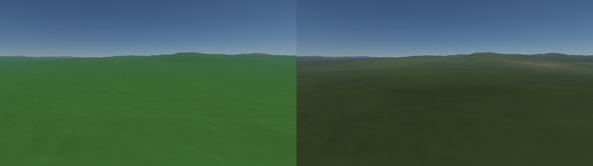
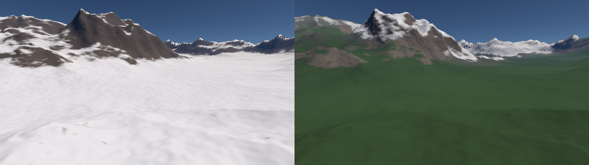
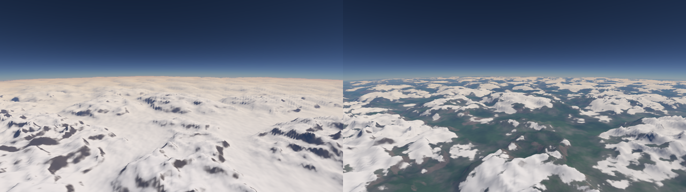
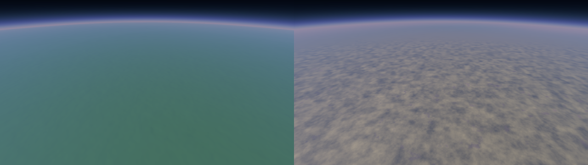

## 2026-10-21 · Atmosphere, sky and sun · in test

**Change:** the image is calculated in high dynamic, under an atmosphere according to Hillaire 2020. Specification: `log/spec-rendu.md`, Steps A and B.

- **Stage A, image string:** floating-point rendering, highlight compression, sRGB output. Image identical to ±1 level close.
- **Step B, atmosphere:** three small tables calculated at start, then the sky and the aerial perspective calculated pixel by pixel.
- **lighting:** the colors of the field become reflections. The sun comes filtered by the air, and the sky illuminates the shadows.
- **Measurement:** 0,11 to 0,26 ms rendering at worst of ten reference views. Land calculation unchanged.
- **To compare:** O and P keys to move the sun, `MYPLANETENGINE_SUN` for captures.
- **To go back:** the previous commit. The atmosphere settings are in `PlanetSettings.hlsli`.

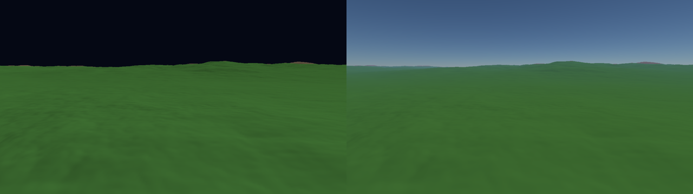
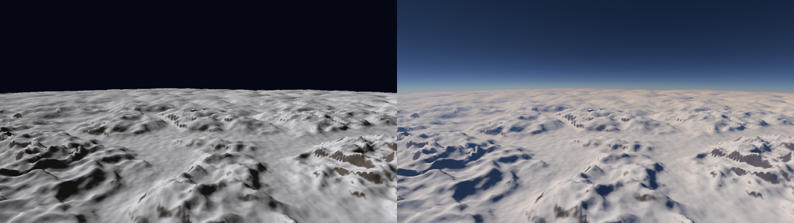
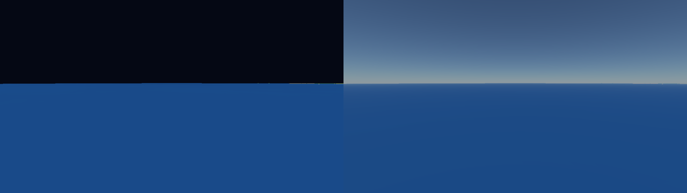

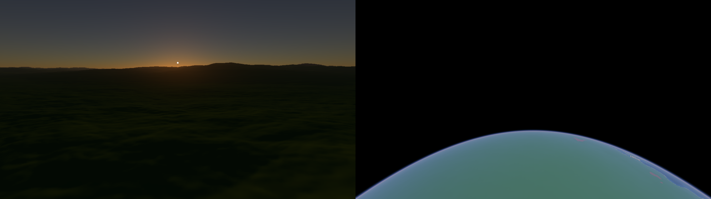

## 2026-10-21 · Normals on neighboring vertices and fine grain in pixels · kept, to be taken back

**Change:** the normal comes from the four neighboring vertices, on two grid cells. The lost fine grain is re-drawn in pixels by a light noise, fixed on the planet. Specification: `log/spec-stabilite.md`.

- **Views:** the continent of departure, 15° S, 50° E, and mountains at 15° S, 120° E.
- **Problem:** Measurement benchmark showed that the jitter comes almost entirely from the lighting. The normal at one quarter of grid cell captures the fine edges of the relief, which change as soon as the vertices slide.
- **Fine grain:** only between 1 and 8 grid cells, the band that the normals of the summits lose, and only between 13,5 m and 6 km, where complexplanet has fine relief. Otherwise he would invent relief.
- **Measure:** worst case of 4,9 to 1,9 calculation ms: no more additional evaluations per vertex. Rendering from 0,05 to 0,11 ms at most.

| jitter, on 255 | Before | After |
|---|---|---|
| Start, 50 m, horizon | 0,49 | 0,22 |
| Starting, 50 m, down | 0,43 | 0,23 |
| Start, 10 km, horizon | 0,79 | 0,45 |
| Mountain, 50 m, horizon | 1,74 | 0,57 |
| Mountain, 10 km, horizon | 17,6 | 6,6 |

- **Visual deviation:** above the continent of departure, almost identical, same fine grain measured to 3 % close. In mountains, the edges are softer: 9 % grain less at 50 m, 38 % at 10 km. The generic noise does not reproduce the sharp edges of the ridged noise.
- **Rest in mountains at 10 km:** especially the color rock or snow, which still depends on the slope at the summits.
- **To return:** `DETAIL_SLOPE = 0` removes the grain. For old normal, the previous commit.

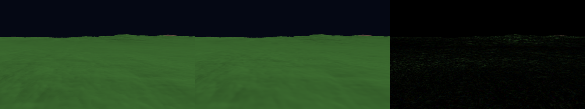
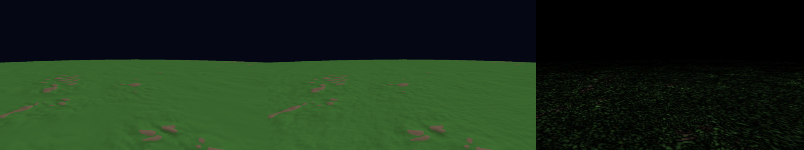
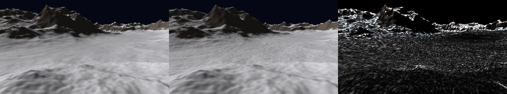
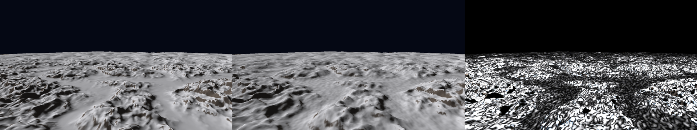

## 2026-10-21 · Smooth normals calculated on the relief · replaced

**Change:** the lighting uses the normal of the relief itself, instead of the slope of each triangle.

- **Problem:** The faceted lighting amplifies the jitter. When a vertex moves a few centimeters, the slope of the neighboring triangles changes, so their brightness too.
- **Principle:** In the compute shader, each vertex evaluates the relief at two additional points, at one quarter of grid cell, and deduces the normal of the surface. The lighting becomes smooth and almost independent of the position of the vertex.
- **Measure:** worst case of 1,6 to 5,6 ms, due to the two additional evaluations per vertex. To be optimized if the solution is kept.
- **To compare:** R key, which returns to the faceted lighting.

## 2026-10-21 · · notch stabilization discontinued

The mesh returns to continuous sliding. The `RING_FILTER_CELLS` and `RING_FILTER_RAMP` settings are removed.

- **Flight observation:** no more jitter in the central square, but geometry changes in increments. Out of the square, the jitter remained. More severe filtering, tested with the M and N keys, smoothed out too much relief without removing the jitter.
- **Why it is abandoned:** the continuous slip of the plane is precisely what densifies the mesh gradually and makes the approach seamless. Some of the notches turn it into old-fashioned tiered detail levels.

## 2026-10-20 · Stabilization of mesh · abandoned on 2026-10-21

**Settings:** `RING_FILTER_CELLS` from 2 to 4, `RING_FILTER_RAMP` = 16, and stabilization on the C++ side. Detail in `log/spec-stabilite.md`.

- **Problem:** In flight, the relief was shaking. The G key, which freezes the mesh, made it disappear: it was the mesh that slipped on the relief, not the precision.
- **Principle:** the grid moves only by increments, chosen so that the vertex fall back on old vertex.
  - The plan rotates by increments of a grid cell of the central square.
  - The size changes by the growth of the rings, based on a smoothed soil height.
  - The rings, which still slip a little, are filtered more severely.
- **Measurement:** worst case of 1,6 to 1,9 ms, below the target of 2 ms.
- **Visual deviation:** the distant relief is a little softer, because of the filtering of the rings.
- **To return:** H key in flight to compare. To remove everything: `RING_FILTER_CELLS = 2.0` and `mStabilized = false` in `D3DApp.h`.

## 2026-10-20 · Vector turbulence · activated

**Setting:** `VECTOR_TURBULENCE` from `false` to `true`. The code arrived disabled in the `ea35946` commit, and the activation follows the entry of this log in the git history.

- **Principle:** a turbulence moves a point with three noise functions of Perlin, one per axis. The vector version calculates all three axes at once: same grid cut-off of noise, same mix weights, same seeds as libnoise. But the three axes are sampled at the point itself, instead of three offset points.
- **Measurement:** worst case of 2,8 to 1,6 ms. All other views are under 0,3 ms.
- **Visual difference:** the character of the relief remains the same, same areas of rock and hills. The exact shape of rock spots and ripples changes. Average variation from 1 to 3 on 255 depending on view, about 1 % of pixels change markedly.
- **Images:** `journal/2026-10-20-turbulence-vectorielle-1m.png`, `-10km.png`, `-cote.png`.
- **Decision:** tested in flight, with and without. No difference noticed by the eye: we keep the fastest version.
- **To return:** `VECTOR_TURBULENCE = false`.

## 2026-10-20 · Turbulence of continents capped · commit `ea35946`

**Setting:** `CONTINENT_TURBULENCE_MAX_FREQUENCY` from no limit to 1024.

- **Principle:** the three turbulence of the continents lose their fine octaves. These moved the coasts only by a few meters.
- **Measurement:** worst case of 3,2 to 2,8 ms.
- **Visual deviation:** only the fine outline of some islands changes, on the coast view: 0,2 % of pixels. Nothing else.
- **Image:** `journal/2026-10-20-turbulences-continents-1024-cote.png`.
- **To return:** `CONTINENT_TURBULENCE_MAX_FREQUENCY = NO_LIMIT`.
- The same commit brings together all the settings in `PlanetSettings.hlsli`.

## 2026-10-20 · Shared gradient table, double precision near camera · commit `5d221d4`

**Setting:** `EXACT_LATTICE_MAX_CELL` = 4 m. Before, double precision was used everywhere.

- **Gradient table in shared memory:** rendered identical to pixel. Gain from 16 to 50 % depending on view.
- **Double precision reserved for grid cellss less than 4 m:** further, the precision of the float, 0,4 m on the planet, is not seen. Visual difference from 0,01 to 255. Up to 70 % gain depending on view.
- **Fix:** The camera could stay under the relief if the window lost focus on startup.
- **Measurement:** worst case of 4,6 to 3,2 ms.
- **To return:** `EXACT_LATTICE_MAX_CELL = NO_LIMIT`. The shared table has no adjustment, since it does not change the rendering.

## 2026-10-20 · Field of view, filtered terrain type · commit `5429682`

**Setting:** `TERRAIN_TYPE_MAX_FREQUENCY` = 64. Before, there was no limit.

- **Field of view:** Out-of-field vertices are no longer calculated. Worst case of 15,1 to 7,6 ms. No visual effects.
- **Terrain type:** limited to wavelengths greater than ~100 km, since it is only used to choose between plains, hills and mountains. Worst case of 7,6 to 4,6 ms. Visual deviation of no more than 0,13 on 255.
- **To return:** `TERRAIN_TYPE_MAX_FREQUENCY = NO_LIMIT`.

## 2026-10-20 · Rings to the horizon, octave filtering · commit `91bcea4`

- **mesh :** compared to 128 × 128 grid cells, surrounded by rings that grow from 1 + 2/128 each, until the horizon more 323 km for mountains. k = 2.
- **Octave filtering:** each vertex evaluates only the octaves visible at its grid spacing. An octave that is not in the line is replaced by its average: −0,36 for Billow, 0,52 for RidgedMulti, −0,06 for Voronoi.
- **Measurement:** worst case of 15,1 ms at ground level.

## 2026-10-20 · port de complexplanet · commit `b7b8c76`

- **Terrain:** the complexplanet example from libnoise, ported to HLSL with its original values, but with the current version of the noise from libnoise. The images on the libnoise site use the old version 1: the planet is not the same.
- **Precision:** the position in the grid of noise is calculated in double precision precision. The compute shader is DXC, in Shader Model 6, because of a bug in the NVIDIA driver with FXC.
- **Radius:** 6 378 km, against about 7 040 km for the complexplanet planet. The reliefs are therefore about 10 % smaller than in the original.
