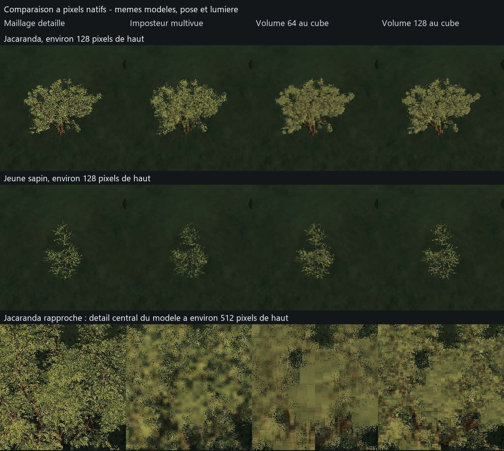

# Prototype: volume vegetation and impostors

**Log since 2026-10-30:** prototype closed. The vegetation of the game is that of `../vegetation-planetaire.md`. Its measurements remain the reference for comparing representations. Its code, `FoliagePrototype` and its shaders, its benchmarks and its launcher are removed on the same day; they remain in the `jalon/24-vegetation-detaillee-main` tag.

**Status: prototype compared the 2026-10-26 and 27, kept as a comparison tool.** Base `piste/vegetation-foliage-base`; integrated with validated planetary version, milestone `jalon/24-vegetation-detaillee-main`. Complete `../recherche-vegetation.md`.

**History:** `prototype-vegetation-volumique-historique.md` keeps replaced tests and intermediate measurements.

**Planetary suite of the 2026-10-27:** `../vegetation-planetaire.md` connects these models to the engine population for a first judgment in flight, without benchmark prior to the user's request. The measurements below remain those of the isolated plot.

**The question:** keep detailed trees and their volume from further away, with a GPU expense and measured memory.

**The choice to compare:**
- **Reference:** the detailed textured model, its leaves and their real holes.
- **impostor:** pre-calculated views of the same model, with color, opacity, normals and depth.
- **Volume:** a hierarchy of aggregates of the same model, filtered by pixel size.
- **The terrain:** complexplanet remains unchanged.

**Perimeter:**
- An isolated rendering component in the DirectX engine 12.
- An explicit activation for the prototype.
- A single tree and then a deterministic plot of several trees.
- A fixed anchor on the planet for all modes and all views.
- The HDR rendering, depth, atmosphere and time smoothing of the engine.
- An inspiration from Nanite Foliage: the prototype does not reproduce all Nanite.
- The test isolates volumetric aggregates; branch assemblies and skeletal movement described by Epic remain outside the perimeter.

**Data:**
- Two detailed models from Poly Haven, licensed CC0.
- Source files, their URL and their footprints are kept by the preparer.
- The three representations come from the same source tree and keep the same boundaries.
- The import keeps the UV and mask of the leaves.
- The levels of detail or variants of the source file are identified before preparation.

**The rules of comparison:**
- Same models, poses, sizes, seeds, number of trees and light.
- Same shadow handling in all three modes.
- No moving of the ground or climate adjustment to advantage a view.
- The views cover multiple locations, distances, angles and directions of the sun.
- Visual judgment looks at silhouettes, holes, light and stability in motion.
- Close-up images are examined at their native resolution.
- The times come from measures GPU after warming up.
- The modes pass successively, without concurrent GPU tests.
- Medians, p95, numbers and raw data accompany the results.
- Memory and preparation times are separate from time per frame.
- The geometric reference remains limited; load tests are identified separately.

**Audits:**
- Compilation of the engine and shaders.
- Dedicated comparison benchmark in `tools/`.
- Captures without window and without focus.
- quality benchmark against `tools/banc_qualite_reference.json` by `--before`.
- The p95s are checked against the historical reference and against the baseline; the already present exceedances are explained.
- File of flight tests and launch by `tools/lance.ps1` or its dedicated launcher.

**The implementation:**
- `FoliagePrototype.cpp` and its shaders isolate the three renderings.
- The models are standardized to 12 m to compare their performances at the same screen size.
- The jacaranda retains 3 863 832 triangles; the young fir, 157 402 triangles.
- Volume types exist in 32³, 64³ and 128³; the default is 64³.
- The hierarchy filters the transmission of children; it does not sum the hidden sheets as if they remained all visible.
- The average normal and its dispersion serve the diffuse lighting.
- Normals are averaged before orientation to view; this approximation can lighten or darken the leaves.
- The impostor features 12 azimuths and 5 elevations, with a filtered pyramid of color, coverage, normal and depth.
- Masks have their dedicated capture, with depth of field and without temporal smoothing.
- The feet meet the triangle drawn following the line of their planetary anchorage.
- The placement tests the two triangles and the neighboring grid cells, in double precision precision relative to the camera.
- The GPU audit covers twelve cases in two locations, for 1, 16 and 1 024 instances, close and far.
- The maximum residue at the plane of the triangle remains under 0,032 mm for the found feet; the cases of 1 and 16 shafts are all valid.
- A case close to the second place finds only 971 feet on 1 024; the load benchmark therefore announces requested instances.
- Preflight rejects any empty reference mask before calculating quality.
- The GPU time series come from two captures of 60 images after 40 warm-up images, i.e. 120 samples per case.

**The protocol:**
- RTX 4070 Ti, 12 GB; driver NVIDIA 610.88; image of 1 280 × 720 pixels.
- The exploratory campaign has twenty distinct views and four small translations or rotations.
- It covers two locations: 30,37° N, 120,53° E and 0,37° N, 60,53° E.
- It compares single tree and grove of 16 trees, to 128, 32 and 8 pixels, from multiple angles and lights.
- It uses three captures of 120 images after 120 warm-up images.
- The final campaign compares the volumes 64³ and 128³ on six views: the two trees at 512, 128 and 8 pixels, in the first place.
- The placement tests also cover single trees and groves at both sites.
- The consecutive samples are not independent repetitions.
- Drawing times are isolated from the placement and the terrain.
- Mask images are not used for performance measurements.
- The benchmark load compares the two simplified representations with 64, 256 and 1 024 instances requested, to 300, 400 and 500 m.
- The patterns are repeated on a grid of 13 m; this measures a representation, not a natural population.
- Intermediate campaigns with a missing reference are invalidated; they do not support any results.

**Limitations of the prototype:**
- Two trees source, without wind or shadows carried by trees.
- Source models still use alpha masks for their sheets or needles; not all their outlines are mesh.
- The lighting Soleil/ciel is common, without own shadows or shadows of relief on trees.
- The normal maps, the roughness and the sheet transmission are not yet exploited.
- The modes compare pure representations; the automatic relay to the near mesh remains to be built.
- The volume uses a dense grid and a step in the pixel, with a weighted average depth.
- It samples the closest voxel and a whole level; the transition between levels remains to be smoothed.
- Reference tests the bilinear alpha at 0,5; preparers use a test at point for the impostor and a continuous weight for volume.
- The coverage gaps therefore include mask filtering, beyond the geometric shape alone.
- GPU representations are stored without compression.
- There is no streaming, no selection of scattered bricks, no reuse of branches within a tree.
- The views of impostor cover the upper hemisphere.
- The prototype mode removes the usual nearby plants; their compensation in the background canopy remains active.
- This common background to the three modes does not constitute a validation of the connection to the usual population.
- Measurements of a bounded plot do not predict the cost of a forested planet.

**Replicate measures:**

```powershell
$env:MYPLANETENGINE_SCANS = '<scan directory>'
python tools/banc_foliage.py x64/FoliageProto/MyPlanetEngine.exe x64/FoliageComparaison --reduced --masks --volume-res 64 --warmup 40 --samples 60 --repetitions 2
python tools/banc_foliage.py x64/FoliageProto/MyPlanetEngine.exe x64/FoliageSixVues --manifest tools/foliage/results/2026-10-26/manifeste-final.json --masks --volume-res 64 --warmup 40 --samples 60 --repetitions 2
# Repeat this command in another directory with --volume-res 128 for the other resolution.
python tools/banc_foliage_stress.py x64/FoliageProto/MyPlanetEngine.exe x64/FoliageCharge --volume-res 64 --warmup 40 --samples 60 --repetitions 2
python tools/foliage/foot_audit.py prepare
python tools/foliage/foot_audit.py run --exe x64/FoliageProto/MyPlanetEngine.exe
```

**Judge in flight:**

```powershell
./tools/lance_foliage.ps1 -Mode volume -Model jacaranda -Scene grove
./tools/lance_foliage.ps1 -Mode impostor -Model jacaranda -Scene grove
./tools/lance_foliage.ps1 -Mode reference -Model fir -Scene single
```

- The launcher calls `tools/lance.ps1` and the test palette.
- The positions of the pallet are recorded on the captures, in absolute altitude.
- The second place uses `-Tests tools/tests/2026-10-26-vegetation-prototype-tropical.txt -Anchor '0.37 60.53'`.
- The variables `MYPLANETENGINE_FOLIAGE_COUNT` and `MYPLANETENGINE_FOLIAGE_VOLUME_RES` select the load and resolution.

**The quality measured:**

| View | IoU impostor | IoU volume 64³ | IoU volume 128³ | Covered 64³ / reference | Covered 128³ / reference |
|---|---:|---:|---:|---:|---:|
| Jacaranda, 128 pixels | 0,613 | 0,733 | 0,754 | 1,070 | 1,018 |
| Tree, 128 pixels | 0,376 | 0,537 | 0,590 | 1,115 | 0,995 |
| Jacaranda, 512 pixels | 0,549 | 0,724 | 0,744 | 1,086 | 1,034 |
| Tree, 512 pixels | 0,382 | 0,542 | 0,593 | 1,122 | 1,000 |

- The IoU is the intersection of the masks divided by their union; 1 is the reference.
- The 64³ volume exceeds the impostor on all six views; the 128³ improves all four views by at least 128 pixels.
- At 8 pixels, references count only 36 pixels of jacaranda and 7 pixels of fir; these results are very sensitive to aliasing.
- The best silhouette does not show the individual sheets: close up, both proxies lose detail.
- In the side view of the jacaranda at 128 pixels, the volume keeps about 0,875 of the reference luminance on the union of the masks.
- Backlight scanning shows an opposite sign light bias; a color multiplier would not correct the lighting rule.
- The four pairs of small movements of the exploration are not sufficient to certify the absence of flicker.



**Cost of performances:**
- By species on GPU, without compression: impostor 26,214 MB, volume 64³ 9,587 MB, volume 128³ 76,696 MB useful.
- These figures exclude instances and temporary copies; they do not compare compressed production formats.
- At 128 pixels, the jacaranda alone requires 0,380 ms in mesh, 0,008 ms in impostor, 0,048 ms in volume 64³ and 0,177 ms in 128³, drawing medians.
- At 512 pixels, the fir tree alone requires 0,030 ms in mesh, 0,104 ms in impostor and 0,143 ms in volume 64³.
- The simplification is therefore not systematically faster than the source model.
- The 128³ multiplies memory by eight for moderate mask gain; it is not suitable as uniform resolution.

**The load, drawing time GPU in ms, median / p95:**

| Model | Requested instances | impostor | Volume 64³ |
|---|---:|---:|---:|
| Jacaranda | 64 | 0,046 / 0,056 | 0,228 / 0,275 |
| Jacaranda | 256 | 0,124 / 0,132 | 0,389 / 0,428 |
| Jacaranda | 1 024 | 0,373 / 0,386 | 0,980 / 1,047 |
| Sapin | 64 | 0,024 / 0,035 | 0,114 / 0,144 |
| Sapin | 256 | 0,066 / 0,076 | 0,227 / 0,275 |
| Sapin | 1 024 | 0,209 / 0,222 | 0,467 / 0,518 |

- Each line and mode counts 120 measured images, divided into two captures.
- Placement is separated: about 0,010 ms median in these scenes.
- These are times of representation on local grids; they do not predict the budget of a global forest.

**The architectural decision:**
- Preserve imported models detailed for close views.
- Continue the volumetric experiment for dense shafts at medium and long distance; the cost of calculation alone does not dismiss it.
- Choose representation by projection error and cost specific to each model, instead of a single threshold for all species.
- First correct the distribution of normals, visibility and depth before multiplying the species.
- Then replace the dense grid with scattered bricks and reused parts; build the relay and the planetary population cache.
- Keep the impostors as a cost reference and as an option for distances where their error becomes acceptable.
- These suites are not implemented by the prototype.

**Data:** `../../tools/foliage/results/2026-10-26/README.md` describes reports, their footprints, and local raw output.

**The usual rendering:**
- The disabled prototype keeps exactly the same measurements on the 24 places taken from the benchmark before modification.
- The extracted 2 990 are identical pixel by pixel; no p95 degrades.
- Captures after editing disable the static TAA; this pixel identity is verified, not assumed.
- Against historical reference, 16 hole or repeat indicators and 2 mutation indicators already exceed 10 % before this work.
- These 18 overrides remain identical after; the canonical reference is retained.
- The detail is in `../../tools/foliage/results/2026-10-26/qualite.json`.

**Technical sources:**
- [Nanite Foliage, Epic](https://dev.epicgames.com/documentation/en-us/unreal-engine/nanite-foliage).
- [Impostor Baker, Epic](https://dev.epicgames.com/documentation/en-us/unreal-engine/impostor-baker-plugin-in-unreal-engine).
- [Poly Haven Models License](https://polyhaven.com/license).
