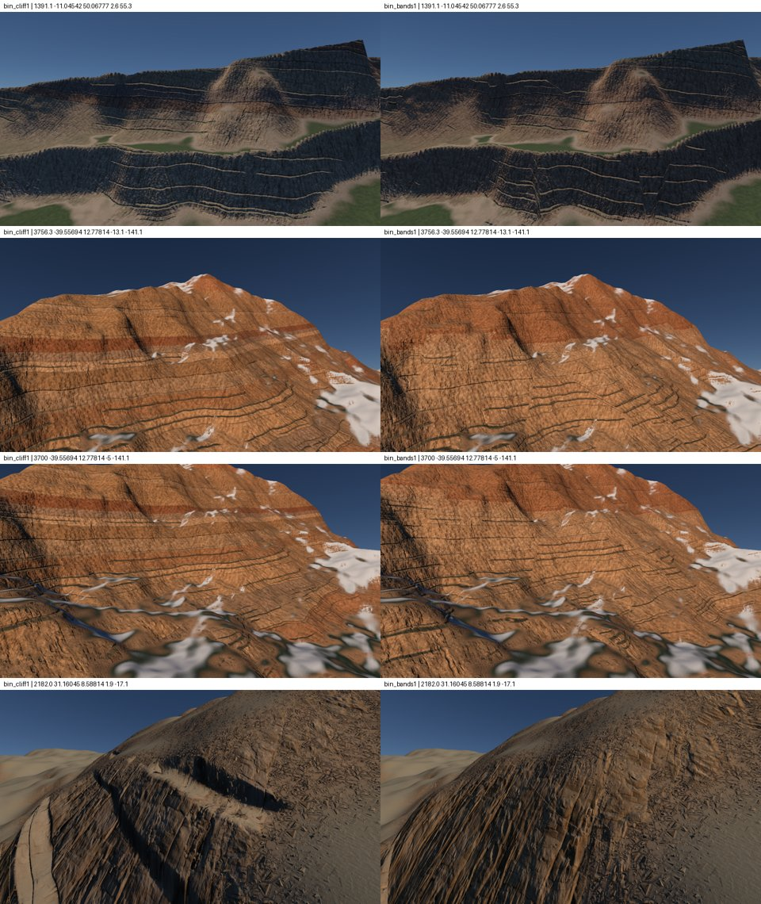
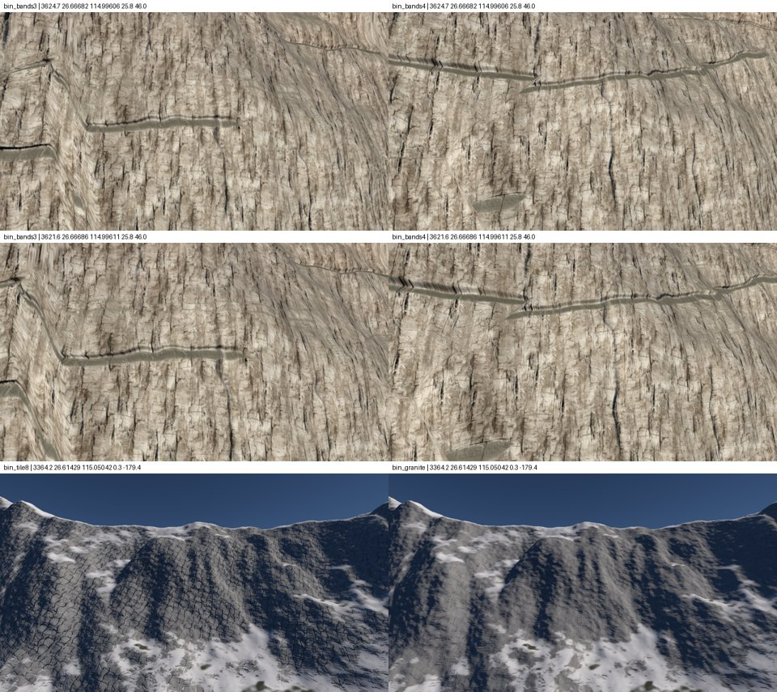

# History of mineral walls

**The outdated sections of `../spec-parois-minerales.md`,** released the 2026-10-30. The present state is there.

- **The options of the rendered track,** of the 2026-10-23: the cliff photo remained.
- **The broken strips and patches of the first flight:** the faults, `STRATA_PLATE_RISE`, `STRATA_PLATE_TILT`, `STRATA_FAULT_ZONE`, the ripple `STRATA_WANDER` and the granite apart, `MASSIVE_TILE`, are removed the 2026-10-24 with the rock families, `jalon/16-une-roche`. The strata at the pixel remain.
- **The erosion filter,** set aside: tag `piste/erosion-filtre`.

## The rendering path, the options of the 2026-10-23

Which makes a mineral wall from 100 m to 1 km without touching the shape. Pixels cover from 8 cm to 1 m.

| Option | What it brings | Layer | Cost |
|---|---|---|---|
| **1. Broken strips**: plates of 50 to 300 m that shift and tilt the strata, varying thicknesses, colors by large masses | end of continuous scratches | color | two Voronoi per pixel |
| **2. Grout and varnish**: dark traces in the direction of the slope, under the cornices | the vertical structure of the real walls | color | almost nothing |
| **3. Diaclases**: vertical fractures, normal and cavity | blocks, edges, fine shadows | normal | an anisotropic Voronoi |
| **4. Cliff pictures**: `marble_cliff` Poly Haven, 4 to 20 m, in triplanar, paved without repetition, recolored by the strata | actual mineral matter from 1 to 20 m | color and normal | a tile and readings; download to be allowed |
| **5. Ombre des creux**: screen-space shadows | black ravines and alcoves | shadow | a pass full screen |

**User's choice, the 2026-10-23:** the cliff photo first, the 4 option.

**Proximity geometry is disabled during this work,** `MATERIAL_RELIEF` = 0 and `WALL_RELIEF` = 0: rendering is set to the complexplanet geometry only (`../geometrie.md`).

**The measure:**
- views of walls at 100 m, 300 m and 1 km, next to the photos `cible-*.jpg`;
- benchmarks of jitter, descent and peaks;
- cost of rendering.

## Results of option 1: the broken strips

- **The plates:** almost vertical faults cut the strata into plates of about 128 m, a Voronoi of the planet's grid with cells four times higher than wide. Each plate raises the strata of ±20 m, `STRATA_PLATE_RISE`, and tilts them of ±0,12, `STRATA_PLATE_TILT`. On either side of a fault, the two offsets merge on two pixels.
- **The groups:** formations go by groups five times thicker, which give the shade. A formation now only deviates by 30 % from the shade of its group, `STRATA_FORMATION_CONTRAST`; badlands keep their bands live.
- **Color only:** geometry does not change. The column, 64 m tile and parallax follow the same offset strata.
- **What we see:**
  - the bands are interrupted at the faults, offset and inclined;
  - colors change by large masses;
  - remain the thin dark lines of the joints between the benchmarks, now in sections.
- **Measures:**
  - jitter with smoothing 0,43 → 0,42 on the steep wall, 0,23 → 0,26 to 45°; the cornice has changed place, the view is no longer comparable;
  - rendering cost +0,1 to 0,3 ms, measured noise by the shared GPU;
  - descent of the rock unchanged.

## Fixes after the theft of the 2026-10-23: immobile strips, a granite without grillage

**Symptom 1:** As we approached, the bands moved. Between two distant positions of 10 m, `3624.7 26.66682 114.99606 25.8 46.0` and `3621.6 26.66686 114.99611 25.8 46.0`, nothing was in the same place anymore.
- **The plates were stretched vertically from the anchor of the noise functions.** The anchor jumps from 64 m when the camera moves, and the plates were re-cut. They are now a Voronoi 2D of the planet's grid, on its two axes farthest from the vertical: the faults remain almost vertical. A test at all the hangings spread the Z-bands over tens of meters, where a fault ran along the wall.
- **Geology, strata offset and lenses were calculated per vertex and filtered by the grid cell.** A grid cell covers about 13 pixels: their octaves appeared in sight as the grid cells shrank, up to the folds of 128 m and their ±10 m. They are now calculated in pixels and filtered by pixel size.
- **Faults drew a black line:** the steep slope of `s` in the fault zone was lit up like a step. It is only used to soften the beds, `gStrataFault`, on a crushed area of 30 cm, `STRATA_FAULT_ZONE`, or two pixels: the tape stops at the fault and resumes offset.

**Symptom 2:** lines still straight. strata now ripple from 2,5 m standard deviation on 4 to 256 m, `STRATA_WANDER`, instead of 0,8 m on 4 to 64 m.

**Symptom 3:** a cracked grid on all granite walls, `3364.2 26.61429 115.05042 0.3 -179.4`.
- **Cause:** The 64 m tile of granite traces two families of fractures all 21 m, everywhere with the same strength. They cross in wire mesh.
- **The correction:** each fracture shows in sections of about 16 m, most often weak, sometimes deep.
- **By the way:** granite and basalt keep their own tile of 8 m, `MASSIVE_TILE`. The change from the layered rock to 12,8 m for the photo had enlarged them.

**Measures:**
- the two positions at 10 m from each other show the same bands and the same fault;
- jitter with smoothing 0,26 → 0,22 to 45°, 0,34 → 0,28 on granite, 0,42 and 0,26 → 0,28 elsewhere; the benchmark keeps the camera fixed and does not see the anchor jump;
- cost unchanged, measurement distorted by an open app instance; rock descent unchanged.

## The geometry path, the erosion filter

**The erosion filter, tried the 2026-10-23,** tag `piste/erosion-filtre`:
- **What it does:** the ravines of 366 m to 11 m in the relief itself, along the slope smoothed on 512 m, in 3D on the planet grid.
- **What it gives:** corridors on distant mountains, V-shaped strata in ravines; close up, ravines too rare and too thin.
- **What it costs:** +1,7 to 2,4 ms of terrain calculation. The three more complexplanet evaluations per vertex are the probable cause, not isolated.
- **The jitter with smoothing:** 0,61 → 0,95, 0,22 → 0,46, 0,16 → 0,52. Rounded hollows on two grid cells were then written, not measured.
