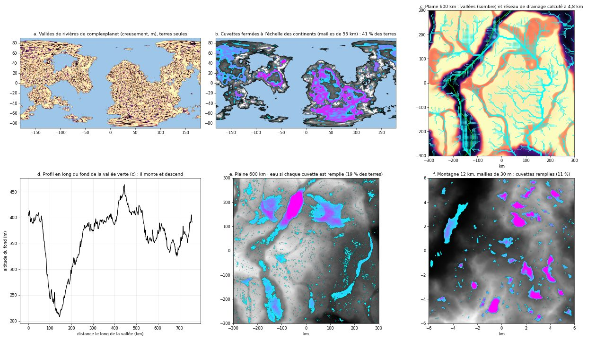

# Recherche : rivières, fleuves et lacs de montagne

Statut : recherche du 2026-10-24. Elle mesure ce que complexplanet fait déjà et propose un plan. **Étape 1 faite le 2026-10-25,** tag `piste/carte-planete` : la carte de la planète, ses cuvettes et son réseau, mesurés (`journal-planete.md`, la carte de la planète ; `tools/banc_carte.py`). Le reste n'est pas décidé. **Les spikes du 26 et 27 octobre sont mis de côté :** maquette Dendry, bassins construits avec leurs rivières, réseau global sur complexplanet ; tag `piste/rivieres-spikes`, doc dans `log/recherche-rivieres-historique.md`. La recherche continue sur la branche `erosion-niveaux`. La mer, et les lacs vus depuis l'eau, sont dans `recherche-mer.md` ; les côtes, dans `recherche-cotes.md`.

## 1. Conclusion et plan

**En bref :**
- **complexplanet a des rivières, sans eau.** Son groupe « river positions » creuse des vallées larges de 15 à 45 km et profondes de 50 à 230 m.
- **Ce sont des courbes de niveau de bruit.** Des boucles fermées, sans source ni embouchure, dont le fond monte et descend. Pour les montrer en eau, l'auteur de libnoise remontait le niveau de la mer de 650 à 1 111 m selon l'image.
- **Les remplir ne donne pas des rivières.** L'eau monterait les pentes : 6 à 7 creux par 100 km de fond. Les fonds couvrent un tiers des terres ; rivières et ruisseaux en couvrent 0,6 % sur Terre.
- **Le relief n'est pas drainé.** À l'échelle des continents, 41 % des terres sont dans des cuvettes fermées, profondes de 260 m en médiane. Sur Terre, les bassins sans issue font un cinquième des terres, surtout arides.
- **Aucun calcul par point ne donne le niveau d'un lac ni le chemin vers la mer.** Il faut une passe non locale.
- **La plus petite qui suffit : une carte hydrologique de complexplanet,** sur une grille fixe de la planète, calculée au démarrage. C'est celle que `recherche-mer.md` propose pour les lacs : une passe pour les deux.
- **Elle ne touche pas à complexplanet.** Elle donne lacs, réseau et débits du relief tel qu'il est. Son réseau emprunte les vallées de complexplanet jusqu'à deux fois plus que le hasard.
- **La règle de la côte s'étend.** La côte est là où l'altitude croise le niveau de l'eau : 0 pour la mer, le niveau de son lac ou de sa rivière ailleurs. Même `SpreadStep`, même règle à toute distance.
- **Les lits de rivière sont une surcouche.** Sous 13,5 m de large, ajout de détail. Au-delà, et pour les gorges, remplacement, sur piste.
- **Les lacs de montagne viennent en dernier.** Nos montagnes ont des cuvettes, mais trop et au hasard : 11 % de la surface à 30 m. Les vrais lacs de cirque se groupent près de l'ancienne limite des glaciers, au pied d'une paroi.

**Le plan :**

| Étape | Contenu | Nature | Mesure de réussite |
|---|---|---|---|
| 0 | Le banc hors moteur : complexplanet porté sur CPU, remplissage des cuvettes, réseau. Fait pour cette recherche | outil, le moteur ne change pas | il reproduit les chiffres de la section 2 |
| 1 | La carte hydrologique : complexplanet sur 6 × 1 024² cellules au démarrage, remplissage par priorité, réseau, bilan d'eau. Trois vues de diagnostic : vallées, cuvettes, réseau | rendu seul ; rien ne s'affiche en vol | mêmes cuvettes que le banc 0 sur ses fenêtres ; part constante au banc de descente ; part des lacs après bilan d'eau, pour décider des mers intérieures |
| 2 | Les lacs : une eau plate au niveau de son lac, le modèle d'eau de la mer | surface d'eau, hors des trois familles, comme la mer | part des terres en lacs et tailles contre HydroLAKES ; aucune fuite au bord d'un lac ; banc de qualité inchangé sur terre |
| 3 | Les rivières de loin : un ruban d'eau en part du pixel sur le réseau lissé et méandré ; les corridors verts | rendu seul | surface des rivières 0,3 à 0,6 % des terres ; longueur d'onde des méandres près de 12 largeurs ; reflet vu d'avion |
| 4 | L'hydrologie fine près de la caméra : tuiles de 600 m puis 75 m sur la grille de la planète, bornées par la carte grossière. Ruisseaux et petits lacs | rendu seul et surface d'eau | densité de drainage de 2 à 5 km/km² ; aucun saut au passage d'un niveau à l'autre, au banc de tremblement |
| 5 | Les lits : chenal creusé sous le niveau de l'eau, berges, gorges | surcouche : ajout de détail sous 13,5 m de large, remplacement au-delà. Spec, branche, tag `piste/rivieres-lits`, réglage `RIVER_BED` = 0 | profondeur creusée, p99 ; part du réseau en gorge ; bancs de qualité et de tremblement |
| 6 | L'eau qui coule : sens et vitesse, écume, rapides, cascades, couleur, berges mouillées, glace | rendu seul | photos par type de lit ; part d'écume constante en descente |
| 7 | Cirques et lacs de moraine | surcouche : remplacement, sur piste | tailles des cirques contre Barr 2019 ; bande d'altitude des lacs |

**L'étape 1 est petite et mesurable.**
- **Ce qu'elle touche :** une passe de calcul au démarrage, comme les tuiles générées ; un remplissage sur CPU de 6,3 millions de cellules ; trois vues `MYPLANETENGINE_VIEW`.
- **Ce qu'elle mesure :** les mêmes nombres que le banc 0, sur les mêmes fenêtres.
- **Ce qu'elle tranche :** combien de lacs et de mers intérieures ce relief porte, avant d'en dessiner un seul.

**À décider avant l'étape 2 : les mers intérieures.**
- **Mesuré sur la carte, le 2026-10-25 :** chaque cuvette remplie, 43 % des terres sont sous l'eau, 231 m de fond en médiane. Les intérieurs des continents font trois cuvettes de 58, 28 et 10 millions de km² ; 95 % des terres s'y jettent. Sans bilan d'eau, pas de lac à dessiner.
- **Les grandes cuvettes de complexplanet sont profondes.** Rouvrir celles de moins de 20 m n'en vide presque aucune : 12 à 21 % des terres restent sous l'eau, à 4,8 km de maille.
- **Le bilan d'eau les assèche en climat sec :** des salars, comme le Grand Bassin américain.
- **En climat humide, elles restent pleines :** de grands lacs, comme les Grands Lacs ou la Caspienne.
- **Trois choix :** les garder ; les vider par une brèche creusée, un remplacement ; les montrer en marais. La vue de l'étape 1 permet de juger.

**Ne pas toucher à `RIVER_DEPTH`.** Les vallées de complexplanet restent la source de vérité. Elles accueilleront une part du réseau et des chapelets de lacs. Les retirer serait un remplacement, avec sa piste.

## 2. L'audit : les rivières de complexplanet

*a : le creusement des rivières sur les terres. b : les cuvettes fermées à l'échelle des continents. c : une plaine de 600 km, ses vallées en sombre, le réseau calculé à 4,8 km en cyan, une vallée en vert. d : le profil en long du fond de cette vallée. e : la même plaine, chaque cuvette remplie. f : 12 km de montagne à 30 m, chaque cuvette remplie.*

### Ce que dit le code

`RiverPositions` et la fin de `ComplexPlanetElevation`, dans `ComplexPlanet.hlsli` :
- **Deux familles de vallées :** deux RidgedMulti d'une seule octave, aux fréquences 18,75 et 43,25 sur la sphère unité. Leurs mailles font 340 km et 147 km.
- **Une RidgedMulti d'une octave vaut (1 − |n|)² × 1,25 − 1.** Elle culmine là où le bruit n passe par 0. La courbe la retourne : ses crêtes deviennent des fonds.
- **Une turbulence les tord :** fréquence 9,25, amplitude 1/57,75 du rayon, soit 110 km, six octaves. La plus fine fait 21 km de longueur d'onde. Rien ne serpente plus court.
- **La profondeur :** `RIVER_DEPTH` vaut 0,0234 unité, soit 192 m. Le fond des grandes vallées descend de 192 m sur ses bords à 227 m au centre ; celui des petites, de 48 à 66 m.
- **Où elles creusent :** un `Select` sur l'altitude. Pleine force à 1 024 m ; moitié au niveau de la mer et à 2 048 m ; rien sous −1 024 m ni au-dessus de 3 072 m.
- **Donc :** elles creusent aussi le plateau continental, et pas les hautes montagnes.
- **Le reste des terres** baisse d'une dizaine de mètres au plus.

**Ce qu'en montrait libnoise :** la page de l'exemple montre des « river valleys ». Pour les voir en eau, chaque vue rapprochée remonte le niveau de la mer : 850 m, 650 m, 1 111 m, « to flood the river valleys ».

**SpaceEngine a fait pareil en 2013 :** des « pseudo-rivières » qui ne coulent pas des hauteurs à la mer, forment des boucles « comme des vaisseaux sanguins », et n'ont d'eau qu'au niveau de la mer. Elles ne sont belles que près des côtes.

### Les mesures

**La méthode :** complexplanet porté en numpy depuis le HLSL, constantes comprises, au filtrage d'octaves d'une maille de la taille de la cellule. Trois fenêtres de 600 km à 1,2 km : une plaine, une côte, une montagne. La planète entière à 0,5°. Deux fenêtres de montagne de 12 km à 30 m, une de plaine de 30 km à 100 m.

| Grandeur | Grandes vallées | Petites vallées |
|---|---|---|
| Largeur du fond | 37 à 46 km | 14 à 17 km |
| Largeur jusqu'au haut des flancs | 54 à 69 km | |
| Profondeur médiane du fond, en plaine | 169 à 182 m | 45 à 47 m |
| Pente des flancs, p99 | 2 % | 2 % |
| Longueur par 1 000 km² de terres | 2,8 à 4,4 km | 8 à 12 km |
| Écart moyen le long d'une droite | 360 à 570 km | 130 à 190 km |
| Part des terres en fond de vallée | 19 % | 14 % |
| En montagne, médiane à 4 km | absentes | absentes |

- **42 % des terres** sont abaissées de plus de 10 m.

### Ce que ça veut dire

- **Des vallées, pas des rivières.** 15 à 45 km de fond, c'est l'échelle d'une plaine alluviale ou du fossé rhénan, pas d'un chenal.
- **Presque invisibles au sol.** Des flancs à 2 % : 180 m de descente sur 9 km.
- **Des boucles.** Là où un bruit vaut 0 sur une sphère, la courbe est toujours fermée. Sur les terres, une vallée ne s'arrête qu'à la côte.
- **Aucune confluence.** Les deux familles se croisent en X. Aucune ne se jette dans l'autre en Y.
- **Aucun sens d'écoulement.** Le fond est le relief moins une profondeur : il suit les bosses du relief. Le long des fonds de grandes vallées, lissés sur 5 km :
  - 6 à 7 creux par 100 km ;
  - la montée totale vaut 0,6 à 1,2 fois la descente ;
  - 20 à 61 % de la longueur est dans une cuvette fermée ;
  - la vallée de la figure d monte de 210 à 460 m sur 300 km.
- **La mer par hasard.** Là où une boucle croise une côte, le creusement passe sous 0 et la mer entre, en ria. Dans la fenêtre côtière, 2,4 % des terres deviennent mer ainsi.
- **Les vallées de montagne ont la même forme.** `MountainBaseDef` et `HillyTerrain` creusent les leurs par une RidgedMulti d'une octave à 367 : un labyrinthe de boucles de 17 km de maille, fermées aussi.

### Ce que montrerait l'eau, selon le niveau

1. **Au niveau de la mer, aujourd'hui :** les vallées côtières deviennent des rias ; le reste est sec. Une mer intérieure sous 0, coupée de l'océan à 55 km de maille, couvre 3,6 % des terres. Elle est dessinée comme la mer.
2. **Un ruban à hauteur fixe au-dessus de chaque fond :** un tiers des terres sous l'eau, en rubans de 15 à 45 km, cinquante fois la surface des rivières terrestres. L'eau monte et descend avec le fond.
3. **Chaque cuvette remplie jusqu'à son seuil :** des chapelets de lacs, 37 à 39 % des fonds de grandes vallées.
   - Sur toute la fenêtre : 19 à 26 % des terres à 1,2 km, 15 à 22 % à 4,8 km.
   - Sur la planète, à 55 km : 41 %, des cuvettes profondes de 263 m en médiane.
   - Rouvrir les cuvettes de moins de 20 m n'en vide presque rien : il en reste 12 à 21 %.
4. **En montagne, à 30 m :** 9 à 11 % de la surface en lacs.
   - 500 à 730 lacs de plus d'un hectare par 1 000 km².
   - Profonds de 21 à 24 m en médiane.
   - Leurs tailles suivent N(>A) ∝ A^−0,7.
5. **En plaine, à 100 m :** 12 % de mares de 3 m de fond en médiane, entre les bosses des Billow.

### La carte de drainage calculée sur complexplanet

Un réseau calculé à 4,8 km, comparé au relief à 1,2 km de la même fenêtre :
- **Il trouve les vallées.** En plaine et sur la côte, 42 à 63 % du réseau drainant plus de 200 km² y passe, pour 31 % de la surface.
- **Il traverse beaucoup de lacs :** 41 à 82 % de sa longueur.
- **Le relief plus fin le gêne peu en plaine.** La cellule de 1,2 km la plus basse dépasse le niveau de l'eau de plus de 5 m sur 0,04 % du réseau en plaine, 1 % en montagne, 4 % sur la côte. Au p99 : 0,5 m, 1,8 m, 18 m.
- **En montagne, son niveau flotte.** Il passe 480 m au-dessus des fonds de vallée fins, en médiane. La carte grossière donne le chemin et le débit, pas le niveau de l'eau : il faut l'affiner près de la caméra.

### Les limites de la mesure

- **Des minorants :** la mer et le bord de chaque fenêtre servent d'exutoires. Une cuvette plus grande que la fenêtre s'y vide.
- **Des ordres de grandeur :** quelques fenêtres, pas une statistique de la planète.
- **Cette planète a 58 % de terres,** contre 29 % pour la Terre.
- **À vérifier dans le moteur :** une vue de diagnostic des vallées. La part des terres en fond de grande vallée, 19 %, doit rester la même de 1 500 km au sol.
- **Les scripts** sont dans `tools/hydro/` ; la carte du moteur se vérifie et se mesure par `tools/banc_carte.py`.

### Où regarder en vol

Au format de `tools/tests` : altitude, latitude, longitude, inclinaison, cap.

| Lieu | Position |
|---|---|
| Fond de grande vallée en plaine, 347 m | `20000 28.87168 -148.68863 60 0` |
| Cuvette de vallée, un lac s'il était rempli, 222 m | `20000 28.75533 -144.96030 60 0` |
| Vallée qui rejoint la mer, en ria | `15000 21.44456 -107.64384 60 0` |
| Cuvettes de montagne, 3 600 m | `6000 38.52929 169.97278 50 0` |

## 3. Rivières et lacs réels : types et tailles

### Le réseau

- **La longueur est dans les ruisseaux, la surface dans les rivières.** L'essentiel de la longueur est en cours d'ordre 1 ; l'essentiel de la surface, en ordres 5 à 9 (Downing 2012).
- **La loi de Hack :** la longueur du cours principal croît comme l'aire drainée à la puissance 0,5 à 0,6. L = 1,4 A^0,6, en miles.
- **La densité de drainage :** 2 à 5 km de cours par km² en général ; 2 à 12 du semi-aride à l'humide.
- **Où naît un cours :** au-delà d'une aire drainée critique, qui varie avec la pente, la roche et le climat (Schneider 2017).
- **complexplanet en a 0,011 à 0,016 km/km² :** cent à quatre cents fois moins, et seulement de grands cours.

### Largeur, profondeur, vitesse

- **La géométrie hydraulique** (Leopold et Maddock 1953) : largeur, profondeur et vitesse en puissances du débit Q.
  - W ∝ Q^b, D ∝ Q^f, V ∝ Q^m, avec b + f + m = 1.
  - Valeurs usuelles vers l'aval : b ≈ 0,5, f ≈ 0,4, m ≈ 0,1.
- **Une loi mondiale :** W ≈ 7,2 Q^0,5, en m et m³/s (Moody et Troutman 2002, vérifiée par Frasson 2019 sur les fleuves de plus de 90 m).
  - 50 m pour 50 m³/s, 230 m pour 1 000 m³/s, 1,6 km pour 50 000 m³/s.
  - Écart typique de −35 % à +81 %.
- **La surface :** rivières et ruisseaux couvrent 0,58 % des terres non englacées (Allen et Pavelsky 2018) ; 0,3 à 0,56 % selon Downing 2012.
- **La pente baisse vers l'aval.** Au-delà de 70 cm/km, ce sont surtout des cours de moins de 100 m (Frasson 2019).

### Les formes du lit

- **Méandres :**
  - longueur d'onde de 12,7 largeurs en médiane, 9 en mode (Frasson 2019) ; 11 chez Leopold et Wolman 1960 ;
  - le rapport baisse avec la largeur : 21 sous 100 m, 8,4 au-delà de 300 m ;
  - rayon de courbure de 2 à 3 largeurs ;
  - sinuosité moyenne de 1,25 à 1,5, très asymétrique.
- **Tresses :** pente forte pour le débit, sédiments grossiers abondants, débit variable. Torrents glaciaires, cônes de déjection.
  - Seuil de Leopold et Wolman 1957 : S = 0,06 Q^−0,44, Q en pieds³/s, soit environ 0,012 Q^−0,44 en m³/s. Au-dessus, des tresses.
- **Le lit selon la pente** (Montgomery et Buffington 1997) : cascades au-dessus d'environ 6,5 % ; marches et vasques dès 3 % environ ; lit plat, puis seuils et mouilles plus bas ; dunes de sable aux pentes les plus faibles.
- **Cascades :** là où le profil casse. Roche dure, vallée suspendue d'un ancien glacier, faille.
  - Des chutes naissent aussi seules, en série, sur un lit uniforme (Scheingross 2019).

### Les lacs

- **Combien :**
  - 117 millions de plus de 0,2 ha, 5 millions de km², 3,7 % des terres non englacées (Verpoorter 2014) ;
  - 1,4 million de plus de 10 ha, 2,67 millions de km², environ 1,8 % (HydroLAKES).
- **Les tailles :** les grands et moyens lacs font l'essentiel de la surface (Verpoorter 2014).
- **Où :** surtout sur les terres jadis couvertes de glaciers, boucliers canadien et scandinave.
- **Les bassins sans issue :** un cinquième des terres, en climat aride et semi-aride (Wang 2018). Leurs lacs sont salés ou à sec.
- **Les types :** glaciaires, en cirque, derrière une moraine, dans une auge ; tectoniques, dans un rift ; fluviaux, en bras mort ; volcaniques ; barrés par un éboulement ; karstiques.

### Les lacs de montagne

- **Le lac de cirque :** un cirque est un creux en fauteuil, à paroi raide et fond surcreusé (Barr et Spagnolo 2015). Le fond garde souvent un lac.
  - **Tailles :** sur 2 208 cirques de Grande-Bretagne et d'Irlande, longueur 774 ± 426 m, largeur 786 ± 365 m, profondeur 283 ± 108 m, en loi log-normale (Barr 2019).
  - **Le lac** occupe une partie du fond : de quelques hectares à quelques dizaines.
  - **L'altitude :** les fonds de cirque se groupent près de la ligne d'équilibre des glaciers passés. Ils servent à la reconstruire.
- **Le lac de moraine :** retenu par l'arc morainique au front d'un glacier. Souvent turquoise.
- **Le chapelet :** des lacs en escalier le long d'une auge glaciaire, entre des verrous rocheux.
- **Les lacs glaciaires grandissent :** +53 % en nombre et +51 % en surface de 1990 à 2018 (Shugar 2020).
- **Ce que nos montagnes ont :** des cuvettes de bruit, 11 % de la surface, partout, à toute altitude, sans paroi en fauteuil au-dessus. Les vrais lacs de cirque sont rares, dans une bande d'altitude, au pied d'une paroi.

### Les couleurs

- **31 % des lacs sont bleus, 69 % verts à bruns,** sur 85 360 lacs (Yang 2022). Les bleus sont profonds et froids, en climat humide, gelés l'hiver.
- **Turquoise laiteux :** la farine glaciaire, des grains de roche très fins, reste en suspension (NASA Earth Observatory). Elle fait les deux tiers de l'atténuation de la lumière dans les lacs de glacier (Rose 2014).
- **Bleu sombre, presque noir :** un lac de montagne profond et clair, sans farine.
- **Brun :** matière organique dissoute, tourbières et forêts boréales ; sédiments en plaine.
- **Une échelle de mesure :** Forel-Ule, 21 teintes du bleu au brun. Un jeu de données mondial existe pour les lacs, de 2000 à 2018.
- **Les rivières :** beiges et limoneuses en plaine, laiteuses sous les glaciers, transparentes en torrent de roche.

## 4. Les construire dans notre moteur : options comparées

### La question clé

**L'altitude est un bruit évalué point par point, sans passe globale.**
- **Ce qu'un point ne peut pas savoir :** le niveau d'un lac dépend du seuil le plus bas de tout son bassin, parfois à des centaines de kilomètres. Le sens d'une rivière dépend de tout l'aval jusqu'à la mer.
- **Donc :** aucune méthode purement locale ne donne, sur le relief de complexplanet, des rivières qui descendent et des lacs plats.
- **Les méthodes locales qui y arrivent fabriquent le relief autour de l'eau.** Elles remplacent complexplanet.

### Les options

| Option | Descend toujours | Lacs plats | Nos règles | Famille, `geometrie.md` | Verdict |
|---|---|---|---|---|---|
| A. Remplir les vallées de complexplanet à un niveau tiré du point | non : 6 à 7 creux par 100 km | non | universelle et sur la grille ; l'eau monte | surface d'eau | écartée pour les rivières |
| B. Niveau tiré des minima voisins, sans passe | non | non : le seuil est loin | coûteux ; plat par cellule seulement, marches aux bords | surface d'eau | écartée |
| C. Carte hydrologique grossière de complexplanet, au démarrage | oui, par construction | oui, un niveau par lac | grille fixe, indépendante de la caméra : même résultat à toute distance, aucun saut | lacs : surface d'eau ; lits : ajout de détail ou remplacement | retenue, le socle |
| D. Tuiles hydrologiques fines près de la caméra, bornées par C | oui | oui | déterministe par tuile ; le passage d'un niveau à l'autre sous le pixel | idem | retenue, étape 4 |
| E. Réseau d'abord, relief autour : Derzapf 2011, Génevaux 2013, Dendry 2019, Fischer 2022, Davis 2026 | oui | oui | local pour Dendry ; le relief suit l'eau | remplacement lourd | piste lointaine |
| F. Érosion de toute la planète : stream power, érosion hydraulique sur GPU | oui, relief drainé | peu de cuvettes | passe globale lourde ; relief nouveau | remplacement total | voie géométrie |
| G. Filtre d'érosion, `piste/erosion-filtre` | non : ses lignes s'interrompent | non | local et universel | remplacement, déjà classé | ravines seulement |

**Les options en détail :**
- **A, remplir les vallées :** c'est ce que faisait libnoise. Les mesures de la section 2 l'écartent : l'eau monterait, les rubans seraient géants, les boucles n'auraient pas de sens.
- **B, minima locaux :** un point qui voudrait trouver son seuil devrait évaluer le relief sur des dizaines de kilomètres. Ancré sur des cellules, le niveau serait plat par cellule et ferait des marches entre elles.
- **C, la carte grossière :** la seule qui garde complexplanet tel quel.
  - complexplanet sur un cube fixe de la planète, 6 × 1 024² d'abord, environ 10 km ; 2 048² si la mesure le demande.
  - Remplissage par priorité (Barnes 2014), en n log n.
  - Bilan d'eau par Fill-Spill-Merge (Barnes 2021) : 4 millions de cellules en 8,7 s.
  - Sens, aire drainée et débit de chaque cellule.
- **D, les tuiles fines :** la carte grossière donne chemin et débit ; le niveau de l'eau vient du relief fin.
  - Des tuiles de 600 m puis 75 m, calculées à la demande autour de la caméra, chacune bornée par la carte grossière : la rivière entre et sort par des points fixés à l'avance.
  - Le contenu d'une tuile ne dépend que de sa place sur la planète.
  - C'est l'idée de Derzapf 2011, sur une planète, et de Davis 2026, par plaque.
- **E, le réseau d'abord :** la famille la plus riche.
  - Kelley 1988, cité par Fischer 2022, puis Derzapf 2011 sur une planète : le réseau d'abord, par déplacement du point milieu contraint, le relief ensuite. Derzapf construit des planètes entières en quelques secondes et raffine sur GPU en vol.
  - Prusinkiewicz et Hammel 1993 : montagne et rivière dans un même processus.
  - Génevaux 2013 : un graphe de drainage, puis des primitives de relief le long des rivières.
  - Dendry, Gaillard 2019 : une fonction évaluée point par point, la distance à un arbre construit à la volée. Des réseaux cohérents, mais le relief doit suivre.
  - Fischer 2022 : lacs et rivières d'abord, le relief « poussé » autour.
  - Davis 2026 : réseaux tracés par plaque tectonique, mis en cache, hauteurs ajustées pour que chaque segment descende.
  - Red Blob Games, TerraFirmaCraft : des arbres de rivières sur une carte ou une région finie ; un monde sans fin se découpe en régions.
  - **Chez nous :** tout cela remplace la forme de complexplanet à grande échelle. À garder pour une décision de la voie géométrie.
- **F, l'érosion globale :** Cordonnier 2016 et Schott 2023 par la loi du stream power, Tzathas 2024 par ses solutions analytiques, Mei 2007 sur GPU. Le relief devient drainé. C'est un nouveau relief.
- **G, le filtre d'érosion :** son auteur le dit : ses lignes de drainage peuvent s'arrêter à mi-pente. Il dessine des ravines, pas un réseau.

### Les règles qui en découlent

1. **La côte généralisée.** La côte est là où l'altitude croise le niveau de l'eau. La mer a 0 ; un lac a son niveau ; une rivière, le niveau de son cours. La part d'eau du pixel suit `SpreadStep`, comme la mer.
2. **Un niveau par lac, constant.** La carte porte l'identifiant du lac. Sa zone, élargie d'une cellule, porte un seul niveau. La rive est là où le relief fin croise ce niveau : îles et baies viennent seules.
3. **Le bilan d'eau, tiré de notre climat.**
   - Le ruissellement : la pluie, de 100 à 3 000 mm/an par notre humidité, moins l'évaporation, tirée de la température.
   - Une cuvette se remplit jusqu'à ce que l'évaporation du lac égale l'apport de son bassin, au plus jusqu'à son seuil. Pleine, elle déborde dans la suivante.
   - En climat sec : lacs salés partiels, ou cuvettes sèches.
4. **La largeur par le débit :** W ≈ 7,2 Q^0,5, Q le ruissellement fois l'aire drainée. Pas de largeur choisie à la main.
5. **Le cours lissé et méandré sur la grille de la planète.** Le chemin des cellules lissé, puis des méandres de longueur d'onde près de 12 largeurs, d'amplitude variable le long du cours.
6. **Aucun cours ne naît d'un trait.** Un ruisseau apparaît au-delà de l'aire critique et s'élargit sur quelques largeurs (`principes.md` : aucune structure ne s'arrête net).
7. **Un niveau plus fin n'apparaît que sous le pixel.** Une tuile fine déplace le cours de moins d'un pixel là où elle prend le relais. La même règle que les octaves filtrées par maille.

### Les familles, dans les termes de `geometrie.md`

- **La surface d'un lac ou d'une rivière :** de la géométrie, mais pas celle du terrain. Le maillage monte à `max(e, niveau)`, comme il monte à `max(e, 0)` pour la mer. À inscrire avec la mer, hors des trois familles, comme le propose `recherche-mer.md`.
- **Un lit de moins de 13,5 m de large :** ajout de détail.
- **Un lit plus large, une gorge, une brèche :** remplacement. Spec, branche, tag `piste/…`, réglage d'arrêt.
- **Un cirque :** remplacement.

### Le coût

- **La carte :** 6,3 millions de points de complexplanet, filtrés à 10 km : de l'ordre de quelques images du maillage, une seule fois. Le remplissage sur CPU : quelques secondes, à mesurer. Ensuite en cache.
- **La mémoire :** niveau en flottant, sens, aire drainée et identifiant de lac : de l'ordre de 50 à 80 Mo à 1 024² par face.
- **Les tuiles fines :** 600 m sur 500 km de rayon, ou 75 m sur 50 km : quelques millions de cellules chacune.
- **Le rendu :** une lecture de texture par sommet et par pixel.

## 5. Le rendu de l'eau intérieure

### Ce qui se partage avec la mer

`recherche-mer.md` en donne le modèle ; les lacs le prennent tel quel.
- **Le reflet :** Fresnel, ciel reflété, soleil par Cox-Munk. Pour un lac abrité, les variances de l'eau couverte d'un film : un reflet plus net.
- **Les vagues de lac :** le fetch est la taille du lac, que donne la carte. 5 m/s sur 5 km font 0,18 m.
- **La couleur :** par profondeur et type d'eau, le fond visible en eau peu profonde, l'échelle de Forel-Ule.
- **L'écume :** une part du pixel.
- **Les reflets du relief :** en espace écran.

### Ce qui est propre aux eaux courantes

- **Le sens et la vitesse :** la tangente du cours, mêlée à la pente du niveau de l'eau. Une vitesse de 0,5 à 3 m/s, qui croît lentement avec le débit, comme Q^0,1.
- **La surface qui coule :**
  - de près, des cartes de flux à deux phases (Vlachos 2010) ;
  - sur de grands réseaux, l'advection de Yu 2009, reprise dans Proland ;
  - de loin, la pente des rides perdue par le pixel devient rugosité du reflet, comme pour la mer.
- **Le lit selon la pente** (section 3) : seuils et mouilles lisses ; lit plat ridé ; marches et vasques, écume en taches ; cascades, eau blanche.
  - **Les rapides :** une part d'écume qui croît avec la pente et le débit. Uncharted 4 les fait par particules d'onde.
- **Les cascades :** là où le niveau tombe de plus que la largeur sur une courte distance, ou franchit une paroi rocheuse.
  - De près : une nappe verticale, texture qui défile, embruns au pied.
  - De loin : un trait blanc en part du pixel.
- **La couleur, tirée du climat et du lieu :**
  - laiteuse et turquoise sous les glaciers, près de la limite des neiges ;
  - beige dans les grands cours de plaine ;
  - transparente dans les torrents de roche ;
  - brune en forêt humide et en tourbière.
- **Les berges mouillées :** une bande au-dessus de l'eau, plus large quand le débit croît. Albédo plus sombre selon la porosité, surface plus lisse (Lagarde 2013). Bancs de galets dans les tresses.
- **Les corridors verts :** l'humidité relevée le long du réseau. La végétation des rives se voit d'orbite dans les déserts, comme le Nil. `BiomeColor` existe déjà.
- **La glace :** sous −2 °C, la règle de la neige, les lacs et les cours lents gèlent sous la neige. Les torrents rapides restent ouverts.
- **De loin :** un cours plus étroit que le pixel en est une part, sa largeur sur la taille du pixel. Il brille en trait quand le soleil s'y reflète.

### Les références de rendu

- **Peytavie 2019, *Procedural Riverscapes* :** lits creusés selon la classification de Rosgen, surface animée par un arbre de flux, écume et débris. La référence pour les étapes 5 et 6.
- **Hendrickx 2010 :** réseaux de rivières en courbes de Bézier et cartes de normales qui défilent.
- **Lightspeed, GDC 2023 :** hauteur, vitesse et écume de l'eau calculées, maillage d'eau adaptatif.

## 6. Mesurer contre le réel

### Les données

À télécharger dans `../donnees-terre`, avec accord :
- **HydroLAKES et HydroRIVERS** (HydroSHEDS) : lacs de plus de 10 ha, réseau mondial avec débits.
- **GRWL** (Allen et Pavelsky 2018) : largeurs des rivières de plus de 30 m.
- **GRIN** (Schneider 2017) : densité de drainage mondiale à 7,5′.
- **La base de Frasson 2019 :** largeur, pente, méandres, sinuosité, débit.
- **Le jeu Forel-Ule des lacs,** 2000 à 2018.

### Ce qu'on compare

- **Le réseau :**
  - densité de drainage par climat, contre GRIN ;
  - exposant de Hack, 0,5 à 0,6, sur nos cours principaux ;
  - part des terres sans issue, près de 20 % (Wang 2018) ; 41 % aujourd'hui à 55 km.
- **Les rivières :**
  - surface totale, 0,3 à 0,6 % des terres ;
  - distribution des largeurs contre GRWL ;
  - méandres : longueur d'onde sur largeur de 9 à 13, sinuosité contre la base de Frasson.
- **Les lacs :**
  - part des terres, 1,8 % au-dessus de 10 ha, 3,7 % au-dessus de 0,2 ha ;
  - nombre par classe de taille contre HydroLAKES ;
  - en montagne : densité, tailles et bande d'altitude contre les lacs des Alpes et des Pyrénées dans HydroLAKES.
- **Les couleurs :** indice Forel-Ule ; 31 % de lacs bleus.

### Les photos

**Un jeu par type, dans `../references` :** lac de cirque, lac de moraine turquoise, rivière en tresses, méandres vus d'avion, torrent à marches et vasques, cascade, fleuve d'orbite au reflet du soleil. Comparées avec les mesures de `tools/realisme.py`.

### Les bancs du moteur

- **Banc de descente :** la part d'eau intérieure constante de 1 500 km au sol, par une vue de diagnostic.
- **Banc de qualité :** aucune régression sur terre.
- **Banc de tremblement :** rives et rubans immobiles.
- **Banc de la carte, `tools/banc_carte.py` :** l'altitude de la carte contre le portage numpy, sa surface remplie contre un Priority-Flood écrit à part, ses écoulements jusqu'à la mer ; lacs, réseau, loi de Hack.

## 7. Sources

**complexplanet et les moteurs :**
- libnoise, l'exemple complexplanet, niveaux de mer remontés « to flood the river valleys » : https://libnoise.sourceforge.net/examples/complexplanet/index.html
- SpaceEngine, les pseudo-rivières, 2013 : https://spaceengine.org/news/blog131222/
- Outerra, rivières par données vectorielles : https://forum.outerra.com/index.php?topic=99.0 ; mise à jour, largeur et lit modulés : https://www.avsim.com/forums/topic/540892-outerra-major-update-17109830-82118/
- Microsoft Flight Simulator, masques d'eau tirés d'OpenStreetMap, constat de la communauté : https://forums.flightsimulator.com/t/how-does-the-sim-determine-quantity-of-water-in-rivers/701889
- Star Citizen, Genesis ou Planet Tech v5, rivières tirées de la géologie et de l'érosion, sans détail technique publié : https://www.gamestar.de/videos/jeder-planet-ein-spektakel-star-citizen-macht-mit-genesis-einen-weiteren-schritt-richtung-fotorealismus,138406.html
- No Man's Sky, Worlds Part II, lacs et océans, pas de rivières documentées : https://www.gematsu.com/2025/01/no-mans-sky-worlds-part-ii-update-now-available
- Proland, le greffon rivières : https://proland.inrialpes.fr/doc/proland-4.0/river/html/index.html

**Hydrologie réelle :**
- Allen et Pavelsky 2018, *Global extent of rivers and streams*, Science : https://www.sciencenews.org/article/earth-rivers-cover-44-percent-more-land-we-thought ; GRWL : https://gee-community-catalog.org/projects/grwl/
- Downing et al. 2012, *Global abundance and size distribution of streams and rivers*, Inland Waters : https://utrecht-main-test.atmire.com/items/da859c45-f6a9-4acd-a82f-49fac6463ff8
- Frasson et al. 2019, *Global relationships between river width, slope, catchment area, meander wavelength, sinuosity, and discharge*, GRL : https://research-information.bris.ac.uk/en/publications/global-relationships-between-river-width-slope-catchment-area-mea/ ; base : https://zenodo.org/record/2579160
- Moody et Troutman 2002, *Characterization of the spatial variability of channel morphology*, ESPL : https://doi.org/10.1002/esp.403
- Leopold et Maddock 1953, *The hydraulic geometry of stream channels*, USGS PP 252 : https://pubs.usgs.gov/publication/pp252
- Leopold et Wolman 1957, *River channel patterns: braided, meandering, and straight*, USGS PP 282-B : https://pubs.usgs.gov/publication/pp282B
- Leopold et Wolman 1960, *River meanders*, GSA Bulletin : https://pubs.usgs.gov/publication/70185557
- Hack 1957, USGS PP 294-B : https://pubs.usgs.gov/pp/0294b/report.pdf ; la loi de Hack : https://en.wikipedia.org/wiki/Hack%27s_law
- Montgomery et Buffington 1997, *Channel-reach morphology in mountain drainage basins*, GSA Bulletin : https://fs.usda.gov/rm/boise/publications/watershed/rmrs_1997_montomeryr001.pdf
- Densité de drainage, valeurs usuelles : https://www.netmaptools.org/Pages/NetMapHelp/drainage_density.htm
- Schneider et al. 2017, réseau mondial et densité de drainage, GRL : https://hal.sorbonne-universite.fr/hal-01496152 ; GRIN : https://www.metis.upmc.fr/en/node/375
- Scheingross, Lamb et Fuller 2019, *Self-formed bedrock waterfalls*, Nature : https://resolver.caltech.edu/CaltechAUTHORS:20181121-090230516
- Verpoorter et al. 2014, inventaire mondial des lacs, GRL : https://hal.archives-ouvertes.fr/hal-01066344
- Messager et al. 2016, HydroLAKES, Nature Communications : https://www.hydrosheds.org/hydrolakes
- Wang et al. 2018, bassins endoréiques, Nature Geoscience : https://www.sciencedaily.com/releases/2018/11/181130153841.htm
- Barr et Spagnolo 2015, *Glacial cirques as palaeoenvironmental indicators*, Earth-Science Reviews : https://e-space.mmu.ac.uk/619051/
- Barr et al. 2019, *The dynamics of mountain erosion: cirque growth slows as landscapes age*, ESPL : https://eprints.whiterose.ac.uk/147552/
- Shugar et al. 2020, *Rapid worldwide growth of glacial lakes since 1990*, Nature Climate Change : https://eprints.whiterose.ac.uk/168562
- Yang et al. 2022, *The Color of Earth's Lakes*, GRL : https://news.agu.org/press-release/climate-change-is-making-lakes-less-blue/
- Rose et al. 2014, farine glaciaire et atténuation de la lumière, JGR : https://researchcommons.waikato.ac.nz/bitstream/10289/8942/1/2014%20rose%20hamilton%20williamson%20mcbride%20fischer%20olson%20saros%20allan%20cabrol%20Journal%20of%20Geophysical%20Research.pdf
- NASA Earth Observatory, *How glaciers turn lakes turquoise* : https://www.earthobservatory.nasa.gov/images/145055/how-glaciers-turn-lakes-turquoise
- Indice Forel-Ule des eaux intérieures, 2000 à 2018 : https://www.ncbi.nlm.nih.gov/pmc/articles/PMC7835379/ ; Pitarch et al. 2019 : https://ore.exeter.ac.uk/repository/handle/10871/38277

**Hydrologie procédurale et algorithmes :**
- Prusinkiewicz et Hammel 1993, *A fractal model of mountains with rivers* : https://algorithmicbotany.org/papers/mountains.gi93.html
- Derzapf, Ganster, Guthe et Klein 2011, *River networks for instant procedural planets*, CGF : https://diglib.eg.org/handle/10.1111/v30i7pp2031-2040 ; page des auteurs : https://www.mathematik.uni-marburg.de/~derzapf/public/2011/index.html
- Génevaux et al. 2013, *Terrain generation using procedural models based on hydrology*, SIGGRAPH : https://doi.org/10.1145/2461912.2461996
- Cordonnier et al. 2016, *Large scale terrain generation from tectonic uplift and fluvial erosion*, CGF : https://hal.archives-ouvertes.fr/hal-01262376
- Schott et al. 2023, *Large-scale terrain authoring through interactive erosion simulation*, ACM TOG : https://history.siggraph.org/learning/large-scale-terrain-authoring-through-interactive-erosion-simulation-by-schott-paris-fournier-guerin-and-galin ; code : https://github.com/H-Schott/StreamPowerErosion
- Tzathas et al. 2024, *Physically-based analytical erosion for fast terrain generation*, CGF : https://diglib.eg.org/handle/10.1111/cgf15033
- Mei, Decaudin et Hu 2007, *Fast hydraulic erosion simulation and visualization on GPU* : https://hgpu.org/?p=2256 ; Jákó et Tóth 2011 : https://diglib.eg.org/handle/10.2312/EG2011.short.057-060
- Galin et al. 2019, *A review of digital terrain modeling*, CGF : https://cs.purdue.edu/cgvlab/www/publications/Galin19CGF
- Gaillard et al. 2019, *Dendry: a procedural model for dendritic patterns*, I3D : https://cs.purdue.edu/cgvlab/www/publications/Gaillard19I3D
- Peytavie et al. 2019, *Procedural riverscapes*, CGF : https://diglib.eg.org/handle/10.1111/cgf13814
- Fischer, Boeckers et Zachmann 2022, *Procedural generation of landscapes with water bodies using artificial drainage basins*, CGI : https://cgvr.cs.uni-bremen.de/papers/cgi22/CGI22.pdf
- Davis 2026, *Plate-local river generation*, arXiv : https://arxiv.org/abs/2610.00301
- Red Blob Games, *Procedural river drainage basins* : https://www.redblobgames.com/x/1723-procedural-river-growing/
- O'Leary, *Generating fantasy maps* : https://mewo2.com/notes/terrain
- TerraFirmaCraft, *Why are rivers so complicated?* : https://gist.github.com/alcatrazEscapee/8bd54572c8d3fe070d1ed92704dd6aed
- Johansen 2026, *Fast and gorgeous erosion filter* : https://blog.runevision.com/2026/03/fast-and-gorgeous-erosion-filter.html
- Barnes, Lehman et Mulla 2014, *Priority-Flood* : https://arxiv.org/pdf/1511.04463
- Planchon et Darboux 2001, remplissage des dépressions : https://horizon.documentation.ird.fr/exl-doc/pleins_textes/divers20-05/010031925.pdf
- Lindsay 2016, brèche sélective : https://doi.org/10.1002/hyp.10648
- Barnes, Callaghan et Wickert 2021, *Fill-Spill-Merge*, ESurf : https://esurf.copernicus.org/articles/9/105/2021/

**Rendu :**
- Vlachos 2010, *Water flow in Portal 2* : https://www.advances.realtimerendering.com/s2010/Vlachos-Waterflow(SIGGRAPH%202010%20Advanced%20RealTime%20Rendering%20Course).pdf
- Yu, Neyret, Bruneton et Holzschuch 2009, *Scalable real-time animation of rivers* : https://artis.inrialpes.fr/Publications/2009/YNBH09/
- Hendrickx, Smelik et Bidarra 2010, *Real-time rendering of river networks* : https://publications.tno.nl/publication/17006495/cJodKI/hendrickx-2010-realtime.pdf
- Uncharted 4, rapides par particules d'onde, cité par : https://github.com/acskyline/wave-particles-with-interactive-vortices
- Lightspeed Studios, GDC 2023, eau de monde ouvert : https://gdcvault.com/play/1028915/Advanced-Graphics-Summit-Open-World
- Lagarde 2013, *Water drop 3a: physically based wet surfaces* : https://seblagarde.wordpress.com/2013/03/19/water-drop-3a-physically-based-wet-surfaces/
