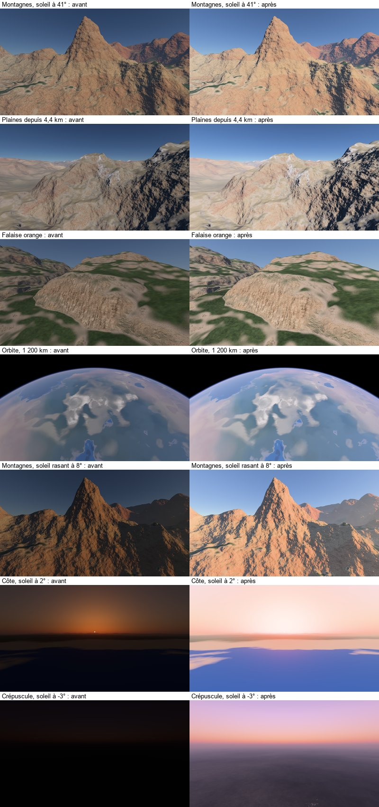

# Search: exhibition and the tone curve

Status: implemented, updated 2026-11-07. Code: `SceneExposure.hlsli` and `ToneMap.hlsl`, settings in `PlanetSettings.hlsli`. Flight review: `tools/tests/2026-11-07-exposition-sans-lissage.txt`. Sources at the end of the file.

## 1. Conclusion

**The simplest and most robust choice: an exposure set on the illuminance, a photoreceptor curve on the strongest channel.**

**Exposure measures the light that falls, not the light in the image.**
- The ground reference reads the solar beam and diffuse sky; as the air falls below the observer, direct sunlight is metered at the observer instead.
- The transition uses the existing air fraction `1 - exp(-h / 8 km)`.
- Above the atmosphere, solar rays first intersect its outer sphere before using the transmittance table; rays missing it cross vacuum.
- The apparent planetary horizon follows the observer altitude; ground sunset must not trigger orbital night exposure.
- Near an orbital eclipse, eight strips average the visible solar disc through the air; analytic disc coverage retains a thin crescent after the centre ray is hidden.
- A gray card facing the sun shows its reflectance, regardless of its height. In low sunlight, the illuminated faces keep their clarity; the flat ground and shadow darken, as in a photo exposed for its high lights.
- It never reads the image: turning the camera does not change it. Neither pumping, nor flicker, by construction.
- Below sunset, the meter follows twilight, natural night light and the moons; a perceptual key keeps night dark (`spec-ciel-celeste.md`).
- **A setting:** compensation, in EV, as on a camera. An EV: the middle floor of our day views is equal to that of sunny photos.

**The curve is that of the photoreceptors: x^a / (x^a + k^a).**
- This is the Naka-Rushton law. Lots 2016 and the new ACES 2 are going.
- It goes through the registration plate, 0,18 to 0,18: the exposure alone decides the clarity.
- His foot dives into the shadows, his shoulder softens the high lights towards white, without cutting.
- Applied to the strongest channel, the ratios between channels kept: the shades do not turn.
- What it removes at the strongest channel whitens the color, like an overexposed film: the desaturation of Khronos PBR Neutral, 0,15.
- **A setting:** the contrast has = 1,5: a slope of 1,23 to gray, the one needed for a screen in a dim room, 1,2 to 1,25.

**Dismissed:**
- **the histogram:** its measurement depends on the frame; even smoothed, it follows the frame, slower; snow becomes gray;
- **ACES 1, Hable:** curves per channel, saturated colors turn into high-lights;
- **AgX:** good, but per channel behind two matrices, more code, for a gain that the curve on the strong channel already gives;
- **Khronos PBR Neutral, our front curve:** without foot, by design; it adds no contrast;
- **a calibration on the screen, a color table 3D:** nothing to calibrate as long as the physics and the curve are sufficient; it would hide the errors of rules.

**Since the 2026-10-31, the compensation follows the altitude** (`spec-rendu-orbite.md`): +1 EV on the ground, that of the landscapes; 0 EV in orbit, that of the photos of the Earth, measured on "Blue Marble" of Apollo 17; between the two, the part of the air under the camera, `1 − exp(−h / 8 km)`.

**Since 2026-11-03, the incident meter also reads shelter under forest crowns** (`spec-rendu-vegetation.md`). The existing habitat probe supplies canopy cover and height. A bounded response of at most two stops follows its porous sun/sky transport, fades above the canopy and remains neutral at night. It converges in 0.35 s without reading the frame. Open-ground and orbital calibration remain unchanged; this camera response does not replace radiance transport or alter the linear temporal history.

**Since 2026-11-07, night has a metered response** (`spec-ciel-celeste.md`). The key decreases towards 0.03/0.69 in darkness. Stellar points and diffuse galactic light use a separate bounded eye response. Resolved bright bodies cap local exposure at 8. These display responses do not modify physical surface illumination. The previous sunset clamp is archived in `log/recherche-tons-exposition-historique.md`.

**Direct response restored, 2026-11-07**
- Apply the incident meter directly to tone mapping and cockpit dimming.
- The user rejected the asymmetric temporal filter after flight review; the experiment is archived in `log/recherche-tons-exposition-historique.md`.
- The observer-altitude solar meter, visible-disc integration and previous orbital overexposure correction remain active.

## 2. What we had

**No exposure:** a radiance of 1 gives white.
- The sun is worth π at the top of the atmosphere: a white surface facing it, out of the air, has a radiance of 1.
- This is the exposure of a camera in full sunlight, the rule of the f/16, roughly. But it does not move when the sun sets: the image goes out.

**The curve of Khronos PBR Neutral, without its black shift:** identity under 0,76, then faded to white.

**Measured on our daytime views, against sunny photos** (section 8):
- **the ground, two and a half times too dark:** median 0,096 in linear luminance, against 0,266;
- **short shadows and span:** 1,1 EV from median to 5e percentile, versus 4,6; 2,7 EV from 5e to 95e, versus 5,8;
- **at low sun, the image goes out:** mid-floor 0,023 to 6 and 8°; 0,002 at sunset.

## 3. Physical exposure

**The luminescence index, EV100.**
- EV100 = log2(N²/t) − log2(S/100), with N the aperture, t the exposure time, S the sensitivity ISO.
- **The rule of the f/16:** in full sun, f/16 and 1/S s. Or EV100 ≈ 15.

**Lagarde and de Rousiers 2014, Frostbite, reprinted by Filament:**
- **Sensor saturation:** Lmax = 78 / (q S) × N²/t, with q = 0,65. Or Lmax = 1,2 × 2^EV100 to ISO 100.
- **Exposure:** the luminance divided by Lmax; 1 is the sensor white.
- **Reflective positioner:** EV100 = log2(L S/K), K = 12,5, that of Canon, Nikon and Sekonic.
- **Incidental position meter:** E = 2,5 × 2^EV100 in lux, plane sensor, C = 250; 3,4 × 2^EV100 with half sphere, C = 340.

**The standard of the devices, ISO 12232:**
- **Standard output sensitivity:** the exposure that gives 118 on 255 in sRGB, or linear 0,18, to a gray card.
- **Saturation sensitivity:** 78/H vs. 10/H. The sensor white is 7,8 times, 3 EV, above the gray card.
- A white card, 5,5 once the gray, keeps half-EV of margin.

**At home.**
- The sun at the top of the atmosphere, π, is worth 128 000 to 134 000 lx depending on the sources: one unit is worth about 42 000 lx.
- The gray card is worth 0,18 × E / π, with E the light it receives. The π/E exhibition shows it to 0,18: the convention of the standard. Our E is that of a map facing the sun (section 4).
- At noon, E is about π, and π / E about 1: our absence of exposure was that, for a sun at the zenith.

**The contrast between sun and shadow** (measurements of Filament, California, March, incident exposure meter):
- at 10 h, sun and sky 120 000 lx, sky alone 20 000 lx: 6 for 1, 2,6 EV;
- to 17 h 30, 90 000 against 9 000 lx: 10 for 1, 3,3 EV.
- A cast shadow is therefore 2,5 to 3,5 EV under the sunny ground, before the curve. Our renderings do not have cast shadows yet.

## 4. Automatic exposure, eye adjustment

**By histogram: Unreal.**
- A histogram of 64 classes of the logarithm of the luminance of the image; the mean between two percentiles, 70 to 80 % and 80 to 95 % recommended.
- A speed of rise and descent, in EV per second; bounds in EV100.
- A compensation, and a compensation curve according to the EV of the scene: dark scenes remain darker.

**Its defect, of nature: the measure depends on the frame.**
- Turning the camera from the sky to the ground changes the average: exposure follows. Smoothed, it follows slower; it follows still. It's pumping.
- Snow turns gray, a dark forest turns gray: the reflective exposure meter brings everything back to medium gray.
- Half of the frame is black space: it must be excluded by the percentiles.

**illuminance: Ghost of Tsushima.**
- Patry 2021: an exposure "mainly based on the illuminance"; the luminance only when high lights exceed a threshold, fire or reflections.
- Why: on inFamous, the loop between the exhibition and the albedoes had pushed the artists towards too dark albedoes.

**The eye.**
- The cones respond in I^n / (I^n + σ^n), Naka and Rushton 1966; σ follows adaptation. Reinhard and Devlin 2005 derive a tone operator from it.
- A rising solar crescent can change incident illumination rapidly even with a continuous geometric meter; the current rendering retains the direct response selected in flight.

**From orbit to ground.**
- Flight simulators publish little about their exhibition.
- What the problem imposes: from orbit, the frame is half black, and the planet covers large differences of illuminance. A measure on the image overexposes the planet, except to exclude black.
- The incident meter avoids framing dependence; direct sunlight and the planetary horizon must follow the observer altitude.
- A sunlit orbital observer retains daylight exposure even above the night hemisphere; genuine planetary shadow permits dark adaptation.

**The exposure meter turned towards the sun, not flat.**
- **Tested first flat,** the illuminance from a horizontal ground: at noon, the two are equal; at low sun, the flat ground receives almost only the sky, and the exposure went up from 3 to 4 EV.
- **Measured:** low suns came out clearer than noon, median ground 0,35 against 0,27, sky towards the sun cut off on 11 to 15 %; in flight, a milky mist, nothing more of the evening.
- **Faced to the sun,** the card receives the full beam: the illuminated faces keep their clarity, the rest darkens with the sun. This is the exposure of a photographer protecting his high lights in the setting sun.
- **The sky is counted as on a flat ground:** an approximation; it weighs little in front of the beam, except at nightfall, where it remains alone.
- **Try, not keep:** the clear sky of the map, the halo and the low sky in front of it, in the sky table. 0,1 EV of less day, 0,3 to 0,5 at low sun; sunset remains clear. A small gain for one more table.

## 5. The filmic curves

**Why a foot: the image is not seen as the scene.**
- An sRGB screen makes 80 cd/m², in a dimly lit room. The image must have more contrast than the scene.
- Hunt: a rendering gamma of about 1,0 in light ambient, 1,25 dimmed, 1,5 in dark.
- BT.2100: the HLG television adds a gamma system from 1,2 to 1 000 cd/m².

**ACES 1 :**
- curve per channel in primary AP1; log-log slope to gray of about 1,55;
- per channel, the saturated colors turn upward: blue to purple, red to orange; ACES adds ad hoc corrections.

**ACES 2, 2024 :**
- the curve, a Michaelis-Menten, only touches the clarity J of an appearance model, Hellwig 2022: the hue is kept;
- 0,18 gives 10 cd/m² on a screen of 100, 1,0 gives 45,8 and 2,0 gives 64;
- gray gradient imposed under 1,55.

**AgX, Sobotka; Blender 4.0 default, instead of Filmic:**
- a logarithmic encoding around the gray 0,18, then a sigmoid per channel;
- before it, a matrix brings the primary colors closer to gray: the bright colors go towards white without crashing on six shades, the defect of Filmic;
- the shades move a little, by this matrix; an inverse matrix, a polynomial: more code.

**Talk 2010, Uncharted 2:**
- a rational fraction per channel, six constants and a blank at 11,2: foot and shoulder;
- per channel, the saturated colors turn; Hable 2017 replaces it with powers by pieces, with direct settings.

**Khronos PBR Neutral, 2024 :**
- identity under 0,76, minus a black shift of 0,04; above, fading to white and desaturation of 0,15;
- tint kept: everything remains in the plane of color and white;
- made to keep the basic colors recognizable: no foot, no contrast.

**Lots 2016, AMD:**
- z = xZ^a, then y = z / (zZ^d b + c), b and c chosen to pass through (grey, gray) and reach 1 to white;
- its example: gray 0,18 to 0,18, white 64, contrast to = 1,3, shoulder d = 0,995;
- applied to the maximum of r, g, b, the kept ratios; a path to the white by cross-talk;
- clarity is set before the curve, by gray: a gamma after it changes contrast and saturation.

**Our curve: Lottes' curve, shoulder d = 1, without white point.**
- With d = 1, it is the Naka-Rushton law, asymptote 1: a single adjustment, a.
- The white point and d do not change almost anything: from 8 to 64, less than 0,02 on the sRGB screen, except all at the top.
- Log-log slope: a in the shadows, 0,82 a in gray, then decreasing.

## 6. Calibration referred to the display

- **What it is:** correct colors after curve, on screen values, by curves or table 3D, like a photographer on his JPEG. The inverse of the calibration referred to the scene, before the curve, in linear light.
- **For:** we set what we see.
- **Cons:** no physical meaning; specific to a screen; a table of 32³ loses 2 to 3 bits, according to Lottes.
- **Nothing for us now.** The color comes from the rules: air, albedo, light. A table would hide their errors (`principes.md`).

## 7. Calibrate on photos

**What we compare:** the luminance linear of the ground, its percentiles, on the photos `docs/images/cible-*.jpg` and on our views.
- **Photos:** the floor under a line laid at the main per photo; three covered, shown but out of the median.
- **Our views:** the ground and the sea exactly, by the diagnostic view of the sea.
- **Measurements:** median; shadows, from median to 5e percentile, in EV; extent, from 5e to 95e; sky; cut-off.

**The limits.**
- The exposure of the photos is unknown; each camera has its curve and local contrast.
- Our renderings have no cast shadows: their shadows remain lighter than those of the photos, regardless of the curve. We do not adjust the curve to compensate for them.
- The median of the soil depends on the albedo: the compensation regulates the whole, not a material.

## 8. Measures

**The views:** `tools/tests/2026-10-24-tons.txt`, those of atmospheric depth, plus low suns, a twilight and the terminator seen from orbit. luminance linear ground, median of views.

|  | p5 | p25 | p50 | p75 | p95 | shadows | Extent | sky |
|---|---|---|---|---|---|---|---|---|
| Sunny photos, 6 | 0,011 | 0,105 | 0,266 | 0,391 | 0,571 | 4,6 | 5,8 |  |
| Before, day, 7 views under 20 km | 0,036 | 0,059 | 0,096 | 0,175 | 0,262 | 1,1 | 2,7 | 0,113 |
| After, day | 0,095 | 0,167 | 0,254 | 0,451 | 0,520 | 1,3 | 2,9 | 0,296 |
| Before, sun from 2 to 8°, 4 views | 0,009 | 0,012 | 0,023 | 0,058 | 0,088 | 1,4 | 3,6 | 0,047 |
| After, sun low | 0,118 | 0,140 | 0,224 | 0,412 | 0,638 | 1,1 | 2,5 | 0,676 |

- **Day:** the median joins that of the photos; the 75e and the 95e percentile, close to 0,06.
- **The shadows remain short:** 1,3 EV vs 4,6. It is the cast shadows that are missing, not the curve: at 1,8 of contrast, the best fit, the 5e percentile would still only go down to 0,07.
- **The low sun** is no longer extinguished, and remains a little darker than the day. Towards the sun, the sky is shattered: 9 % of the image at 6°, 16 % at sunset.
- **Twilight at −3°:** 0,050 ground, five times darker than day; the sky keeps its colors.
- **From orbit:** ground 0,27 to 160 km, 0,33 to 1 200 km; space remains black.

**The choice of two settings, on these measures.**
- **The offset:** our images inverted by the curve then reexposed give a median day ground of 0,15 to 1/3 of EV, 0,25 to 1 EV, 0,32 to 4/3 of EV; the photos, 0,27: 1 EV, a camera snap.
- **Contrast:** at equal median, the variance from 25e to 75e percentile is 1,2 EV to 1,3 contrast, 1,4 EV to 1,5; photos, 1,9. Beyond 1,5, we would compensate the absent shadows: to resume with them.

**The stability.**
- **Turning the camera, `banc_tons.py tour`:** from −20° to 70° of inclination, at 800 m, the sky at 10° above the horizon does not move, 0,00 EV; the ground at 25° below, 0,02 EV. The whole image varies from 1,36 EV: what a measured exposure on the image would have followed. At low sun, 2,10 EV, and still 0,00 and 0,01.
- **Descend, `banc_tons.py descente`:** from 1 500 km to 30 m, vertically on a mountain. The exposure depends only on the sun at the nadir: it does not move. Against the front, the center of the image gains from 1,37 EV in orbit to 1,08 EV on the ground, without jumping: 0,07 EV at most one height to the next, the shape of the curve.
- **The flicker, `banc_tremblement.py`:** with smoothing, 0,16 → 0,18 and 0,09 → 0,12 levels on two views; the image there is 1,5 to 1,6 times clearer in sRGB levels. The same jitter, shown more clearly; nothing new sparkles.

**The quality benchmark,** 12 places, before and after, the same places and the same suns:
- **the snow gains its detail:** fine detail median +3 to +6 dB, towards that of the photos; the curve before it crushed above 0,76;
- **the rest is almost unmoving:** scale hole p95 at 0,2 dB near, repeat p95 at 0,02 near; fine detail of grass −0,6 at −1,6 dB;
- **beyond the 10 % rule:**
  - the p95 scale hole of the snow at 800 and 3 000 m, +0,6 and +0,5 dB: its detail, now visible, shows its holes; the photos have 3,5 dB;
  - the p95 repetition of the sand at 50 m, 0,12 → 0,28: the worst crop is 0,31 before as after; on 60 crops, the p95 switches from one crop to another;
  - the p95 mutation at 12 and 200 m, 0,016 → 0,019 and 0,130 → 0,144: the foot amplifies the relative deviations in the dark; it decreases at 800 and 3 000 m.
- **Diagnostic views** were going through the front curve, their white at 0,88; with exposure, it would have varied with the sun, and the benchmark chose other crops. They no longer pass through exposure or curve: white to 1, regardless of the sun.

## Sources

- Lagarde S., de Rousiers C., « Moving Frostbite to Physically Based Rendering 3.0 », SIGGRAPH 2014, notes de cours, the physical camera.
- Google, Physically Based Rendering in Filament, the physical camera and the measurements of sun and sky.
- ISO 12232:2019, sensitivity of digital cameras, SOS and saturation; ISO 2720, calibration of exposure meters, K and C.
- Epic Games, "Auto Exposure in Unreal Engine", documentation.
- Patry J., « Real-Time Samurai Cinema: Lighting, Atmosphere, and Tonemapping in Ghost of Tsushima », SIGGRAPH 2021, Advances in Real-Time Rendering.
- Naka K. I., Rushton W. A. H., « S-potentials from colour units in the retina of fish », J. Physiol. 185, 1966.
- Reinhard E., Devlin K., « Dynamic Range Reduction Inspired by Photoreceptor Physiology », IEEE TVCG 11(1), 2005.
- Lottes T., « Advanced Techniques and Optimization of HDR VDR Color Pipelines », GDC 2016.
- Hable J., "Uncharted 2: HDR Lighting", GDC 2010; "Filmic Tonemapping with Piecewise Power Curves", 2017.
- Academy, ACES 2.0 Output Transforms, technical documentation, the tone curve.
- Khronos Group, "PBR Neutral Tone Mapping", 2024.
- Sobotka T., AgX; Blender 4.0, release notes, color management.
- Hunt R. W. G., « The Reproduction of Colour », rendering gamma according to the mood.
- ITU-R BT.2100, the gamma system of HLG.
