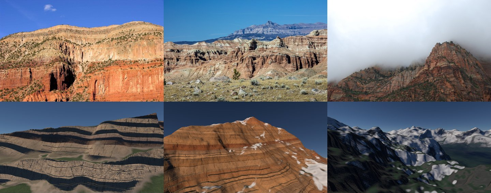
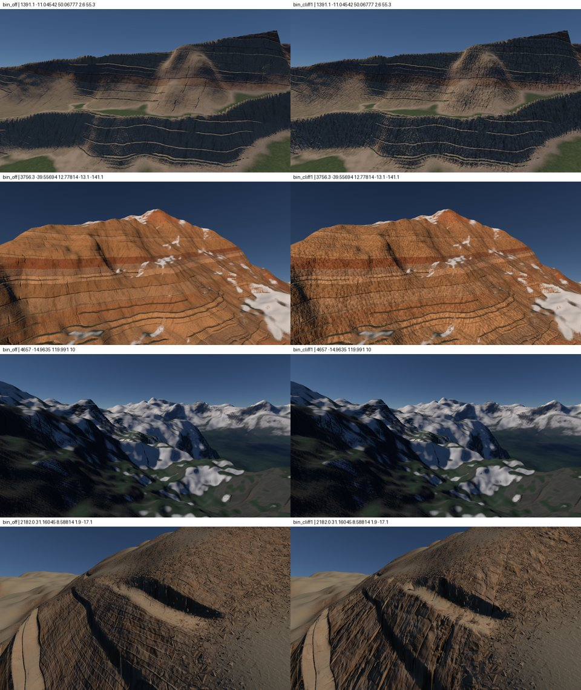

# Spécification : des parois minérales de 100 m à 1 km

Statut : recherche le 2026-10-23 ; deux voies séparées, le rendu d'abord. **En place :** la photo de paroi et les strates calculées au pixel. **Retirées le 2026-10-24 :** les bandes cassées, leurs failles et les familles de roche. La méthode est désormais celle de `spec-texturage-universel.md`. Les options, essais et mesures dépassés sont dans `log/spec-parois-minerales-historique.md`. Fait suite à `log/spec-parois.md`, dont les gradins restent sous le tag `piste/parois-gradins`. La géométrie reste à complexplanet : `geometrie.md`.

## Le constat

- **De près, le relief accidenté convient.** Le fourmillement et le scintillement restent à régler, plus tard.
- **De 100 m à 1 km, les parois font tissu :** des bandes droites, continues et régulières sur une surface lisse. Elles ne font pas minéral.
- **On tourne en rond :** couleurs des strates, arrondis, gradins n'y ont rien changé. C'est la méthode de base qui est en cause.

## Le diagnostic, face aux photos

- **Sur une vraie paroi, la structure dominante est perpendiculaire aux strates :** ravines, cannelures, diaclases, coulures de vernis sombre.
- **Les strates y sont interrompues :** recoupées en V par les ravines, cachées par les éboulis et la végétation des vires, d'épaisseur variable, décalées par les failles.
- **Les couleurs changent par grandes masses :** rouge en bas, blanc en haut à Zion, et peu de bandes franches.
- **Les creux se lisent par l'ombre :** alcôves et ravines sont noires.
- **Chez nous, c'est l'inverse :** les bandes sont nombreuses et continues, et rien ne les coupe.

**La méthode en cause :**
- **Nous partons des strates pour faire la paroi.**
- **Dans la nature, la paroi naît de l'érosion,** qui creuse à travers des couches planes. Les bandes en sont la conséquence : c'est la règle des V des géologues.

## L'état de l'art

**Le filtre d'érosion par point,** la piste la plus neuve.
- **Ce qu'il fait :** des ravines et des crêtes ramifiées, alignées sur la pente, posées sur n'importe quelle fonction de hauteur. Chaque point s'évalue seul, sans simulation : rapide, adapté au GPU, calculable par morceaux. [Johansen, mars 2026](https://blog.runevision.com/2026/03/), après [Clay John 2018](https://www.shadertoy.com/view/MtGcWh) et [Fewes 2023](https://www.shadertoy.com/view/7ljcRW).
- **Le principe :** des rayures orientées par le gradient descendant, découpées en cellules à la Worley, fondues entre voisines, en octaves qui héritent chacune de la pente de la précédente.
- **Ses pièges :** direction confuse sur les crêtes et les fonds plats, drains qui s'arrêtent à mi-pente. Sur une paroi, la pente forte rend la direction nette.
- **Licence :** le code de référence est en MPL 2.0. On le réécrit depuis la description, sans copier le code.

**Les autres pistes procédurales :**
- **Strates cassées en plaques :** le nœud [Stratify de Gaea](https://docs.quadspinner.com/Reference/Erosion/Stratify.html) fait des sous-strates locales entre plaques brisées, et non des terrasses.
- **Diaclases et blocs :** [Paris et al. 2020](https://hal.archives-ouvertes.fr/hal-02926218), [Peytavie et al. 2009](https://diglib.eg.org/handle/10.2312/CGF.v28i7pp1801-1809). Volumiques et hors ligne ; transposables en Voronoi anisotrope.
- **Ombre des creux :** les [screen-space shadows de Bend](https://www.bendstudio.com/blog/inside-bend-screen-space-shadows/), livrés dans Days Gone.
- **Coulures et vernis :** un bruit étiré dans le sens de la pente sur l'albédo, presque gratuit. Base physique : [Dorsey 1996](https://graphics.stanford.edu/papers/flow).

**Les jeux :**
- **Les falaises lisibles y sont des maillages photogrammétriques :** [Far Cry 5](https://gdcvault.com/play/1025557/Procedural-World-Generation-of-Far), [Valley of the Ancient](https://dev.epicgames.com/documentation/unreal-engine/valley-of-the-ancient-sample-game-for-unreal-engine), [Battlefront](https://gdcvault.com/play/1023272/Photogrammetry-and-Star-Wars-Battlefront).
- **Star Citizen** pave des tuiles de hauteur selon la pente et la géologie ([Adobe](https://www.adobe.com/products/substance3d/magazine/star-citizen-texturing-sci-fi-open-world-game-substance.html)).

**Écartés :**
- [Dendry](https://www.cs.purdue.edu/cgvlab/www/resources/papers/Gaillard-2019-Dendry_A_Procedural_Model_for_Dendritic_Patterns.pdf) : 10 s pour 512².
- Le neuronal, [Terrain Diffusion 2025](https://arxiv.org/html/2512.08309v3) : des secondes par région, pas par image.
- [Le fBm à dérivées](https://iquilezles.org/articles/morenoise) : il lisse les fortes pentes.

## L'hybride : les données libres

**Le relief réel, 1 m ou mieux :**
- **[IGN LiDAR HD](https://cartes.gouv.fr/catalogue/dataset/IGNF_MNT-LIDAR-HD) :** 0,5 m, Licence Ouverte 2.0, dalles de 1 km d'environ 16 Mo. Vercors, Calanques, Verdon.
- **[USGS 3DEP](https://apps.nationalmap.gov/downloader/) :** 1 m, domaine public. Grand Canyon, Yosemite.
- **[swissALTI3D](https://www.swisstopo.admin.ch/en/height-model-swissalti3d) :** 0,5 m, données libres avec mention. Eiger, Lauterbrunnen.

**Le piège :** un modèle d'élévation aérien n'a qu'une hauteur par point. Une paroi verticale y tient en quelques pixels. Pour la paroi elle-même, il faut un nuage de points pris de face :
- **[San Gabriel et San Jacinto](https://doi.org/10.5069/G96H4FKG) :** CC0, parois de 10 à 300 m, environ 1 000 points par m², 4 Go, avec photos de face.
- **[El Capitan](https://doi.org/10.5066/P1YT5RK3) :** CC0, lidar terrestre sur environ 1 km² de granite vertical.

**Les surfaces et maillages, CC0 chez Poly Haven :**
- **Surfaces :** `marble_cliff_01` à `06`, de 4 à 20 m de paroi, avec déplacement.
- **Maillages :** `coastal_cliff_04`, une falaise de 87 m.

**Non redistribuables dans un dépôt public :** Megascans et Fab, Textures.com.

**L'usage chez nous :** un patch de relief réel, dont on ne garde que les détails fins, orienté par la pente, pavé sans répétition, de 1 à 30 m. **Le risque :** la répétition se voit à 1 km.

## Deux voies séparées

**La géométrie vient de complexplanet** (`geometrie.md`). Le problème des parois se traite d'abord dans le rendu ; ce qui change la forme est un sujet à part.

### La voie rendu : ce qui est en place

Ce qui rend une paroi minérale de 100 m à 1 km sans toucher la forme. Les pixels y couvrent de 8 cm à 1 m. Des cinq options étudiées le 2026-10-23, la photo de falaise reste. Les bandes cassées, leurs failles et l'ondulation des strates sont retirées le 2026-10-24 avec les familles de roche, `jalon/16-une-roche`. Les options, leurs mesures et les correctifs du premier vol sont dans `log/spec-parois-minerales-historique.md`.

**La géométrie de proximité est retirée du code** le 2026-10-30, relief des matériaux et gradins ; tag `piste/parois-gradins`. Le rendu se règle sur la seule géométrie de complexplanet (`geometrie.md`).

**Les strates au pixel.** Calculés par sommet et filtrés par la maille, les strates, leur décalage et les lentilles laissaient leurs octaves apparaître à vue quand les mailles rétrécissaient : une maille couvre environ 13 pixels. Ils sont calculés dans les pixels et filtrés par leur taille ; la géologie, régionale, reste aux sommets (`journal-planete.md`, 2026-10-23). La règle est dans `principes.md`.

### La photo de falaise

- **La photo :** `marble_cliff_04` de Poly Haven, CC0, une paroi de 12,7 m photographiée de face, aux fractures et cannelures verticales. Elle est préférée à `marble_cliff_05`, 20 m, plus isotrope et prise de dessus.
- **Où :** la tuile de la roche, `ROCK_TILE` = 64/5 m, au lieu de la tuile générée de 8 m ; la tuile fine reste générée. Depuis le 2026-10-24, toute la roche est cette photo, et la roche de moins de 45° prend `marble_cliff_05`, le même marbre pris de dessus (`journal-planete.md`).
- **Ce qu'elle garde :**
  - toutes ses longueurs d'onde jusqu'à la tuile, sans le passe-haut à 50 cm du sable ;
  - 30 % de ses variations de teinte : les strates donnent la couleur ;
  - 1,2 m de relief par unité, ce qui donne à ses pentes l'écart type de la règle universelle de la roche, `STONE_SLOPE_SIGMA`.
- **Ce qu'on voit :** une matière fracturée et cannelée sur les parois raides et à la corniche, plus minérale. De 300 m à 1 km, les bandes de strates dominent encore.
- **Mesures :**
  - tremblement avec lissage 0,40 → 0,43, 0,19 → 0,23, 0,17 → 0,16 à la corniche ;
  - coût du rendu inchangé ;
  - descente de la roche inchangée de 800 à 8 km.

### La voie géométrie, à part

Sur une branche, à reprendre après le rendu, et à décider explicitement : `geometrie.md`, famille « remplacement ».

**Le filtre d'érosion, essayé le 2026-10-23,** est mis de côté : tag `piste/erosion-filtre`. Ce qu'il donnait et coûtait : `log/spec-parois-minerales-historique.md`.

**Les autres pistes :** patchs de relief réel, dalles IGN LiDAR HD dans `../donnees-terre/lidar-hd`, hors du dépôt ; rochers semés, `log/spec-parois.md`, option 3.
