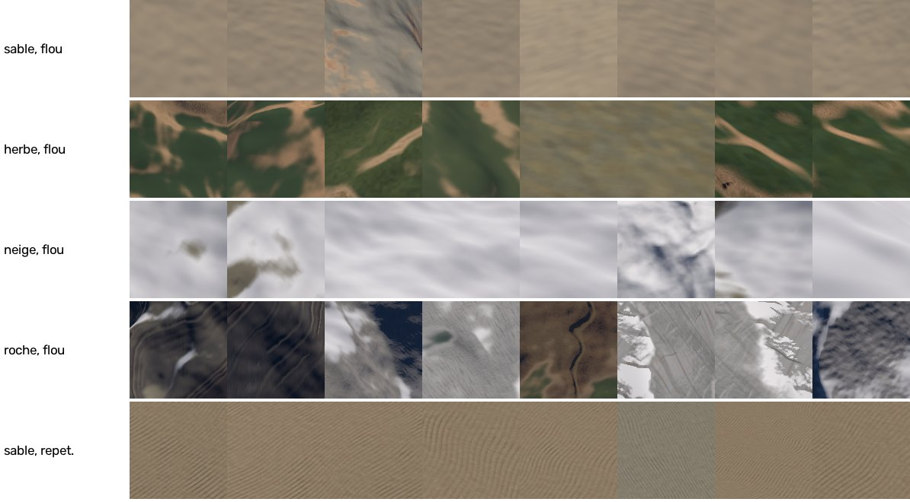
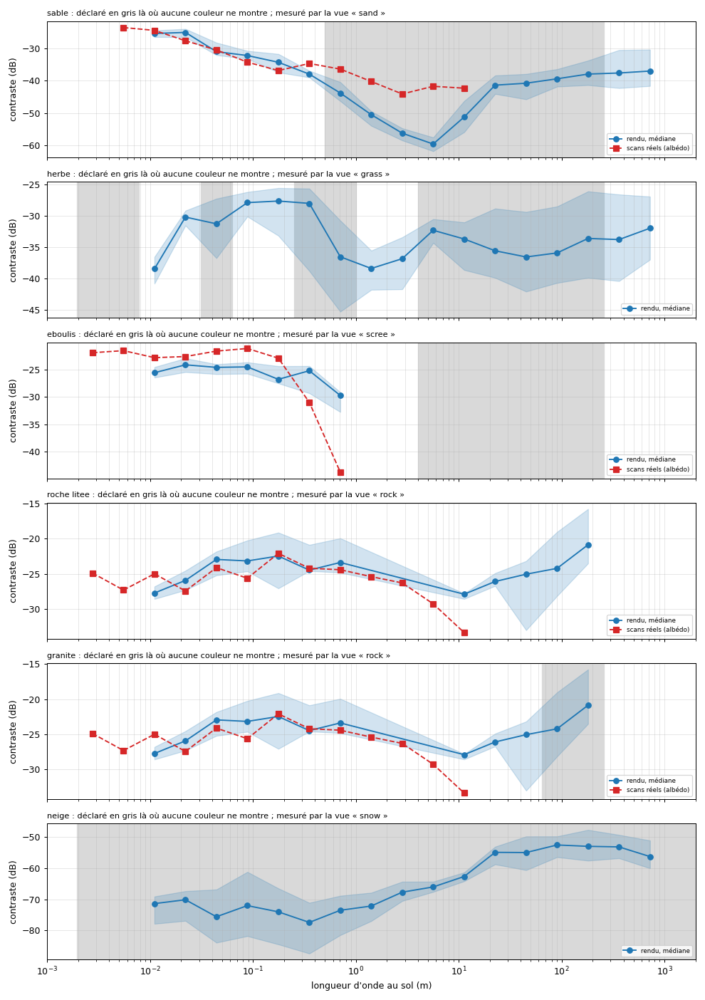
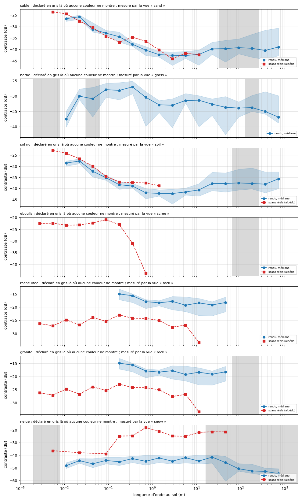
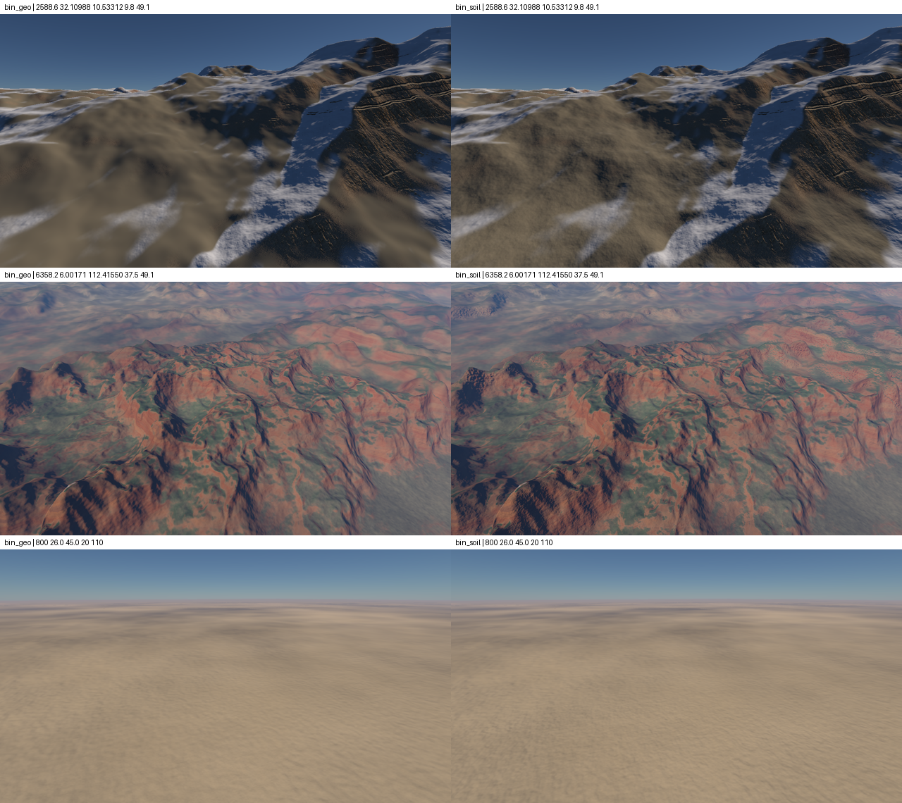

# Specification: a universal texturing, by scales, verified by benchmark

Status: validated the 2026-10-23; steps 1 and 2 done, step 3 in progress. Replaces the method of view-by-view corrections. Recalls the plans of `spec-photos-par-echelle.md` and `spec-parois-minerales.md`.

## The finding

**Stagnating:** each correction adjusts the reported view, and the next mountain shows the same family of defects. Recent cases:
- **the blurred sand** of 250 m a few kilometers;
- **the "sparadraps":** strips and crevices that stop net;
- **the wire mesh** of cracks on granite;
- **the strips that slip** at the approach.

**Three causes of method:**
1. **No material has a complete and declared detail scale.** Each stacks layers added as needed, with holes between them.
2. **The rules exist, but there is no verification that they are kept everywhere.** Control is through the eye, one view at a time.
3. **Faults are first seen from far away and elsewhere,** where no one looks at the time of correction.

## The audit: what covers each scale, material by material

Common to all: the color of the biome, beyond 200 km; a noise of clarity of 8 km per pixel, ±15 %; the grain of lighting of the octaves of complexplanet that the grid cell does not carry.

| Material | What covers it | Hole |
|---|---|---|
| Sand | Fine grain under 3 cm; wrinkles of 12 cm; photo `sandy_gravel_02`, limited to 50 cm | of 50 cm per kilometre |
| Grass | strands, tufts, spots of 2 m; bumps up to 4 m, in light | from 4 m per kilometre |
| scree | tile generated by 4 m | from 4 m per kilometre |
| Granites, basalts | tile of 8 m; structures of 64 m | from 64 m per kilometre |
| layered rock | Photo of 12,8 m; structures of 64 m; strata up to 300 m; plates of 128 m | covered, but clear stops |
| Badlands | the marble photo of the layered rock | false material |
| Snow | no texture | all scales |

## What the industry is doing

Search for the 2026-10-23. No studio writes "content in every octave" word for word, but they all converge towards this architecture.
- **Stages per scale:** a macro color per kilometer, a meso from 10 to 100 m, a micro from 1 to 4 m. [Frostbite, Andersson 2007](https://www.advances.realtimerendering.com/s2007/Andersson-TerrainRendering(Siggraph07)-CourseNotes.pdf), [Wildlands](https://80.lv/articles/landscape-and-material-pipeline-of-ghost-recon-wildlands/), [Star Citizen](https://www.adobe.com/products/substance3d/magazine/star-citizen-texturing-sci-fi-open-world-game-substance.html).
- **A layer is the strip missing from the top layer:** detail texture is defined as what is missing at the coarser level. [Patent SGI](https://patents.google.com/patent/US5471572)
- **Zero-average bands do not alter scales above:** no jump when a band is erased. [Pixar patent](https://patents.google.com/patent/US7672476), [Proland](https://proland.inrialpes.fr/doc/proland-4.0/terrain/html/index.html)
- **A band too thin for the pixel is removed,** and its variance goes elsewhere: within the limits, in the roughness. [Lagae 2010](https://lirias.kuleuven.be/retrieve/104878), [LEAN](https://userpages.cs.umbc.edu/olano/papers/lean/)
- **Against repetition:** shift and rotation per tile, mix that keeps average and variance, hex-tiling. [Quilez](https://iquilezles.org/articles/texturerepetition), [Heitz and Neyret 2018](https://highperformancegraphics.org/2018/best-paper/), [Mikkelsen 2022](https://jcgt.org/published/0011/03/05/paper.pdf)
- **A single copy covers only a range of scales:** several are needed, chained, for a continuous zoom. [Han 2008](https://www.cs.columbia.edu/cg/mts/)
- **The blurred sand symptom is known elsewhere:** Flight Simulator players report it. [Forum MSFS](https://forums.flightsimulator.com/t/ground-textures-are-blurry-lod-system-is-too-aggressive-and-loss-of-detail-in-2024-streamed-scenery-and-clouds-looks-worse-than-2020/676315?page=53)

## The rule: one stack of strips per material

**A material is a stack of strips, from millimeter to kilometer, about 22 octaves, without hole.** It's data, not code.

- **A band declares:** its source, procedural, generated tile or photo; its wavelengths; its standard deviation per channel, in color and slope.
- **Coverage:** the largest wavelength of one band exceeds the smallest wavelength of the next band. A validator, outside the engine, rejects any hole-in-the-wall battery. The current sand would fail.
- **Amplitude follows a law per material:** the standard deviation of an octave as a function of its wavelength, measured on photos of the material, as `STONE_SLOPE_SIGMA` is already for the slope of the rock.
- **Each band is zero average:** its average belongs to the top band, up to the biome palette.
- **One erasure rule for all sources:** the weight of a tape is `OctaveFade(log2 λ, log2 pixel)`, the one that the noise functions already have. Tiles, photos and noise functions erase the same, without distance threshold.
- **What the pixel loses is not lost:** the variance of the erased bands broadens the boundaries between materials (`SpreadStep`, the universal rule) and, eventually, the roughness.
- **Against repetition:** the tiles keep the paving offset and turned of `ProjectMaterial`, to the mixture that keeps the variance; each band is modulated by the band of the top, which masks its period.
- **No structure stops clearly:** a band, a crevasse, a stratum ends up thinning or fading, over a length of at least several times its width. This is the rule of "sparadraps"; flaws and lenses are subjected to it.

**What we already have:** octave erasure (`OctaveFade`), universal limit rule (`SpreadStep`, `SlopeShares`), variance-keeping paving (`ProjectMaterial`), photo loading by scale (`kScans`). **What is missing:** the declared stack, the validator, the sources of the bands from 1 m to 1 km, and the benchmark.

**What it replaces:** the fine tile, the coarse tile, the 64 m tile and the noise functions added on a case-by-case basis become a generic stack, read by a single function.

## The benchmark: measuring instead of looking

Search for the 2026-10-23. No tool covers these defect families alone; the literature provides one brick per family, in Python. No published benchmark samples massively places: ours is to be built.

**Does the 2026-10-23:** `tools/banc_qualite.py`, on the list mode of the engine (`MYPLANETENGINE_BATCH`), which chains hundreds of views in a launch, without window: about 1,3 s per view, 25 places in ten minutes.

```
python tools/banc_qualite.py <exe> <dossier> [--sites 25] [--seed 1] [--before tools/banc_qualite_reference.json]
```

**Sampling:**
- **places drawn by material:** eight times more candidates than places, seen from 3 km vertically in the view of each material; on land, an equal share of places for each, where it covers the most;
- **each place looks to where its material shows the most,** among eight caps, at 35° below the horizon;
- **Five heights above ground:** 12, 50, 200, 800 and 3 000 m;
- **crops of 128² pixels,** assigned to the visible material covering 70 %, snow covering the rest, water excluded; masks taken from `MYPLANETENGINE_VIEW` diagnostic views.

**The measures, one per defect family:**

| Default | Measure | Reference: real photos |
|---|---|---|
| Blurred, fine detail missing |  `hf` : energy of the finest octave of the crop, 2 to 4 pixels, against that of 16 to 32 pixels, in dB; a natural image has as much energy in each octave ([Spectra of natural images](https://pmc.ncbi.nlm.nih.gov/articles/PMC2929959/figure/F3)) | median +0,8 dB, p5 −6,9 |
| Hole of ladder |  `trou` : how much the weakest middle octave falls below its two neighbours, in dB | p95 3,5 dB |
| Repeat | highest local peak of detail autocorrelation, outside the central lobe, as long as it is; verified: noise 0,03, paved pattern 1,0 ([Lutz 2023](https://diglib.eg.org/bitstream/handle/10.1111/cgf14766/v42i2pp347-358_cgf14766.pdf)) | p95 0,18 |
| Straight stripes, seams | straight segments of more than 60 pixels on the ground ([LSD](https://ipol.im/pub/art/2012/gjmr-lsd), which cuts a wavy strip into pieces of less than 120 pixels) | — |
| Mutation at the approach | the same camera, the mesh twice thinner: relative change of light on the ground. What the mesh decides about the look changes when you approach; what the pixels erase according to their size does not matter, the camera is the same | — |
| flicker |  `tools/banc_tremblement.py`, fixed camera | — |

**Reference photos** are `docs/images/cible-*.jpg`, passed through the same crops. Remains to do: the comparison to photos of the same material, and the distance KID ([KID](https://arxiv.org/pdf/1801.01401)).

**Make regressions visible:**
- `qualite.json` and `rapport.md` at each pass, with the boards of the twelve most blurry and repetitive crops of each material;
- `--before` adds to the report the deviation to a previous passage; the reference is `tools/banc_qualite_reference.json`;
- a correction is accepted only if no p95 degrades by more than 10 %.

**The human eye remains judge of taste,** on some reference views, as advised by [Wronski](https://bartwronski.com/2019/08/14/how-not-to-test-graphics-algorithms/): a dozen golden images, the rest by measured invariants.

## The reference of the 2026-10-23

25 places, 5 by material, seed 1, state `5b5af34`. Full figures in `tools/banc_qualite_reference.json`. A wall there has rock and vires together, as we see it.



**Fine detail, `hf` median in dB, against +0,8 for actual photos:**

| Material | 12 m | 50 m | 200 m | 800 m | 3 000 m |
|---|---|---|---|---|---|
| Sand | +10,6 | +16,9 | −5,9 | −14,8 | −8,5 |
| Grass | −3,7 | −17,2 | −7,1 | −12,7 | −7,1 |
| Snow | −6,7 | −6,0 | −9,6 | −13,0 | −6,7 |
| Rock | −1,7 | 0,0 | −1,7 | +0,1 | — |

**The findings:**
- **Everything is blurred from 200 m to 3 km, except rock:** 6 to 17 dB of fine detail are missing. The rock stands close to the photos thanks to the cliff photo, the strata and 64 m structures, which cover its scales. This is the hole the audit foresaw.
- **Sand, close up, is sharper than nature,** +10 to +17 dB: the grain of the photo. Then nothing beyond 200 m, and an octave hole of 9 dB to 50 m, against 3,5 dB for photos.
- **Snow has a hole of 9 dB to 50 m:** it has no texture.
- **Repeat is low,** 0,16 to 0,32 against 0,18 for photos; except the wrinkles of the sand close up, 0,46, partly natural.
- **The mutation at approach:** when the mesh is thinning, the light changes from less than 1 % in median, but from 7 to 10 % at p95, from 200 m to 3 km. Places where the appearance still depends on the mesh, to be examined.
- **The scree are too little sampled,** 19 crops: the rock covers them almost everywhere; they will need dedicated places.

## Step 2: the declared stack and its validator

Make the 2026-10-23, without changing anything to the image.

**The declared pile,** `tools/bandes_materiaux.json`: for each material, each source detailed in the code, with its wavelengths, what it carries, color or light, and where it is in the code. The common sources, the local clarity, the grain of the relief and the relief of the mesh, are separated.

**The validator,** `tools/valide_bandes.py`, in two parts:
- **declared:** octave by octave, from 2 mm to 2 km, a source of color strong enough to be seen; the local clarity loses 38 % per octave towards the end and does not count anymore under 10 % of its strength, or under 256 m;
- **measured:** the engine is aimed at the ground at verticals of 1,5 m to 6 km, each height showing five octaves of known ground height; the rock and scree, which hold to the slopes, are aimed at 45° toward the wall. The contrast of each octave, the standard deviation of the logarithm of light in dB, is arranged by material and by octave of the world, next to the same measure on the actual scans of `../scans`, whose width is known. The scans have only their albedo, without sun.

```
python tools/valide_bandes.py --declared
python tools/valide_bandes.py <exe> <dossier> [--sites 15]
```

**The drawing of the sites** takes into account what covers each material: a rock under the snow does not count for the rock. A wall is measured as seen, including rock and vires, the view `rockall`.

### The result



**Declaration and measurement agree:** each declared hole is seen in the rendering. Figures in `tools/spectre_reference.json`, 20 places, seed 2.

| Material | Hole declared, no color | What the rendering measures | Difference to actual scans |
|---|---|---|---|
| Sand | from 50 cm to 256 m | a drop up to −60 dB at 4 m, between −25 dB per centimeter and −40 dB beyond 16 m | 16 to 18 dB under scans of 1 to 8 m |
| Snow | all scales | −70 to −77 dB up to 1 m; −53 dB beyond 16 m, the only light of the relief | 40 to 50 dB under other materials |
| Grass | from 25 cm to 1 m, from 4 m to 256 m | the lows at −37 dB to 1 m and from 16 to 128 m, compared to −28 dB between 1 and 25 cm | no grass scan |
| scree | from 4 m to 256 m | scans up to 25 cm; beyond, not enough views | — |
| layered rock, granite | from 64 to 256 m for granite | at the scan level of 8 mm to 50 cm, −21 to −28 dB of 8 to 128 m | None |

**What it fixes:**
- **The order of the step 3:** snow, then sand, then grass, then scree beyond 4 m; rock does not need it.
- **The target of each octave to fill:** the level of the actual scans of the material, or that of its neighboring octaves, which is about −25 to −40 dB.
- **Verification:** a filled octave rises in this graph; the quality benchmark confirms that it is seen on the screen.

**Limits:** scans have only albedo; snow and grass have no reference scan; rock lacks views from 1 to 4 m.


## Step 3: Fill in the gaps

### First pass, the 2026-10-23: the detail strips

**One single function for all materials,** `DetailBands` (`Materials.hlsli`): one octave of noise of planet grid gradient by wavelength, from `2^finest` to `2^widest` m.
- **Each octave tilts the ground with the same slope:** a self-similar relief, like that of nature, gives the same contrast to each octave.
- **Each octave changes the color by the same factor.**
- **Each octave is erased according to the pixel size,** like all noise (`OctaveFade`).
- **Only parameters differ by material,** in `PlanetSettings.hlsli`: `SNOW_BANDS`, `SAND_BANDS`, `GRASS_BANDS`, `SCREE_BANDS`.
- **Calibration, measured:** a slope of 0,05 per octave gives about −49 dB of contrast; a color of 0,04, about −40 dB.

| Material | Bands | Slope, color per octave | Front, contrast at lowest | After |
|---|---|---|---|---|
| Snow | 1 cm to 16 m; beyond, snow smoothes the ground, relief draws | 0,08 ; 0,015 | −70 to −77 dB under 1 m | −42 to −48 dB, flat |
| Sand | 50 cm to 32 m, between his photo and the light of the relief | 0,05 ; 0,04 | −60 dB to 4 m | −41 to −42 dB, the level of its actual scans |
| Grass | 25 cm to 128 m | 0,06 ; 0,2 | −35 to −38 dB to 1 m | −30 to −34 dB |
| scree | 4 to 64 m, beyond its tile | 0,05 ; 0,06 | not measured | not measured, lack of views |



**The quality benchmark:**
- **the scale holes return to the level of the photos,** 3,5 dB at p95: sand at 50 m from 9,1 to 2,8 dB, snow at 8,7 to 2,4 dB, grass at 800 m from 6,5 to 1,5 dB;
- **repetition and mutation do not move;**
- **the flicker either,** on four views;
- **fine detail compared to medium detail, `hf`, close drop,** sand at 12 m from +10,6 to +3,5 dB: the medium gained more than the end. The last octave of the screen remains partially erased by the anti-crease rule; `hf` cannot reach the photos, and is only read in the distance.

**Trying and dismissing:** erasing noise functionss according to the geometric mean of both sides of the pixel, instead of the longest, for raster views. Invisible effect.

### The blur that remained: bare ground, a forgotten material

**The observation:** at the sight reported in flight, `2588.6 32.10988 10.53312 9.8 49.1`, a large light brown area remained blurred at all distances.

**Cause, found by diagnostic views:** this area was **no material**. No sand, no grass, no scree, no rocks, no snow: from **sol nu**, where it is too dry for grass and too wet or cold for sand. It had only the color of the biome, no texture at any scale.

**The blind spot of the benchmark:** it only measured the five materials that have a diagnostic view. The bare ground, the rest of the ground, was not in any crop.



**The corrections:**
- **The bare ground has its texture:** the photo `sandy_gravel_02`, a sandy and stony desert soil, without the wrinkles of sand; its detail strips of 50 cm to 64 m, `SOIL_BANDS`. It enters into the slope, relief and cavity like other soils.
- **The benchmark and validator have a sixth class,** `soil`, the rest of the floors after the grass and sand laid, pulled and measured like the others.
- **The rule, in `principes.md`:** every pixel of the ground belongs to a material that has its stack of strips.

**Measurements, on the same 30 places:**
- Bare ground: fine detail +4,7 to +5,4 dB from 12 to 50 m, +3,5 dB to 800 m; scale holes −1 to −2,5 dB;
- flat bare soil spectrum, from −28 to −42 dB, at gravel scans;
- no other material moves; flicker unchanged.

### Tried and rejected: the grain of relief under the grid cell

**The idea:** the complexplanet relief between the pixel size and that of the grid cell is not drawn by anyone, except the fine grid on the face; the universal rule counts these octaves as hidden and spreads the material boundaries on a grid cell. The grain of the pixels, `DetailSlope`, would have drawn them to the pixel, with the slope per octave that assumes the dispersion: 2 `OCTAVE_SLOPE` times the roughness, the gradient of our noise having a standard deviation of 0,5 per axis.

**The result, measured:**
- **no gain at quality benchmark** on the same locations;
- **the rock loses one point in descent,** 10,5 % → 9,0 % to 200 km: our gradient noise has less extreme slopes than a normal law, and fewer pixels pass the rock threshold;
- **the flicker increases by 14 %** on a view.

**Withdrawn.** The blur came from the bare ground. The idea is still valid, but it would take a noise with normal tails, and a measured gain.

## The plan

1. **The benchmark first,** makes the 2026-10-23: `tools/banc_qualite.py`, its reference and its first findings above.
2. **The declared stack and its validator,** made the 2026-10-23, above.
3. **Fill holes, material by material, in the order measured by step 2:** snow, sand, grass and soil, scree beyond 4 m. First pass done; the bare, forgotten ground has its texture. The sources of the strips from 1 m to 1 km: noise functions by material, larger generated tiles, Poly Haven aerial photos from 15 to 90 m, already partly in `../scans`.
4. **The rule of stops:** faults, lenses and crevices end up thinning; measured by the straight segments of the benchmark.
5. **Each step is accepted by the benchmark:** no regression of more than 10 % on a p95, and the eye only on a dozen reference views.

**What is pending, to be included under these rules:**
- the flaws of strata, `StrataPlates`, not committed: they cut the net bands, hence the "sparadraps";
- the blurred sand of 250 m a few kilometers away, in the mountains as elsewhere, `2588.6 32.10988 10.53312 9.8 49.1`: the hole of his pile;
- the badlands, which bear the marble photo of the layered rock.
