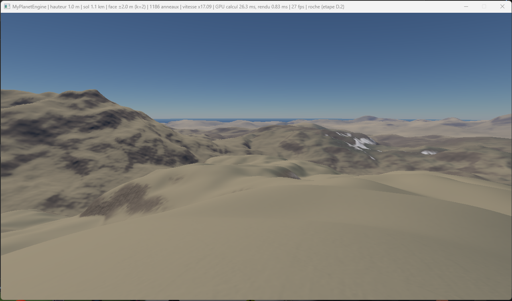
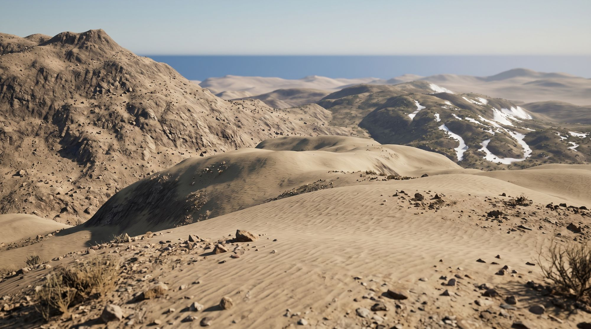
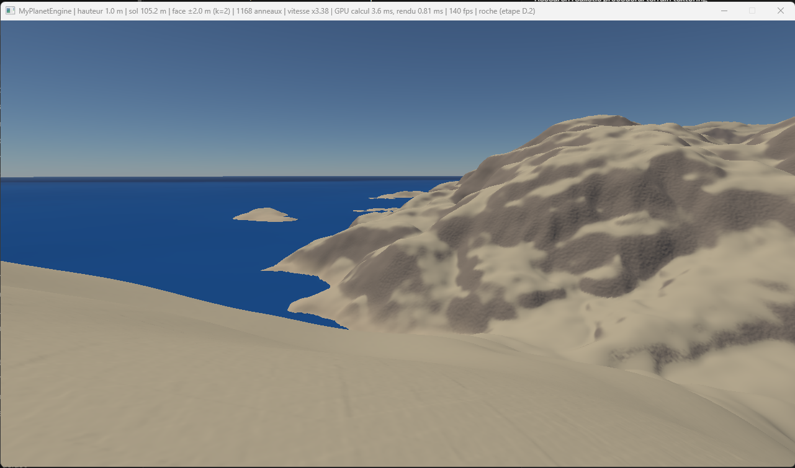
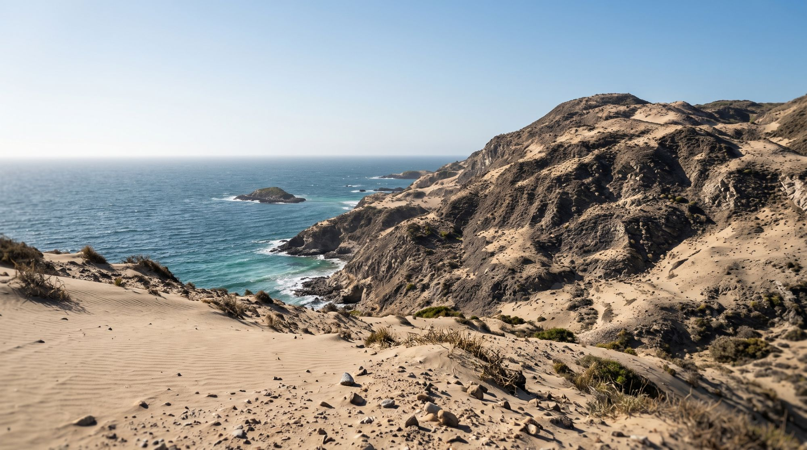

# Spécification : textures générées au démarrage (voie B)

Statut : choisie le 2026-10-21, en place : le générateur, le sable, les éboulis, le niveau de détail fin et les couleurs de la roche. Depuis le 2026-10-24, la roche visible est une photo, `marble_cliff_04` (`spec-parois-minerales.md`) : la recette de roche ne sert plus que si les scans manquent. Les pistes de la comparaison, les tours de la roche et sa structure de 64 m, retirée, sont dans `log/spec-textures-generees-historique.md`. Voie B de `log/etat-de-l-art-details.md`. Elle remplace les textures de près calculées au pixel de l'étape D (`log/spec-rendu.md`), dont les recettes passent dans le générateur.

## La cible

**Ce que la cible a en plus, par ordre d'importance pour l'échelle :**

1. **Au premier plan, les rides du sable et ses grains,** juste sous les pieds.
2. **Des cailloux et des pierres semés,** avec leurs ombres.
3. **Des pentes rocheuses lisibles :** strates, ravines d'érosion, éboulis au pied, sable dans les creux, roche vive sur les crêtes.
4. **De la brume avec la distance,** et des ombres portées dans les vallées.

### Deuxième cible : la côte

**Ce que cette cible ajoute :**

- **Une roche sombre en falaises,** fracturée, avec des ravines. Le sable se dépose sur ses replats et dans ses creux, et pas sur les parois raides : il tient sous son angle de repos, environ 33°.
- **Le contraste entre roche et sable,** franc, quand le moteur ne montre que des taches grises floues.
- **La mer :** dégradé turquoise près du rivage, vagues et écume au pied des falaises.
- **La végétation des dunes :** touffes sèches et arbustes, avec leurs ombres.
- **Des cailloux semés** au premier plan, comme dans la première cible.

**La voie B traite les points 1 et 3 de la première cible, et la roche, le sable et leur frontière de la seconde :** l'aspect des surfaces et leurs transitions. Les points 2 et 4 relèvent d'autres pistes, listées en fin de document.

## Le principe

### Générer une fois, au démarrage

**Un générateur de matériaux, en compute, tourne une seule fois au démarrage,** comme les tables de l'atmosphère.

- **Pour chaque matériau, un jeu de textures sans couture :**
  - hauteur ;
  - couleur ;
  - creux, l'occlusion ambiante ;
  - normale, tirée de la hauteur.
- **Six matériaux :** roche, éboulis et graviers, sable, neige, sol aride, sol herbeux.
- **Résolution :** 1024 × 1024 par carte, sur une tuile de 2 à 8 m selon le matériau. Soit 2 à 8 mm par texel.
- **Deux tableaux de textures RGBA8 :**
  - couleur et creux ;
  - normale en x et y, hauteur, réserve.
  Avec les mipmaps, environ 70 Mo.
- **Sans couture par construction :** tous les bruits du générateur sont périodiques, à la taille de la tuile.
- **Une graine par planète :** déterministe, et chaque planète a ses propres matériaux.
- **Temps de démarrage visé :** moins d'une seconde.
- **Aucun fichier chargé.** Le concept est intact : tout vient du code et de la graine.

### Les recettes

| Matériau | Recette |
|---|---|
| Roche | Blocs de Voronoï à faces planes inclinées au hasard, arêtes chanfreinées et ébréchées. Strates en plans inclinés, en gradins, les couches dures en saillie. Fissures sur les bords de blocs. Érosion par fBm à dérivées. Poussière dans les creux |
| Éboulis et graviers | Pierres arrondies de plusieurs tailles, serrées, semées par cellule. Sable et poussière entre elles, par la hauteur |
| Sable | Rides de 8 à 15 cm, au profil dissymétrique : pente douce au vent, raide sous le vent. Phase ondulée pour casser la régularité. Grains |
| Neige | Lisse, ondulations de vent faibles, les sastrugi |
| Sol aride | Craquelures en polygones, petits cailloux épars, poussière |
| Sol herbeux | Les touffes de l'étape D, sous les futurs brins |

**Chaque recette part d'un seul champ de hauteur.** Couleur, creux et normale en dérivent : la fissure est creuse, sombre et mate à la fois. C'est la leçon principale de la recherche.

### L'échantillonnage à chaque image

- **Des coordonnées ancrées sur la planète :** le point du pixel, relatif à l'ancre de 64 m, est exact. Les périodes des tuiles divisent 64 m, donc l'ancre tombe toujours sur un bord de tuile. Rien ne glisse.
- **Projection biplanaire,** d'Inigo Quilez, sur les axes fixes de la planète : deux projections au lieu des trois du triplanaire, sans étirement sur les pentes raides.
- **Pavage hexagonal,** de Mikkelsen 2022 : chaque hexagone décale la tuile au hasard. Trois lectures par projection, aucun motif répété visible.
- **Les matériaux orientés, sable et neige, ne tournent pas au hasard :** une rotation casserait l'alignement des rides. Leur direction suit un vent régional, tiré d'un bruit lent.
- **Deux échelles par matériau :** la tuile, et la tuile divisée par huit. La grande porte la structure, la petite le grain. Ensemble, elles couvrent du centimètre à plusieurs mètres et cachent la répétition.
- **Filtrage par mipmaps et anisotropie :** stable, sans scintillement. De loin, la texture se réduit à sa moyenne.

### Le mélange des matériaux

- **Les poids de l'étape C restent la base :** climat, pente, altitude.
- **Nouveaux masques tirés de la forme du relief :**
  - éboulis au pied des pentes raides ;
  - sable et poussière dans les creux ;
  - roche vive sur les crêtes.
  La courbure vient de la surface spline, qui donne ses dérivées secondes presque gratuitement.
- **Mélange par la hauteur des textures :** à la frontière, le matériau le plus haut l'emporte. Le sable remplit les creux entre les pierres.
- **Deux matériaux au plus par pixel,** les deux plus forts, pour tenir le coût.
- **Moyenne préservée :** la couleur générée est normalisée à une moyenne de 1, puis multipliée par la couleur de l'étape C. La teinte vue de loin ne change pas.

### La lumière

- **La normale des textures s'ajoute** à la normale spline.
- **Les creux assombrissent la lumière du ciel.**
- **Ombres fines, à la manière de Call of Duty WWII :** l'occlusion devient un cône qui coupe aussi la lumière du soleil dans les creux. Quelques opérations par pixel.

## Ce qui change dans le code

- **`MaterialGenerator.hlsl`,** nouveau : les recettes, une passe par matériau et par carte, puis les mipmaps.
- **`D3DApp.cpp`** : les deux tableaux de textures, leur génération au démarrage après les tables de l'atmosphère, un échantillonneur en répétition anisotrope.
- **`PixelShader.hlsl`** : projection biplanaire, pavage hexagonal, mélange, lumière. Les textures de près calculées au pixel, `GrassTexture` et `RockTexture`, deviennent des recettes du générateur.
- **`PlanetSettings.hlsli`** : tailles de tuile, intensités, bascule entre l'ancien et le nouveau rendu pour comparer.

## Les étapes

1. **Le cadre, avec le sable seul :** générateur, tableaux, mipmaps, projection, pavage hexagonal. C'est le premier plan de la cible. Comparaison côte à côte avec elle.
2. **La roche et les éboulis,** avec les masques de forme et le mélange par la hauteur.
3. **La neige, le sol aride, le sol herbeux.**
4. **La lumière :** creux et ombres fines.
5. **Les mesures.**

## La mesure

- **Côte à côte avec la cible,** depuis un point de vue proche du sien : à 1 m du sol, dans les dunes, devant une pente rocheuse.
- **Banc de tremblement et de mutation,** sur les vues de référence et au ras du sol.
- **Couleur de loin :** écart moyen de moins de 1 sur 255.
- **Coût :** temps de démarrage du générateur, et rendu au pire au ras du sol. Moins de 1 ms de plus qu'aujourd'hui.

## Critères de validation

- **Au ras du sol, on lit l'échelle sans hésiter :** rides, grains, blocs, éboulis.
- **Aucune répétition visible,** ni de près ni à mi-distance.
- **Pas de scintillement ni de mutation en plus.**
- **La couleur de loin ne change pas.**

## Résultats de l'étape 1 : le cadre et le sable

- **Les rides de vent se lisent au ras du sol :** profil dissymétrique, crêtes qui ondulent et se divisent, creux plus sombres, grain. Au-delà de quelques dizaines de mètres, elles passent sous le pixel et se fondent dans la couleur.
- **Le pavage stochastique** est fait sur une grille de triangles légèrement cisaillée plutôt qu'hexagonale : 64 m y font un nombre entier de cases, donc l'ancre qui suit la caméra ne déplace jamais les tuiles. Le léger quadrillage aux mélanges de copies est réduit par des poids plus nets et une variation d'angle de ±4°.
- **Une seule échelle pour le sable :** une seconde échelle huit fois plus petite donnerait des rides de 1,5 cm, qui n'existent pas. La variation à grande échelle vient déjà des bruits de l'étape C.
- **Couleur de loin préservée :** +0,28 sur 255 à 10 m, +0,17 à 50 m. La moyenne de chaque texture est lue dans son dernier niveau de mipmap.
- **Tremblement :** inchangé avec le lissage temporel ; sans lui, de 0,02 à 0,05 à 2 m.
- **Coût :** pas de différence mesurable au rendu. Génération au démarrage : une fraction de seconde.
- **Lieu de test :** un désert près du niveau de la mer, 26° N, 45° E.
- **Ce qui manque encore pour la cible :** les cailloux semés, les dunes à l'échelle du relief, la roche et les éboulis, les ombres portées.

## Étape 2 : les rides du sable refaites, la roche et les éboulis

**Méthode :** le banc visuel, `tools/banc_visuel.py`. Il capture chaque site à 1,5 m, 10 m, 100 m et 1 km au-dessus de son sol, à côté de l'image de référence, et permet d'itérer vite.

### Le sable : des rides calculées au pixel

- **Constat, en vol et au banc :** là où deux copies de tuile se mêlent, leurs rides se croisent hors de phase. Un motif périodique ne survit pas au pavage stochastique.
- **Les rides sont donc calculées au pixel,** sans tuile, comme une onde plane dans l'espace qui traverse la surface de la planète.
- **La phase est exacte partout.** Le vent, tangent au sol, est arrondi à un vecteur entier de longueur 8 environ, à 4° près. Avec un nombre entier de rides par 64 m le long de ce vecteur, les 64 m de l'ancre ajoutent toujours des rides entières.
- **Aucune projection ne bascule :** un premier essai en projection plane montrait un raccord net là où le plan passait d'un axe de la planète à l'autre.
- **Trois bruits ancrés, de 16 m, 4 m et 2 m,** font varier l'espacement, courbent les crêtes et les font se diviser là où elles se resserrent. Deux autres, de 16 m et 2 m, affaiblissent les rides par endroits.
- **Antialiasing exact :** les rides s'effacent selon leur propre pas à l'écran, mesuré dans leur direction.
- **La tuile générée du sable** ne garde que le grain, les marbrures et les bosses, sur 8 m.

### La roche et les éboulis

- **Générés au démarrage :**
  - roche en blocs à faces inclinées, divisés en facettes, fissures sur un tiers des bords, strates dont les couches tendres reculent ;
  - éboulis en pierres de 40 et 15 cm dans une poussière plus claire.
- **Les strates suivent la verticale locale sur les parois,** grâce à une projection choisie selon la normale de la surface.
- **Mélange par la hauteur :** sol, éboulis au pied des pentes, roche sur les pentes raides.
- **Depuis le 2026-10-24,** la photo de paroi remplace la roche générée ; la recette ne sert plus que si les scans manquent.
- **Ombres fines au soleil,** à la manière d'Uncharted 4 : les creux ferment un cône qui coupe aussi la lumière directe, relativement à leur moyenne, pour que le sol lointain garde sa lumière.

## La mesure de réalisme

**`tools/realisme.py` compare le sol du moteur à un scan réel, à la même échelle.** Elle reprend la mesure du POC IA de la branche `poc-ia-textures`.

- **La vue :** le moteur est capturé à la verticale, à la hauteur où un pixel couvre un texel du scan.
- **La structure seule :** la luminance, moins sa moyenne locale, divisée par son écart local, pour que lumière et couleur comptent moins que les formes.
- **Deux notes, plus basses c'est mieux :**
  - **motifs :** distance de Wasserstein tranchée entre motifs de 7 × 7, sur trois échelles, en multiple de la distance entre deux zones du scan lui-même ;
  - **spectre :** écart moyen des spectres de 3 cm à 1 m, en dB.
- **Les scans restent hors du dépôt,** par exemple ceux de Poly Haven sous licence CC0.

**Première mesure, contre le scan de plage Aerial Beach 01 :**

| Sable | Motifs | Spectre |
|---|---|---|
| Lisse, sans texture | ×48 | 3,5 dB |
| Rides pavées, étape 1 | ×13 | 8,1 dB |
| Rides au pixel, étape 2 | ×20 | 8,8 dB |
| Le scan contre lui-même | ×1 | 0,8 dB |

- **La mesure discrimine bien** le sol lisse du sol texturé.
- **Elle compare à un scan précis :** ce sable de plage a des rides de 50 à 80 cm, courtes et en langues, quand les nôtres sont des rides de vent de 12,5 cm. Les rides pavées s'en rapprochent par leur désordre, malgré leurs raccords.
- **Il faut donc un scan du matériau visé :** rides de vent du désert, paroi rocheuse, éboulis. La mesure pourra alors servir à régler les recettes sur le réel.

**Les scans, téléchargés le 2026-10-21 :** six scans Poly Haven sous licence CC0, rangés hors du dépôt dans `../scans/` ; leurs largeurs réelles sont dans `log/spec-hybride-scans.md`. `tools/telecharger_scans.ps1` retélécharge ceux du moteur. Poly Haven n'a pas de rides de vent de désert.

**Deuxième mesure, version avec relief réel, vue verticale :**

| Scan | Sol du moteur | Motifs | Spectre |
|---|---|---|---|
| aerial_sand, sable côtier piétiné, 15 m | désert, 4,6 m de haut | ×7,8 | 8,2 dB |
| sandy_gravel_02, sol de désert, 2,5 m | désert, 1,5 m | ×17 | 10,3 dB |
| cliff_side, grès en blocs, 1,8 m | roche, 1,5 m | ×5,3 | 2,1 dB |
| dark_rock_02, roche litée, 2 m | roche, 1,5 m | ×8,8 | 2,7 dB |

- **Les petits scans** couvrent moins d'un millimètre par texel. La caméra ne descend pas sous 1,5 m, alors le scan est réduit à son échelle, 2,4 mm par pixel.
- **Ce que montrent les planches, au-delà des notes :**
  - **nos matériaux sont flous de près :** leur texel de 7,8 mm, une tuile de 8 m en 1024, est trop gros, quand les scans montrent un détail net au millimètre ;
  - **notre sable n'a que des rides,** quand les scans de sable sont faits de grain, de traces et de petits cailloux ;
  - **nos couleurs sont ternes :** les vraies roches varient du gris à l'orange et au presque noir, par bloc et par couche.
- **Les pistes qui en découlent :**
  - un niveau de détail fin, une seconde tuile de 1 m à 1 mm par texel ;
  - du grain et des cailloux dans le sable ;
  - des couleurs de roche plus franches ;
  - puis le réglage des recettes sur les scans, guidé par la mesure.

## Le niveau de détail fin

Statut : fait le 2026-10-21, première des pistes de la mesure de réalisme.

**Le constat :** de près, nos matériaux sont flous. À 1,5 m du sol, un pixel couvre 2,4 mm ; le texel de nos tuiles en couvre 7,8. Les scans montrent un grain net au millimètre : sable semé de grains clairs et sombres de 1 à 5 mm, granite moucheté de cristaux, fissures capillaires.

**Le principe : une seconde tuile par matériau, de 1 m en 1024 texels, soit 1 mm par texel.**

- **Même générateur, au démarrage :** trois tranches de plus dans les textures, sable fin, roche fine, éboulis fins.
- **Elle ne porte que les longueurs d'onde de moins de 3 cm.** Sa répétition tous les mètres reste invisible, et le pavage aléatoire la casse en plus.
- **Même lecture :** pavage aléatoire en triangles et projection biplanaire, avec la même orientation que la tuile grossière. Une tuile de 1 m divise l'ancre de 64 m.
- **Le mélange, moyenne conservée :** couleur et occlusion multipliées, pentes et hauteurs ajoutées à celles de la tuile grossière.
- **L'effacement :** au-delà de 1 à 2 cm par pixel, la tuile fine n'est plus lue. Ses mipmaps tendent déjà vers la moyenne, sans saut. Le surcoût se limite aux premiers mètres.
- **Le relief des sommets l'ignore :** ses mailles filtrent au-delà de 4 cm.

**Les recettes fines :**

- **Sable :** semis dense de grains de 1 à 4 mm, clairs, sombres et colorés ; quelques graviers arrondis de 3 à 8 mm ; micro-bosses. Le grain de 7,8 mm de la tuile grossière disparaît.
- **Roche :** cristaux de 1 à 3 mm, chacun sa teinte ; rugosité de 4 mm et 2 mm ; piqûres. Les fissures capillaires attendent : leur réseau d'une dizaine de centimètres dépasse la tuile fine.
- **Éboulis :** gravillons anguleux de 5 mm à 2 cm sur la poussière.

**La mesure :** la mesure de réalisme contre sandy_gravel_02, cliff_side, dark_rock_02 et gray_rocks, avant et après ; le banc visuel à 1,5 m et 10 m ; le coût GPU à 1,5 m.

**Critère :** de près, du grain net au lieu du flou, sans motif répété visible, pour moins de 0,5 ms.

**Résultats, mesure de réalisme à 1,5 m, motifs :**

| Scan | Avant | Après |
|---|---|---|
| sandy_gravel_02, sol de désert | ×17 | ×4,9 |
| cliff_side, grès | ×5,3 | ×2,3 |
| dark_rock_02, roche litée | ×8,8 | ×3,2 |
| gray_rocks, pierres | ×7,5 | ×3,6 |

- **Le flou de près a disparu :** grains et graviers sur le sable, moucheture et micro-relief sur la roche.
- **Le spectre du sable reste à 9,9 dB :** nos rides de 12,5 cm n'existent pas dans ce scan de sol caillouteux. La note de motifs est la plus parlante.
- **Ni répétition ni ligne de transition visibles,** au banc visuel.
- **Tremblement inchangé,** 0,06 / 0,33 sur la roche à 3 m. **Coût :** +0,05 ms à 1,5 m.
- **Réglage du premier tour :** grains du sable plus denses, piqûres de la roche plus rares. Sable ×6,0 → ×4,9.
- **Reste à faire, d'après les planches :** couleurs de roche plus franches ; le sable de dune pourrait vouloir moins de graviers que ce sol caillouteux.

## Les couleurs de la roche

Statut : fait le 2026-10-21, deuxième piste de la mesure de réalisme.

**Le constat :** toute la roche de la planète a une seule couleur, un brun gris de réflectance 0,20 / 0,17 / 0,14, à ±15 % près. Les scans et les images de référence vont du gris au ocre, à l'orange, au rouge et au presque noir.

**Deux échelles.**

- **De loin, le type de roche, par région :** un bruit de 500 m à 40 km choisit dans une palette de roches réelles, en réflectance linéaire.
  - granite gris, 0,26 / 0,25 / 0,24 ;
  - calcaire clair, 0,36 / 0,34 / 0,30 ;
  - grès ocre, 0,38 / 0,28 / 0,18 ;
  - grès rouge, 0,32 / 0,16 / 0,09 ;
  - basalte sombre, 0,08 / 0,075 / 0,07.
  - Deux autres bruits dosent l'oxydation, vers le rouge, et le vernis du désert, vers le sombre. Les éboulis prennent la couleur de la roche d'où ils tombent.
- **De près, dans l'affleurement,** dans la recette de la tuile grossière :
  - **les couches :** chacune sa teinte, du pâle au rouille, et sa clarté à ±15 % ;
  - **les blocs :** clarté à ±20 % ;
  - **les taches d'oxyde de fer,** rouges, par plaques de 30 à 60 cm ;
  - **le vernis,** brun sombre, dans les coulures ;
  - **les lichens :** croûtes de 2 à 4 cm, groupées en colonies d'un mètre, gris vert ou orange d'une colonie à l'autre.
- **La moyenne de la tuile reste celle du type de roche :** les variations de près ne changent pas la couleur vue de loin.

**La mesure :** la mesure de réalisme ne regarde que la luminance, alors on juge à l'œil. Le banc visuel, sur plusieurs sites de montagne, montre la variété des types ; les vues proches, la variété dans l'affleurement, face aux scans et aux images de référence.

**Critère :** des roches qui changent de couleur d'une région à l'autre, et qui ont de près la variété des scans, sans bariolage.

**Résultats :**

- **Une teinte par région :** brun sombre sur le site de la roche, crème dans les collines sèches à 26° N 130° E, ocre ailleurs, calcaire gris pâle sur un plateau herbeux.
- **De près,** la paroi montre ses couches, des taches de rouille, du vernis dans les coulures et des lichens.
- **Coût :** le bruit régional, sept octaves, coûtait 0,3 ms par pixel. Calculé par sommet puis interpolé, il ne coûte plus que 0,05 à 0,08 ms. Ses longueurs d'onde de 500 m et plus le permettent.
- **Réglages du premier tour :**
  - le calcaire, à 0,45 de réflectance, paraissait blanc : ramené à 0,36 ;
  - les lichens en taches rondes s'alignaient sur leur grille : remplacés par des croûtes tirées d'un bruit.

## La roche en bancs et en diaclases

Statut : premier tour fait le 2026-10-21. La recette reste ; depuis le 2026-10-24, elle ne se voit plus que si les scans manquent.

**Le constat :** vue de 50 m sur une pente raide, la roche ressemble à des écailles répétitives. Ses blocs de Voronoi ont tous la même taille, 1,3 m. Chacun a son bord arrondi et son liseré sombre.

**Le principe :** les blocs suivent la structure réelle d'une paroi, comme dans les scans cliff_side et dark_rock_02.

- **Des bancs :** les couches de 50 cm se regroupent en bancs de 0,5 à 2 m d'épaisseur.
- **Des diaclases :** dans chaque banc, des fractures à peu près perpendiculaires aux couches, espacées de 0,5 à 2 m selon le banc, décalées d'un banc à l'autre, un peu ondulées.
- **Peu de fractures ouvertes :** environ quatre sur dix sont ouvertes, sombres et arrondies sur leurs bords ; les autres ne sont qu'une marche ou un trait léger.
- **Le reste ne change pas :** l'inclinaison et la teinte par bloc, la rugosité, les couleurs.

**La mesure :** une vue à 50 m sur une pente raide et une vue de près, avant et après ; la mesure de réalisme contre cliff_side et dark_rock_02.

**Résultats du premier tour :**

- **De près,** de grandes faces lisses, quelques fractures ouvertes, des bancs : plus proche d'une paroi.
- **De plus loin,** un quadrillage de bancs et de diaclases reste visible.
- **Réglage :** un premier essai, avec des diaclases tous les 0,5 à 2 m et des blocs inclinés de ±0,25, faisait une maçonnerie. Il est passé à des diaclases tous les 0,8 à 4 m, des blocs inclinés de ±0,10 et une fracture ouverte sur quatre.
- **Réalisme, motifs :** cliff_side ×2,05 → ×2,18, dark_rock_02 ×3,3 → ×3,7. **Spectre :** 2,2 → 2,0 dB et 2,6 → 2,2 dB. Neutre dans l'ensemble.

## Le sable mêlé de roche

- **Le défaut :** la roche affleurait dans chaque creux de ride, en bandes de dallage cassé.
- **La cause :** le mélange par la hauteur comparait les hauteurs de chaque matériau dans sa propre unité. Une ride de 6 mm y pesait autant qu'une bosse de roche de 30 cm.
- **Le correctif :** les bordures comparent les vraies hauteurs, en mètres. Une texture qui dépasse de `BLEND_RISE` = 0,3 m au-dessus de sa moyenne déplace la bordure d'un poids entier. Les rides restent continues ; la roche ne perce que là où elle dépasse vraiment.
- **Effet de bord :** les touffes d'herbe, de 5 cm, ne passent presque plus entre les pierres des éboulis.

**Note du 2026-10-22 :** la projection biplanaire est remplacée par une projection triplanaire aux poids continus, `max(|n| − 0,45, 0)²`. Voir `log/spec-relief-reel.md`, correctif des lames.
